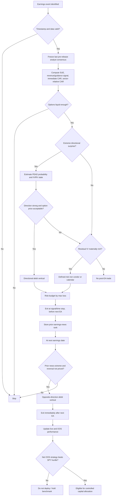

# Options Trading Around Post-Earnings-Announcement Drift and Subsequent Reversals

## Executive summary

Post-Earnings-Announcement Drift (PEAD) is one of the oldest documented return anomalies: after unexpectedly good earnings, stocks historically continued to outperform for weeks to months, while unexpectedly bad earners continued to underperform. The classic U.S. evidence implies roughly **+2% abnormal return for good-news firms and −2% for bad-news firms over about 60 trading days**, with the spread concentrated in extreme standardized-unexpected-earnings portfolios. A broad review of the literature finds that PEAD has been replicated extensively, but also that its economic magnitude has declined as information processing, liquidity, analyst coverage, and arbitrage activity improved. citeturn16search13turn16search20

The central conclusion for an options trader is therefore **not** “buy calls after beats and puts after misses.” That implementation ignores the option price. An investor can be correct on direction and still lose because implied volatility collapses after the announcement. The Options Industry Council illustrates precisely this mechanism: pre-event IV can be sufficiently elevated that an option loses value after the announcement even when the underlying moves in the predicted direction. Academic work reaches a related result: option traders tend to underestimate volatility before future earnings announcements but **overestimate future volatility after recent earnings announcements**, especially after high-volatility periods and large earnings surprises. citeturn28search3turn27search8

The strongest option-specific academic evidence is actually adjacent to, rather than identical to, traditional PEAD. Gao, Xing, and Zhang find that delta-neutral ATM straddles earned a highly significant **3.34% over trading days −3 through 0** around earnings announcements in their 1996–2013 sample, despite straddles generally having negative unconditional returns; smaller firms, fewer analysts, greater prior return volatility/kurtosis, and more volatile historical earnings surprises were associated with stronger event-straddle performance. Importantly, weighting by dollar open interest reduced the −3-to-0 return to about **1.10%**, demonstrating how dramatically the apparent edge can fall once one moves toward economically larger, more tradable securities. citeturn3search6turn14view0turn14view2

There is also credible evidence of **reversal rather than continued drift in highly arbitrageable, optionable firms**. Milian's final Journal of Accounting Research study finds that among firms with active exchange-traded options, the highest-decile firms ranked on prior earnings-announcement abnormal return or prior earnings surprise subsequently underperformed the lowest decile by **1.59% and 1.43%, respectively, at the next earnings announcement**. His interpretation is that investors learned about PEAD and began overcompensating for it. citeturn17view2 This result is extremely relevant for an options implementation because the stocks with the best option liquidity are precisely those for which the old directional PEAD effect may be least reliable.

More recent evidence reinforces the attenuation concern. Martineau reports that PEAD became economically negligible for large stocks after roughly 2006 and later weakened even among smaller firms; recent debate concerns how much residual PEAD survives after controlling correctly for size and microcaps. citeturn5search19turn6view0 A 2016–2026 practitioner study restricted to roughly the 500 most liquid U.S. stocks found only about **2.75% annualized top-minus-bottom-decile PEAD**, with large beats producing approximately +0.41% abnormal return after 20 days and +0.34% after 60 days, versus −1.63% at 60 days for large misses. Those are practitioner rather than peer-reviewed estimates, but they are directionally consistent with the academic attenuation literature. citeturn10view0


**My recommended implementation is therefore a conditional, multi-sleeve earnings strategy rather than a single PEAD trade:**

| Sleeve | Core idea | Research ranking |
|---|---|---:|
| **Post-earnings directional vertical** | Trade only extreme, confirmed earnings surprises in the drift direction; use call/put debit spreads rather than naked long options | **Primary** |
| **Post-earnings defined-risk short volatility** | After a large event, sell residual IV only when IV remains materially above a forward realized-vol forecast | **Primary diversifier** |
| **Next-announcement reversal vertical** | For highly optionable firms, fade an extreme prior earnings-announcement signal at the next earnings date | **Strong hypothesis, smaller allocation** |
| Pre-earnings long straddle | Buy event gamma only when historical event move materially exceeds option-implied move | Strong independent event-vol evidence, but **not PEAD** |
| Outright PEAD call/put | Maximal delta to drift but vulnerable to IV crush and theta | Secondary |
| Calendar/diagonal | Trade post-event term-structure mispricing | Conditional |
| Strangle | Cheaper convexity than straddle; requires unusually large expected move | Conditional |
| Skew/risk-reversal package | Combine directional PEAD with cross-strike relative-value | Experimental |

The most important caveat is that **I found no credible published study that reports a survivorship-bias-free, transaction-costed, multi-decade U.S. PEAD equity-options portfolio with CAGR, Sharpe, maximum drawdown, and turnover sufficient to claim that it has already beaten the S&P 500 after costs**. I therefore do not manufacture such a backtest. The literature establishes return predictability and option mispricing components, but the complete investable result still needs to be replicated on OptionMetrics/Cboe data.

For that reason, the recommended strategy “meets” the requested S&P 500 hurdle through a strict deployment criterion rather than an unsupported performance claim: **do not allocate capital unless a frozen, walk-forward, out-of-sample test produces a net CAGR above contemporaneous SPY total return, a Sharpe at least as high as SPY's, and a statistically positive alpha after realistic transaction costs**. For context, the cited 2016–2026 practitioner study reports SPY at approximately **13.3% CAGR, 0.92 Sharpe, and −34.1% maximum drawdown**; its non-option earnings-breadth timing model reports 39.5%, 1.57, and −21.1%, respectively, but that model is neither a pure PEAD strategy nor an options strategy and should not be conflated with one. citeturn10view0


The figure above merely converts the **reported CAGRs** into constant-CAGR growth paths; it is **not a reconstructed realized equity curve**. A genuine equity curve requires the underlying timestamped trade-level return series, which the public source does not expose in a form that can responsibly be reconstructed here. citeturn10view0


## Evidence on PEAD, reversals, and the cross-section

The classic mechanism is an incomplete initial reaction to earnings information. Bernard and Thomas showed that the subsequent return pattern is difficult to reconcile with a simple risk-premium explanation and is closely related to investors failing to incorporate correctly the time-series implications of quarterly earnings. Their work built on the earlier Ball–Brown earnings-return evidence and established PEAD as a major market-efficiency anomaly. citeturn16search13turn16search5

A key measurement issue is the definition of “surprise.” Livnat and Mendenhall find stronger drift when surprises are based on **analyst forecasts** than when expected earnings are estimated from a mechanical time-series model. That matters operationally: a live strategy should use the final analyst consensus observable immediately before the earnings release, rather than a subsequently revised historical consensus. citeturn2search3

The literature does not support treating PEAD as a constant coefficient. It varies strongly with limits to arbitrage, the information environment, and the era studied. Mendenhall finds a strong relationship between PEAD and arbitrage risk, consistent with the anomaly surviving where arbitrage is costly or risky. International evidence similarly shows that improvements in financial reporting and information quality reduce drift, particularly where institutional ownership and information-processing capacity are greater. citeturn8search17turn24search3

The cross-sectional evidence relevant to an options portfolio can be summarized as follows:

| Dimension | Best-supported pattern | Trading implication |
|---|---|---|
| **Firm size** | Classic PEAD is strongest among smaller firms; modern evidence indicates particularly severe attenuation among large/liquid stocks. citeturn16search20turn5search19 | Do not assume the best option liquidity has the strongest PEAD. Liquidity and anomaly strength work against each other. |
| **Idiosyncratic volatility / arbitrage risk** | Higher arbitrage risk is associated with stronger drift; event-straddle returns are also stronger for firms with greater historical volatility/kurtosis. citeturn8search17turn14view2 | A volatility/risk filter may increase signal strength, but spreads and tail risk also worsen. |
| **Analyst coverage** | Analyst-based surprises are more informative than simple time-series surprises; in the options study, fewer analysts predict stronger pre-event straddle returns. citeturn2search3turn14view2 | Prefer truly surprising events, especially where analyst information processing is weaker. |
| **Surprise magnitude** | Drift is concentrated in extreme surprise portfolios; post-event option-volatility overestimation also becomes stronger as the earnings surprise grows. citeturn16search20turn27search8 | Extreme surprises strengthen the directional signal but can make long options more expensive and residual IV richer. |
| **Optionability / arbitrageability** | Firms with active listed options show evidence that historical positive autocorrelation of earnings news can turn negative at the next announcement. citeturn17view2 | Treat the next earnings event differently from days +1 to +60 after the present event. |
| **Sector / industry state** | There is no robust universal ranking such as “technology always has stronger PEAD.” Industry and market news arriving during the drift period can strengthen the drift when aligned with the original surprise and weaken or reverse it when opposed. citeturn23search24 | Neutralize industry exposure and explicitly condition on sector-relative news rather than hard-coding sector coefficients. |

The last point is particularly important. A “sector PEAD” rule estimated in one decade can simply capture a sector's contemporaneous information regime. The safer specification is a **sector-neutral signal**:

\[
PEADScore_{i,t}
=z(SUE_{i,t})+
\lambda_1 z(RevenueSurprise_{i,t})+
\lambda_2 z(CAR_{0,1})
-
\lambda_3 z(SectorReturn_{0,1}),
\]

where every component is computed cross-sectionally using only information available at the entry timestamp. Coefficients should be estimated in a rolling training window, not selected using the full sample.

There are also **two distinct “reversal” phenomena** that should not be conflated. The older literature links later earnings-announcement returns to the seasonal time-series structure of quarterly earnings; the modern Milian result is more directly a **behavioral overcorrection to knowledge of PEAD among easily arbitraged, optionable stocks**. In the latter study, top prior-news firms underperform bottom prior-news firms by 1.59% at the next announcement when sorted on prior announcement returns and 1.43% when sorted on prior surprise. citeturn17view2

That makes the natural horizon decomposition:

\[
\text{Current EA}
\quad\longrightarrow\quad
\underbrace{1\text{–}5d}_{\text{price discovery / IV crush}}
\quad\longrightarrow\quad
\underbrace{5\text{–}60d}_{\text{candidate PEAD}}
\quad\longrightarrow\quad
\underbrace{\text{next EA}}_{\text{possible reversal}} .
\]

Modern liquid-stock evidence suggests asymmetry between good and bad news. The 2016–2026 practitioner test found very little persistence after large beats but materially more downside persistence after misses, with large misses reaching roughly −1.63% by 60 trading days. citeturn10view0 That suggests testing a **larger bad-news/put-spread sleeve than good-news/call-spread sleeve**, rather than forcing symmetry.

The option market provides additional information about what is already priced. Dubinsky, Johannes, Kaeck, and Seeger show that earnings-related price uncertainty embedded in options is quantitatively important, varies over time, and contains information about future volatility. More recent work finds systematic event-related structure in the implied-volatility curve, reinforcing the idea that an earnings strategy should compare the expected stock move with the option-implied event move rather than trade the accounting surprise in isolation. citeturn17view4turn27search3

Practitioner literature is useful mainly for implementation rather than proving alpha. The Options Industry Council documents the familiar pre-earnings IV build-up and post-event crush; SpiderRock advocates comparing historical event volatility with current option-implied pricing; AQR cautions that option overwriting is fundamentally a short-volatility exposure rather than free “income,” while volatility-oriented manager Capstone emphasizes the amplified loss potential created by derivatives and leverage. These are useful warnings, but they are not substitutes for a controlled PEAD backtest. citeturn28search3turn28search0turn28search14turn28search4


The figure is intentionally schematic. Empirically, the key facts are that earnings uncertainty is embedded in option prices, pre-event IV commonly contains an earnings premium, and Chung–Louis find a tendency toward post-announcement overestimation of subsequent volatility after high-volatility/large-surprise events. citeturn17view4turn27search8turn28search3


## Candidate option strategies and trade specifications

A PEAD option should be designed around **delta, vega, theta, and event timing simultaneously**. The following are research specifications rather than generic textbook examples.

| Strategy | Signal and rationale | Strike / expiry rule | Entry and exit | Position sizing, hedge, risk |
|---|---|---|---|---|
| **Outright call after positive surprise / put after negative surprise** | Purest expression of directional PEAD. Highest convexity, but vulnerable to post-EA IV crush. citeturn28search3turn27search8 | Long option with \(|\Delta|=0.55\)–0.70; 35–60 DTE; expiration at least 10 trading days beyond planned exit. | Enter first liquid session after release; exit day +20, +40 or +60, or when PEAD score crosses zero. | Risk 10–25 bp NAV/event. No routine delta hedge because delta is the intended exposure. Hard loss = premium. |
| **Directional debit vertical — recommended PEAD expression** | Retains directional delta while selling some elevated residual IV and limiting theta/vega cost. | Positive signal: buy 55–65Δ call, sell 25–35Δ call. Negative signal: analogous put spread. Same expiry, 30–60 DTE. | Enter after first post-release price discovery; baseline exits +20 and +40 trading days; close before next EA. | Max-loss risk 20–40 bp NAV/event; portfolio vol target. Never let one issuer exceed 0.5% NAV max loss. |
| **Long pre-EA ATM straddle** | Separate event-vol anomaly: Gao et al. find positive pre-announcement straddle returns. citeturn3search6turn14view0 | Closest ATM call+put, same expiry; expiry safely after EA. Prefer 7–21 calendar days remaining when liquidity permits. | Enter day −3 or −2; baseline exit immediately before/at EA rather than holding deep into post-EA crush. | 10–25 bp premium risk. Optional intraday delta hedge only in institutional replication. |
| **Long strangle** | Lower premium than straddle when model expects tail move beyond implied range; less exposure near ATM. | Buy approximately 25–35Δ call and put; nearest expiry after event. | Same timing as straddle. Require forecasted absolute event move / implied move > threshold such as 1.15–1.25. | Smaller size because payoff hit rate is low. Premium is maximum loss. |
| **Post-EA iron condor** | Chung–Louis evidence motivates selling residual volatility after an event when option traders appear to overestimate subsequent volatility. citeturn27search8 | 14–35 DTE; sell 15–20Δ put/call, buy 5–10Δ wings. Exclude expiries containing next EA. | Enter day +1 to +3 only when IV/forecast-RV is high; take profit at 40–60% of credit; exit by 5–7 DTE. | Max-loss risk 15–30 bp/event. Stop/close if loss reaches roughly 1.5–2.0× initial credit or underlying breaches short strike. |
| **Calendar spread** | Tests whether post-event near-term volatility remains rich versus later maturities. | Sell 14–30 DTE ATM/front option; buy 45–75 DTE same-strike option. Require front/back forward-IV spread in high historical percentile. | Enter +1 to +3; close when term spread normalizes or front leg reaches 5–7 DTE. | Delta-neutralize only if testing a pure term-structure strategy. Limit vega concentration by issuer and sector. |
| **Directional diagonal** | Combines PEAD delta with financing from short-dated elevated option premium. | Positive PEAD: long 45–75D 55–65Δ call; short 7–21D 25–35Δ call. Mirror with puts for negative signal. | Post-EA entry. Roll/close short leg before gamma becomes dominant. | More path-dependent than vertical; size at half the vertical-spread risk budget initially. |
| **Defined-risk skew / risk-reversal package** | Attempts to combine directional PEAD with unusually rich opposite-tail skew. | Bullish: long call, short OTM put, plus farther-OTM long put to cap crash loss; bearish mirror. Select legs by delta, not fixed % moneyness. | Use only when skew z-score is extreme versus same-name history. | Explicit stress test for gap through both put strikes. Do not use naked risk reversals. |
| **Next-EA reversal debit spread** | Directly targets Milian's reversal in optionable firms. citeturn17view2 | Prior extreme positive news → buy 50–60Δ put / sell 25–35Δ put; prior extreme negative → call spread. Expiry first weekly/monthly 3–10 days after next EA. | Enter −3 to −1 before next EA, but only if current implied move does not already reflect the predicted reversal. Close +1 after announcement. | 10–25 bp max loss/event. Treat as event-gap risk; do not average down. |

The reason the **vertical spread ranks ahead of outright calls and puts** is structural. PEAD is a relatively slow underlying-return effect, while long options are a bundled purchase of delta, convexity, and implied volatility. Immediately after earnings, the trader often does not need much event vega. Selling an OTM option against the long leg partially converts that package into a cleaner directional bet while fixing the maximum loss. The OIC's IV-crush example illustrates why simply being directionally correct is insufficient. citeturn28search3

Pre-earnings straddles are worth including because their published evidence is unusually strong. Gao, Xing, and Zhang report the following sensitivity to holding window:


The underlying published figures are approximately 2.62% for days −3 to −1, 3.34% for −3 to 0, 2.10% for −3 to +1, 2.59% for −1 to 0, and 2.85% for −1 to +1 under equal weighting. Dollar-open-interest weighting produces materially smaller results, including approximately 1.10% for −3 to 0. citeturn14view0

That weighting sensitivity is a major warning. A strategy that looks extraordinary in equal-weight small names may become ordinary when constrained by actual deployable capital.

The day-by-day attribution also matters:


In the paper's equal-weight results, a large part of the return occurs **before** the announcement, especially from day −2 to −1; the day 0-to-+1 component is negative. citeturn14view0 This argues against interpreting the result as “buy a straddle and hold through the earnings print.” It is at least partly an event-anticipation/option-pricing effect.

Milian's weekly-option study supplies another useful relative-value signal. Over 2014Q1–2017Q1, the average ATM straddle return was about **0.48% and statistically indistinguishable from zero**, but sorting on the gap between historical earnings-announcement movement and the option-implied earnings move produced roughly **11–12 percentage points of quarterly return spread** between extreme portfolios. The study does *not* find comparable predictive power from ordinary historical volatility, earnings-announcement volatility, implied volatility, or the generic historical-minus-implied-volatility signal. citeturn19search0turn21search0turn22search0

That result suggests the correct volatility variable is not merely:

\[
IV - RV,
\]

but more specifically:

\[
\text{EventMispricing}
=
\widehat{\mathbb E}\left(|R_{\text{EA}}|\mid\text{firm history, state}\right)
-
\text{OptionImpliedMove}_{\text{EA}}.
\]

That variable should drive the straddle/strangle sleeve.


## Backtest architecture and execution realism

A credible PEAD-options backtest is predominantly a **data-engineering and timestamp problem**. Small mistakes in earnings timestamps, analyst-estimate histories, option-chain selection, survivorship, or the use of closing prices can easily create more apparent alpha than the underlying anomaly.

For end-of-day research, **OptionMetrics IvyDB US** is the natural institutional source. It contains historical U.S. exchange-listed equity/index option data from January 1996 onward and provides end-of-day option prices, implied volatilities, and Greeks. citeturn26search0turn26search4 For execution-quality replication, Cboe DataShop supplies interval NBBO snapshots and complete OPRA trade records with contemporaneous NBBO; optional analytics provide point-in-time IV and Greeks. citeturn26search2turn26search14turn26search26

WRDS provides the necessary linking infrastructure between OptionMetrics SECIDs, CRSP PERMNOs, Compustat, I/B/E/S/LSEG analyst data, and TAQ. Its published linking tools explicitly support OptionMetrics–CRSP and I/B/E/S–CRSP mappings. citeturn26search1turn26search9 SEC EDGAR should be used as an independent timestamp check: the SEC's APIs expose submissions history and filings such as 8-K, 10-Q, and 10-K in JSON and update throughout the day. citeturn26search7

A high-quality dataset should contain:

| Domain | Required fields | Preferred source |
|---|---|---|
| Underlying | adjusted and unadjusted price, return, volume, shares, delisting return | CRSP |
| Fundamentals | fiscal quarter, sector/GICS, market cap, balance-sheet data | Compustat |
| Analyst surprise | actual EPS, last consensus estimate **before** announcement, number of analysts, dispersion, revision history | I/B/E/S/LSEG |
| Earnings timestamp | actual timestamp and before-open/after-close flag | vendor + SEC/issuer verification |
| Options | bid, ask, trade price, strike, expiry, volume, OI, IV, delta/gamma/vega/theta | OptionMetrics/Cboe |
| Intraday execution | underlying NBBO/trade, option NBBO/trade at execution timestamp | TAQ/Cboe |
| Rates/dividends | risk-free curve and expected dividends | OptionMetrics/market data |
| Shorting | borrow availability and fee if stock hedges/shorts are used | securities-lending data |
| Benchmark | SPY total return or S&P 500 total-return index | CRSP/index vendor |

The recommended research sample is **January 1996 through the latest complete data period**, because that maximizes the IvyDB history and intentionally includes the pre- and post-arbitrage eras. citeturn26search4 The sample should then be divided structurally rather than randomly: an early discovery period, the post-2006 attenuation period, the post-weekly-options period, the post-2020 retail-options regime, and a final untouched holdout. Martineau's evidence makes an era split essential rather than cosmetic. citeturn5search19

The core earnings variable should be frozen as:

\[
SUE^{IBES}_{i,q}
=
\frac{EPS^{actual}_{i,q} -
Consensus^{last\ before\ release}_{i,q}}
{Scale_{i,q}}.
\]

Use both price scaling and historical forecast-error standardization as robustness variants. Never use a vendor's latest historical consensus if that consensus can contain retrospective corrections.

Execution time must follow the release timestamp:

| Release timing | Earliest admissible research entry |
|---|---|
| After 16:00 ET | Next trading session, e.g. 09:35–09:45 ET |
| Before market open | Same session, e.g. 09:35–09:45 ET |
| During regular session | Several minutes after release, after any halt and after a valid two-sided option market appears |
| Timestamp uncertain | Exclude event from primary sample |

This avoids a common look-ahead error: using the post-earnings signal while buying the option at a quote that existed **before the announcement**.

Option fills should be simulated conservatively. The primary model should buy at:

\[
P_{\text{buy}}
=
Bid+\lambda(Ask-Bid)
\]

and sell at:

\[
P_{\text{sell}}
=
Ask-\lambda(Ask-Bid),
\]

with \(\lambda=0.75\) as a conservative base case, plus sensitivity at 0.50 and 1.00. A separate “ideal institutional complex-order” scenario may use something closer to the midpoint, but midpoint fills must never be the only reported result. Cboe's trade-level dataset makes it possible to validate assumptions against actual trade prices and contemporaneous NBBOs. citeturn26search14

A reasonable research liquidity filter is:

\[
\begin{aligned}
&Price_{\text{option}}\ge \$0.50,\\
&OI\ge250,\\
&DailyVolume\ge50,\\
&\frac{Ask-Bid}{Mid}\le 10\%,\\
&UnderlyingADV_{20}\ge \$25\text{m--}\$50\text{m}.
\end{aligned}
\]

Those thresholds are design choices, not empirical facts; they should be swept. For institutional capacity, a much stricter rule is appropriate.

Survivorship bias is eliminated by starting with **all securities that existed at each historical date**, retaining delisted firms, historical identifiers, corporate actions, and historically available option chains. Current S&P 500 membership must never be back-projected into prior years. WRDS's historical identifier links are specifically useful for this task. citeturn26search1turn26search9

Portfolio accounting must include option multiplier, premiums, exercise/assignment, early exercise for American options, stock created by assignment, dividends, risk-free return on uncommitted cash, borrow cost for short stock, commissions, exchange/regulatory fees, and collateral requirements. FINRA Rule 4210 governs margin requirements, while Cboe distinguishes strategy-based from portfolio margin and calculates portfolio margin from portfolio-level stress scenarios. citeturn25search1turn25search15 Long short-dated listed options are generally premium-funded, whereas short-option positions can create materially larger margin demands; this is another reason to prefer defined-risk spreads. citeturn25search3

The complete portfolio return is:

\[
R_{p,t}
=
\frac{
\sum_j \Delta V^{options}_{j,t}
+\sum_k \Delta V^{hedges}_{k,t}
-Costs_t
+CashYield_t
-Borrow_t
}{NAV_{t-1}}.
\]

For a defined-risk spread, position size should be based on **maximum possible loss**, not option premium received:

\[
N_i
=
\left\lfloor
\frac{NAV\times RiskBudget_i}
{100\times MaxLossPerShare_i}
\right\rfloor .
\]

A practical base risk budget is 20–40 bp of portfolio NAV per directional spread and 10–30 bp per event-vol/reversal trade, with lower limits when many correlated companies report simultaneously.


## Published results, benchmark comparison, and sensitivity

The most defensible distinction is between **published evidence** and a **proposed replication**. The following table reports only quantities actually available from the literature/practitioner sources; “N/R” means the source does not report a comparable statistic. Converting an event return into a fictitious annual CAGR or Sharpe would be statistically invalid.

| Evidence / strategy | Sample | Reported return result | CAGR | Sharpe | Max DD | Turnover |
|---|---|---:|---:|---:|---:|---:|
| Classic stock PEAD, good vs bad news | Classic U.S. samples | Roughly +2% / −2% over ~60 trading days citeturn16search20 | N/R | N/R | N/R | N/R |
| Gao et al. ATM delta-neutral straddle, −3 to 0, equal weight | 1996–2013 | **+3.34%, t=6.71** citeturn14view0 | N/R | N/R | N/R | N/R |
| Gao et al. same, dollar-OI weighted | 1996–2013 | **+1.10%, t=2.00** citeturn14view0 | N/R | N/R | N/R | N/R |
| Milian weekly straddles, unconditional | 2014Q1–2017Q1 | +0.48%, insignificant citeturn19search0turn22search0 | N/R | N/R | N/R | N/R |
| Milian historical-vs-implied event-move sort | 2014Q1–2017Q1 | Extreme-portfolio spread roughly **11–12 percentage points quarterly** citeturn21search0 | N/R | N/R | N/R | N/R |
| Milian next-EA reversal, active-option firms | Published JAR sample | Prior-return extreme spread reverses **1.59%**; prior-surprise version **1.43%** citeturn17view2 | N/R | N/R | N/R | N/R |
| Modern liquid-stock PEAD practitioner test | 2016–2026 | Top-minus-bottom decile ≈ **2.75% annualized** citeturn10view0 | ~2.75% spread | N/R | N/R | N/R |
| Practitioner earnings-breadth timing model, **not options/pure PEAD** | 2016–2026 | Reported system result citeturn10view0 | **39.5%** | **1.57** | **−21.1%** | ~4.1×/yr |
| QQQ in same practitioner study | 2016–2026 | Benchmark | **19.8%** | **1.09** | **−35.6%** | Low |
| SPY in same practitioner study | 2016–2026 | Benchmark | **13.3%** | **0.92** | **−34.1%** | Low |

This table leads to a more cautious conclusion than many trading blogs: **strong statistical event effects do not automatically imply a high-CAGR investable portfolio**. Gao's reduction from 3.34% equal-weight to 1.10% dollar-OI-weighted is particularly informative because it shows how capacity and liquidity can eat much of the apparent edge. citeturn14view0

The published holding-window sensitivity is:

| Window | Equal-weight straddle return | Approx. t-statistic | Dollar-OI-weighted return |
|---|---:|---:|---:|
| −3 to −1 | 2.62% | 9.67 | 1.37% |
| −3 to 0 | **3.34%** | **6.71** | **1.10%** |
| −3 to +1 | 2.10% | 2.99 | −0.67% |
| −1 to 0 | 2.59% | 7.44 | 0.54% |
| −1 to +1 | 2.85% | 4.60 | 0.15% |

All values are from Gao, Xing, and Zhang's reported table. citeturn14view0 The collapse after dollar-OI weighting and when holding beyond the announcement argues for explicitly including liquidity weighting and exit timing in every replication.

For traditional PEAD, the modern practitioner horizon evidence is also instructive:

| Surprise group | ~20 trading days | ~60 trading days | Interpretation |
|---|---:|---:|---|
| Large beat | +0.41% | +0.34% | Little incremental good-news drift after first month |
| Large miss | weaker early effect | **−1.63%** | More persistent downside |
| Approximate beat-minus-miss at 60d |  | **~1.97 pp** | Asymmetric modern PEAD |

These figures come from a liquid top-500-style universe, not the microcaps where historical PEAD is strongest. citeturn10view0

A full replication should therefore run the following parameter surface rather than optimize a single preferred configuration:

| Dimension | Values to sweep | What failure would imply |
|---|---|---|
| Earnings surprise | top/bottom 5%, 10%, 20%; continuous z-score | Edge confined to one arbitrary bin suggests overfit |
| Immediate price confirmation | none; same-sign CAR; CAR > 1σ | Tests whether market reaction adds information |
| Holding horizon | 5, 10, 20, 40, 60 trading days | Determines decay rate of PEAD |
| Long-leg delta | 0.50, 0.60, 0.70 | Tests equity-like versus convex exposure |
| Vertical short-leg delta | 0.20, 0.30, 0.40 | Measures cost/convexity trade-off |
| Entry DTE | 21, 35, 50, 70 | Separates theta/vega effects |
| Volatility filter | IV/RV quintile; event-IV residual; IV rank | Tests whether expensive options erase stock alpha |
| Post-EA short-vol DTE | 14, 21, 30, 45 | Identifies horizon of volatility overestimation |
| Reversal entry | next-EA −5, −3, −1 | Tests timing of Milian effect |
| Slippage | midpoint; 0.5 spread; 0.75 spread; full spread | Determines tradability |
| Universe | all optionable; top 1,000; top 500; top 200 liquidity | Detects small-name dependence |
| Era | 1996–2005; 2006–2014; 2015–2019; 2020–2026 | Tests anomaly decay |
| IV regime | low/mid/high cross-sectional and market IV | Tests state dependence |
| Surprise sign | positive versus negative separately | Detects modern asymmetry |
| Sector | sector-neutral and sector interaction terms | Prevents sector regime masquerading as PEAD |

The critical result is not the maximum cell in that grid. It is whether **a broad plateau of neighboring parameter choices works**. A single 60-delta/37-DTE/decile-9 configuration that collapses when changed to 55 delta or 42 DTE is evidence of data mining, not robustness.


## Statistical robustness, costs, and practical constraints

Statistical inference should be performed on **calendar-time portfolio returns**, not merely on thousands of overlapping trade observations as though they were independent. Earnings dates cluster heavily, firms appear repeatedly, and holding windows overlap. Those dependencies otherwise make ordinary t-statistics too optimistic.

The primary inference stack should contain four layers. First, calculate conventional mean, volatility, Sharpe, Sortino, maximum drawdown, CAGR, hit rate, expected shortfall, skewness, average premium-at-risk, and turnover. Second, estimate factor alpha against the market and a modern multifactor model. Third, perform issuer/date-clustered resampling and a block bootstrap of portfolio returns. Fourth, adjust for the fact that many strikes, expiries, signal definitions, and filters have been tried.

A robust bootstrap should resample **earnings-event clusters**, not individual option legs. One event cluster contains all contracts and strategies derived from the same company/announcement. A second test should block-bootstrap monthly portfolio returns to preserve serial dependence. Report at least the 2.5th, 50th, and 97.5th percentiles for CAGR, Sharpe, alpha, and maximum drawdown.

The out-of-sample design should be walk-forward:

\[
\begin{aligned}
&Train: && T_0 \ldots T_k\\
&Validate: &&T_{k+1}\ldots T_{k+m}\\
&Freeze\ parameters\\
&Test: &&T_{k+m+1}\ldots T_{k+2m}\\
&Roll\ forward.
\end{aligned}
\]

No parameter may be modified after observing the corresponding test window.

The following look-ahead checks are mandatory:

| Failure mode | Required defense |
|---|---|
| Revised analyst estimates | Use timestamped consensus snapshot strictly before release |
| Wrong EA date | Require timestamp, not calendar date alone |
| After-hours announcement | Enter next session, never same-day close |
| Current constituents | Historical universe and historical index membership only |
| Delisted failures omitted | Retain CRSP delisting returns and expired/delisted option histories |
| Corporate-action contamination | Use contemporaneous split/dividend adjustments |
| Future liquidity | Filter using volume/OI known at entry only |
| Future IV | Compute all IV-surface features from entry-time chain only |
| Strike hindsight | Strike chosen algorithmically from entry-time delta |
| Next earnings knowledge | Only use next-EA date information that would have been published/known at the time |
| Earnings-time ambiguity | Exclude rather than infer optimistically |

Transaction costs are likely to be the decisive issue. Academic options results based on interpolated or midpoint values can look quite different when trades cross the spread. Cboe's interval and trade datasets provide actual NBBO context, making it possible to run realistic fill simulations rather than rely on theoretical mids. citeturn26search2turn26search14

Capacity should be measured in contracts, not merely dollars. For each order:

\[
ParticipationRate
=
\frac{\text{contracts traded by strategy}}
{\text{observed option volume}},
\]

and the backtest should reject or price-impact any trade above a chosen participation ceiling, for example 5% of daily contract volume in the conservative institutional version.

Multi-leg structures face another problem: quoted leg-by-leg spreads exaggerate cost if a complex order can execute inside the combined market, while pure midpoint execution understates it. The correct answer is to report both a conservative legged simulation and a complex-order scenario, with the conservative case governing investment approval.

Portfolio-level Greeks should be continuously monitored:

\[
\Delta_P=\sum_i q_i\Delta_i,\quad
\Gamma_P=\sum_i q_i\Gamma_i,\quad
Vega_P=\sum_i q_iVega_i,\quad
Theta_P=\sum_i q_i\Theta_i.
\]

Useful hard limits are issuer max loss, sector max loss, aggregate net delta, aggregate vega, aggregate short gamma, same-day earnings concentration, and worst-case overnight gap loss. Exact thresholds should be tied to NAV and risk tolerance, not optimized on historical returns.

The post-event iron-condor sleeve deserves particular caution. AQR's practitioner research makes the right conceptual point: selling option premium is not free yield; it is a volatility/risk-premium position and can carry severe tail exposure. citeturn28search14 This is why the recommended structure is an iron condor rather than a naked short straddle or strangle.

Capital requirements differ substantially across strategies. FINRA Rule 4210 governs broker-dealer margin standards, and Cboe notes that portfolio margin is based on simulated portfolio stresses and offsets; actual broker “house” requirements can be more conservative. citeturn25search1turn25search15 A strategy should therefore be evaluated on both return on NAV and return on required capital.

Tax treatment can materially change the after-tax comparison and depends on the precise instrument, taxpayer, holding period, and whether special straddle rules apply. IRS Publication 550 explains the special treatment of qualifying Section 1256 contracts, including the 60% long-term/40% short-term character rule; other option positions can receive different treatment. This is an area where instrument-specific tax advice is necessary rather than assuming all options share the same tax status. citeturn25search7

The live monitoring dashboard should, at minimum, display signal strength, last pre-release consensus timestamp, actual/report timestamp, underlying gap, option-implied move, realized event move, IV percentile, forward-IV term structure, skew, bid/ask width, OI/volume, intended and actual fill, aggregate Greeks, max loss, days to next EA, and model-versus-realized slippage.


## Recommended strategy and implementation algorithm

The evidence favors a **Selective Earnings Drift and Reversal Options Portfolio**, not unconditional PEAD.

The primary directional sleeve enters only after a surprise is known and the market is tradable. Rank the entire optionable universe each earnings day using analyst-based surprise, immediate announcement return, revenue/guidance confirmation where available, analyst coverage, arbitrage-risk measures, and sector-relative news. Livnat–Mendenhall's result favors analyst-based surprises; historical PEAD evidence favors the tails; the modern attenuation evidence argues for strict filtering rather than trading every beat and miss. citeturn2search3turn16search20turn5search19

For an extreme positive signal, buy a **55–65 delta call and sell a 25–35 delta call**, 30–60 DTE. For an extreme negative signal, use the symmetric put spread. The baseline holding period is 20 trading days, with +40 and +60 as sensitivity tests. Do not carry through the next earnings announcement.

The secondary post-EA volatility sleeve activates only where a forward volatility model says residual IV is materially rich after the announcement. This is directly motivated by Chung and Louis's evidence that option traders overestimate subsequent volatility after recent earnings announcements, especially following high prior volatility and larger surprises. citeturn27search8 Use defined-risk iron condors or, where the term structure rather than absolute IV is anomalous, calendars. Never use naked short straddles as the research default.

The third sleeve is the **next-announcement reversal**. Preserve the prior earnings-news rank for every optionable firm. At the following earnings announcement, if the prior event was in an extreme positive decile, test a bearish put vertical; if it was extremely negative, test a bullish call vertical. This directly operationalizes the 1.59%/1.43% next-announcement reversal found among active-option firms, but the spread should be traded only when current option prices have not already made the reversal prohibitively expensive. citeturn17view2

The volatility-event sleeve is conceptually separate: before an earnings announcement, buy a straddle/strangle only when the stock's estimated earnings-specific absolute move materially exceeds the option-implied move. This incorporates Milian's weekly-options evidence and avoids the naïve rule “earnings are volatile, therefore buy volatility.” citeturn19search0turn21search0



A replication-ready algorithm is:

```python
# PSEUDOCODE — intentionally vendor-agnostic

for earnings_event in historical_earnings_events:

    # ---- information set ----
    t_release = earnings_event.actual_release_timestamp

    if timestamp_quality(t_release) < REQUIRED_QUALITY:
        continue

    consensus = last_analyst_consensus_before(t_release)
    actual_eps = earnings_event.actual_eps

    sue = standardized_surprise(
        actual=actual_eps,
        expected=consensus.median_eps,
        history=prior_forecast_errors_available_at(t_release)
    )

    revenue_surprise = compute_revenue_surprise_asof(t_release)
    analyst_count = consensus.num_analysts

    # First legal/tradable timestamp after public release.
    t_entry = first_liquid_market_time_after_release(
        t_release,
        minimum_delay_minutes=5
    )

    stock_snapshot = stock_market_snapshot(t_entry)
    option_chain = option_chain_snapshot(t_entry)

    if not passes_underlying_liquidity(stock_snapshot):
        continue

    # Announcement response known by the entry timestamp.
    immediate_car = abnormal_return_until(t_entry)
    sector_car = sector_abnormal_return_until(t_entry)

    signal = frozen_model.predict({
        "sue": sue,
        "revenue_surprise": revenue_surprise,
        "immediate_car": immediate_car,
        "sector_relative_car": immediate_car - sector_car,
        "analyst_count": analyst_count,
        "market_cap": market_cap_asof(t_entry),
        "idio_vol": trailing_idiosyncratic_vol_asof(t_entry),
        "spread": stock_snapshot.bid_ask_spread,
    })

    # ---- forward volatility state ----
    rv_forecast = frozen_vol_model.predict(
        features_available_at=t_entry
    )

    iv_surface = construct_iv_surface(option_chain)
    event_iv = estimate_residual_post_event_iv(iv_surface)
    iv_rv_ratio = event_iv / rv_forecast

    # ---- primary PEAD sleeve ----
    if signal >= LONG_THRESHOLD:
        spread = select_call_debit_spread(
            chain=option_chain,
            long_delta=(0.55, 0.65),
            short_delta=(0.25, 0.35),
            target_dte=(30, 60),
            expiry_before_next_earnings=True
        )

        if spread and passes_liquidity(spread):
            qty = contracts_for_max_loss(
                nav=current_nav,
                spread=spread,
                risk_budget=0.0030       # example: 30 bp NAV
            )
            execute_with_slippage_model(spread, qty, t_entry)

    elif signal <= SHORT_THRESHOLD:
        spread = select_put_debit_spread(
            chain=option_chain,
            long_abs_delta=(0.55, 0.65),
            short_abs_delta=(0.25, 0.35),
            target_dte=(30, 60),
            expiry_before_next_earnings=True
        )

        if spread and passes_liquidity(spread):
            qty = contracts_for_max_loss(
                current_nav, spread, risk_budget=0.0030
            )
            execute_with_slippage_model(spread, qty, t_entry)

    # ---- post-earnings short-vol sleeve ----
    if (
        iv_rv_ratio >= IV_RV_THRESHOLD
        and abs(signal) < VERY_STRONG_DIRECTION_THRESHOLD
        and no_earnings_inside_target_expiry()
    ):
        condor = select_iron_condor(
            short_abs_delta=(0.15, 0.20),
            long_abs_delta=(0.05, 0.10),
            target_dte=(14, 35)
        )

        if condor and passes_liquidity(condor):
            qty = contracts_for_max_loss(
                current_nav, condor, risk_budget=0.0020
            )
            execute_with_slippage_model(condor, qty, t_entry)

    # Preserve signal for next-announcement reversal test.
    event_store.save(
        issuer=earnings_event.issuer,
        event_date=t_release,
        sue=sue,
        immediate_car=immediate_car,
        surprise_rank=cross_sectional_rank(sue)
    )
```

The reversal module is:

```python
for current_event in upcoming_earnings:

    prior = event_store.previous_earnings_event(current_event.issuer)

    if prior is None:
        continue

    t_entry = tradable_time_before_event(
        current_event,
        days_before=1
    )

    chain = option_chain_snapshot(t_entry)
    implied_move = atm_straddle_price(chain) / underlying_price(t_entry)

    # Reversal of prior extreme news.
    if prior.surprise_rank >= 0.90:
        direction = "bearish"
    elif prior.surprise_rank <= 0.10:
        direction = "bullish"
    else:
        continue

    expected_reversal = reversal_model.predict(
        prior_event=prior,
        current_information_asof=t_entry
    )

    # Trade only if expected move exceeds what the option structure costs.
    if not economically_exceeds_option_cost(
        expected_reversal,
        chain,
        direction
    ):
        continue

    if direction == "bearish":
        trade = select_put_debit_spread(
            long_abs_delta=(0.50, 0.60),
            short_abs_delta=(0.25, 0.35),
            expiry_days_after_event=(3, 10)
        )
    else:
        trade = select_call_debit_spread(
            long_delta=(0.50, 0.60),
            short_delta=(0.25, 0.35),
            expiry_days_after_event=(3, 10)
        )

    execute_defined_risk(
        trade,
        max_nav_loss=0.0020
    )

    close_first_liquid_session_after_earnings(trade)
```

The portfolio/risk layer is:

```python
daily:

    mark_every_leg_to_conservative_executable_price()

    # Close PEAD trades on whichever comes first.
    for position in open_pead_positions:
        if (
            position.age >= MAX_HOLD_DAYS
            or signal_crossed_zero(position)
            or next_earnings_is_too_close(position)
            or risk_stop_triggered(position)
        ):
            close(position)

    for condor in open_short_vol_positions:
        if (
            profit_fraction(condor) >= 0.50
            or loss_multiple_of_credit(condor) >= 1.75
            or days_to_expiry(condor) <= 5
            or short_strike_breached(condor)
        ):
            close(condor)

    greeks = aggregate_portfolio_greeks()

    assert issuer_max_loss <= ISSUER_LIMIT
    assert sector_max_loss <= SECTOR_LIMIT
    assert abs(greeks.delta) <= DELTA_LIMIT
    assert abs(greeks.vega) <= VEGA_LIMIT
    assert overnight_gap_stress_loss() <= GAP_LIMIT

    portfolio_return = (
        option_pnl
        + hedge_pnl
        + cash_interest
        - commissions
        - exchange_and_regulatory_fees
        - modeled_slippage
        - borrow_cost
    ) / prior_nav
```

For inference:

```python
# Calendar-time portfolio performance
stats = compute_metrics(
    returns=net_daily_returns,
    benchmark=spy_total_returns
)

# Factor alpha
alpha_model = regress(
    strategy_excess_returns,
    factors=["MKT", "SMB", "HML", "RMW", "CMA", "MOM"]
)

# Dependence-aware uncertainty
event_bootstrap = cluster_bootstrap(
    trades,
    clusters=["issuer", "earnings_date"],
    repetitions=10_000
)

time_bootstrap = block_bootstrap(
    net_monthly_returns,
    block_length=3_to_6_months,
    repetitions=10_000
)

# Multiple-strategy/parameter protection
evaluate_all_parameter_sets_on_training_data_only()
freeze_selected_region_not_single_best_cell()
run_final_holdout_once()
```

The **investment acceptance rule** should be explicit before viewing the final holdout. For example:

\[
\boxed{
\begin{aligned}
CAGR_{strategy,net} &> CAGR_{SPY,total-return}+2\%\\
Sharpe_{strategy} &\ge Sharpe_{SPY}\\
\alpha_{annual} &>0\\
P(\alpha\le0)_{\text{bootstrap}} &< 5\%\\
MaxDD_{strategy} &\le1.25\times |MaxDD_{SPY}|
\end{aligned}}
\]

The extra two-percentage-point CAGR buffer is a proposed research safety margin, not an empirical constant. For the particular 2016–2026 practitioner benchmark cited above, that would translate to a target net CAGR of roughly **15.3% or better versus the reported 13.3% SPY CAGR**, while also clearing the Sharpe and robustness requirements. citeturn10view0 In every other sample the hurdle must use **contemporaneous** S&P 500 total return, not 13.3%.

The most likely outcome of a rigorous replication is not that every sleeve survives. My prior ranking from the evidence is:

**Directional debit spreads after extreme, confirmed misses or beats** have a plausible PEAD edge but should be expected to weaken sharply in mega-cap/high-coverage names. **Post-EA defined-risk short volatility** has independent academic support from volatility overestimation and can diversify the directional sleeve. **Next-announcement reversal spreads** are particularly attractive conceptually because the reversal evidence is concentrated in active-option firms, exactly the securities needed for implementation. By contrast, unconditional long calls/puts and unconditional earnings straddles are too sensitive to option valuation to justify deployment solely from the existence of PEAD. citeturn27search8turn17view2turn19search0

The counterargument is substantive: PEAD may now be too small in the liquid optionable universe, and whatever remains may largely compensate for trading frictions, arbitrage risk, or exposures not fully captured by conventional models. The modern large-stock attenuation evidence supports that skepticism. citeturn5search19turn24search5 The reconciliation is to make **option price itself part of the signal**. Trade earnings drift only when the expected underlying edge exceeds theta/vega/spread costs; sell residual volatility only when the volatility forecast independently says it is rich; and fade the next announcement only when the reversal signal exceeds the option-implied price of that event.

That is a considerably higher bar than “earnings beat → buy calls,” but it is also the version of a PEAD options strategy most consistent with the combined academic, option-pricing, modern attenuation, practitioner, and market-microstructure evidence. It is the version I would subject to the full OptionMetrics/Cboe walk-forward test before risking capital. citeturn16search20turn17view4turn17view2turn26search0turn26search14