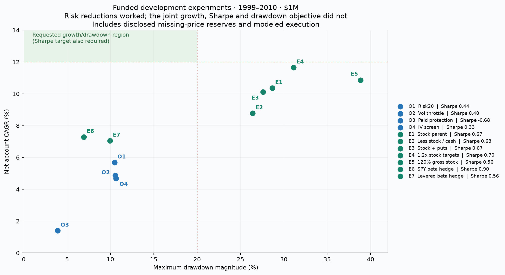
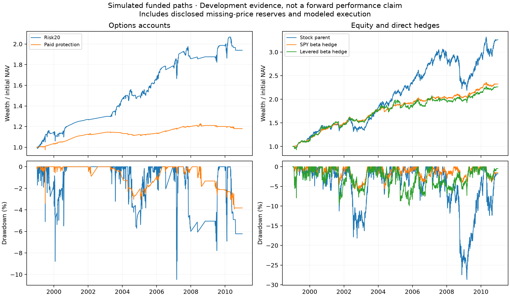

# Funded options and equity hedging: results and decisions

Publication note: this review branch publishes code and aggregate summaries/figures. The full per-account ledgers, audits, protocols and input manifest are preserved locally at `codex/options-risk-synthesis` commit `93893e7`; they are not included in this public branch or its history.

## Decision

The requested combination of **12%+ net CAGR, excess-risk-free Sharpe at least 1, and maximum drawdown no worse than 20% is not established by this research**. Building smaller risk budgets, buying protection, adding a pricing screen and borrowing did not create a higher-quality return source. The useful new finding is a direct SPY beta hedge: it materially reduced the equity book's historical drawdown, but sacrificed return and alpha. It is a risk-reduction research control, not a strategy with all the requested benefits.

The implementation and its accounting have been tested and corrected. **Investment acceptance remains false for every account.** This distinction matters: a reconciled simulation can demonstrate its conditional historical cash flows; it cannot prove future profitability or that every quoted order was executable.

## What was built and tested

An independent `pead/risk_research/` package owns one cash ledger for actual stock targets, option liabilities, native SPX SET settlement, collateral, fees, capacity-limited exits and financing. It preserves the original engines, worktrees, licensed data and frozen #19 holdout hashes.

The completed governing and follow-up suites contain **196 account/scenario observations**: 56 original-policy accounts on 1999–2010, 56 on January 2012–August 30, 2013, 16 pricing-screen accounts on each segment, and 26 direct-beta hedge accounts on each segment. These are dependent experiments on the same archive, not 196 independent strategies or new holdouts. Six earlier completed implementation observations and failed/superseded vintages remain in the register for transparency.

Options were tested at $100K and $1M; equity accounts at $1M and $10M. Governing capacity assumes **no one-contract floor**. Stresses include doubled fees, 1% additional adverse option-leg slippage, the original assumed one-lot floor, and a financing spread of 4% instead of 2%. The option-slippage stress has no effect on a book containing no options; such rows are intentionally not independent evidence.

Every completed account resolves its simulated terminal positions and reconciles both cumulative cash flows and separately recorded trade P&L, cash interest, financing, short dividends and borrow. Across all completed observations, the largest absolute terminal attribution residual is **less than $0.000001**. Some stock closes are explicitly conservative reserves for missing native prices, not asserted executable fills.

Final publication verification: **138 tests passed, 19 data-dependent skips**, including **31 focused synthesis tests** (one additional test protects published summaries when local ledgers are absent). Independent code review reproduced accounting defects before their corrections and rechecked the SPY dividend/split/funding paths. All eight original #19 frozen source hashes still match in the preserved source checkout. The input manifest fingerprints 53 simulation inputs and five native diagnostic files; licensed rows were not copied into the output artifacts.

## Matched development results

1999-01-04 through 2010-12-31, 3,019 common sessions, $1M initial account. CAGR uses 252 sessions/year; Sharpe subtracts the same published French daily RF proxy. Cash itself earns the previous complete month's proxy less a 10bp annual haircut. These are simulated account returns after the stated costs.

| Policy | CAGR | Excess-RF Sharpe | Max drawdown | Decision |
|---|---:|---:|---:|---|
| Risk20 SPX put-credit carry | 5.68% | 0.44 | −10.47% | Useful risk-budget reference; return/Sharpe target fails |
| Risk20 carry, 10% market-volatility admission throttle | 4.88% | 0.40 | −10.57% | Reject as improvement |
| Risk20 carry with paid put-spread protection | 1.40% | −0.68 | −3.92% | Reject; loses to the cash proxy on excess-return economics |
| Risk20 carry with prior IV/RV compensation screen | 4.69% | 0.33 | −10.64% | Reject; does not improve its parent |
| Funded, conservative next-session equity parent | 10.37% | 0.67 | −28.67% | Comparison parent; not the unchanged canonical result |
| 80% of that equity target plus cash | 8.78% | 0.63 | −26.40% | Does not solve the joint objective |
| Equity parent with paid index put-spread hedge | 10.11% | 0.67 | −27.60% | Reject as demonstrated improvement |
| 1.2× parent equity targets, capped at 96% marked stock/NAV | 11.65% | 0.70 | −31.12% | More return with more drawdown; no account financing occurred |
| Explicit 120%-NAV gross-stock request | 10.85% | 0.56 | −38.84% | Reject; actual financing and risk weaken it |
| Equity with direct SPY beta target | **7.29%** | **0.90** | **−6.93%** | Retain only as a risk-reduction research control |
| Levered equity with direct SPY beta target | 7.05% | 0.56 | −9.95% | Reject leverage enhancement |

The direct hedge's realized development market beta was about **0.029**, compared with **0.459** for its unhedged parent. The name `equity_beta_neutral` describes a target: warmup, changing beta, share rounding, capacity and margin can leave residual exposure.





## Why the approaches failed, and how the failures were addressed

### Options: a small maximum loss is not a new edge

The earlier #19 SPX candidate earned 13–16% with approximately 47–51% development drawdowns. Its 30/30/80% ticket/cohort/aggregate admission limits exposed much more capital to related short-volatility trades. Risk20 uses 5% per ticket/weekly cohort, 20% aggregate, and 10% per expiry. Several strike tickets on one index remain related exposure; they are not independent earnings bets.

Reducing that risk restored a much smaller drawdown but also removed much of the return. At $1M, Risk20's development option trade P&L was **+$500,472**, while cash interest contributed **+$438,773**. Its account growth cannot all be called option alpha. A simple volatility admission throttle lowered both CAGR and Sharpe and did not improve the worst drawdown.

The compensation revision therefore tested a different mechanism instead of increasing size: admit a carry structure only when its short put's **strictly previous-session IV is at least 1.2× lagged realized market volatility**. The threshold was frozen before that follow-up, with no threshold sweep. Missing/nonadjacent prior IV excludes the trade. It returned less than its matched parent in both development and the recent segment; it is not retained as an improvement. A simple IV/RV ratio is not a validated forecast of a skewed option spread's physical expected payout or jump loss.

### Paid protection: negative carry, affordability and forced adjustments

Protected carry buys 25/10-delta bear put spreads, 60–120 DTE, with a 1% initial-year-NAV gross annual premium budget. Replacement must be independently funded before old protection can be sold; admission requires actual funded hedge coverage. Whole SPX lots can be unaffordable, particularly at $100K. A put spread's payout is capped, and initial delta coverage is not a guarantee of future loss protection.

Review found and fixed real implementation defects: a loss-budget/spot calculation had been mistaken for spread delta, and a roll could sell protection without an affordable replacement. Correcting those defects did not rescue the economics. At $1M, protected carry's development carry trades lost **$102,633**, its hedges lost **$69,811**, and cash interest contributed **$353,364**. Coverage changes, deferred exits, budget exhaustion and spread costs matter; the tiny drawdown largely accompanies very little rewarded risk.

Paid equity protection also failed to produce a persuasive improvement over the stock parent. This is why comparison against reducing stock exposure was mandatory. [Cboe describes the premium/upside tradeoffs of puts and collars](https://www.cboe.com/insights/posts/benchmark-indices-series-hedging-downside-exposure-with-pput-cll-and-cllz-indices); [Israelov's research explicitly compares protective puts with reducing exposure](https://www.aqr.com/Insights/Research/White-Papers/Pathetic-Protection-The-Elusive-Benefits-of-Protective-Puts). Neither source validates this particular portfolio.

### Equity: direct hedging reduces risk, but funding and collateral are costly

The direct SPY control estimates beta from **long-stock P&L divided by account NAV**, excluding hedge P&L, using prior 126 sessions with a 60-session minimum and clipping beta to [0,1]. It targets beta × NAV in actual SPY shorts, rebalanced weekly, subject to lagged ADV and funding. Sale proceeds are included in 150% short collateral; they are not free cash. Actual prices mark a fixed share quantity between verified CRSP split-factor changes. Dividends, 1% assumed annual borrow, 2bp per-side execution and margin funding are charged separately.

That hedge substantially reduced drawdown, but did **not** preserve the parent alpha. Development FF3 annual alpha was approximately **2.81%**, HAC 95% interval **[0.61%, 5.00%]**, versus approximately **4.97%** for the parent. Those are conditional, selected-sample estimates, not surprise-specific skill or proof of future alpha. The recent hedge alpha interval includes zero.

At $1M, the direct hedge paid about **$53,291** in funding, **$113,458** in borrow and **$201,127** in dividends over development, plus **$17,109** of short execution fees. The levered hedge paid about **$200,185** in funding and had a lower CAGR and Sharpe. More gross exposure did not produce a better net investment.

The funding policies are admission/maintenance conventions, not guaranteed continuous broker limits. The ordinary/levered hedges had 19/65 maintenance observations; marked funding/NAV reached about 20.25%/51.12% versus 20%/50% admission references. Reductions are capacity limited. Long plus short gross can exceed the stated long-stock target, and real broker house requirements and borrow availability remain unverified.

## Uncertainty and later-period evidence

Paired circular three-calendar-month blocks, 1,000 draws, seed 20261026; candidate and parent are jointly resampled. These intervals condition on the designs already selected from this archive and do not correct the entire historical research search.

For the direct SPY hedge minus its unhedged parent, development 95% intervals were:

| Difference | 2.5th percentile | 97.5th percentile |
|---|---:|---:|
| CAGR | −8.27 percentage points | +1.95 points |
| Sharpe | −0.17 | +0.60 |
| Signed maximum drawdown | +6.10 percentage points | +30.16 points |
| Annual market alpha | −4.37 percentage points | −1.02 points |

A positive signed drawdown difference means a shallower decline. The drawdown benefit is much clearer than the Sharpe improvement; preserving alpha is not supported.

January 2012–August 30, 2013 is **already consumed history**, 418 sessions, separately cash-started because native 2011 option quotes are absent. It is not a new holdout. At $1M:

| Policy | Recent CAGR | Excess-RF Sharpe | Max drawdown |
|---|---:|---:|---:|
| Risk20 carry | 8.43% | 0.93 | −9.41% |
| Pricing-screen carry | 4.26% | 0.65 | −7.10% |
| Protected carry | −0.54% | −0.74 | −0.94% |
| Funded equity parent | 12.83% | 1.44 | −6.57% |
| Explicit gross-stock 120% request | 17.83% | 1.38 | −9.26% |
| Direct SPY beta hedge | 4.47% | 1.18 | −2.34% |
| Levered direct SPY hedge | 5.31% | 0.71 | −4.86% |

The leveraged stock book looks attractive in that short rising-market segment, but its development drawdown was 38.84%. Choosing only the favorable segment would defeat the exercise.

## Costs, data quality and comparison limits

- Risk20 at $1M: doubled fees **5.60% CAGR / 0.43 Sharpe / −10.62% DD**; additional adverse option-leg slippage **5.27% / 0.39 / −10.69%**. Its costs survive as positive historical returns, but the requested growth/Sharpe does not appear.
- Direct SPY hedge at $1M: doubled execution costs **6.79% / 0.80 / −7.11%**. The levered version with a 4% financing spread returns **6.68% / 0.52 / −10.42%**. Higher financing does not rescue leverage.
- The funded stock parent deliberately differs from canonical `steady_drift_plus`: conservative next-session entry, verified timing/link exclusions, aggregate issuer limits, marked positions, shared exit capacity, integer initial shares, total-return/DRIP marks and a separate cash/funding convention. Its 10.37% CAGR is **not** an attempted exact reproduction or silent replacement of the older published 12.07% result. Older summaries also use zero-RF Sharpe and different dates.
- Four missing-price episodes affect the ordinary $1M funded stock parent. They are present in native CRSP too: securities 86569 (2001), 10342 (2003), 24476 (2007–2008), and 88995 (2009). Some native quotes later resume. This implementation deliberately retains a pessimistic zero reserve after such an unresolved interruption; a reserve is **not an actual sale at zero**. There are four conservative reserve exits in the ordinary parent and direct hedge, and more in the levered books. These accounts are not fully verified executable historical records. No affected firm was removed retrospectively.
- The local CRSP delisting table does not resolve those specific missing-price dates. Inferring a favorable cash payout or filtering the names with future information would be unjustified. A corporate-action/quote-resumption reconciliation is required before replacing those lower-bound reserves with a claimed actual execution path.
- Some development options also require missing-quote worst-value reserves; counts are reported as mark evaluations, not unique failure days. Recent source coverage and native SET are distinct from displayed-size or complex-order execution proof.
- FF3 and market alpha do not control all nonlinear option risks, nor prove PEAD skill distinct from the announcing-stock universe. Long-stock residual risk and short-index basis risk remain.
- Stock fills use native closes plus the stated bps/capacity model, not timestamped stock NBBO. Options use EOD bid/ask plus modeled capacity; displayed size, quote synchronization, market impact, actual borrow availability and intraday margin are unverified. Cash carry is a disclosed proxy, not a directly reconstructed Treasury account.

## What is retained

The **cash/collateral ledger, causal features, independent reconciliation, cost stresses, failure register and direct-beta risk control** are retained for research. There is no new live-enabled or investment-approved strategy, and unsuccessful recipes were not inserted into the canonical registry as winners merely to increase its strategy count.

A serious next validation requires timestamped executable inputs, resolved corporate actions/missing-price paths and genuinely untouched post-2013 data. A stronger signal or better demonstrated pricing edge would be needed to raise returns without restoring the old risk. Further selection on these same years cannot supply that evidence.

## Reproduce and inspect

From this worktree, with Python 3.12/pandas 3 and the preserved source/data paths (override `--source`, `--data`, `--optionmetrics` if relocated):

```powershell
python -m pead.risk_research.study --family all --stress suite --label fresh_development
python -m pead.risk_research.study --family all --stress suite --segment recent --label fresh_recent
python -m pead.risk_research.study --family options --pricing-revision --stress suite --label fresh_pricing
python -m pead.risk_research.study --family equity --linear-revision --stress suite --label fresh_beta
python -m pead.risk_research.report --bootstrap 1000 --quiet
python scripts/plot_risk_synthesis.py --development-trial fresh_development_development_all_suite --pricing-trial fresh_pricing_development_options_suite --linear-trial fresh_beta_development_equity_suite
python -m pytest tests -q
```

For recent follow-ups, add `--segment recent` to the pricing/beta commands. Trial names are write-once; rerunning requires a new label. Stored protocols contain the exact policy and source hashes; commits preserve earlier implementations, so use the recorded vintage when reproducing an old rather than current implementation.

The current machine's tested runtime is `C:/Users/hrudi/.codex/worktrees/selective-earnings-research/PEAD_Trading/.venv/Scripts/python.exe`. The bare default Python lacks these dependencies; no raw data or environment was copied into this worktree.

Published aggregates: [`comparison.csv`](../results/options_risk_synthesis/comparison.csv), [`yearly.csv`](../results/options_risk_synthesis/yearly.csv), [`paired_uncertainty.json`](../results/options_risk_synthesis/paired_uncertainty.json), [`trial_register.csv`](../results/options_risk_synthesis/trial_register.csv), and figures. The input manifest and per-account daily paths, trade records, audits and frozen protocols remain in the full local snapshot. Failed/superseded and smoke vintages are identified separately and excluded from the governing conclusions. Rerunning with licensed inputs generates full ledgers locally; the reporter requires those ledgers before regenerating aggregates and will preserve the published summaries when they are absent.
