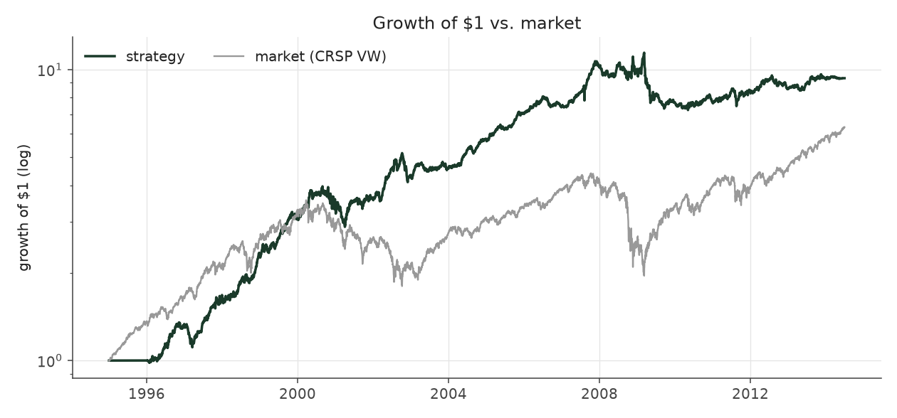
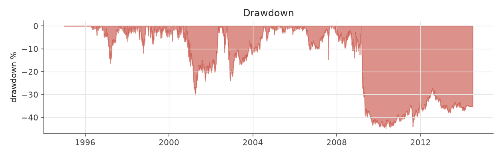
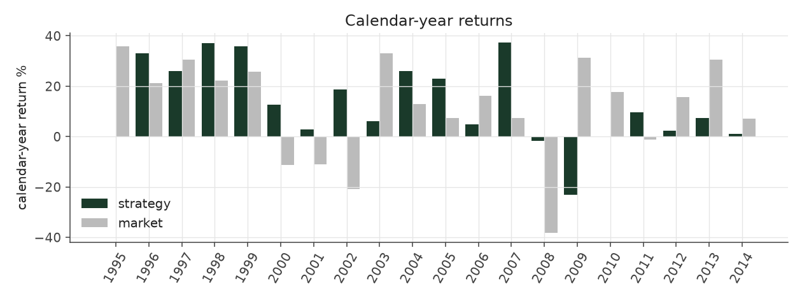
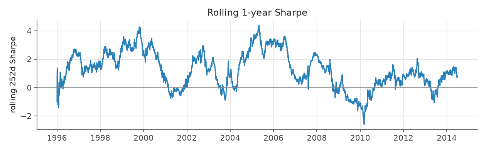
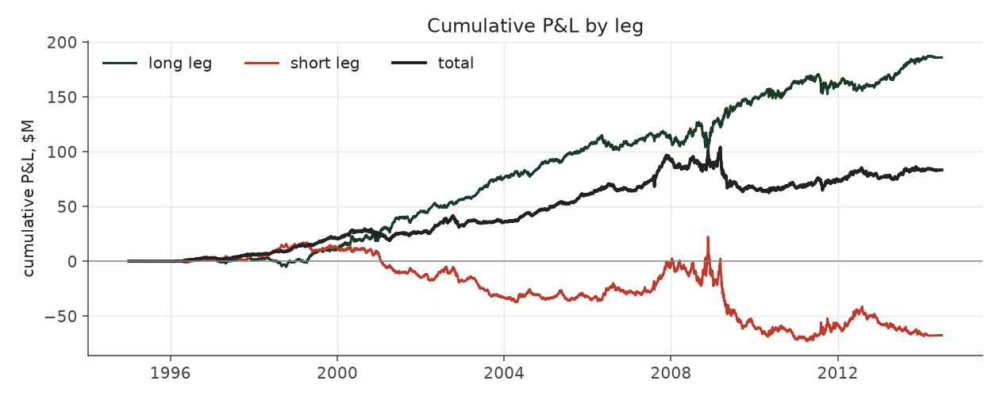
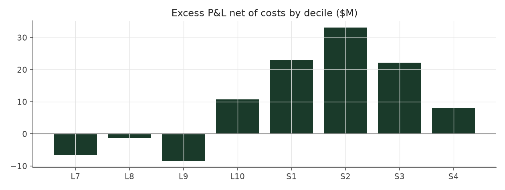

# balanced_leverage_max

_equity strategy | family: equity-max | status: research | derived from `balanced_leverage`_

## What this strategy does

balanced_leverage with bigger bets for more return: base unit 0.012, 6x leverage cap

**Why it should work.** Market-neutral earnings drift with enough gross exposure to matter; the neutrality is the hedge.

**Design notes** (from the strategy's source file).

Max-size variants ("<name>_max") of the hand-built equity strategies.

Same signal, trim, tilt and neutralization as each base strategy; only the two dials that set how big and how levered the book is change (base_unit_fraction, gross-leverage cap = 6x). The multiplier for each was picked by sweeping 1.5x..12x the original base unit and taking the highest return subject to Sharpe >= 0.6 and max drawdown >= -40% (a worse drawdown is a fund-ending event, not a risk preference). The untouched 5%-of-ADV liquidity cap remains the real capacity constraint, and bites roughly four times as often at this sizing.

These are generated from the base strategy classes, so a change to a base strategy's weights flows through automatically.

| parameter | value |
|---|---|
| base_unit_fraction | 0.012 |
| max_gross_leverage | 6.0 |
| liquidity_cap_frac | 0.05 |
| return_basis | mktadj |
| cap_mode | priority |
| exposure_cap | open_book |
| beta_overlay | 0.0 |

## Performance

| metric | balanced_leverage_max | market (CRSP VW) |
|---|---|---|
| Annualized return | 8.35% | 9.94% |
| Annualized volatility | 12.82% | 19.35% |
| Sharpe (NAV-pct) | 0.69 | 0.59 |
| Sortino | 0.98 |  |
| Max drawdown | -44.9% | -55.5% |
| Calmar | 0.19 |  |
| Final NAV ($10M start) | $47,669,815 |  |
| Worst day | -7.42% |  |
| % positive days | 49.3% |  |
| Sharpe 1996-2001 | 1.20 |  |
| Sharpe 2002-2007 | 1.39 |  |
| Sharpe 2008-2013 | -0.41 |  |

Correlation of daily returns with the market: **-0.02**.

- best Sharpe among equity: `calm_rank_tilt` (1.47); this one: 0.69
- best return among equity: `market_boost_max` (0.116); this one: 0.0835
- best Calmar among equity: `calm_rank_tilt` (0.442); this one: 0.186

*NAV (log scale)*

*Drawdown from running peak*

*Calendar-year returns*

*Is the edge stable, or concentrated in a few years?*

## Where the return comes from

*Long leg vs. short leg vs. total*

|  | long leg | short leg |
|---|---|---|
| P&L ($M, before costs) | 124.90 | -64.83 |
| P&L after costs ($M) | 114.04 | -76.37 |
| of which common (average-event) component ($M) | 119.86 | -122.72 |
| of which excess / PEAD component ($M) | 5.05 | 57.89 |
| excess minus costs ($M) | -5.82 | 46.35 |
| gross return per $ traded (bp) | 177.22 | -88.04 |
| positions in the money (hit rate) | 0.55 | 0.48 |
| stand-alone Sharpe (leg only) | 1.00 | -0.38 |

Daily P&L correlation between the two legs: **-0.74**.

- **The short leg loses money in absolute terms** (-64.8M before costs) while the long leg earns +124.9M. That is mostly a benchmark effect, not a signal failure: the average earnings-event stock beat the cap-weighted market during its holding window, which flatters the long leg and hurts the short leg by 119.9M / 122.7M. Stripping that common component, the surprise signal itself earned +5.0M on the long side and +57.9M on the short side.
- The two legs' daily P&L are -0.74 correlated: the short leg is the hedge that makes the long leg's variance disappear (stand-alone leg Sharpe 1.00 long / -0.38 short vs 0.69 combined).

### By decile and side (signal-driven part only)

| leg | decile | positions | notional_M | net_pnl_M | excess_M | cost_M | alpha_net_M | alpha_share | alpha_bp_per_$ |
|---|---|---|---|---|---|---|---|---|---|
| long | 7 | 3,244 | 418.72 | 3.15 | -3.46 | 0.66 | -4.11 | -10.1% | -98.22 |
| long | 8 | 11,112 | 1,487.56 | 22.24 | -3.49 | 2.32 | -5.81 | -14.3% | -39.07 |
| long | 9 | 13,857 | 2,195.43 | 32.84 | 1.63 | 3.34 | -1.70 | -4.2% | -7.76 |
| long | 10 | 16,409 | 2,946.33 | 55.81 | 10.36 | 4.55 | 5.81 | 14.3% | 19.71 |
| short | 1 | 14,397 | 2,839.18 | -24.90 | 27.52 | 4.54 | 22.98 | 56.7% | 80.96 |
| short | 2 | 14,634 | 2,617.43 | -34.07 | 14.28 | 4.07 | 10.22 | 25.2% | 39.04 |
| short | 3 | 10,525 | 1,714.05 | -15.26 | 14.62 | 2.65 | 11.97 | 29.5% | 69.85 |
| short | 4 | 1,465 | 192.64 | -2.14 | 1.46 | 0.28 | 1.18 | 2.9% | 61.13 |

*D10 and the short deciles carry the alpha; the middle of each leg earns little*

### By size quintile (1 = smallest)

| size_quintile | positions | notional_M | net_pnl_M | excess_M | cost_M | alpha_net_M | alpha_share | alpha_bp_per_$ |
|---|---|---|---|---|---|---|---|---|
| 1 | 6,679 | 331.94 | -5.30 | -2.98 | 0.98 | -3.97 | -9.8% | -119.48 |
| 2 | 14,442 | 1,582.52 | 5.65 | 11.42 | 3.70 | 7.72 | 19.0% | 48.77 |
| 3 | 19,426 | 3,099.11 | 12.52 | 18.91 | 5.81 | 13.10 | 32.3% | 42.26 |
| 4 | 21,910 | 4,343.53 | 13.61 | 20.01 | 6.40 | 13.61 | 33.6% | 31.32 |
| 5 | 23,186 | 5,054.24 | 11.20 | 15.59 | 5.51 | 10.08 | 24.9% | 19.94 |

### By liquidity quintile (1 = least liquid)

| liquidity_quintile | positions | notional_M | net_pnl_M | excess_M | cost_M | alpha_net_M | alpha_share | alpha_bp_per_$ |
|---|---|---|---|---|---|---|---|---|
| 1 | 5,125 | 92.61 | 0.46 | 1.35 | 0.46 | 0.88 | 2.2% | 95.45 |
| 2 | 14,300 | 1,181.02 | -1.30 | 4.61 | 3.54 | 1.07 | 2.6% | 9.03 |
| 3 | 20,824 | 3,382.54 | 18.20 | 27.98 | 6.76 | 21.21 | 52.3% | 62.71 |
| 4 | 22,097 | 4,695.64 | 9.39 | 15.52 | 6.57 | 8.95 | 22.1% | 19.05 |
| 5 | 23,293 | 5,058.34 | 10.80 | 13.34 | 5.06 | 8.28 | 20.4% | 16.37 |

### By holding-window length

| hold_bucket | positions | notional_M | net_pnl_M | excess_M | cost_M | alpha_net_M | alpha_share | alpha_bp_per_$ |
|---|---|---|---|---|---|---|---|---|
| <=40d | 29,895 | 5,173.43 | -11.36 | 33.59 | 7.78 | 25.80 | 63.7% | 49.88 |
| 41-60d | 20,346 | 3,298.60 | 5.39 | 21.14 | 5.64 | 15.49 | 38.2% | 46.97 |
| 61-90d | 29,276 | 5,201.79 | 34.05 | 0.54 | 7.44 | -6.90 | -17.0% | -13.27 |
| >90d | 6,126 | 737.53 | 9.58 | 7.68 | 1.54 | 6.14 | 15.1% | 83.22 |

### By era

| era | positions | notional_M | net_pnl_M | excess_M | cost_M | alpha_net_M | alpha_share | alpha_bp_per_$ |
|---|---|---|---|---|---|---|---|---|
| 1996-01 | 26,452 | 2,447.71 | 17.98 | 21.81 | 3.85 | 17.96 | 44.3% | 73.39 |
| 2002-07 | 29,968 | 5,544.24 | 39.31 | 44.52 | 8.52 | 36.01 | 88.8% | 64.94 |
| 2008-13 | 29,223 | 6,419.40 | -19.62 | -3.39 | 10.04 | -13.44 | -33.2% | -20.93 |

### By FF12 sector

| ff12_sector | positions | notional_M | net_pnl_M | excess_M | cost_M | alpha_net_M | alpha_share | alpha_bp_per_$ |
|---|---|---|---|---|---|---|---|---|
| BusEq | 13,945 | 1,413.84 | -5.32 | -1.40 | 2.31 | -3.71 | -9.2% | -26.26 |
| Chems | 2,350 | 911.10 | 3.53 | 4.62 | 1.27 | 3.35 | 8.3% | 36.80 |
| Durbl | 2,464 | 971.15 | -1.63 | 0.69 | 1.37 | -0.68 | -1.7% | -6.99 |
| Enrgy | 5,523 | 1,239.10 | 10.99 | 13.53 | 1.79 | 11.73 | 29.0% | 94.70 |
| Hlth | 8,778 | 1,529.54 | 8.27 | 10.27 | 2.44 | 7.83 | 19.3% | 51.20 |
| Manuf | 9,286 | 1,371.31 | 1.37 | 3.28 | 2.21 | 1.07 | 2.6% | 7.81 |
| Money | 9,738 | 1,006.41 | 3.77 | 5.27 | 1.76 | 3.51 | 8.7% | 34.90 |
| NoDur | 4,402 | 1,165.92 | 5.68 | 6.90 | 1.73 | 5.17 | 12.8% | 44.34 |
| Other | 11,612 | 1,284.04 | 6.67 | 9.27 | 2.18 | 7.09 | 17.5% | 55.22 |
| Shops | 9,830 | 1,499.65 | 9.11 | 11.15 | 2.42 | 8.73 | 21.5% | 58.20 |
| Telcm | 3,469 | 1,055.51 | -4.45 | -2.45 | 1.45 | -3.90 | -9.6% | -36.98 |
| Utils | 4,246 | 963.79 | -0.32 | 1.80 | 1.46 | 0.34 | 0.8% | 3.49 |

### By idiosyncratic-volatility tercile

| vol_tercile | positions | notional_M | net_pnl_M | excess_M | cost_M | alpha_net_M | alpha_share | alpha_bp_per_$ |
|---|---|---|---|---|---|---|---|---|
| high vol | 29,591 | 5,215.15 | -10.61 | 1.87 | 7.58 | -5.71 | -14.1% | -10.95 |
| low vol | 27,167 | 4,306.69 | 25.27 | 33.04 | 7.18 | 25.86 | 63.8% | 60.05 |
| mid vol | 27,433 | 4,712.18 | 21.91 | 26.96 | 7.34 | 19.63 | 48.4% | 41.65 |

### Short-borrow sensitivity (not modeled in the backtest)

| borrow_rate | fee_M | annualized_return | drag |
|---|---|---|---|
| 0.0% | 0.0 | 8.35% | 0.00% |
| 0.5% | 7.1 | 7.46% | 0.89% |
| 1.0% | 14.1 | 6.41% | 1.94% |
| 2.0% | 28.3 | 3.46% | 4.89% |
| 5.0% | 70.7 | -100.00% | 108.35% |

The engine charges the same transaction cost on shorts as on longs and no stock-borrow fee. The short leg is concentrated in small, illiquid names, where borrow is scarce and expensive -- read the table as a floor on the cost of running the short leg.
