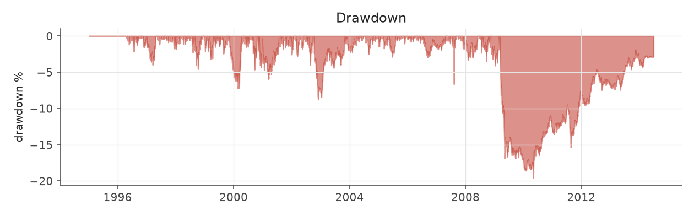
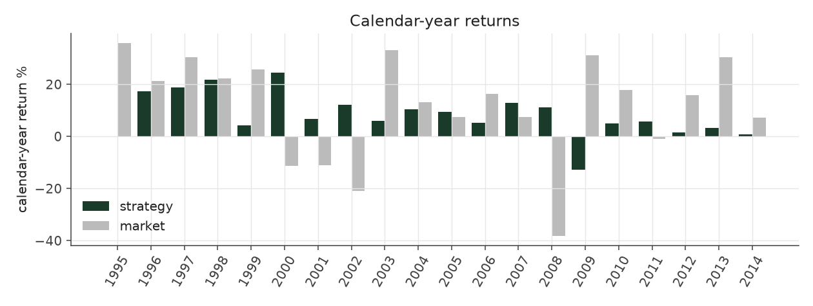
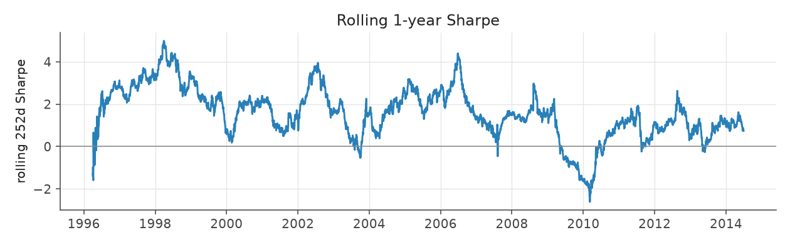
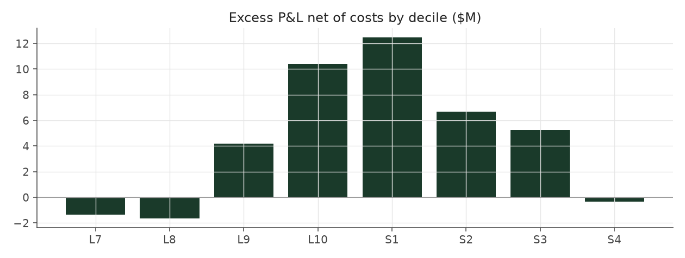

# calm_rank_levered

_equity strategy | family: equity-volatility | status: research | derived from `calm_rank_tilt`_

## What this strategy does

Calm Rank Tilt with its lower risk spent on larger bets (about 1.7x) and a 4x borrowing limit

**Why it should work.** PEAD alpha per dollar is highest in calm stocks; rank-weight toward them without depending on vol levels.

**Design notes** (from the strategy's source file).

Calm Rank Tilt -- Balanced Leverage, tilted hard toward the calmest stocks by volatility RANK (research).

Calm Weighted sized each event by 1/idiosyncratic-vol (pre-fix Sharpe 1.30 -> 1.47; corrected run 1.09 -> 1.24). The attribution work showed that PEAD alpha per dollar is concentrated in low-volatility names and almost absent in the wildest tercile, and that the 1/vol weight, being linear in the vol LEVEL, only mildly demotes the high-vol tail. Weighting by (1.02 - vol percentile)^2 -- where the percentile is measured against the previous quarter's cross-section within the stock's size quintile -- demotes it hard while staying smooth:

Corrected run: Sharpe 1.09 (Balanced Leverage) -> 1.24 (Calm Weighted) -> 1.47; max drawdown -18.6% -> -17.5% -> -13.6%; every era improves (pre-fix: 1.30 -> 1.47 -> 1.81, -16.6% -> -11.6%) split-sample check: exponent picked on 1996-2004 data alone (best k ~ 3) lifts 2005-2013 Sharpe 0.93 -> 1.10 (pre-fix, not re-run), the same as the full-sample best, so the gain is not an artifact of one period.

Lower volatility buys room: `calm_rank_levered` spends it on 1.7x the base unit and a 4x gross cap for ~9% a year at ~5% vol (a market-neutral book clearing the S&P 500's return in this sample). More sizing than that stops paying: the 5%-of-ADV liquidity cap starts to bind and 2008-13 Sharpe decays.

STATUS research: the exponent and sizing were chosen after seeing Calm Weighted's full-sample results (the split-sample check above is the only out-of-sample evidence), and the levered variant leans on small-cap capacity.

| parameter | value |
|---|---|
| base_unit_fraction | 0.005 |
| max_gross_leverage | 4.0 |
| liquidity_cap_frac | 0.05 |
| return_basis | mktadj |
| cap_mode | priority |
| exposure_cap | open_book |
| beta_overlay | 0.0 |

## Performance

| metric | calm_rank_levered | market (CRSP VW) |
|---|---|---|
| Annualized return | 8.07% | 9.94% |
| Annualized volatility | 5.70% | 19.35% |
| Sharpe (NAV-pct) | 1.39 | 0.59 |
| Sortino | 2.08 |  |
| Max drawdown | -19.6% | -55.5% |
| Calmar | 0.41 |  |
| Final NAV ($10M start) | $45,295,760 |  |
| Worst day | -4.00% |  |
| % positive days | 51.4% |  |
| Sharpe 1996-2001 | 2.17 |  |
| Sharpe 2002-2007 | 1.66 |  |
| Sharpe 2008-2013 | 0.38 |  |

Correlation of daily returns with the market: **-0.10**.

- best Sharpe among equity: `calm_rank_tilt` (1.47); this one: 1.39
- best return among equity: `market_boost_max` (0.116); this one: 0.0807
- best Calmar among equity: `calm_rank_tilt` (0.442); this one: 0.412

*NAV (log scale)*

*Drawdown from running peak*

*Calendar-year returns*

*Is the edge stable, or concentrated in a few years?*

## Where the return comes from

*Long leg vs. short leg vs. total*

|  | long leg | short leg |
|---|---|---|
| P&L ($M, before costs) | 64.36 | -17.72 |
| P&L after costs ($M) | 58.81 | -23.51 |
| of which common (average-event) component ($M) | 47.25 | -47.58 |
| of which excess / PEAD component ($M) | 17.11 | 29.86 |
| excess minus costs ($M) | 11.56 | 24.07 |
| gross return per $ traded (bp) | 213.15 | -58.45 |
| positions in the money (hit rate) | 0.56 | 0.48 |
| stand-alone Sharpe (leg only) | 1.31 | -0.26 |

Daily P&L correlation between the two legs: **-0.76**.

- **The short leg loses money in absolute terms** (-17.7M before costs) while the long leg earns +64.4M. That is mostly a benchmark effect, not a signal failure: the average earnings-event stock beat the cap-weighted market during its holding window, which flatters the long leg and hurts the short leg by 47.2M / 47.6M. Stripping that common component, the surprise signal itself earned +17.1M on the long side and +29.9M on the short side.
- The two legs' daily P&L are -0.76 correlated: the short leg is the hedge that makes the long leg's variance disappear (stand-alone leg Sharpe 1.31 long / -0.26 short vs 1.39 combined).

### By decile and side (signal-driven part only)

| leg | decile | positions | notional_M | net_pnl_M | excess_M | cost_M | alpha_net_M | alpha_share | alpha_bp_per_$ |
|---|---|---|---|---|---|---|---|---|---|
| long | 7 | 6,446 | 221.13 | 2.31 | -0.93 | 0.41 | -1.35 | -3.8% | -60.86 |
| long | 8 | 16,531 | 691.72 | 10.13 | -0.38 | 1.28 | -1.66 | -4.7% | -23.99 |
| long | 9 | 18,481 | 922.83 | 17.24 | 5.86 | 1.68 | 4.18 | 11.7% | 45.33 |
| long | 10 | 20,051 | 1,183.81 | 29.13 | 12.56 | 2.18 | 10.38 | 29.1% | 87.72 |
| short | 1 | 18,225 | 1,123.91 | -5.86 | 14.69 | 2.22 | 12.47 | 35.0% | 110.92 |
| short | 2 | 18,826 | 1,044.37 | -9.82 | 8.64 | 1.98 | 6.66 | 18.7% | 63.81 |
| short | 3 | 15,255 | 771.21 | -6.14 | 6.69 | 1.43 | 5.25 | 14.7% | 68.12 |
| short | 4 | 2,350 | 92.05 | -1.68 | -0.16 | 0.16 | -0.32 | -0.9% | -34.75 |

*D10 and the short deciles carry the alpha; the middle of each leg earns little*

### By size quintile (1 = smallest)

| size_quintile | positions | notional_M | net_pnl_M | excess_M | cost_M | alpha_net_M | alpha_share | alpha_bp_per_$ |
|---|---|---|---|---|---|---|---|---|
| 1 | 13,938 | 327.96 | 1.25 | 3.34 | 1.24 | 2.10 | 5.9% | 64.01 |
| 2 | 22,110 | 921.09 | 7.59 | 10.53 | 2.58 | 7.96 | 22.3% | 86.37 |
| 3 | 24,900 | 1,352.22 | 9.92 | 12.58 | 2.87 | 9.71 | 27.2% | 71.80 |
| 4 | 27,063 | 1,661.74 | 10.57 | 12.91 | 2.67 | 10.24 | 28.7% | 61.62 |
| 5 | 28,154 | 1,788.03 | 5.97 | 7.61 | 1.99 | 5.62 | 15.8% | 31.46 |

### By liquidity quintile (1 = least liquid)

| liquidity_quintile | positions | notional_M | net_pnl_M | excess_M | cost_M | alpha_net_M | alpha_share | alpha_bp_per_$ |
|---|---|---|---|---|---|---|---|---|
| 1 | 13,319 | 241.88 | 2.91 | 4.50 | 1.21 | 3.29 | 9.2% | 136.05 |
| 2 | 22,452 | 1,045.90 | 6.13 | 10.78 | 3.14 | 7.64 | 21.4% | 73.05 |
| 3 | 25,189 | 1,577.10 | 12.71 | 16.25 | 3.15 | 13.09 | 36.8% | 83.02 |
| 4 | 27,001 | 1,638.51 | 8.36 | 9.64 | 2.29 | 7.34 | 20.6% | 44.81 |
| 5 | 28,199 | 1,547.42 | 5.14 | 5.75 | 1.55 | 4.20 | 11.8% | 27.15 |

### By holding-window length

| hold_bucket | positions | notional_M | net_pnl_M | excess_M | cost_M | alpha_net_M | alpha_share | alpha_bp_per_$ |
|---|---|---|---|---|---|---|---|---|
| <=40d | 41,550 | 2,201.76 | 1.87 | 18.24 | 3.92 | 14.32 | 40.2% | 65.03 |
| 41-60d | 27,518 | 1,482.19 | 7.72 | 13.57 | 3.06 | 10.51 | 29.5% | 70.94 |
| 61-90d | 37,656 | 1,971.30 | 18.32 | 8.68 | 3.34 | 5.34 | 15.0% | 27.09 |
| >90d | 9,441 | 395.78 | 7.39 | 6.48 | 1.02 | 5.45 | 15.3% | 137.81 |

### By era

| era | positions | notional_M | net_pnl_M | excess_M | cost_M | alpha_net_M | alpha_share | alpha_bp_per_$ |
|---|---|---|---|---|---|---|---|---|
| 1996-01 | 32,241 | 1,019.95 | 14.16 | 16.11 | 1.89 | 14.22 | 39.9% | 139.41 |
| 2002-07 | 38,279 | 2,111.49 | 15.57 | 18.70 | 3.89 | 14.82 | 41.6% | 70.17 |
| 2008-13 | 45,645 | 2,919.59 | 5.57 | 12.15 | 5.56 | 6.59 | 18.5% | 22.58 |

### By FF12 sector

| ff12_sector | positions | notional_M | net_pnl_M | excess_M | cost_M | alpha_net_M | alpha_share | alpha_bp_per_$ |
|---|---|---|---|---|---|---|---|---|
| BusEq | 21,022 | 622.83 | 3.95 | 4.88 | 1.26 | 3.61 | 10.1% | 58.03 |
| Chems | 2,545 | 383.62 | 2.15 | 2.76 | 0.61 | 2.15 | 6.0% | 55.94 |
| Durbl | 2,819 | 403.03 | 1.16 | 1.95 | 0.67 | 1.28 | 3.6% | 31.80 |
| Enrgy | 6,318 | 469.94 | 4.90 | 5.93 | 0.81 | 5.12 | 14.4% | 108.86 |
| Hlth | 11,333 | 581.58 | 1.65 | 2.52 | 1.12 | 1.40 | 3.9% | 24.03 |
| Manuf | 11,872 | 563.11 | 2.46 | 3.83 | 1.09 | 2.75 | 7.7% | 48.79 |
| Money | 17,196 | 562.65 | 4.35 | 5.72 | 1.19 | 4.54 | 12.7% | 80.60 |
| NoDur | 4,899 | 470.37 | 3.02 | 3.72 | 0.82 | 2.90 | 8.1% | 61.65 |
| Other | 17,930 | 604.27 | 4.83 | 6.22 | 1.28 | 4.94 | 13.9% | 81.79 |
| Shops | 11,548 | 575.54 | 3.86 | 4.83 | 1.12 | 3.72 | 10.4% | 64.57 |
| Telcm | 3,947 | 415.79 | 2.11 | 2.80 | 0.69 | 2.11 | 5.9% | 50.81 |
| Utils | 4,736 | 398.28 | 0.87 | 1.80 | 0.69 | 1.12 | 3.1% | 28.07 |

### By idiosyncratic-volatility tercile

| vol_tercile | positions | notional_M | net_pnl_M | excess_M | cost_M | alpha_net_M | alpha_share | alpha_bp_per_$ |
|---|---|---|---|---|---|---|---|---|
| high vol | 38,501 | 537.62 | 2.32 | 3.83 | 0.97 | 2.86 | 8.0% | 53.26 |
| low vol | 38,978 | 3,340.68 | 20.09 | 27.40 | 6.38 | 21.02 | 59.0% | 62.92 |
| mid vol | 36,897 | 2,077.78 | 11.70 | 14.53 | 3.81 | 10.72 | 30.1% | 51.62 |

### Short-borrow sensitivity (not modeled in the backtest)

| borrow_rate | fee_M | annualized_return | drag |
|---|---|---|---|
| 0.0% | 0.0 | 8.07% | -0.00% |
| 0.5% | 3.0 | 7.69% | 0.38% |
| 1.0% | 5.9 | 7.29% | 0.78% |
| 2.0% | 11.9 | 6.39% | 1.67% |
| 5.0% | 29.7 | 2.31% | 5.75% |

The engine charges the same transaction cost on shorts as on longs and no stock-borrow fee. The short leg is concentrated in small, illiquid names, where borrow is scarce and expensive -- read the table as a floor on the cost of running the short leg.
