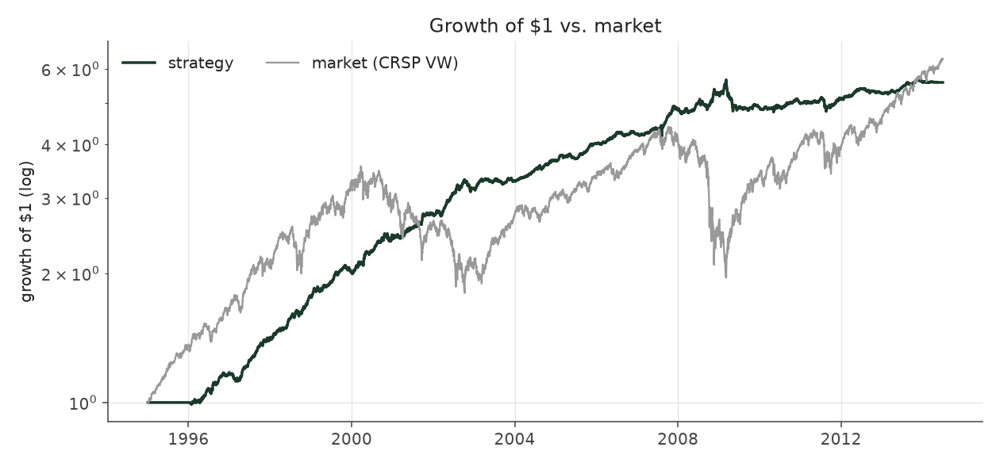
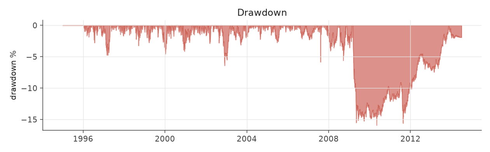
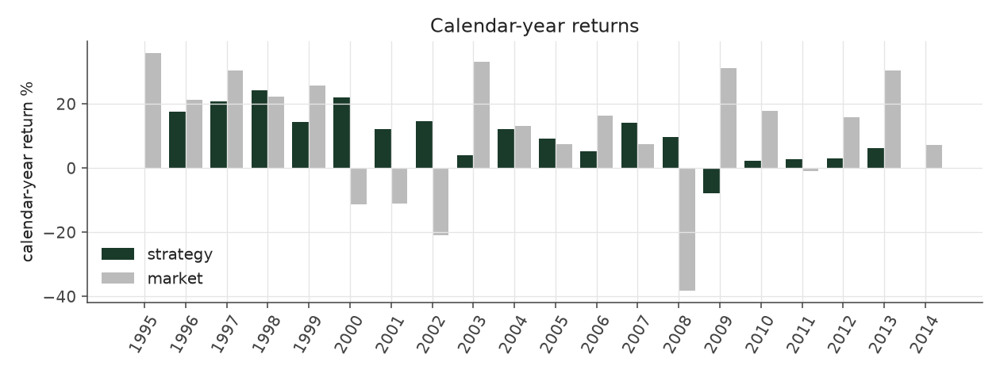
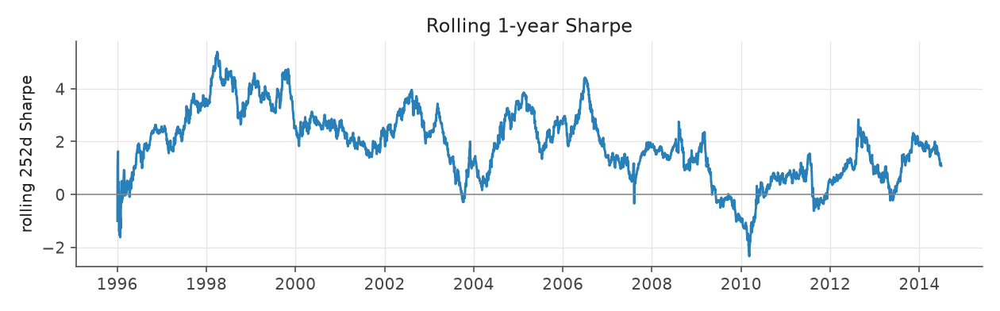
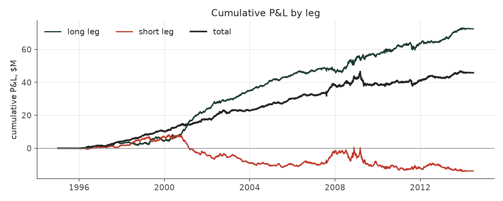
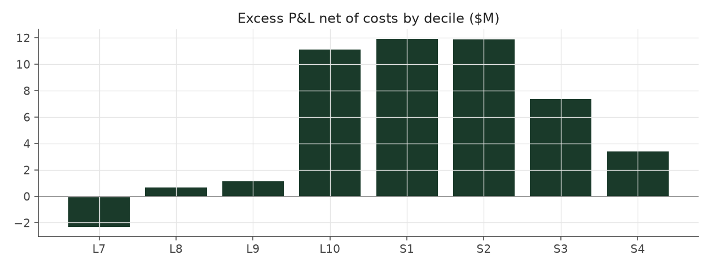

# calm_rank_levered_legacy

_equity strategy | family: equity-volatility | status: reference | derived from `calm_rank_levered`_

## What this strategy does

Calm Rank Tilt with its lower risk spent on larger bets (about 1.7x) and a 4x borrowing limit -- ORIGINAL leverage cap (new positions only, open book ignored)

**Why it should work.** PEAD alpha per dollar is highest in calm stocks; rank-weight toward them without depending on vol levels.

**Design notes** (from the strategy's source file).

Calm Rank Tilt -- Balanced Leverage, tilted hard toward the calmest stocks by volatility RANK (research).

Calm Weighted sized each event by 1/idiosyncratic-vol (pre-fix Sharpe 1.30 -> 1.47; corrected run 1.09 -> 1.24). The attribution work showed that PEAD alpha per dollar is concentrated in low-volatility names and almost absent in the wildest tercile, and that the 1/vol weight, being linear in the vol LEVEL, only mildly demotes the high-vol tail. Weighting by (1.02 - vol percentile)^2 -- where the percentile is measured against the previous quarter's cross-section within the stock's size quintile -- demotes it hard while staying smooth:

Corrected run: Sharpe 1.09 (Balanced Leverage) -> 1.24 (Calm Weighted) -> 1.47; max drawdown -18.6% -> -17.5% -> -13.6%; every era improves (pre-fix: 1.30 -> 1.47 -> 1.81, -16.6% -> -11.6%) split-sample check: exponent picked on 1996-2004 data alone (best k ~ 3) lifts 2005-2013 Sharpe 0.93 -> 1.10 (pre-fix, not re-run), the same as the full-sample best, so the gain is not an artifact of one period.

Lower volatility buys room: `calm_rank_levered` spends it on 1.7x the base unit and a 4x gross cap for ~9% a year at ~5% vol (a market-neutral book clearing the S&P 500's return in this sample). More sizing than that stops paying: the 5%-of-ADV liquidity cap starts to bind and 2008-13 Sharpe decays.

STATUS research: the exponent and sizing were chosen after seeing Calm Weighted's full-sample results (the split-sample check above is the only out-of-sample evidence), and the levered variant leans on small-cap capacity.

| parameter | value |
|---|---|
| base_unit_fraction | 0.005 |
| max_gross_leverage | 4.0 |
| liquidity_cap_frac | 0.05 |
| return_basis | mktadj |
| cap_mode | priority |
| exposure_cap | entry_cohort |
| beta_overlay | 0.0 |

## Performance

| metric | calm_rank_levered_legacy | market (CRSP VW) |
|---|---|---|
| Annualized return | 9.23% | 9.94% |
| Annualized volatility | 5.17% | 19.35% |
| Sharpe (NAV-pct) | 1.73 | 0.59 |
| Sortino | 2.64 |  |
| Max drawdown | -15.9% | -55.5% |
| Calmar | 0.58 |  |
| Final NAV ($10M start) | $55,789,745 |  |
| Worst day | -3.60% |  |
| % positive days | 52.5% |  |
| Sharpe 1996-2001 | 2.86 |  |
| Sharpe 2002-2007 | 1.96 |  |
| Sharpe 2008-2013 | 0.50 |  |

Correlation of daily returns with the market: **-0.03**.

- best Sharpe among equity: `calm_rank_tilt` (1.47); this one: 1.73
- best return among equity: `market_boost_max` (0.116); this one: 0.0923
- best Calmar among equity: `calm_rank_tilt` (0.442); this one: 0.579

*NAV (log scale)*

*Drawdown from running peak*

*Calendar-year returns*

*Is the edge stable, or concentrated in a few years?*

## Where the return comes from

*Long leg vs. short leg vs. total*

|  | long leg | short leg |
|---|---|---|
| P&L ($M, before costs) | 72.46 | -13.81 |
| P&L after costs ($M) | 66.24 | -20.45 |
| of which common (average-event) component ($M) | 55.02 | -54.57 |
| of which excess / PEAD component ($M) | 16.80 | 41.19 |
| excess minus costs ($M) | 10.60 | 34.57 |
| gross return per $ traded (bp) | 208.91 | -39.14 |
| positions in the money (hit rate) | 0.56 | 0.49 |
| stand-alone Sharpe (leg only) | 1.45 | -0.16 |

Daily P&L correlation between the two legs: **-0.77**.

- **The short leg loses money in absolute terms** (-13.8M before costs) while the long leg earns +72.5M. That is mostly a benchmark effect, not a signal failure: the average earnings-event stock beat the cap-weighted market during its holding window, which flatters the long leg and hurts the short leg by 55.0M / 54.6M. Stripping that common component, the surprise signal itself earned +16.8M on the long side and +41.2M on the short side.
- The two legs' daily P&L are -0.77 correlated: the short leg is the hedge that makes the long leg's variance disappear (stand-alone leg Sharpe 1.45 long / -0.16 short vs 1.73 combined).

### By decile and side (signal-driven part only)

| leg | decile | positions | notional_M | net_pnl_M | excess_M | cost_M | alpha_net_M | alpha_share | alpha_bp_per_$ |
|---|---|---|---|---|---|---|---|---|---|
| long | 7 | 8,029 | 326.55 | 3.79 | -1.74 | 0.59 | -2.33 | -5.2% | -71.35 |
| long | 8 | 16,588 | 843.87 | 14.71 | 2.18 | 1.52 | 0.65 | 1.4% | 7.73 |
| long | 9 | 17,747 | 1,080.59 | 17.10 | 3.04 | 1.91 | 1.14 | 2.5% | 10.50 |
| long | 10 | 17,174 | 1,217.60 | 30.64 | 13.32 | 2.20 | 11.12 | 24.6% | 91.34 |
| short | 1 | 17,169 | 1,171.25 | -4.34 | 14.21 | 2.29 | 11.91 | 26.4% | 101.73 |
| short | 2 | 17,281 | 1,084.11 | -6.66 | 13.89 | 2.02 | 11.87 | 26.3% | 109.49 |
| short | 3 | 15,970 | 888.83 | -6.83 | 8.99 | 1.64 | 7.35 | 16.3% | 82.72 |
| short | 4 | 9,171 | 384.55 | -2.61 | 4.09 | 0.68 | 3.41 | 7.6% | 88.70 |

*D10 and the short deciles carry the alpha; the middle of each leg earns little*

### By size quintile (1 = smallest)

| size_quintile | positions | notional_M | net_pnl_M | excess_M | cost_M | alpha_net_M | alpha_share | alpha_bp_per_$ |
|---|---|---|---|---|---|---|---|---|
| 1 | 14,213 | 343.64 | 5.44 | 7.77 | 1.29 | 6.48 | 14.3% | 188.51 |
| 2 | 22,885 | 1,016.63 | 8.45 | 11.38 | 2.83 | 8.55 | 18.9% | 84.08 |
| 3 | 25,501 | 1,544.72 | 12.48 | 14.78 | 3.26 | 11.52 | 25.5% | 74.59 |
| 4 | 27,583 | 1,953.20 | 11.43 | 14.02 | 3.12 | 10.91 | 24.1% | 55.84 |
| 5 | 28,947 | 2,139.15 | 7.99 | 10.04 | 2.37 | 7.67 | 17.0% | 35.86 |

### By liquidity quintile (1 = least liquid)

| liquidity_quintile | positions | notional_M | net_pnl_M | excess_M | cost_M | alpha_net_M | alpha_share | alpha_bp_per_$ |
|---|---|---|---|---|---|---|---|---|
| 1 | 13,650 | 251.16 | 5.02 | 6.72 | 1.26 | 5.46 | 12.1% | 217.48 |
| 2 | 23,084 | 1,138.52 | 8.26 | 13.19 | 3.42 | 9.77 | 21.6% | 85.81 |
| 3 | 25,851 | 1,809.17 | 14.81 | 18.61 | 3.62 | 14.99 | 33.2% | 82.84 |
| 4 | 27,665 | 1,938.19 | 9.63 | 10.59 | 2.71 | 7.87 | 17.4% | 40.61 |
| 5 | 28,874 | 1,860.06 | 8.04 | 8.86 | 1.86 | 7.00 | 15.5% | 37.62 |

### By holding-window length

| hold_bucket | positions | notional_M | net_pnl_M | excess_M | cost_M | alpha_net_M | alpha_share | alpha_bp_per_$ |
|---|---|---|---|---|---|---|---|---|
| <=40d | 45,855 | 2,914.53 | 2.37 | 17.73 | 4.88 | 12.85 | 28.4% | 44.08 |
| 41-60d | 25,652 | 1,600.35 | 11.07 | 9.46 | 2.99 | 6.47 | 14.3% | 40.42 |
| 61-90d | 35,324 | 1,883.42 | 13.71 | 15.05 | 3.65 | 11.40 | 25.2% | 60.51 |
| >90d | 12,298 | 599.04 | 18.64 | 15.75 | 1.34 | 14.41 | 31.9% | 240.61 |

### By era

| era | positions | notional_M | net_pnl_M | excess_M | cost_M | alpha_net_M | alpha_share | alpha_bp_per_$ |
|---|---|---|---|---|---|---|---|---|
| 1996-01 | 33,895 | 1,122.39 | 17.52 | 19.48 | 2.06 | 17.42 | 38.6% | 155.21 |
| 2002-07 | 39,956 | 2,449.43 | 20.47 | 24.05 | 4.43 | 19.62 | 43.4% | 80.11 |
| 2008-13 | 45,278 | 3,425.53 | 7.80 | 14.45 | 6.37 | 8.08 | 17.9% | 23.59 |

### By FF12 sector

| ff12_sector | positions | notional_M | net_pnl_M | excess_M | cost_M | alpha_net_M | alpha_share | alpha_bp_per_$ |
|---|---|---|---|---|---|---|---|---|
| BusEq | 22,094 | 729.85 | 5.33 | 6.37 | 1.46 | 4.91 | 10.9% | 67.27 |
| Chems | 2,590 | 441.60 | 3.43 | 3.99 | 0.69 | 3.30 | 7.3% | 74.75 |
| Durbl | 2,843 | 460.22 | 2.24 | 3.00 | 0.74 | 2.26 | 5.0% | 49.01 |
| Enrgy | 6,194 | 534.68 | 5.92 | 7.08 | 0.90 | 6.18 | 13.7% | 115.63 |
| Hlth | 11,696 | 673.29 | 3.17 | 4.01 | 1.28 | 2.74 | 6.1% | 40.63 |
| Manuf | 12,034 | 655.21 | 3.13 | 4.38 | 1.24 | 3.14 | 7.0% | 47.94 |
| Money | 17,583 | 657.72 | 5.56 | 7.16 | 1.36 | 5.79 | 12.8% | 88.10 |
| NoDur | 5,081 | 542.02 | 2.69 | 3.38 | 0.92 | 2.46 | 5.5% | 45.43 |
| Other | 18,377 | 706.61 | 5.30 | 6.91 | 1.47 | 5.44 | 12.0% | 76.99 |
| Shops | 11,984 | 672.08 | 4.85 | 5.88 | 1.28 | 4.60 | 10.2% | 68.42 |
| Telcm | 3,981 | 466.01 | 2.81 | 3.56 | 0.75 | 2.81 | 6.2% | 60.36 |
| Utils | 4,672 | 458.03 | 1.34 | 2.27 | 0.78 | 1.49 | 3.3% | 32.57 |

### By idiosyncratic-volatility tercile

| vol_tercile | positions | notional_M | net_pnl_M | excess_M | cost_M | alpha_net_M | alpha_share | alpha_bp_per_$ |
|---|---|---|---|---|---|---|---|---|
| high vol | 39,523 | 625.15 | 5.22 | 6.76 | 1.11 | 5.64 | 12.5% | 90.27 |
| low vol | 40,091 | 3,855.29 | 24.00 | 31.52 | 7.20 | 24.33 | 53.9% | 63.10 |
| mid vol | 37,903 | 2,416.18 | 15.81 | 19.17 | 4.36 | 14.81 | 32.8% | 61.32 |

### Short-borrow sensitivity (not modeled in the backtest)

| borrow_rate | fee_M | annualized_return | drag |
|---|---|---|---|
| 0.0% | 0.0 | 9.23% | 0.00% |
| 0.5% | 3.4 | 8.87% | 0.36% |
| 1.0% | 6.9 | 8.49% | 0.74% |
| 2.0% | 13.8 | 7.65% | 1.58% |
| 5.0% | 34.4 | 3.97% | 5.25% |

The engine charges the same transaction cost on shorts as on longs and no stock-borrow fee. The short leg is concentrated in small, illiquid names, where borrow is scarce and expensive -- read the table as a floor on the cost of running the short leg.
