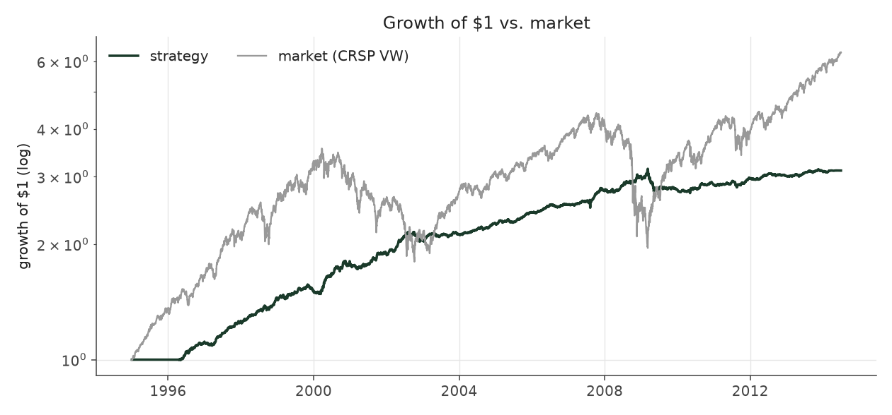
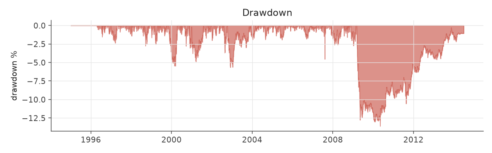
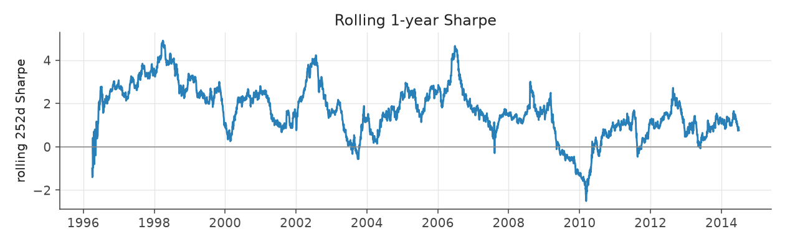
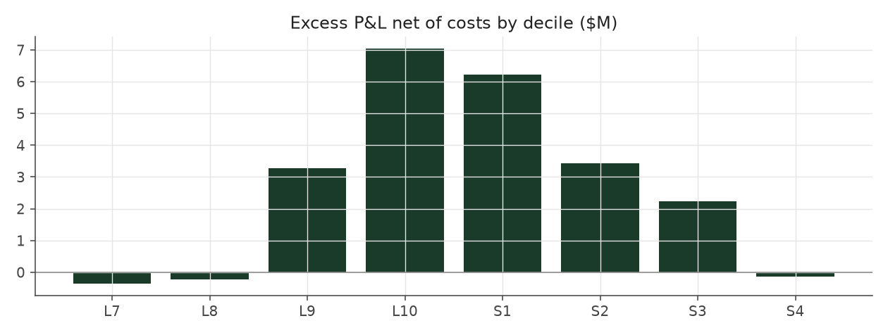

# calm_rank_tilt

_equity strategy | family: equity-volatility | status: research | derived from `calm_weighted`_

## What this strategy does

Balanced Leverage, with bets shrunk sharply for the jumpiest stocks (ranked against last quarter)

**Why it should work.** PEAD alpha per dollar is highest in calm stocks; rank-weight toward them without depending on vol levels.

**Design notes** (from the strategy's source file).

Calm Rank Tilt -- Balanced Leverage, tilted hard toward the calmest stocks by volatility RANK (research).

Calm Weighted sized each event by 1/idiosyncratic-vol (Sharpe 1.30 -> 1.47). The attribution work showed that PEAD alpha per dollar is concentrated in low-volatility names and almost absent in the wildest tercile, and that the 1/vol weight, being linear in the vol LEVEL, only mildly demotes the high-vol tail. Weighting by (1.02 - vol percentile)^2 -- where the percentile is measured against the previous quarter's cross-section within the stock's size quintile -- demotes it hard while staying smooth:

Sharpe 1.30 (Balanced Leverage) -> 1.47 (Calm Weighted) -> 1.81; max drawdown -16.6% -> -11.6%; every era improves split-sample check: exponent picked on 1996-2004 data alone (best k ~ 3) lifts 2005-2013 Sharpe 0.93 -> 1.10, the same as the full-sample best, so the gain is not an artifact of one period.

Lower volatility buys room: `calm_rank_levered` spends it on 1.7x the base unit and a 4x gross cap for ~9% a year at ~5% vol (a market-neutral book clearing the S&P 500's return in this sample). More sizing than that stops paying: the 5%-of-ADV liquidity cap starts to bind and 2008-13 Sharpe decays.

STATUS research: the exponent and sizing were chosen after seeing Calm Weighted's full-sample results (the split-sample check above is the only out-of-sample evidence), and the levered variant leans on small-cap capacity.

| parameter | value |
|---|---|
| base_unit_fraction | 0.003 |
| max_gross_leverage | 2.5 |
| liquidity_cap_frac | 0.05 |
| return_basis | mktadj |
| cap_mode | priority |
| exposure_cap | open_book |
| beta_overlay | 0.0 |

## Performance

| metric | calm_rank_tilt | market (CRSP VW) |
|---|---|---|
| Annualized return | 6.01% | 9.94% |
| Annualized volatility | 4.04% | 19.35% |
| Sharpe (NAV-pct) | 1.47 | 0.59 |
| Sortino | 2.20 |  |
| Max drawdown | -13.6% | -55.5% |
| Calmar | 0.44 |  |
| Final NAV ($10M start) | $31,136,472 |  |
| Worst day | -2.74% |  |
| % positive days | 51.6% |  |
| Sharpe 1996-2001 | 2.31 |  |
| Sharpe 2002-2007 | 1.63 |  |
| Sharpe 2008-2013 | 0.51 |  |

Correlation of daily returns with the market: **-0.09**.

- best Sharpe among equity: this strategy; this one: 1.47
- best return among equity: `market_boost_max` (0.15); this one: 0.0601
- best Calmar among equity: this strategy; this one: 0.442

*NAV (log scale)*

*Drawdown from running peak*

*Calendar-year returns*

*Is the edge stable, or concentrated in a few years?*

## Where the return comes from

*Long leg vs. short leg vs. total*

|  | long leg | short leg |
|---|---|---|
| P&L ($M, before costs) | 36.73 | -9.40 |
| P&L after costs ($M) | 33.72 | -12.58 |
| of which common (average-event) component ($M) | 23.99 | -24.33 |
| of which excess / PEAD component ($M) | 12.74 | 14.93 |
| excess minus costs ($M) | 9.73 | 11.75 |
| gross return per $ traded (bp) | 242.68 | -61.14 |
| positions in the money (hit rate) | 0.56 | 0.48 |
| stand-alone Sharpe (leg only) | 1.35 | -0.26 |

Daily P&L correlation between the two legs: **-0.78**.

- **The short leg loses money in absolute terms** (-9.4M before costs) while the long leg earns +36.7M. That is mostly a benchmark effect, not a signal failure: the average earnings-event stock beat the cap-weighted market during its holding window, which flatters the long leg and hurts the short leg by 24.0M / 24.3M. Stripping that common component, the surprise signal itself earned +12.7M on the long side and +14.9M on the short side.
- The two legs' daily P&L are -0.78 correlated: the short leg is the hedge that makes the long leg's variance disappear (stand-alone leg Sharpe 1.35 long / -0.26 short vs 1.47 combined).

### By decile and side (signal-driven part only)

| leg | decile | positions | notional_M | net_pnl_M | excess_M | cost_M | alpha_net_M | alpha_share | alpha_bp_per_$ |
|---|---|---|---|---|---|---|---|---|---|
| long | 7 | 6,035 | 104.53 | 1.45 | -0.15 | 0.21 | -0.36 | -1.7% | -34.79 |
| long | 8 | 15,853 | 342.73 | 5.87 | 0.47 | 0.68 | -0.22 | -1.0% | -6.39 |
| long | 9 | 17,910 | 462.42 | 9.63 | 4.18 | 0.91 | 3.27 | 15.2% | 70.70 |
| long | 10 | 19,474 | 603.92 | 16.76 | 8.25 | 1.21 | 7.04 | 32.8% | 116.56 |
| short | 1 | 17,681 | 587.44 | -3.43 | 7.48 | 1.26 | 6.21 | 28.9% | 105.79 |
| short | 2 | 18,145 | 529.86 | -5.05 | 4.52 | 1.08 | 3.43 | 16.0% | 64.76 |
| short | 3 | 14,451 | 375.14 | -3.34 | 2.99 | 0.75 | 2.24 | 10.4% | 59.79 |
| short | 4 | 2,253 | 44.76 | -0.76 | -0.06 | 0.08 | -0.14 | -0.6% | -31.06 |

*D10 and the short deciles carry the alpha; the middle of each leg earns little*

### By size quintile (1 = smallest)

| size_quintile | positions | notional_M | net_pnl_M | excess_M | cost_M | alpha_net_M | alpha_share | alpha_bp_per_$ |
|---|---|---|---|---|---|---|---|---|
| 1 | 13,415 | 239.05 | 1.23 | 2.68 | 0.94 | 1.74 | 8.1% | 72.91 |
| 2 | 21,312 | 542.52 | 5.65 | 7.47 | 1.57 | 5.90 | 27.5% | 108.76 |
| 3 | 23,965 | 699.07 | 5.97 | 7.47 | 1.53 | 5.94 | 27.7% | 85.02 |
| 4 | 26,031 | 776.73 | 5.44 | 6.47 | 1.27 | 5.20 | 24.2% | 66.93 |
| 5 | 27,079 | 793.45 | 2.85 | 3.58 | 0.89 | 2.69 | 12.5% | 33.91 |

### By liquidity quintile (1 = least liquid)

| liquidity_quintile | positions | notional_M | net_pnl_M | excess_M | cost_M | alpha_net_M | alpha_share | alpha_bp_per_$ |
|---|---|---|---|---|---|---|---|---|
| 1 | 12,819 | 192.50 | 2.26 | 3.52 | 0.96 | 2.56 | 11.9% | 132.96 |
| 2 | 21,720 | 642.79 | 4.99 | 7.90 | 1.93 | 5.97 | 27.8% | 92.95 |
| 3 | 24,297 | 794.77 | 6.97 | 8.52 | 1.59 | 6.93 | 32.3% | 87.16 |
| 4 | 25,919 | 739.49 | 4.43 | 5.00 | 1.03 | 3.97 | 18.5% | 53.66 |
| 5 | 27,043 | 681.16 | 2.46 | 2.70 | 0.68 | 2.02 | 9.4% | 29.68 |

### By holding-window length

| hold_bucket | positions | notional_M | net_pnl_M | excess_M | cost_M | alpha_net_M | alpha_share | alpha_bp_per_$ |
|---|---|---|---|---|---|---|---|---|
| <=40d | 39,832 | 1,082.10 | 1.89 | 9.87 | 2.07 | 7.80 | 36.3% | 72.05 |
| 41-60d | 26,568 | 773.40 | 4.74 | 7.77 | 1.71 | 6.06 | 28.2% | 78.32 |
| 61-90d | 36,286 | 967.96 | 10.05 | 6.16 | 1.78 | 4.38 | 20.4% | 45.27 |
| >90d | 9,116 | 227.35 | 4.46 | 3.87 | 0.63 | 3.24 | 15.1% | 142.55 |

### By era

| era | positions | notional_M | net_pnl_M | excess_M | cost_M | alpha_net_M | alpha_share | alpha_bp_per_$ |
|---|---|---|---|---|---|---|---|---|
| 1996-01 | 32,241 | 608.27 | 9.26 | 10.60 | 1.22 | 9.39 | 43.7% | 154.33 |
| 2002-07 | 36,999 | 1,061.00 | 8.16 | 9.99 | 2.11 | 7.88 | 36.7% | 74.24 |
| 2008-13 | 42,562 | 1,381.53 | 3.72 | 7.08 | 2.87 | 4.21 | 19.6% | 30.48 |

### By FF12 sector

| ff12_sector | positions | notional_M | net_pnl_M | excess_M | cost_M | alpha_net_M | alpha_share | alpha_bp_per_$ |
|---|---|---|---|---|---|---|---|---|
| BusEq | 20,214 | 298.84 | 2.27 | 2.80 | 0.65 | 2.15 | 10.0% | 72.01 |
| Chems | 2,495 | 204.06 | 1.24 | 1.57 | 0.36 | 1.21 | 5.7% | 59.49 |
| Durbl | 2,774 | 217.97 | 1.31 | 1.80 | 0.40 | 1.40 | 6.5% | 64.31 |
| Enrgy | 6,062 | 242.48 | 2.38 | 2.90 | 0.46 | 2.44 | 11.4% | 100.63 |
| Hlth | 10,828 | 288.60 | 1.24 | 1.81 | 0.60 | 1.21 | 5.6% | 41.87 |
| Manuf | 11,469 | 276.55 | 1.52 | 2.24 | 0.58 | 1.66 | 7.7% | 59.98 |
| Money | 16,275 | 267.89 | 2.41 | 3.10 | 0.61 | 2.49 | 11.6% | 92.85 |
| NoDur | 4,828 | 247.96 | 1.54 | 1.96 | 0.47 | 1.49 | 6.9% | 60.02 |
| Other | 16,968 | 289.39 | 2.61 | 3.33 | 0.66 | 2.68 | 12.5% | 92.47 |
| Shops | 11,324 | 284.11 | 2.35 | 2.90 | 0.60 | 2.30 | 10.7% | 80.90 |
| Telcm | 3,887 | 233.43 | 1.78 | 2.21 | 0.43 | 1.79 | 8.3% | 76.49 |
| Utils | 4,678 | 199.52 | 0.49 | 1.03 | 0.37 | 0.67 | 3.1% | 33.34 |

### By idiosyncratic-volatility tercile

| vol_tercile | positions | notional_M | net_pnl_M | excess_M | cost_M | alpha_net_M | alpha_share | alpha_bp_per_$ |
|---|---|---|---|---|---|---|---|---|
| high vol | 35,928 | 249.00 | 1.63 | 2.32 | 0.47 | 1.85 | 8.6% | 74.44 |
| low vol | 38,443 | 1,738.39 | 12.00 | 16.30 | 3.64 | 12.67 | 59.0% | 72.86 |
| mid vol | 35,681 | 1,009.55 | 6.70 | 8.19 | 1.98 | 6.21 | 28.9% | 61.52 |

### Short-borrow sensitivity (not modeled in the backtest)

| borrow_rate | fee_M | annualized_return | drag |
|---|---|---|---|
| 0.0% | 0.0 | 6.01% | -0.00% |
| 0.5% | 1.5 | 5.73% | 0.27% |
| 1.0% | 3.1 | 5.44% | 0.56% |
| 2.0% | 6.1 | 4.82% | 1.18% |
| 5.0% | 15.3 | 2.39% | 3.62% |

The engine charges the same transaction cost on shorts as on longs and no stock-borrow fee. The short leg is concentrated in small, illiquid names, where borrow is scarce and expensive -- read the table as a floor on the cost of running the short leg.
