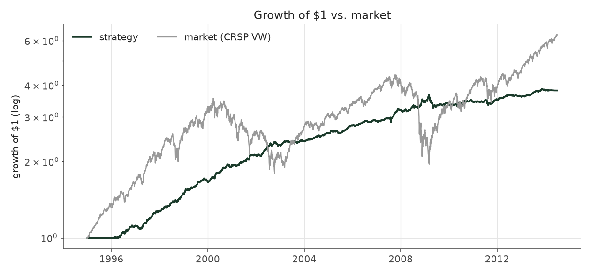
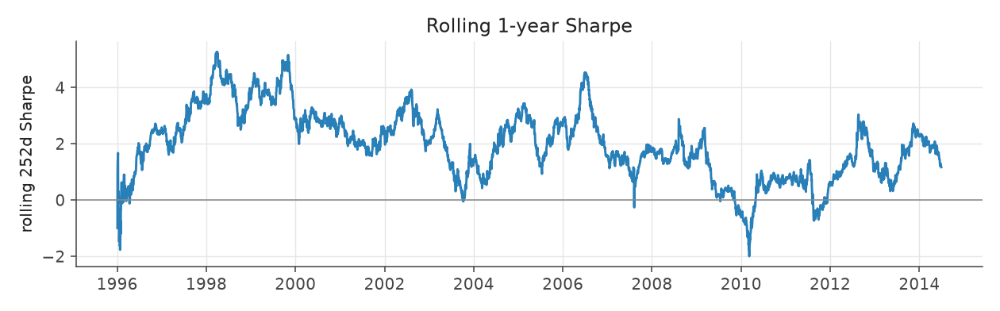

# calm_rank_tilt_legacy

_equity strategy | family: equity-volatility | status: reference | derived from `calm_rank_tilt`_

## What this strategy does

Balanced Leverage, with bets shrunk sharply for the jumpiest stocks (ranked against last quarter) -- ORIGINAL leverage cap (new positions only, open book ignored)

**Why it should work.** PEAD alpha per dollar is highest in calm stocks; rank-weight toward them without depending on vol levels.

**Design notes** (from the strategy's source file).

Calm Rank Tilt -- Balanced Leverage, tilted hard toward the calmest stocks by volatility RANK (research).

Calm Weighted sized each event by 1/idiosyncratic-vol (pre-fix Sharpe 1.30 -> 1.47; corrected run 1.09 -> 1.24). The attribution work showed that PEAD alpha per dollar is concentrated in low-volatility names and almost absent in the wildest tercile, and that the 1/vol weight, being linear in the vol LEVEL, only mildly demotes the high-vol tail. Weighting by (1.02 - vol percentile)^2 -- where the percentile is measured against the previous quarter's cross-section within the stock's size quintile -- demotes it hard while staying smooth:

Corrected run: Sharpe 1.09 (Balanced Leverage) -> 1.24 (Calm Weighted) -> 1.47; max drawdown -18.6% -> -17.5% -> -13.6%; every era improves (pre-fix: 1.30 -> 1.47 -> 1.81, -16.6% -> -11.6%) split-sample check: exponent picked on 1996-2004 data alone (best k ~ 3) lifts 2005-2013 Sharpe 0.93 -> 1.10 (pre-fix, not re-run), the same as the full-sample best, so the gain is not an artifact of one period.

Lower volatility buys room: `calm_rank_levered` spends it on 1.7x the base unit and a 4x gross cap for ~9% a year at ~5% vol (a market-neutral book clearing the S&P 500's return in this sample). More sizing than that stops paying: the 5%-of-ADV liquidity cap starts to bind and 2008-13 Sharpe decays.

STATUS research: the exponent and sizing were chosen after seeing Calm Weighted's full-sample results (the split-sample check above is the only out-of-sample evidence), and the levered variant leans on small-cap capacity.

| parameter | value |
|---|---|
| base_unit_fraction | 0.003 |
| max_gross_leverage | 2.5 |
| liquidity_cap_frac | 0.05 |
| return_basis | mktadj |
| cap_mode | priority |
| exposure_cap | entry_cohort |
| beta_overlay | 0.0 |

## Performance

| metric | calm_rank_tilt_legacy | market (CRSP VW) |
|---|---|---|
| Annualized return | 7.12% | 9.94% |
| Annualized volatility | 3.83% | 19.35% |
| Sharpe (NAV-pct) | 1.81 | 0.59 |
| Sortino | 2.77 |  |
| Max drawdown | -11.6% | -55.5% |
| Calmar | 0.61 |  |
| Final NAV ($10M start) | $38,141,081 |  |
| Worst day | -2.55% |  |
| % positive days | 52.7% |  |
| Sharpe 1996-2001 | 2.94 |  |
| Sharpe 2002-2007 | 1.89 |  |
| Sharpe 2008-2013 | 0.78 |  |

Correlation of daily returns with the market: **-0.01**.

- best Sharpe among equity: `calm_rank_tilt` (1.47); this one: 1.81
- best return among equity: `market_boost_max` (0.116); this one: 0.0712
- best Calmar among equity: `calm_rank_tilt` (0.442); this one: 0.614

*NAV (log scale)*

*Drawdown from running peak*

*Calendar-year returns*

*Is the edge stable, or concentrated in a few years?*

## Where the return comes from

*Long leg vs. short leg vs. total*

|  | long leg | short leg |
|---|---|---|
| P&L ($M, before costs) | 42.31 | -7.14 |
| P&L after costs ($M) | 38.92 | -10.78 |
| of which common (average-event) component ($M) | 27.21 | -27.43 |
| of which excess / PEAD component ($M) | 14.63 | 20.63 |
| excess minus costs ($M) | 11.26 | 17.01 |
| gross return per $ traded (bp) | 244.60 | -40.33 |
| positions in the money (hit rate) | 0.56 | 0.49 |
| stand-alone Sharpe (leg only) | 1.48 | -0.16 |

Daily P&L correlation between the two legs: **-0.79**.

- **The short leg loses money in absolute terms** (-7.1M before costs) while the long leg earns +42.3M. That is mostly a benchmark effect, not a signal failure: the average earnings-event stock beat the cap-weighted market during its holding window, which flatters the long leg and hurts the short leg by 27.2M / 27.4M. Stripping that common component, the surprise signal itself earned +14.6M on the long side and +20.6M on the short side.
- The two legs' daily P&L are -0.79 correlated: the short leg is the hedge that makes the long leg's variance disappear (stand-alone leg Sharpe 1.48 long / -0.16 short vs 1.81 combined).

### By decile and side (signal-driven part only)

| leg | decile | positions | notional_M | net_pnl_M | excess_M | cost_M | alpha_net_M | alpha_share | alpha_bp_per_$ |
|---|---|---|---|---|---|---|---|---|---|
| long | 7 | 8,029 | 158.66 | 2.31 | -0.44 | 0.31 | -0.75 | -2.6% | -47.07 |
| long | 8 | 16,588 | 415.11 | 8.24 | 2.10 | 0.82 | 1.29 | 4.5% | 30.98 |
| long | 9 | 17,747 | 535.73 | 9.62 | 2.97 | 1.03 | 1.93 | 6.8% | 36.09 |
| long | 10 | 17,174 | 620.10 | 18.75 | 10.00 | 1.22 | 8.78 | 31.0% | 141.52 |
| short | 1 | 17,169 | 611.53 | -2.46 | 7.59 | 1.31 | 6.27 | 22.2% | 102.54 |
| short | 2 | 17,281 | 543.16 | -3.69 | 6.58 | 1.11 | 5.48 | 19.4% | 100.81 |
| short | 3 | 15,970 | 433.58 | -3.41 | 4.41 | 0.87 | 3.54 | 12.5% | 81.67 |
| short | 4 | 9,171 | 182.37 | -1.23 | 2.05 | 0.35 | 1.70 | 6.0% | 93.45 |

*D10 and the short deciles carry the alpha; the middle of each leg earns little*

### By size quintile (1 = smallest)

| size_quintile | positions | notional_M | net_pnl_M | excess_M | cost_M | alpha_net_M | alpha_share | alpha_bp_per_$ |
|---|---|---|---|---|---|---|---|---|
| 1 | 14,213 | 258.09 | 5.07 | 6.75 | 1.01 | 5.74 | 20.3% | 222.50 |
| 2 | 22,885 | 608.55 | 6.10 | 7.95 | 1.76 | 6.19 | 21.9% | 101.79 |
| 3 | 25,501 | 801.21 | 7.23 | 8.64 | 1.75 | 6.90 | 24.4% | 86.10 |
| 4 | 27,583 | 905.05 | 6.03 | 7.29 | 1.48 | 5.81 | 20.5% | 64.16 |
| 5 | 28,947 | 927.33 | 3.71 | 4.63 | 1.03 | 3.60 | 12.7% | 38.79 |

### By liquidity quintile (1 = least liquid)

| liquidity_quintile | positions | notional_M | net_pnl_M | excess_M | cost_M | alpha_net_M | alpha_share | alpha_bp_per_$ |
|---|---|---|---|---|---|---|---|---|
| 1 | 13,650 | 208.10 | 4.29 | 5.69 | 1.04 | 4.65 | 16.4% | 223.25 |
| 2 | 23,084 | 716.85 | 6.64 | 9.78 | 2.15 | 7.63 | 27.0% | 106.46 |
| 3 | 25,851 | 912.90 | 8.09 | 9.95 | 1.83 | 8.12 | 28.7% | 88.98 |
| 4 | 27,665 | 861.29 | 5.41 | 5.80 | 1.21 | 4.60 | 16.3% | 53.37 |
| 5 | 28,874 | 800.98 | 3.71 | 4.03 | 0.80 | 3.23 | 11.4% | 40.28 |

### By holding-window length

| hold_bucket | positions | notional_M | net_pnl_M | excess_M | cost_M | alpha_net_M | alpha_share | alpha_bp_per_$ |
|---|---|---|---|---|---|---|---|---|
| <=40d | 45,855 | 1,393.64 | 2.33 | 9.90 | 2.49 | 7.41 | 26.2% | 53.15 |
| 41-60d | 25,652 | 807.71 | 6.04 | 5.77 | 1.65 | 4.12 | 14.6% | 51.01 |
| 61-90d | 35,324 | 966.11 | 8.08 | 9.17 | 2.05 | 7.12 | 25.2% | 73.66 |
| >90d | 12,298 | 332.76 | 11.69 | 10.43 | 0.83 | 9.60 | 33.9% | 288.35 |

### By era

| era | positions | notional_M | net_pnl_M | excess_M | cost_M | alpha_net_M | alpha_share | alpha_bp_per_$ |
|---|---|---|---|---|---|---|---|---|
| 1996-01 | 33,895 | 660.14 | 11.04 | 12.39 | 1.31 | 11.08 | 39.2% | 167.87 |
| 2002-07 | 39,956 | 1,201.49 | 10.83 | 12.96 | 2.37 | 10.60 | 37.5% | 88.18 |
| 2008-13 | 45,278 | 1,638.60 | 6.27 | 9.91 | 3.35 | 6.56 | 23.2% | 40.05 |

### By FF12 sector

| ff12_sector | positions | notional_M | net_pnl_M | excess_M | cost_M | alpha_net_M | alpha_share | alpha_bp_per_$ |
|---|---|---|---|---|---|---|---|---|
| BusEq | 22,094 | 348.54 | 3.31 | 3.99 | 0.76 | 3.23 | 11.4% | 92.82 |
| Chems | 2,590 | 232.45 | 1.79 | 2.07 | 0.40 | 1.67 | 5.9% | 71.87 |
| Durbl | 2,843 | 247.37 | 1.98 | 2.44 | 0.44 | 1.99 | 7.0% | 80.56 |
| Enrgy | 6,194 | 273.83 | 3.43 | 4.03 | 0.51 | 3.51 | 12.4% | 128.29 |
| Hlth | 11,696 | 332.40 | 2.17 | 2.76 | 0.69 | 2.07 | 7.3% | 62.28 |
| Manuf | 12,034 | 318.17 | 2.01 | 2.73 | 0.66 | 2.07 | 7.3% | 64.96 |
| Money | 17,583 | 315.04 | 2.93 | 3.77 | 0.71 | 3.06 | 10.8% | 97.27 |
| NoDur | 5,081 | 282.00 | 1.73 | 2.20 | 0.53 | 1.67 | 5.9% | 59.07 |
| Other | 18,377 | 338.29 | 3.08 | 3.97 | 0.76 | 3.20 | 11.3% | 94.65 |
| Shops | 11,984 | 326.93 | 3.01 | 3.61 | 0.68 | 2.93 | 10.4% | 89.71 |
| Telcm | 3,981 | 259.18 | 1.94 | 2.36 | 0.46 | 1.90 | 6.7% | 73.13 |
| Utils | 4,672 | 226.03 | 0.76 | 1.34 | 0.41 | 0.93 | 3.3% | 41.15 |

### By idiosyncratic-volatility tercile

| vol_tercile | positions | notional_M | net_pnl_M | excess_M | cost_M | alpha_net_M | alpha_share | alpha_bp_per_$ |
|---|---|---|---|---|---|---|---|---|
| high vol | 39,523 | 293.11 | 3.29 | 4.03 | 0.55 | 3.48 | 12.3% | 118.82 |
| low vol | 40,091 | 1,985.36 | 14.71 | 19.34 | 4.09 | 15.25 | 53.9% | 76.81 |
| mid vol | 37,903 | 1,165.50 | 9.67 | 11.48 | 2.26 | 9.22 | 32.6% | 79.12 |

### Short-borrow sensitivity (not modeled in the backtest)

| borrow_rate | fee_M | annualized_return | drag |
|---|---|---|---|
| 0.0% | 0.0 | 7.12% | -0.00% |
| 0.5% | 1.8 | 6.85% | 0.26% |
| 1.0% | 3.5 | 6.58% | 0.53% |
| 2.0% | 7.1 | 5.99% | 1.12% |
| 5.0% | 17.7 | 3.74% | 3.37% |

The engine charges the same transaction cost on shorts as on longs and no stock-borrow fee. The short leg is concentrated in small, illiquid names, where borrow is scarce and expensive -- read the table as a floor on the cost of running the short leg.
