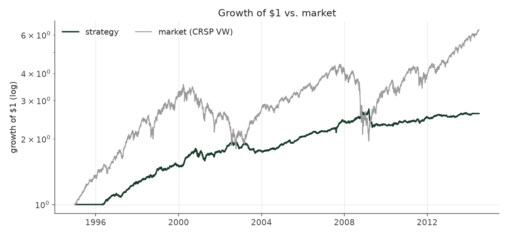
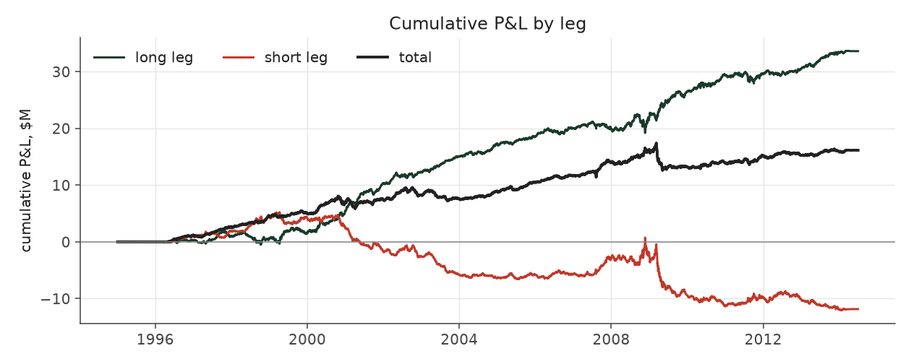
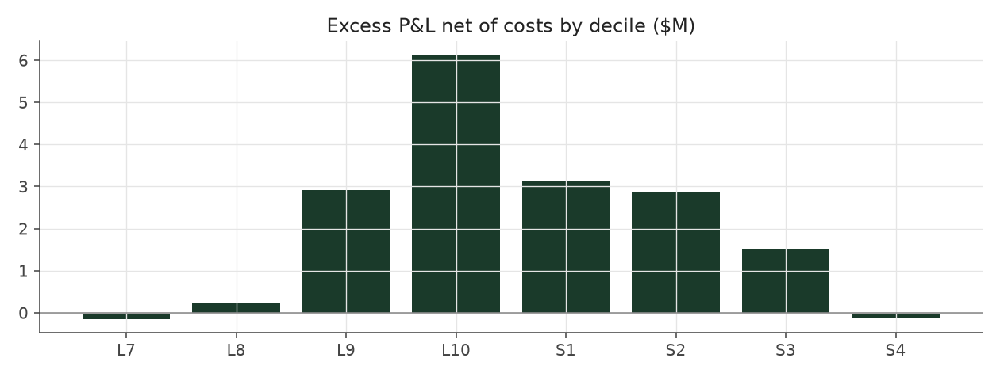

# calm_weighted_filter

_equity strategy | family: equity-volatility | status: research | derived from `balanced_leverage`_

## What this strategy does

Calm Weighted plus the Volatility Filter

**Why it should work.** Skip the cells that history says do not pay -- but the data shows a gradient, not a bad cell.

**Design notes** (from the strategy's source file).

Volatility Filter (and Calm Weighted Filter) -- skip stock groups that have not paid, judged only on past data.

Drops a (side, idio-vol tercile) cell from new entries when its own history says it has not earned its keep, judged ONLY on quarters whose positions had fully exited. Result: filtering does not help on its own (corrected run: Sharpe 0.89 vs 1.09 for Balanced Leverage; pre-fix 1.23 vs 1.30; the effect is a smooth gradient, not one broken cell) and adds nothing once inverse-vol sizing is on (corrected: Calm Weighted Filter 1.08 < Calm Weighted 1.24; pre-fix 1.41 < 1.47). Kept as a documented negative result: size by vol, do not filter by it.

| parameter | value |
|---|---|
| base_unit_fraction | 0.003 |
| max_gross_leverage | 2.5 |
| liquidity_cap_frac | 0.05 |
| return_basis | mktadj |
| cap_mode | priority |
| exposure_cap | open_book |
| beta_overlay | 0.0 |

## Performance

| metric | calm_weighted_filter | market (CRSP VW) |
|---|---|---|
| Annualized return | 5.06% | 9.94% |
| Annualized volatility | 4.66% | 19.35% |
| Sharpe (NAV-pct) | 1.08 | 0.59 |
| Sortino | 1.56 |  |
| Max drawdown | -17.6% | -55.5% |
| Calmar | 0.29 |  |
| Final NAV ($10M start) | $26,144,178 |  |
| Worst day | -3.94% |  |
| % positive days | 50.1% |  |
| Sharpe 1996-2001 | 1.79 |  |
| Sharpe 2002-2007 | 1.22 |  |
| Sharpe 2008-2013 | 0.30 |  |

Correlation of daily returns with the market: **-0.01**.

- best Sharpe among equity: `calm_rank_tilt` (1.47); this one: 1.08
- best return among equity: `market_boost_max` (0.116); this one: 0.0506
- best Calmar among equity: `calm_rank_tilt` (0.442); this one: 0.287

*NAV (log scale)*

*Drawdown from running peak*

*Calendar-year returns*

*Is the edge stable, or concentrated in a few years?*

## Where the return comes from

*Long leg vs. short leg vs. total*

|  | long leg | short leg |
|---|---|---|
| P&L ($M, before costs) | 33.61 | -11.85 |
| P&L after costs ($M) | 30.87 | -14.73 |
| of which common (average-event) component ($M) | 21.76 | -22.12 |
| of which excess / PEAD component ($M) | 11.84 | 10.26 |
| excess minus costs ($M) | 9.11 | 7.39 |
| gross return per $ traded (bp) | 247.89 | -86.16 |
| positions in the money (hit rate) | 0.56 | 0.48 |
| stand-alone Sharpe (leg only) | 1.27 | -0.35 |

Daily P&L correlation between the two legs: **-0.78**.

- **The short leg loses money in absolute terms** (-11.9M before costs) while the long leg earns +33.6M. That is mostly a benchmark effect, not a signal failure: the average earnings-event stock beat the cap-weighted market during its holding window, which flatters the long leg and hurts the short leg by 21.8M / 22.1M. Stripping that common component, the surprise signal itself earned +11.8M on the long side and +10.3M on the short side.
- The two legs' daily P&L are -0.78 correlated: the short leg is the hedge that makes the long leg's variance disappear (stand-alone leg Sharpe 1.27 long / -0.35 short vs 1.08 combined).

### By decile and side (signal-driven part only)

| leg | decile | positions | notional_M | net_pnl_M | excess_M | cost_M | alpha_net_M | alpha_share | alpha_bp_per_$ |
|---|---|---|---|---|---|---|---|---|---|
| long | 7 | 5,871 | 89.22 | 1.37 | 0.03 | 0.18 | -0.16 | -0.9% | -17.51 |
| long | 8 | 15,155 | 299.11 | 5.64 | 0.84 | 0.60 | 0.23 | 1.4% | 7.77 |
| long | 9 | 17,504 | 416.74 | 8.68 | 3.74 | 0.83 | 2.90 | 17.6% | 69.70 |
| long | 10 | 19,169 | 550.70 | 15.18 | 7.24 | 1.11 | 6.13 | 37.2% | 111.32 |
| short | 1 | 17,106 | 542.00 | -5.99 | 4.30 | 1.18 | 3.12 | 18.9% | 57.61 |
| short | 2 | 17,545 | 473.90 | -4.81 | 3.85 | 0.98 | 2.88 | 17.4% | 60.69 |
| short | 3 | 13,895 | 320.77 | -3.27 | 2.18 | 0.65 | 1.53 | 9.3% | 47.64 |
| short | 4 | 2,188 | 39.07 | -0.66 | -0.07 | 0.07 | -0.14 | -0.8% | -35.64 |

*D10 and the short deciles carry the alpha; the middle of each leg earns little*

### By size quintile (1 = smallest)

| size_quintile | positions | notional_M | net_pnl_M | excess_M | cost_M | alpha_net_M | alpha_share | alpha_bp_per_$ |
|---|---|---|---|---|---|---|---|---|
| 1 | 13,004 | 255.30 | 0.39 | 1.95 | 0.99 | 0.95 | 5.8% | 37.37 |
| 2 | 20,713 | 514.35 | 5.21 | 6.96 | 1.47 | 5.49 | 33.3% | 106.67 |
| 3 | 23,276 | 621.98 | 4.67 | 5.96 | 1.33 | 4.62 | 28.0% | 74.31 |
| 4 | 25,115 | 665.12 | 3.69 | 4.51 | 1.07 | 3.44 | 20.9% | 51.75 |
| 5 | 26,325 | 674.75 | 2.18 | 2.74 | 0.75 | 1.99 | 12.1% | 29.55 |

### By liquidity quintile (1 = least liquid)

| liquidity_quintile | positions | notional_M | net_pnl_M | excess_M | cost_M | alpha_net_M | alpha_share | alpha_bp_per_$ |
|---|---|---|---|---|---|---|---|---|
| 1 | 12,449 | 196.55 | 2.26 | 3.60 | 0.98 | 2.62 | 15.9% | 133.42 |
| 2 | 21,246 | 575.59 | 3.51 | 6.05 | 1.73 | 4.32 | 26.2% | 75.11 |
| 3 | 23,678 | 680.72 | 5.17 | 6.64 | 1.36 | 5.27 | 32.0% | 77.48 |
| 4 | 25,037 | 650.42 | 3.36 | 3.77 | 0.91 | 2.85 | 17.3% | 43.88 |
| 5 | 26,019 | 627.99 | 1.80 | 2.00 | 0.63 | 1.37 | 8.3% | 21.82 |

### By holding-window length

| hold_bucket | positions | notional_M | net_pnl_M | excess_M | cost_M | alpha_net_M | alpha_share | alpha_bp_per_$ |
|---|---|---|---|---|---|---|---|---|
| <=40d | 38,507 | 942.57 | 0.42 | 7.51 | 1.82 | 5.70 | 34.5% | 60.41 |
| 41-60d | 25,725 | 689.22 | 2.88 | 5.70 | 1.54 | 4.17 | 25.3% | 60.47 |
| 61-90d | 35,271 | 885.01 | 7.93 | 4.68 | 1.65 | 3.03 | 18.4% | 34.21 |
| >90d | 8,930 | 214.70 | 4.91 | 4.21 | 0.60 | 3.61 | 21.9% | 168.08 |

### By era

| era | positions | notional_M | net_pnl_M | excess_M | cost_M | alpha_net_M | alpha_share | alpha_bp_per_$ |
|---|---|---|---|---|---|---|---|---|
| 1996-01 | 31,425 | 613.57 | 7.59 | 8.76 | 1.23 | 7.53 | 45.7% | 122.77 |
| 2002-07 | 34,959 | 926.36 | 6.15 | 7.96 | 1.86 | 6.10 | 37.0% | 65.84 |
| 2008-13 | 42,049 | 1,191.57 | 2.41 | 5.39 | 2.52 | 2.87 | 17.4% | 24.06 |

### By FF12 sector

| ff12_sector | positions | notional_M | net_pnl_M | excess_M | cost_M | alpha_net_M | alpha_share | alpha_bp_per_$ |
|---|---|---|---|---|---|---|---|---|
| BusEq | 18,852 | 261.58 | 0.75 | 1.25 | 0.57 | 0.69 | 4.2% | 26.36 |
| Chems | 2,525 | 185.06 | 0.65 | 1.00 | 0.33 | 0.67 | 4.0% | 35.97 |
| Durbl | 2,773 | 200.88 | 1.43 | 1.90 | 0.38 | 1.52 | 9.2% | 75.77 |
| Enrgy | 6,141 | 225.35 | 2.43 | 2.88 | 0.43 | 2.44 | 14.8% | 108.35 |
| Hlth | 10,512 | 259.75 | 0.94 | 1.48 | 0.55 | 0.92 | 5.6% | 35.56 |
| Manuf | 11,360 | 244.18 | 1.24 | 1.86 | 0.52 | 1.34 | 8.1% | 54.91 |
| Money | 15,637 | 228.86 | 2.01 | 2.59 | 0.53 | 2.06 | 12.5% | 89.94 |
| NoDur | 4,847 | 224.64 | 0.95 | 1.36 | 0.44 | 0.92 | 5.6% | 40.87 |
| Other | 16,250 | 250.10 | 1.98 | 2.60 | 0.57 | 2.03 | 12.3% | 81.05 |
| Shops | 11,154 | 254.68 | 2.43 | 2.95 | 0.54 | 2.41 | 14.6% | 94.58 |
| Telcm | 3,734 | 220.55 | 1.21 | 1.61 | 0.41 | 1.20 | 7.3% | 54.42 |
| Utils | 4,648 | 175.88 | 0.11 | 0.63 | 0.33 | 0.30 | 1.8% | 17.22 |

### By idiosyncratic-volatility tercile

| vol_tercile | positions | notional_M | net_pnl_M | excess_M | cost_M | alpha_net_M | alpha_share | alpha_bp_per_$ |
|---|---|---|---|---|---|---|---|---|
| high vol | 33,394 | 606.86 | -0.11 | 1.82 | 1.14 | 0.69 | 4.2% | 11.31 |
| low vol | 37,832 | 1,166.70 | 8.85 | 11.57 | 2.56 | 9.01 | 54.6% | 77.24 |
| mid vol | 35,470 | 912.90 | 6.54 | 7.77 | 1.82 | 5.95 | 36.1% | 65.22 |

### Short-borrow sensitivity (not modeled in the backtest)

| borrow_rate | fee_M | annualized_return | drag |
|---|---|---|---|
| 0.0% | 0.0 | 5.06% | -0.00% |
| 0.5% | 1.4 | 4.77% | 0.29% |
| 1.0% | 2.8 | 4.46% | 0.60% |
| 2.0% | 5.5 | 3.78% | 1.28% |
| 5.0% | 13.8 | 1.07% | 3.99% |

The engine charges the same transaction cost on shorts as on longs and no stock-borrow fee. The short leg is concentrated in small, illiquid names, where borrow is scarce and expensive -- read the table as a floor on the cost of running the short leg.
