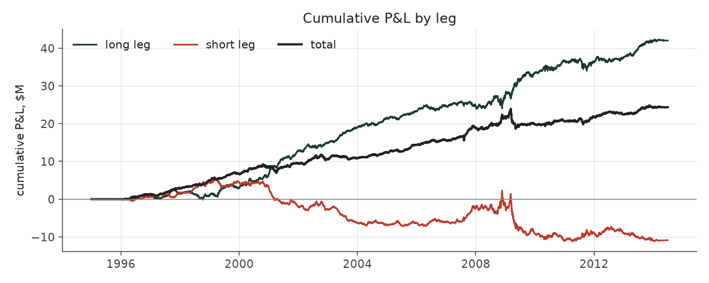
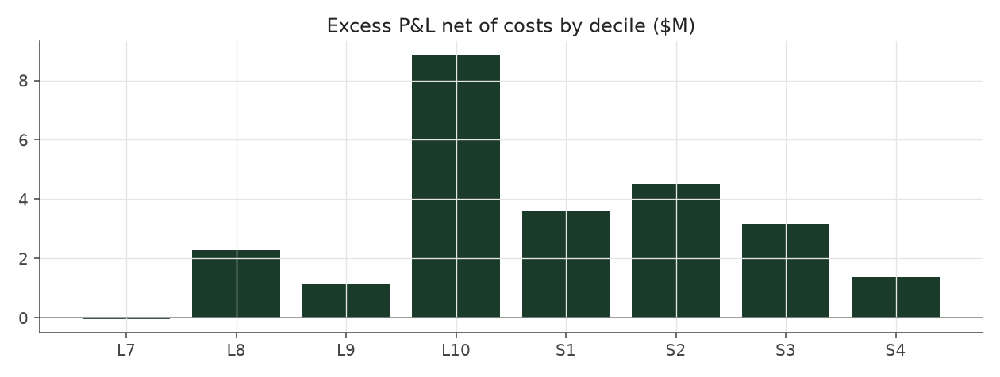

# calm_weighted_filter_legacy

_equity strategy | family: equity-volatility | status: reference | derived from `calm_weighted_filter`_

## What this strategy does

Calm Weighted plus the Volatility Filter -- ORIGINAL leverage cap (new positions only, open book ignored)

**Why it should work.** Skip the cells that history says do not pay -- but the data shows a gradient, not a bad cell.

**Design notes** (from the strategy's source file).

Volatility Filter (and Calm Weighted Filter) -- skip stock groups that have not paid, judged only on past data.

Drops a (side, idio-vol tercile) cell from new entries when its own history says it has not earned its keep, judged ONLY on quarters whose positions had fully exited. Result: filtering does not help on its own (corrected run: Sharpe 0.89 vs 1.09 for Balanced Leverage; pre-fix 1.23 vs 1.30; the effect is a smooth gradient, not one broken cell) and adds nothing once inverse-vol sizing is on (corrected: Calm Weighted Filter 1.08 < Calm Weighted 1.24; pre-fix 1.41 < 1.47). Kept as a documented negative result: size by vol, do not filter by it.

| parameter | value |
|---|---|
| base_unit_fraction | 0.003 |
| max_gross_leverage | 2.5 |
| liquidity_cap_frac | 0.05 |
| return_basis | mktadj |
| cap_mode | priority |
| exposure_cap | entry_cohort |
| beta_overlay | 0.0 |

## Performance

| metric | calm_weighted_filter_legacy | market (CRSP VW) |
|---|---|---|
| Annualized return | 6.54% | 9.94% |
| Annualized volatility | 4.55% | 19.35% |
| Sharpe (NAV-pct) | 1.41 | 0.59 |
| Sortino | 2.07 |  |
| Max drawdown | -15.7% | -55.5% |
| Calmar | 0.42 |  |
| Final NAV ($10M start) | $34,340,070 |  |
| Worst day | -3.42% |  |
| % positive days | 52.3% |  |
| Sharpe 1996-2001 | 2.26 |  |
| Sharpe 2002-2007 | 1.57 |  |
| Sharpe 2008-2013 | 0.60 |  |

Correlation of daily returns with the market: **0.02**.

- best Sharpe among equity: `calm_rank_tilt` (1.47); this one: 1.41
- best return among equity: `market_boost_max` (0.116); this one: 0.0654
- best Calmar among equity: `calm_rank_tilt` (0.442); this one: 0.418

*NAV (log scale)*

*Drawdown from running peak*

*Calendar-year returns*

*Is the edge stable, or concentrated in a few years?*

## Where the return comes from

*Long leg vs. short leg vs. total*

|  | long leg | short leg |
|---|---|---|
| P&L ($M, before costs) | 42.03 | -10.89 |
| P&L after costs ($M) | 38.76 | -14.42 |
| of which common (average-event) component ($M) | 26.12 | -26.74 |
| of which excess / PEAD component ($M) | 15.49 | 16.16 |
| excess minus costs ($M) | 12.23 | 12.64 |
| gross return per $ traded (bp) | 253.44 | -64.00 |
| positions in the money (hit rate) | 0.56 | 0.49 |
| stand-alone Sharpe (leg only) | 1.33 | -0.25 |

Daily P&L correlation between the two legs: **-0.81**.

- **The short leg loses money in absolute terms** (-10.9M before costs) while the long leg earns +42.0M. That is mostly a benchmark effect, not a signal failure: the average earnings-event stock beat the cap-weighted market during its holding window, which flatters the long leg and hurts the short leg by 26.1M / 26.7M. Stripping that common component, the surprise signal itself earned +15.5M on the long side and +16.2M on the short side.
- The two legs' daily P&L are -0.81 correlated: the short leg is the hedge that makes the long leg's variance disappear (stand-alone leg Sharpe 1.33 long / -0.25 short vs 1.41 combined).

### By decile and side (signal-driven part only)

| leg | decile | positions | notional_M | net_pnl_M | excess_M | cost_M | alpha_net_M | alpha_share | alpha_bp_per_$ |
|---|---|---|---|---|---|---|---|---|---|
| long | 7 | 8,009 | 146.90 | 2.71 | 0.24 | 0.29 | -0.05 | -0.2% | -3.46 |
| long | 8 | 16,508 | 390.71 | 8.78 | 3.06 | 0.78 | 2.28 | 9.2% | 58.30 |
| long | 9 | 17,676 | 513.54 | 8.55 | 2.12 | 1.00 | 1.12 | 4.5% | 21.91 |
| long | 10 | 17,111 | 607.20 | 18.71 | 10.07 | 1.20 | 8.87 | 35.6% | 146.05 |
| short | 1 | 17,093 | 608.49 | -5.44 | 4.89 | 1.31 | 3.58 | 14.4% | 58.75 |
| short | 2 | 17,204 | 526.88 | -4.28 | 5.60 | 1.08 | 4.52 | 18.2% | 85.75 |
| short | 3 | 15,897 | 402.46 | -3.39 | 3.99 | 0.82 | 3.17 | 12.7% | 78.73 |
| short | 4 | 9,154 | 163.49 | -1.32 | 1.68 | 0.31 | 1.37 | 5.5% | 83.63 |

*D10 and the short deciles carry the alpha; the middle of each leg earns little*

### By size quintile (1 = smallest)

| size_quintile | positions | notional_M | net_pnl_M | excess_M | cost_M | alpha_net_M | alpha_share | alpha_bp_per_$ |
|---|---|---|---|---|---|---|---|---|
| 1 | 14,166 | 294.58 | 5.45 | 7.39 | 1.14 | 6.24 | 25.1% | 211.98 |
| 2 | 22,785 | 622.38 | 5.57 | 7.64 | 1.77 | 5.87 | 23.6% | 94.34 |
| 3 | 25,396 | 769.16 | 6.24 | 7.63 | 1.64 | 5.99 | 24.1% | 77.91 |
| 4 | 27,473 | 832.21 | 4.17 | 5.27 | 1.32 | 3.95 | 15.9% | 47.44 |
| 5 | 28,832 | 841.35 | 2.90 | 3.72 | 0.93 | 2.79 | 11.2% | 33.19 |

### By liquidity quintile (1 = least liquid)

| liquidity_quintile | positions | notional_M | net_pnl_M | excess_M | cost_M | alpha_net_M | alpha_share | alpha_bp_per_$ |
|---|---|---|---|---|---|---|---|---|
| 1 | 13,618 | 225.32 | 5.01 | 6.57 | 1.13 | 5.44 | 21.9% | 241.54 |
| 2 | 23,010 | 687.46 | 5.62 | 8.59 | 2.06 | 6.53 | 26.2% | 94.94 |
| 3 | 25,773 | 838.97 | 6.51 | 8.47 | 1.68 | 6.80 | 27.3% | 81.02 |
| 4 | 27,539 | 815.59 | 4.56 | 5.00 | 1.14 | 3.85 | 15.5% | 47.24 |
| 5 | 28,707 | 792.06 | 2.61 | 2.99 | 0.79 | 2.19 | 8.8% | 27.70 |

### By holding-window length

| hold_bucket | positions | notional_M | net_pnl_M | excess_M | cost_M | alpha_net_M | alpha_share | alpha_bp_per_$ |
|---|---|---|---|---|---|---|---|---|
| <=40d | 45,693 | 1,290.11 | 0.52 | 7.69 | 2.30 | 5.39 | 21.7% | 41.77 |
| 41-60d | 25,536 | 768.41 | 4.74 | 4.79 | 1.58 | 3.21 | 12.9% | 41.79 |
| 61-90d | 35,163 | 967.77 | 7.01 | 8.45 | 2.07 | 6.38 | 25.6% | 65.94 |
| >90d | 12,260 | 333.38 | 12.07 | 10.72 | 0.85 | 9.87 | 39.7% | 295.98 |

### By era

| era | positions | notional_M | net_pnl_M | excess_M | cost_M | alpha_net_M | alpha_share | alpha_bp_per_$ |
|---|---|---|---|---|---|---|---|---|
| 1996-01 | 33,652 | 683.38 | 9.27 | 10.68 | 1.35 | 9.33 | 37.5% | 136.48 |
| 2002-07 | 39,722 | 1,115.51 | 9.49 | 11.68 | 2.21 | 9.47 | 38.1% | 84.89 |
| 2008-13 | 45,278 | 1,560.78 | 5.58 | 9.29 | 3.24 | 6.05 | 24.3% | 38.78 |

### By FF12 sector

| ff12_sector | positions | notional_M | net_pnl_M | excess_M | cost_M | alpha_net_M | alpha_share | alpha_bp_per_$ |
|---|---|---|---|---|---|---|---|---|
| BusEq | 21,907 | 331.60 | 1.91 | 2.63 | 0.71 | 1.92 | 7.7% | 57.85 |
| Chems | 2,587 | 224.04 | 1.36 | 1.68 | 0.40 | 1.28 | 5.1% | 57.13 |
| Durbl | 2,836 | 241.66 | 2.31 | 2.81 | 0.44 | 2.37 | 9.5% | 98.06 |
| Enrgy | 6,186 | 271.01 | 3.68 | 4.27 | 0.51 | 3.76 | 15.1% | 138.70 |
| Hlth | 11,622 | 321.02 | 2.54 | 3.18 | 0.68 | 2.50 | 10.1% | 77.93 |
| Manuf | 12,007 | 300.44 | 1.79 | 2.50 | 0.63 | 1.87 | 7.5% | 62.26 |
| Money | 17,569 | 293.98 | 2.56 | 3.38 | 0.67 | 2.71 | 10.9% | 92.20 |
| NoDur | 5,074 | 270.67 | 1.34 | 1.83 | 0.52 | 1.32 | 5.3% | 48.65 |
| Other | 18,309 | 319.76 | 2.56 | 3.41 | 0.72 | 2.69 | 10.8% | 83.98 |
| Shops | 11,943 | 311.85 | 3.09 | 3.71 | 0.65 | 3.06 | 12.3% | 98.03 |
| Telcm | 3,942 | 263.04 | 0.64 | 1.12 | 0.48 | 0.64 | 2.6% | 24.16 |
| Utils | 4,670 | 210.60 | 0.56 | 1.13 | 0.39 | 0.74 | 3.0% | 35.37 |

### By idiosyncratic-volatility tercile

| vol_tercile | positions | notional_M | net_pnl_M | excess_M | cost_M | alpha_net_M | alpha_share | alpha_bp_per_$ |
|---|---|---|---|---|---|---|---|---|
| high vol | 39,046 | 814.48 | 3.66 | 6.05 | 1.51 | 4.54 | 18.3% | 55.80 |
| low vol | 40,091 | 1,402.43 | 11.45 | 14.69 | 3.03 | 11.66 | 46.9% | 83.17 |
| mid vol | 37,903 | 1,094.45 | 9.05 | 10.74 | 2.16 | 8.58 | 34.5% | 78.40 |

### Short-borrow sensitivity (not modeled in the backtest)

| borrow_rate | fee_M | annualized_return | drag |
|---|---|---|---|
| 0.0% | 0.0 | 6.54% | -0.00% |
| 0.5% | 1.7 | 6.26% | 0.28% |
| 1.0% | 3.4 | 5.96% | 0.57% |
| 2.0% | 6.9 | 5.33% | 1.21% |
| 5.0% | 17.2 | 2.81% | 3.73% |

The engine charges the same transaction cost on shorts as on longs and no stock-borrow fee. The short leg is concentrated in small, illiquid names, where borrow is scarce and expensive -- read the table as a floor on the cost of running the short leg.
