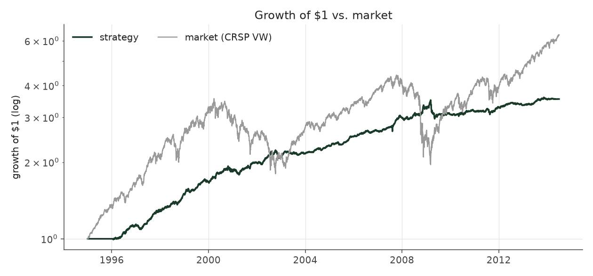
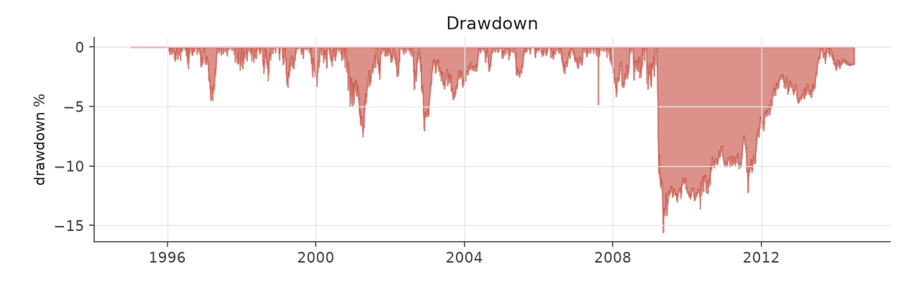
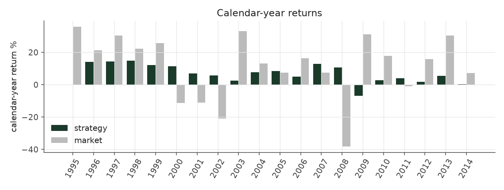
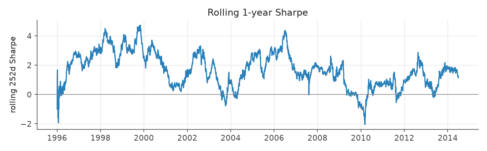
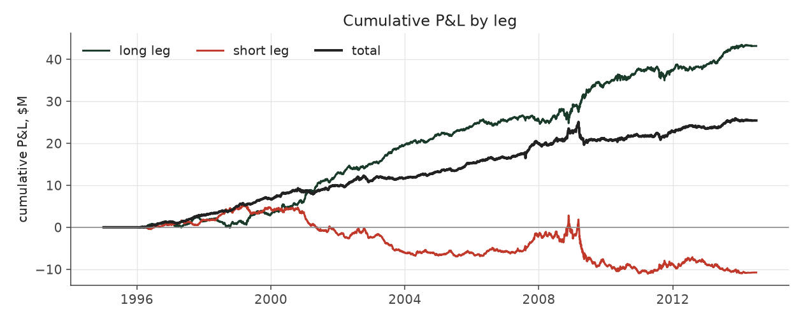
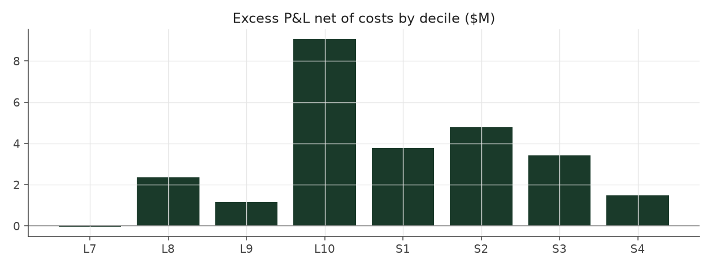

# calm_weighted_legacy

_equity strategy | family: equity-volatility | status: reference | derived from `calm_weighted`_

## What this strategy does

Balanced Leverage, with each bet divided by how jumpy the stock is -- ORIGINAL leverage cap (new positions only, open book ignored)

**Why it should work.** PEAD is a stronger, cleaner signal in low-vol stocks; size positions by inverse risk.

**Design notes** (from the strategy's source file).

Calm Weighted -- Balanced Leverage, with bigger bets on calmer stocks (sized by inverse idiosyncratic volatility).

Within every (quarter, side, sector, size) cell, each event's weight is scaled by 1/ivol, so calm stocks get more capital than wild ones. Rationale: the earnings drift is worth more per unit of risk in low-vol names (the SUE x vol interaction is t = -2.4 to -2.7 in Fama-MacBeth), and the engine's cost/liquidity model charges the same bps regardless of vol. Raises Sharpe with no fitted parameter, in all three sub-eras (corrected run: Balanced Leverage 1.09 -> Calm Weighted 1.24; pre-fix 1.30 -> 1.47).

`CalmWeightedMatched` re-sizes it to Balanced Leverage's exact volatility to answer "at the SAME risk, how much more return" (corrected run: 5.83% vs 5.38%; pre-fix 7.31% vs 6.49%).

| parameter | value |
|---|---|
| base_unit_fraction | 0.003 |
| max_gross_leverage | 2.5 |
| liquidity_cap_frac | 0.05 |
| return_basis | mktadj |
| cap_mode | priority |
| exposure_cap | entry_cohort |
| beta_overlay | 0.0 |

## Performance

| metric | calm_weighted_legacy | market (CRSP VW) |
|---|---|---|
| Annualized return | 6.71% | 9.94% |
| Annualized volatility | 4.49% | 19.35% |
| Sharpe (NAV-pct) | 1.47 | 0.59 |
| Sortino | 2.17 |  |
| Max drawdown | -15.6% | -55.5% |
| Calmar | 0.43 |  |
| Final NAV ($10M start) | $35,421,134 |  |
| Worst day | -3.36% |  |
| % positive days | 52.4% |  |
| Sharpe 1996-2001 | 2.40 |  |
| Sharpe 2002-2007 | 1.63 |  |
| Sharpe 2008-2013 | 0.59 |  |

Correlation of daily returns with the market: **0.01**.

- best Sharpe among equity: `calm_rank_tilt` (1.47); this one: 1.47
- best return among equity: `market_boost_max` (0.116); this one: 0.0671
- best Calmar among equity: `calm_rank_tilt` (0.442); this one: 0.43

*NAV (log scale)*

*Drawdown from running peak*

*Calendar-year returns*

*Is the edge stable, or concentrated in a few years?*

## Where the return comes from

*Long leg vs. short leg vs. total*

|  | long leg | short leg |
|---|---|---|
| P&L ($M, before costs) | 43.18 | -10.78 |
| P&L after costs ($M) | 39.82 | -14.40 |
| of which common (average-event) component ($M) | 26.87 | -27.54 |
| of which excess / PEAD component ($M) | 15.89 | 17.07 |
| excess minus costs ($M) | 12.55 | 13.46 |
| gross return per $ traded (bp) | 253.23 | -61.58 |
| positions in the money (hit rate) | 0.56 | 0.49 |
| stand-alone Sharpe (leg only) | 1.33 | -0.23 |

Daily P&L correlation between the two legs: **-0.81**.

- **The short leg loses money in absolute terms** (-10.8M before costs) while the long leg earns +43.2M. That is mostly a benchmark effect, not a signal failure: the average earnings-event stock beat the cap-weighted market during its holding window, which flatters the long leg and hurts the short leg by 26.9M / 27.5M. Stripping that common component, the surprise signal itself earned +15.9M on the long side and +17.1M on the short side.
- The two legs' daily P&L are -0.81 correlated: the short leg is the hedge that makes the long leg's variance disappear (stand-alone leg Sharpe 1.33 long / -0.23 short vs 1.47 combined).

### By decile and side (signal-driven part only)

| leg | decile | positions | notional_M | net_pnl_M | excess_M | cost_M | alpha_net_M | alpha_share | alpha_bp_per_$ |
|---|---|---|---|---|---|---|---|---|---|
| long | 7 | 8,029 | 151.20 | 2.79 | 0.24 | 0.30 | -0.05 | -0.2% | -3.54 |
| long | 8 | 16,588 | 401.72 | 9.02 | 3.15 | 0.80 | 2.35 | 9.0% | 58.56 |
| long | 9 | 17,747 | 528.00 | 8.81 | 2.19 | 1.02 | 1.17 | 4.5% | 22.07 |
| long | 10 | 17,174 | 624.27 | 19.20 | 10.31 | 1.24 | 9.07 | 34.9% | 145.32 |
| short | 1 | 17,169 | 625.49 | -5.50 | 5.11 | 1.35 | 3.76 | 14.5% | 60.16 |
| short | 2 | 17,281 | 542.85 | -4.32 | 5.89 | 1.11 | 4.78 | 18.4% | 88.01 |
| short | 3 | 15,970 | 414.21 | -3.31 | 4.26 | 0.84 | 3.42 | 13.2% | 82.66 |
| short | 4 | 9,171 | 168.10 | -1.27 | 1.81 | 0.32 | 1.48 | 5.7% | 88.22 |

*D10 and the short deciles carry the alpha; the middle of each leg earns little*

### By size quintile (1 = smallest)

| size_quintile | positions | notional_M | net_pnl_M | excess_M | cost_M | alpha_net_M | alpha_share | alpha_bp_per_$ |
|---|---|---|---|---|---|---|---|---|
| 1 | 14,213 | 299.80 | 5.47 | 7.45 | 1.16 | 6.29 | 24.2% | 209.68 |
| 2 | 22,885 | 638.69 | 5.81 | 7.95 | 1.82 | 6.13 | 23.6% | 96.03 |
| 3 | 25,501 | 791.87 | 6.65 | 8.07 | 1.68 | 6.39 | 24.6% | 80.73 |
| 4 | 27,583 | 858.14 | 4.41 | 5.57 | 1.36 | 4.21 | 16.2% | 49.00 |
| 5 | 28,947 | 867.35 | 3.09 | 3.92 | 0.96 | 2.97 | 11.4% | 34.20 |

### By liquidity quintile (1 = least liquid)

| liquidity_quintile | positions | notional_M | net_pnl_M | excess_M | cost_M | alpha_net_M | alpha_share | alpha_bp_per_$ |
|---|---|---|---|---|---|---|---|---|
| 1 | 13,650 | 228.45 | 5.04 | 6.63 | 1.14 | 5.48 | 21.1% | 240.05 |
| 2 | 23,084 | 704.48 | 5.79 | 8.86 | 2.11 | 6.75 | 25.9% | 95.74 |
| 3 | 25,851 | 863.36 | 6.82 | 8.83 | 1.73 | 7.11 | 27.3% | 82.33 |
| 4 | 27,665 | 841.45 | 4.75 | 5.25 | 1.18 | 4.07 | 15.6% | 48.34 |
| 5 | 28,874 | 817.81 | 3.00 | 3.36 | 0.82 | 2.54 | 9.8% | 31.09 |

### By holding-window length

| hold_bucket | positions | notional_M | net_pnl_M | excess_M | cost_M | alpha_net_M | alpha_share | alpha_bp_per_$ |
|---|---|---|---|---|---|---|---|---|
| <=40d | 45,855 | 1,327.77 | 0.88 | 8.28 | 2.36 | 5.92 | 22.8% | 44.58 |
| 41-60d | 25,652 | 790.84 | 4.93 | 5.01 | 1.62 | 3.39 | 13.0% | 42.86 |
| 61-90d | 35,324 | 995.63 | 7.27 | 8.71 | 2.12 | 6.59 | 25.3% | 66.21 |
| >90d | 12,298 | 341.59 | 12.34 | 10.96 | 0.87 | 10.08 | 38.8% | 295.19 |

### By era

| era | positions | notional_M | net_pnl_M | excess_M | cost_M | alpha_net_M | alpha_share | alpha_bp_per_$ |
|---|---|---|---|---|---|---|---|---|
| 1996-01 | 33,895 | 689.80 | 9.68 | 11.18 | 1.37 | 9.81 | 37.7% | 142.21 |
| 2002-07 | 39,956 | 1,152.94 | 10.10 | 12.32 | 2.28 | 10.04 | 38.6% | 87.06 |
| 2008-13 | 45,278 | 1,613.11 | 5.64 | 9.47 | 3.33 | 6.14 | 23.6% | 38.04 |

### By FF12 sector

| ff12_sector | positions | notional_M | net_pnl_M | excess_M | cost_M | alpha_net_M | alpha_share | alpha_bp_per_$ |
|---|---|---|---|---|---|---|---|---|
| BusEq | 22,094 | 341.69 | 2.19 | 2.95 | 0.73 | 2.21 | 8.5% | 64.77 |
| Chems | 2,590 | 229.95 | 1.46 | 1.78 | 0.40 | 1.38 | 5.3% | 60.00 |
| Durbl | 2,843 | 248.11 | 2.35 | 2.86 | 0.45 | 2.41 | 9.3% | 97.05 |
| Enrgy | 6,194 | 278.49 | 3.79 | 4.39 | 0.52 | 3.87 | 14.9% | 138.92 |
| Hlth | 11,696 | 330.66 | 2.61 | 3.29 | 0.70 | 2.58 | 9.9% | 78.14 |
| Manuf | 12,034 | 309.06 | 1.80 | 2.52 | 0.65 | 1.88 | 7.2% | 60.72 |
| Money | 17,583 | 302.38 | 2.62 | 3.46 | 0.69 | 2.77 | 10.7% | 91.78 |
| NoDur | 5,081 | 278.21 | 1.44 | 1.94 | 0.53 | 1.41 | 5.4% | 50.64 |
| Other | 18,377 | 329.38 | 2.59 | 3.46 | 0.74 | 2.72 | 10.4% | 82.49 |
| Shops | 11,984 | 320.79 | 3.15 | 3.79 | 0.67 | 3.12 | 12.0% | 97.29 |
| Telcm | 3,981 | 270.71 | 0.85 | 1.38 | 0.49 | 0.88 | 3.4% | 32.53 |
| Utils | 4,672 | 216.42 | 0.56 | 1.15 | 0.40 | 0.75 | 2.9% | 34.72 |

### By idiosyncratic-volatility tercile

| vol_tercile | positions | notional_M | net_pnl_M | excess_M | cost_M | alpha_net_M | alpha_share | alpha_bp_per_$ |
|---|---|---|---|---|---|---|---|---|
| high vol | 39,523 | 847.40 | 4.09 | 6.57 | 1.56 | 5.01 | 19.3% | 59.09 |
| low vol | 40,091 | 1,438.79 | 11.70 | 15.06 | 3.10 | 11.96 | 46.0% | 83.14 |
| mid vol | 37,903 | 1,120.54 | 9.45 | 11.17 | 2.21 | 8.96 | 34.4% | 79.93 |

### Short-borrow sensitivity (not modeled in the backtest)

| borrow_rate | fee_M | annualized_return | drag |
|---|---|---|---|
| 0.0% | 0.0 | 6.71% | 0.00% |
| 0.5% | 1.8 | 6.43% | 0.28% |
| 1.0% | 3.5 | 6.13% | 0.57% |
| 2.0% | 7.1 | 5.50% | 1.21% |
| 5.0% | 17.7 | 2.99% | 3.72% |

The engine charges the same transaction cost on shorts as on longs and no stock-borrow fee. The short leg is concentrated in small, illiquid names, where borrow is scarce and expensive -- read the table as a floor on the cost of running the short leg.
