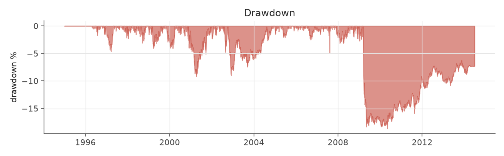
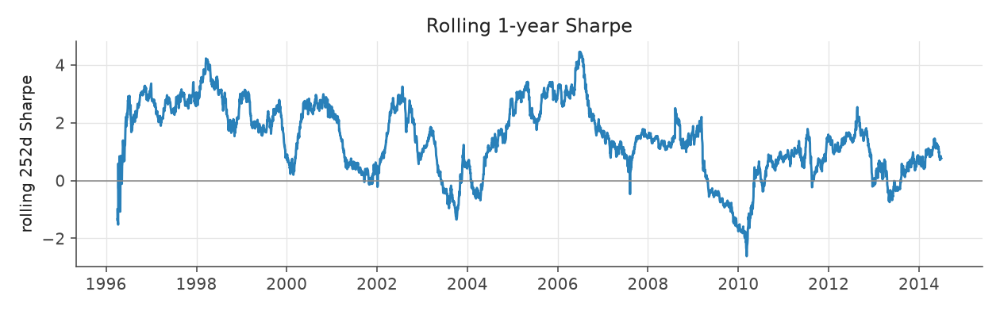
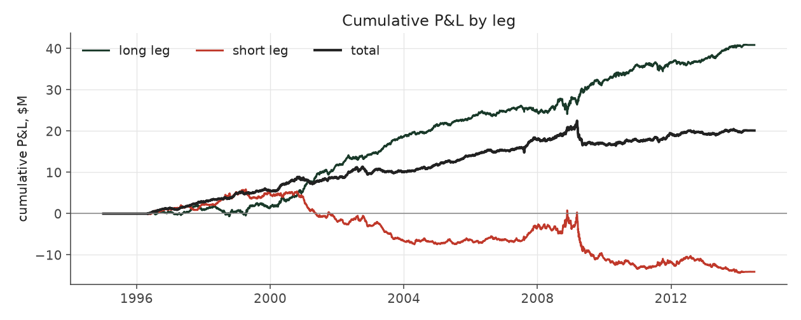
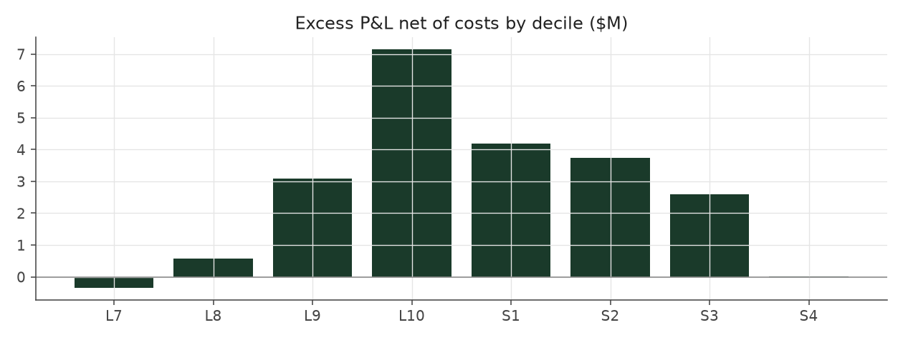

# calm_weighted_matched

_equity strategy | family: equity-volatility | status: validated | derived from `calm_weighted`_

## What this strategy does

Calm Weighted resized so its ups and downs match Balanced Leverage exactly (4.94% a year)

**Why it should work.** PEAD is a stronger, cleaner signal in low-vol stocks; size positions by inverse risk.

**Design notes** (from the strategy's source file).

Calm Weighted -- Balanced Leverage, with bigger bets on calmer stocks (sized by inverse idiosyncratic volatility).

Within every (quarter, side, sector, size) cell, each event's weight is scaled by 1/ivol, so calm stocks get more capital than wild ones. Rationale: the earnings drift is worth more per unit of risk in low-vol names (the SUE x vol interaction is t = -2.4 to -2.7 in Fama-MacBeth), and the engine's cost/liquidity model charges the same bps regardless of vol. Raises Sharpe 1.30 -> 1.47 with no fitted parameter, in all three sub-eras.

`CalmWeightedMatched` re-sizes it to Balanced Leverage's exact volatility to answer "at the SAME risk, how much more return": 7.31% vs 6.49%.

| parameter | value |
|---|---|
| base_unit_fraction | 0.003468808347716693 |
| max_gross_leverage | 2.5 |
| liquidity_cap_frac | 0.05 |
| return_basis | mktadj |
| cap_mode | priority |
| exposure_cap | open_book |
| beta_overlay | 0.0 |

## Performance

| metric | calm_weighted_matched | market (CRSP VW) |
|---|---|---|
| Annualized return | 5.83% | 9.94% |
| Annualized volatility | 4.88% | 19.35% |
| Sharpe (NAV-pct) | 1.18 | 0.59 |
| Sortino | 1.72 |  |
| Max drawdown | -18.7% | -55.5% |
| Calmar | 0.31 |  |
| Final NAV ($10M start) | $30,129,519 |  |
| Worst day | -3.72% |  |
| % positive days | 50.8% |  |
| Sharpe 1996-2001 | 1.94 |  |
| Sharpe 2002-2007 | 1.47 |  |
| Sharpe 2008-2013 | 0.25 |  |

Correlation of daily returns with the market: **-0.05**.

- best Sharpe among equity: `calm_rank_tilt` (1.81); this one: 1.18
- best return among equity: `market_boost_max` (0.15); this one: 0.0583
- best Calmar among equity: `calm_rank_tilt` (0.614); this one: 0.312

*NAV (log scale)*

*Drawdown from running peak*

*Calendar-year returns*

*Is the edge stable, or concentrated in a few years?*

## Where the return comes from

*Long leg vs. short leg vs. total*

|  | long leg | short leg |
|---|---|---|
| P&L ($M, before costs) | 40.86 | -14.09 |
| P&L after costs ($M) | 37.64 | -17.51 |
| of which common (average-event) component ($M) | 27.18 | -28.06 |
| of which excess / PEAD component ($M) | 13.68 | 13.97 |
| excess minus costs ($M) | 10.46 | 10.55 |
| gross return per $ traded (bp) | 249.47 | -82.88 |
| positions in the money (hit rate) | 0.56 | 0.48 |
| stand-alone Sharpe (leg only) | 1.28 | -0.34 |

Daily P&L correlation between the two legs: **-0.78**.

- **The short leg loses money in absolute terms** (-14.1M before costs) while the long leg earns +40.9M. That is mostly a benchmark effect, not a signal failure: the average earnings-event stock beat the cap-weighted market during its holding window, which flatters the long leg and hurts the short leg by 27.2M / 28.1M. Stripping that common component, the surprise signal itself earned +13.7M on the long side and +14.0M on the short side.
- The two legs' daily P&L are -0.78 correlated: the short leg is the hedge that makes the long leg's variance disappear (stand-alone leg Sharpe 1.28 long / -0.34 short vs 1.18 combined).

### By decile and side (signal-driven part only)

| leg | decile | positions | notional_M | net_pnl_M | excess_M | cost_M | alpha_net_M | alpha_share | alpha_bp_per_$ |
|---|---|---|---|---|---|---|---|---|---|
| long | 7 | 4,382 | 99.34 | 1.37 | -0.15 | 0.20 | -0.35 | -1.7% | -35.33 |
| long | 8 | 12,698 | 351.01 | 7.15 | 1.27 | 0.69 | 0.58 | 2.8% | 16.60 |
| long | 9 | 15,395 | 504.72 | 10.39 | 4.06 | 0.98 | 3.08 | 14.7% | 61.02 |
| long | 10 | 17,762 | 682.83 | 18.73 | 8.49 | 1.34 | 7.15 | 34.0% | 104.67 |
| short | 1 | 16,242 | 681.39 | -7.48 | 5.62 | 1.42 | 4.20 | 20.0% | 61.57 |
| short | 2 | 16,137 | 587.36 | -6.10 | 4.91 | 1.17 | 3.75 | 17.8% | 63.81 |
| short | 3 | 11,827 | 385.71 | -3.31 | 3.35 | 0.75 | 2.59 | 12.3% | 67.25 |
| short | 4 | 1,783 | 45.18 | -0.62 | 0.09 | 0.08 | 0.01 | 0.0% | 1.82 |

*D10 and the short deciles carry the alpha; the middle of each leg earns little*

### By size quintile (1 = smallest)

| size_quintile | positions | notional_M | net_pnl_M | excess_M | cost_M | alpha_net_M | alpha_share | alpha_bp_per_$ |
|---|---|---|---|---|---|---|---|---|
| 1 | 10,937 | 270.71 | 0.21 | 1.82 | 1.02 | 0.80 | 3.8% | 29.55 |
| 2 | 18,554 | 610.52 | 6.24 | 8.41 | 1.72 | 6.70 | 31.9% | 109.74 |
| 3 | 20,808 | 768.40 | 6.05 | 7.78 | 1.63 | 6.14 | 29.2% | 79.95 |
| 4 | 22,405 | 836.51 | 4.76 | 5.95 | 1.33 | 4.61 | 22.0% | 55.13 |
| 5 | 23,522 | 851.40 | 2.86 | 3.69 | 0.94 | 2.75 | 13.1% | 32.29 |

### By liquidity quintile (1 = least liquid)

| liquidity_quintile | positions | notional_M | net_pnl_M | excess_M | cost_M | alpha_net_M | alpha_share | alpha_bp_per_$ |
|---|---|---|---|---|---|---|---|---|
| 1 | 10,124 | 191.34 | 2.01 | 3.32 | 0.96 | 2.37 | 11.3% | 123.74 |
| 2 | 19,346 | 681.98 | 4.22 | 7.24 | 2.05 | 5.19 | 24.7% | 76.15 |
| 3 | 21,276 | 847.91 | 6.73 | 8.81 | 1.70 | 7.11 | 33.9% | 83.87 |
| 4 | 22,262 | 821.24 | 4.50 | 5.17 | 1.15 | 4.02 | 19.1% | 48.97 |
| 5 | 23,214 | 794.76 | 2.60 | 3.03 | 0.80 | 2.23 | 10.6% | 28.12 |

### By holding-window length

| hold_bucket | positions | notional_M | net_pnl_M | excess_M | cost_M | alpha_net_M | alpha_share | alpha_bp_per_$ |
|---|---|---|---|---|---|---|---|---|
| <=40d | 33,598 | 1,151.13 | 0.93 | 10.23 | 2.16 | 8.07 | 38.4% | 70.11 |
| 41-60d | 23,226 | 843.91 | 3.21 | 6.82 | 1.83 | 4.99 | 23.8% | 59.15 |
| 61-90d | 31,609 | 1,092.13 | 10.22 | 5.71 | 1.98 | 3.73 | 17.7% | 34.12 |
| >90d | 7,793 | 250.37 | 5.78 | 4.89 | 0.68 | 4.21 | 20.1% | 168.37 |

### By era

| era | positions | notional_M | net_pnl_M | excess_M | cost_M | alpha_net_M | alpha_share | alpha_bp_per_$ |
|---|---|---|---|---|---|---|---|---|
| 1996-01 | 30,165 | 719.54 | 8.87 | 10.63 | 1.41 | 9.22 | 43.9% | 128.15 |
| 2002-07 | 31,557 | 1,151.13 | 8.81 | 10.98 | 2.25 | 8.73 | 41.6% | 75.85 |
| 2008-13 | 34,504 | 1,466.88 | 2.44 | 6.04 | 2.99 | 3.05 | 14.5% | 20.81 |

### By FF12 sector

| ff12_sector | positions | notional_M | net_pnl_M | excess_M | cost_M | alpha_net_M | alpha_share | alpha_bp_per_$ |
|---|---|---|---|---|---|---|---|---|
| BusEq | 16,166 | 297.04 | 0.16 | 1.09 | 0.62 | 0.47 | 2.2% | 15.81 |
| Chems | 2,514 | 236.77 | 1.06 | 1.46 | 0.41 | 1.05 | 5.0% | 44.24 |
| Durbl | 2,755 | 255.23 | 1.66 | 2.27 | 0.46 | 1.81 | 8.6% | 70.87 |
| Enrgy | 5,919 | 284.83 | 3.21 | 3.80 | 0.53 | 3.27 | 15.6% | 114.73 |
| Hlth | 9,694 | 321.37 | 1.47 | 2.12 | 0.66 | 1.46 | 7.0% | 45.47 |
| Manuf | 10,313 | 299.95 | 1.61 | 2.35 | 0.63 | 1.72 | 8.2% | 57.39 |
| Money | 11,832 | 245.92 | 2.06 | 2.60 | 0.57 | 2.02 | 9.6% | 82.28 |
| NoDur | 4,763 | 287.47 | 1.43 | 1.92 | 0.54 | 1.38 | 6.6% | 48.04 |
| Other | 13,276 | 281.24 | 2.20 | 2.90 | 0.62 | 2.27 | 10.8% | 80.80 |
| Shops | 10,682 | 321.89 | 3.01 | 3.65 | 0.66 | 2.98 | 14.2% | 92.71 |
| Telcm | 3,863 | 283.65 | 2.06 | 2.62 | 0.52 | 2.10 | 10.0% | 74.22 |
| Utils | 4,449 | 222.20 | 0.22 | 0.87 | 0.41 | 0.46 | 2.2% | 20.79 |

### By idiosyncratic-volatility tercile

| vol_tercile | positions | notional_M | net_pnl_M | excess_M | cost_M | alpha_net_M | alpha_share | alpha_bp_per_$ |
|---|---|---|---|---|---|---|---|---|
| high vol | 29,615 | 783.87 | 1.08 | 3.52 | 1.42 | 2.11 | 10.0% | 26.88 |
| low vol | 34,228 | 1,417.19 | 10.67 | 14.12 | 3.01 | 11.11 | 52.9% | 78.40 |
| mid vol | 30,825 | 1,084.48 | 7.52 | 9.04 | 2.10 | 6.94 | 33.0% | 63.97 |

### Short-borrow sensitivity (not modeled in the backtest)

| borrow_rate | fee_M | annualized_return | drag |
|---|---|---|---|
| 0.0% | 0.0 | 5.83% | 0.00% |
| 0.5% | 1.7 | 5.51% | 0.31% |
| 1.0% | 3.4 | 5.18% | 0.65% |
| 2.0% | 6.8 | 4.45% | 1.38% |
| 5.0% | 17.0 | 1.41% | 4.41% |

The engine charges the same transaction cost on shorts as on longs and no stock-borrow fee. The short leg is concentrated in small, illiquid names, where borrow is scarce and expensive -- read the table as a floor on the cost of running the short leg.
