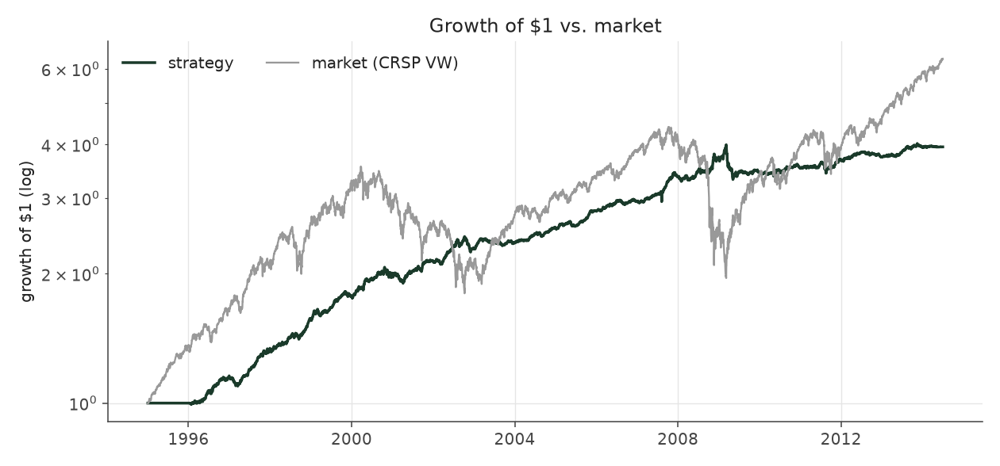
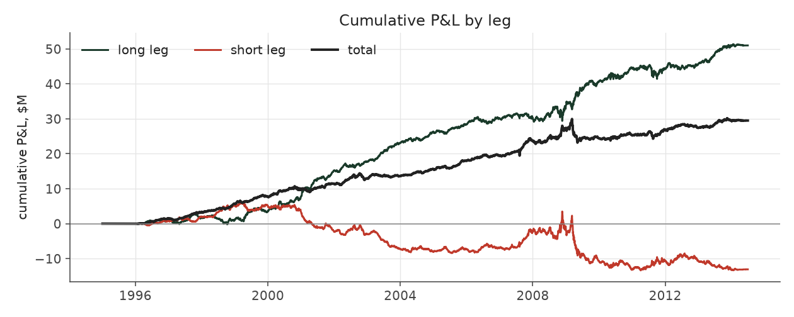
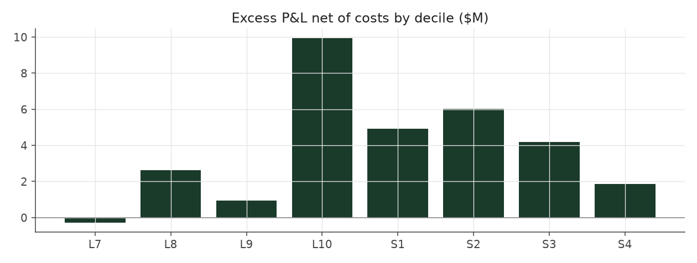

# calm_weighted_matched_legacy

_equity strategy | family: equity-volatility | status: reference | derived from `calm_weighted_matched`_

## What this strategy does

Calm Weighted resized so its ups and downs match Balanced Leverage closely (sized on the pre-fix book; same volatility to within 0.1 point after the fixes) -- ORIGINAL leverage cap (new positions only, open book ignored)

**Why it should work.** PEAD is a stronger, cleaner signal in low-vol stocks; size positions by inverse risk.

**Design notes** (from the strategy's source file).

Calm Weighted -- Balanced Leverage, with bigger bets on calmer stocks (sized by inverse idiosyncratic volatility).

Within every (quarter, side, sector, size) cell, each event's weight is scaled by 1/ivol, so calm stocks get more capital than wild ones. Rationale: the earnings drift is worth more per unit of risk in low-vol names (the SUE x vol interaction is t = -2.4 to -2.7 in Fama-MacBeth), and the engine's cost/liquidity model charges the same bps regardless of vol. Raises Sharpe with no fitted parameter, in all three sub-eras (corrected run: Balanced Leverage 1.09 -> Calm Weighted 1.24; pre-fix 1.30 -> 1.47).

`CalmWeightedMatched` re-sizes it to Balanced Leverage's exact volatility to answer "at the SAME risk, how much more return" (corrected run: 5.83% vs 5.38%; pre-fix 7.31% vs 6.49%).

| parameter | value |
|---|---|
| base_unit_fraction | 0.003468808347716693 |
| max_gross_leverage | 2.5 |
| liquidity_cap_frac | 0.05 |
| return_basis | mktadj |
| cap_mode | priority |
| exposure_cap | entry_cohort |
| beta_overlay | 0.0 |

## Performance

| metric | calm_weighted_matched_legacy | market (CRSP VW) |
|---|---|---|
| Annualized return | 7.31% | 9.94% |
| Annualized volatility | 4.94% | 19.35% |
| Sharpe (NAV-pct) | 1.45 | 0.59 |
| Sortino | 2.15 |  |
| Max drawdown | -17.0% | -55.5% |
| Calmar | 0.43 |  |
| Final NAV ($10M start) | $39,500,315 |  |
| Worst day | -3.35% |  |
| % positive days | 52.4% |  |
| Sharpe 1996-2001 | 2.39 |  |
| Sharpe 2002-2007 | 1.66 |  |
| Sharpe 2008-2013 | 0.52 |  |

Correlation of daily returns with the market: **-0.00**.

- best Sharpe among equity: `calm_rank_tilt` (1.47); this one: 1.45
- best return among equity: `market_boost_max` (0.116); this one: 0.0731
- best Calmar among equity: `calm_rank_tilt` (0.442); this one: 0.43

*NAV (log scale)*

*Drawdown from running peak*

*Calendar-year returns*

*Is the edge stable, or concentrated in a few years?*

## Where the return comes from

*Long leg vs. short leg vs. total*

|  | long leg | short leg |
|---|---|---|
| P&L ($M, before costs) | 51.01 | -13.08 |
| P&L after costs ($M) | 46.96 | -17.46 |
| of which common (average-event) component ($M) | 33.29 | -34.09 |
| of which excess / PEAD component ($M) | 17.26 | 21.34 |
| excess minus costs ($M) | 13.22 | 16.98 |
| gross return per $ traded (bp) | 242.65 | -60.53 |
| positions in the money (hit rate) | 0.56 | 0.49 |
| stand-alone Sharpe (leg only) | 1.32 | -0.23 |

Daily P&L correlation between the two legs: **-0.81**.

- **The short leg loses money in absolute terms** (-13.1M before costs) while the long leg earns +51.0M. That is mostly a benchmark effect, not a signal failure: the average earnings-event stock beat the cap-weighted market during its holding window, which flatters the long leg and hurts the short leg by 33.3M / 34.1M. Stripping that common component, the surprise signal itself earned +17.3M on the long side and +21.3M on the short side.
- The two legs' daily P&L are -0.81 correlated: the short leg is the hedge that makes the long leg's variance disappear (stand-alone leg Sharpe 1.32 long / -0.23 short vs 1.45 combined).

### By decile and side (signal-driven part only)

| leg | decile | positions | notional_M | net_pnl_M | excess_M | cost_M | alpha_net_M | alpha_share | alpha_bp_per_$ |
|---|---|---|---|---|---|---|---|---|---|
| long | 7 | 8,017 | 187.53 | 3.24 | 0.07 | 0.36 | -0.29 | -1.0% | -15.53 |
| long | 8 | 16,581 | 496.58 | 10.87 | 3.58 | 0.96 | 2.61 | 8.7% | 52.63 |
| long | 9 | 17,745 | 651.92 | 10.47 | 2.19 | 1.24 | 0.95 | 3.1% | 14.58 |
| long | 10 | 17,173 | 766.04 | 22.39 | 11.42 | 1.48 | 9.94 | 32.9% | 129.72 |
| short | 1 | 17,166 | 766.10 | -6.38 | 6.53 | 1.61 | 4.92 | 16.3% | 64.23 |
| short | 2 | 17,276 | 669.92 | -5.27 | 7.35 | 1.34 | 6.01 | 19.9% | 89.73 |
| short | 3 | 15,967 | 514.75 | -4.22 | 5.20 | 1.02 | 4.17 | 13.8% | 81.01 |
| short | 4 | 9,161 | 209.99 | -1.58 | 2.26 | 0.40 | 1.86 | 6.2% | 88.73 |

*D10 and the short deciles carry the alpha; the middle of each leg earns little*

### By size quintile (1 = smallest)

| size_quintile | positions | notional_M | net_pnl_M | excess_M | cost_M | alpha_net_M | alpha_share | alpha_bp_per_$ |
|---|---|---|---|---|---|---|---|---|
| 1 | 14,194 | 334.35 | 5.62 | 7.85 | 1.28 | 6.57 | 21.7% | 196.48 |
| 2 | 22,880 | 766.10 | 6.70 | 9.29 | 2.16 | 7.14 | 23.6% | 93.14 |
| 3 | 25,498 | 978.87 | 7.90 | 9.64 | 2.06 | 7.58 | 25.1% | 77.41 |
| 4 | 27,576 | 1,082.62 | 5.42 | 6.90 | 1.71 | 5.18 | 17.2% | 47.89 |
| 5 | 28,938 | 1,100.90 | 3.87 | 4.92 | 1.21 | 3.71 | 12.3% | 33.68 |

### By liquidity quintile (1 = least liquid)

| liquidity_quintile | positions | notional_M | net_pnl_M | excess_M | cost_M | alpha_net_M | alpha_share | alpha_bp_per_$ |
|---|---|---|---|---|---|---|---|---|
| 1 | 13,631 | 247.89 | 5.24 | 6.97 | 1.24 | 5.73 | 19.0% | 231.15 |
| 2 | 23,084 | 835.03 | 6.57 | 10.23 | 2.50 | 7.72 | 25.6% | 92.50 |
| 3 | 25,848 | 1,073.98 | 8.16 | 10.79 | 2.15 | 8.64 | 28.6% | 80.44 |
| 4 | 27,653 | 1,066.69 | 5.75 | 6.36 | 1.49 | 4.87 | 16.1% | 45.63 |
| 5 | 28,865 | 1,038.89 | 3.74 | 4.21 | 1.04 | 3.17 | 10.5% | 30.48 |

### By holding-window length

| hold_bucket | positions | notional_M | net_pnl_M | excess_M | cost_M | alpha_net_M | alpha_share | alpha_bp_per_$ |
|---|---|---|---|---|---|---|---|---|
| <=40d | 45,837 | 1,657.83 | 0.68 | 9.89 | 2.91 | 6.98 | 23.1% | 42.11 |
| 41-60d | 25,647 | 973.48 | 6.02 | 5.96 | 1.96 | 4.00 | 13.2% | 41.07 |
| 61-90d | 35,313 | 1,222.87 | 8.62 | 10.31 | 2.55 | 7.76 | 25.7% | 63.47 |
| >90d | 12,289 | 408.66 | 14.18 | 12.45 | 1.01 | 11.44 | 37.9% | 279.81 |

### By era

| era | positions | notional_M | net_pnl_M | excess_M | cost_M | alpha_net_M | alpha_share | alpha_bp_per_$ |
|---|---|---|---|---|---|---|---|---|
| 1996-01 | 33,895 | 809.38 | 11.18 | 12.87 | 1.57 | 11.30 | 37.4% | 139.60 |
| 2002-07 | 39,913 | 1,427.49 | 12.27 | 14.90 | 2.77 | 12.14 | 40.2% | 85.05 |
| 2008-13 | 45,278 | 2,025.98 | 6.06 | 10.82 | 4.09 | 6.74 | 22.3% | 33.24 |

### By FF12 sector

| ff12_sector | positions | notional_M | net_pnl_M | excess_M | cost_M | alpha_net_M | alpha_share | alpha_bp_per_$ |
|---|---|---|---|---|---|---|---|---|
| BusEq | 22,085 | 427.07 | 2.45 | 3.36 | 0.90 | 2.46 | 8.1% | 57.49 |
| Chems | 2,588 | 279.38 | 1.84 | 2.21 | 0.48 | 1.73 | 5.7% | 61.84 |
| Durbl | 2,843 | 300.63 | 2.59 | 3.18 | 0.53 | 2.64 | 8.7% | 87.90 |
| Enrgy | 6,194 | 342.20 | 4.51 | 5.28 | 0.63 | 4.65 | 15.4% | 135.97 |
| Hlth | 11,685 | 411.81 | 3.00 | 3.81 | 0.86 | 2.96 | 9.8% | 71.83 |
| Manuf | 12,033 | 383.08 | 2.04 | 2.92 | 0.78 | 2.14 | 7.1% | 55.87 |
| Money | 17,569 | 375.06 | 3.08 | 4.09 | 0.83 | 3.26 | 10.8% | 86.92 |
| NoDur | 5,080 | 341.14 | 1.72 | 2.33 | 0.63 | 1.70 | 5.6% | 49.75 |
| Other | 18,372 | 410.74 | 3.06 | 4.12 | 0.91 | 3.21 | 10.6% | 78.04 |
| Shops | 11,984 | 398.66 | 3.75 | 4.54 | 0.81 | 3.73 | 12.3% | 93.56 |
| Telcm | 3,981 | 327.17 | 0.81 | 1.42 | 0.58 | 0.84 | 2.8% | 25.75 |
| Utils | 4,672 | 265.90 | 0.66 | 1.34 | 0.48 | 0.86 | 2.9% | 32.45 |

### By idiosyncratic-volatility tercile

| vol_tercile | positions | notional_M | net_pnl_M | excess_M | cost_M | alpha_net_M | alpha_share | alpha_bp_per_$ |
|---|---|---|---|---|---|---|---|---|
| high vol | 39,494 | 1,057.22 | 4.66 | 7.73 | 1.92 | 5.82 | 19.3% | 55.04 |
| low vol | 40,087 | 1,759.86 | 13.57 | 17.57 | 3.70 | 13.87 | 45.9% | 78.83 |
| mid vol | 37,893 | 1,388.11 | 11.06 | 13.11 | 2.69 | 10.43 | 34.5% | 75.12 |

### Short-borrow sensitivity (not modeled in the backtest)

| borrow_rate | fee_M | annualized_return | drag |
|---|---|---|---|
| 0.0% | 0.0 | 7.31% | -0.00% |
| 0.5% | 2.2 | 7.00% | 0.31% |
| 1.0% | 4.3 | 6.67% | 0.64% |
| 2.0% | 8.7 | 5.95% | 1.36% |
| 5.0% | 21.7 | 3.01% | 4.30% |

The engine charges the same transaction cost on shorts as on longs and no stock-borrow fee. The short leg is concentrated in small, illiquid names, where borrow is scarce and expensive -- read the table as a floor on the cost of running the short leg.
