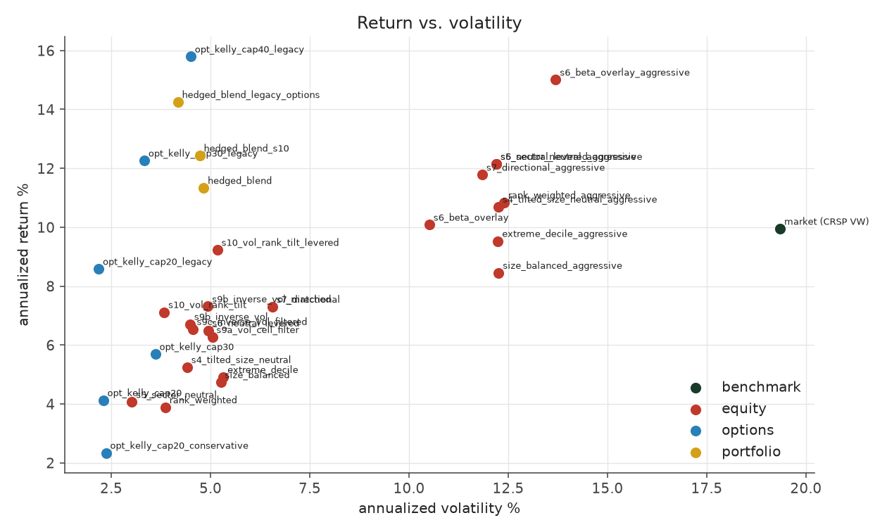
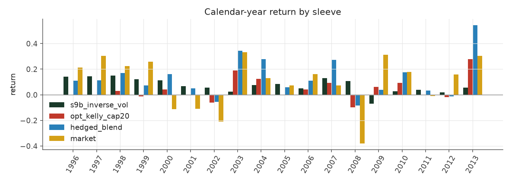
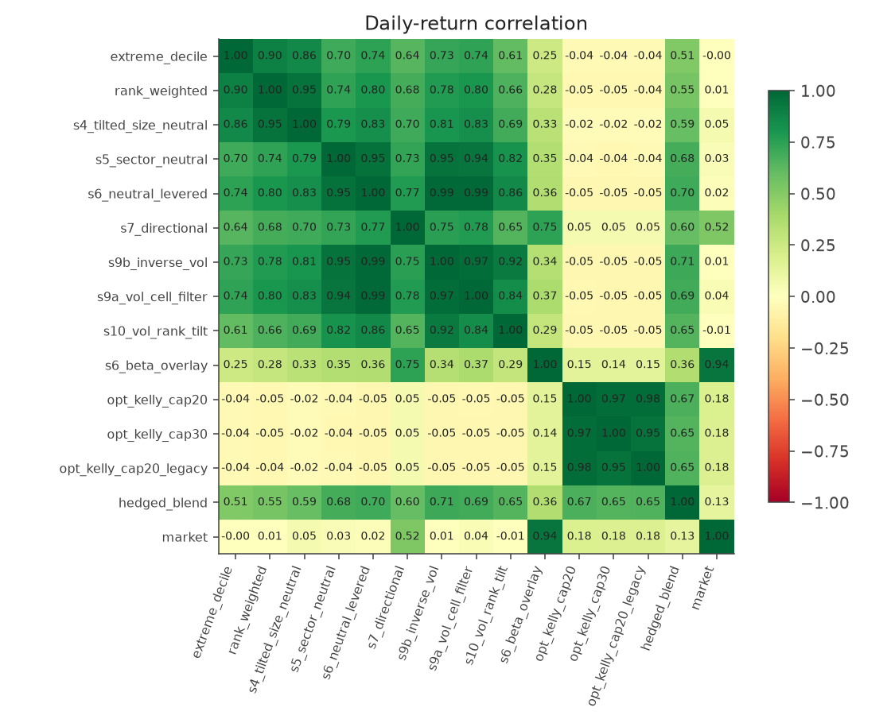
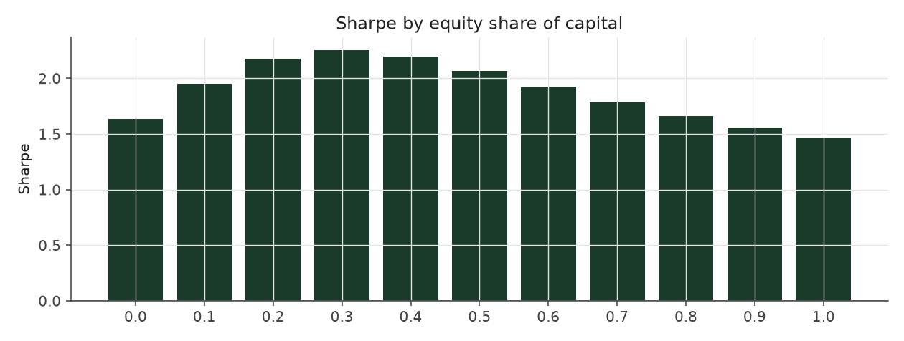

# PEAD strategy suite -- comprehensive report

_31 strategies, 1996-2013, $10M start, NAV-percentage Sharpe_

## 1. League table

Every strategy that has been run, by asset class and Sharpe. `validated` strategies are candidates for use, `research` are explorations/variants, `reference` are kept as documented counter-examples.

| name | family | status | annualized_return | annualized_vol | sharpe | max_drawdown | calmar | sharpe_1996_2001 | sharpe_2002_2007 | sharpe_2008_2013 |
|---|---|---|---|---|---|---|---|---|---|---|
| s10_vol_rank_tilt | equity-volatility | research | 7.1% | 3.8% | 1.81 | -11.6% | 0.61 | 2.94 | 1.89 | 0.78 |
| s10_vol_rank_tilt_levered | equity-volatility | research | 9.2% | 5.2% | 1.73 | -15.9% | 0.58 | 2.86 | 1.96 | 0.50 |
| s9b_inverse_vol | equity-volatility | validated | 6.7% | 4.5% | 1.47 | -15.6% | 0.43 | 2.40 | 1.63 | 0.59 |
| s9b_inverse_vol_matched | equity-volatility | validated | 7.3% | 4.9% | 1.45 | -17.0% | 0.43 | 2.39 | 1.66 | 0.52 |
| s9c_inverse_vol_filtered | equity-volatility | research | 6.5% | 4.6% | 1.41 | -15.7% | 0.42 | 2.26 | 1.57 | 0.60 |
| s5_sector_neutral | equity-neutralized | validated | 4.1% | 3.0% | 1.33 | -10.8% | 0.37 | 2.19 | 1.34 | 0.66 |
| s6_neutral_levered | equity-neutralized | validated | 6.5% | 4.9% | 1.30 | -16.6% | 0.39 | 2.07 | 1.52 | 0.47 |
| s9a_vol_cell_filter | equity-volatility | research | 6.3% | 5.0% | 1.23 | -16.7% | 0.38 | 1.90 | 1.44 | 0.48 |
| s4_tilted_size_neutral | equity-neutralized | validated | 5.2% | 4.4% | 1.18 | -13.1% | 0.40 | 1.74 | 1.31 | 0.60 |
| s7_directional | equity-directional | reference | 7.3% | 6.6% | 1.11 | -15.5% | 0.47 | 1.79 | 1.48 | 0.32 |
| s6_beta_overlay_aggressive | equity-aggressive | research | 15.0% | 13.7% | 1.09 | -37.0% | 0.41 | 1.39 | 1.73 | 0.21 |
| rank_weighted | equity-baseline | validated | 3.9% | 3.9% | 1.01 | -14.0% | 0.28 | 1.39 | 1.55 | 0.32 |
| s5_sector_neutral_aggressive | equity-aggressive | research | 12.1% | 12.2% | 1.00 | -36.5% | 0.33 | 1.53 | 1.71 | -0.07 |
| s6_neutral_levered_aggressive | equity-aggressive | research | 12.1% | 12.2% | 1.00 | -36.5% | 0.33 | 1.53 | 1.71 | -0.07 |
| s7_directional_aggressive | equity-aggressive | research | 11.8% | 11.8% | 1.00 | -33.0% | 0.36 | 1.64 | 1.65 | 0.13 |
| s6_beta_overlay | equity-overlay | validated | 10.1% | 10.5% | 0.97 | -23.2% | 0.43 | 1.30 | 1.14 | 0.48 |
| extreme_decile | equity-baseline | validated | 4.9% | 5.3% | 0.93 | -18.5% | 0.27 | 1.28 | 1.58 | 0.28 |
| size_balanced | equity-baseline | validated | 4.7% | 5.3% | 0.91 | -17.5% | 0.27 | 1.32 | 1.28 | 0.34 |
| rank_weighted_aggressive | equity-aggressive | research | 10.8% | 12.4% | 0.89 | -38.8% | 0.28 | 1.24 | 1.63 | 0.09 |
| s4_tilted_size_neutral_aggressive | equity-aggressive | research | 10.7% | 12.3% | 0.89 | -40.0% | 0.27 | 1.30 | 1.54 | 0.07 |
| extreme_decile_aggressive | equity-aggressive | research | 9.5% | 12.2% | 0.80 | -36.2% | 0.26 | 1.02 | 1.72 | -0.01 |
| size_balanced_aggressive | equity-aggressive | research | 8.4% | 12.3% | 0.72 | -37.5% | 0.23 | 1.00 | 1.52 | 0.03 |
| opt_kelly_cap20_legacy | options-kelly | reference | 8.6% | 2.2% | 3.78 | -10.3% | 0.83 | 1.64 | 4.80 | 4.39 |
| opt_kelly_cap30_legacy | options-kelly | reference | 12.3% | 3.3% | 3.49 | -17.4% | 0.70 | 0.98 | 4.67 | 4.10 |
| opt_kelly_cap40_legacy | options-kelly | reference | 15.8% | 4.5% | 3.28 | -23.9% | 0.66 | 0.54 | 4.58 | 3.93 |
| opt_kelly_cap20 | options-kelly | validated | 4.1% | 2.3% | 1.77 | -13.8% | 0.30 | 0.69 | 2.04 | 2.39 |
| opt_kelly_cap30 | options-kelly | validated | 5.7% | 3.6% | 1.55 | -22.3% | 0.26 | 0.12 | 1.95 | 2.17 |
| opt_kelly_cap20_conservative | options-kelly | research | 2.3% | 2.4% | 0.99 | -17.1% | 0.14 | 0.32 | 0.99 | 1.60 |
| hedged_blend_legacy_options | portfolio | reference | 14.2% | 4.2% | 3.21 | -9.9% | 1.44 | 2.79 | 4.64 | 2.61 |
| hedged_blend_s10 | portfolio | research | 12.4% | 4.7% | 2.50 | -15.5% | 0.80 | 2.92 | 2.84 | 2.10 |
| hedged_blend | portfolio | validated | 11.3% | 4.8% | 2.25 | -16.7% | 0.68 | 2.41 | 2.70 | 1.91 |

*Each dot is one backtest. Options books and the hedged blend sit high-left (high return per unit of risk).*

## 2. What each iteration changed

| strategy | parent | d_return | d_vol | d_sharpe | d_maxdd |
|---|---|---|---|---|---|
| extreme_decile_aggressive | extreme_decile | +4.62% | +6.92% | -0.12 | -17.7% |
| hedged_blend | s9b_inverse_vol | +4.62% | +0.34% | +0.78 | -1.1% |
| hedged_blend_legacy_options | hedged_blend | +2.92% | -0.65% | +0.96 | +6.8% |
| hedged_blend_s10 | hedged_blend | +1.10% | -0.10% | +0.25 | +1.2% |
| opt_kelly_cap20_conservative | opt_kelly_cap20 | -1.79% | +0.07% | -0.78 | -3.3% |
| opt_kelly_cap30 | opt_kelly_cap20 | +1.57% | +1.31% | -0.22 | -8.5% |
| opt_kelly_cap30_legacy | opt_kelly_cap20_legacy | +3.68% | +1.15% | -0.29 | -7.1% |
| opt_kelly_cap40_legacy | opt_kelly_cap20_legacy | +7.21% | +2.32% | -0.50 | -13.6% |
| rank_weighted_aggressive | rank_weighted | +6.95% | +8.53% | -0.11 | -24.8% |
| s10_vol_rank_tilt | s9b_inverse_vol | +0.41% | -0.65% | +0.34 | +4.0% |
| s10_vol_rank_tilt_levered | s10_vol_rank_tilt | +2.11% | +1.34% | -0.08 | -4.3% |
| s4_tilted_size_neutral | rank_weighted | +1.37% | +0.55% | +0.18 | +0.9% |
| s4_tilted_size_neutral_aggressive | s4_tilted_size_neutral | +5.45% | +7.84% | -0.29 | -26.9% |
| s5_sector_neutral | s4_tilted_size_neutral | -1.19% | -1.39% | +0.15 | +2.2% |
| s5_sector_neutral_aggressive | s5_sector_neutral | +8.09% | +9.18% | -0.33 | -25.6% |
| s6_beta_overlay | s6_neutral_levered | +3.59% | +5.57% | -0.33 | -6.6% |
| s6_beta_overlay_aggressive | s6_neutral_levered_aggressive | +2.86% | +1.49% | +0.09 | -0.5% |
| s6_neutral_levered | s5_sector_neutral | +2.43% | +1.92% | -0.03 | -5.8% |
| s6_neutral_levered_aggressive | s6_neutral_levered | +5.66% | +7.26% | -0.30 | -19.8% |
| s7_directional | s6_neutral_levered | +0.80% | +1.62% | -0.19 | +1.1% |
| s7_directional_aggressive | s7_directional | +4.48% | +5.29% | -0.11 | -17.4% |
| s9a_vol_cell_filter | s6_neutral_levered | -0.23% | +0.11% | -0.07 | -0.1% |
| s9b_inverse_vol | s6_neutral_levered | +0.22% | -0.45% | +0.17 | +1.0% |
| s9b_inverse_vol_matched | s9b_inverse_vol | +0.60% | +0.45% | -0.02 | -1.4% |
| s9c_inverse_vol_filtered | s6_neutral_levered | +0.05% | -0.39% | +0.12 | +1.0% |
| size_balanced | extreme_decile | -0.17% | -0.07% | -0.02 | +0.9% |
| size_balanced_aggressive | size_balanced | +3.71% | +7.00% | -0.18 | -19.9% |

`d_*` columns are the change from the parent strategy. Reading down: neutralizing size and sector (S4->S5) and inverse-vol sizing (S6->S9b) buy Sharpe; raising the leverage cap buys return; the aggressive variants buy return at the cost of Sharpe because the liquidity cap starts to bind.

## 3. Stability across eras

| name | sharpe_1996_2001 | sharpe_2002_2007 | sharpe_2008_2013 |
|---|---|---|---|
| extreme_decile | 1.28 | 1.58 | 0.28 |
| rank_weighted | 1.39 | 1.55 | 0.32 |
| s4_tilted_size_neutral | 1.74 | 1.31 | 0.60 |
| s5_sector_neutral | 2.19 | 1.34 | 0.66 |
| s6_neutral_levered | 2.07 | 1.52 | 0.47 |
| s7_directional | 1.79 | 1.48 | 0.32 |
| s9b_inverse_vol | 2.40 | 1.63 | 0.59 |
| s9a_vol_cell_filter | 1.90 | 1.44 | 0.48 |
| s10_vol_rank_tilt | 2.94 | 1.89 | 0.78 |
| s6_beta_overlay | 1.30 | 1.14 | 0.48 |
| opt_kelly_cap20 | 0.69 | 2.04 | 2.39 |
| opt_kelly_cap30 | 0.12 | 1.95 | 2.17 |
| opt_kelly_cap20_legacy | 1.64 | 4.80 | 4.39 |
| hedged_blend | 2.41 | 2.70 | 1.91 |

| year | s9b_inverse_vol | opt_kelly_cap20 | hedged_blend | market |
|---|---|---|---|---|
| 1996 | 14.0% | 0.0% | 11.1% | 21.2% |
| 1997 | 14.4% | 0.0% | 11.4% | 30.4% |
| 1998 | 14.8% | 2.9% | 16.9% | 22.3% |
| 1999 | 12.0% | -1.2% | 7.3% | 25.7% |
| 2000 | 11.3% | 4.0% | 16.1% | -11.3% |
| 2001 | 6.8% | -0.3% | 5.0% | -11.0% |
| 2002 | 5.7% | -6.1% | -5.5% | -20.9% |
| 2003 | 2.5% | 18.8% | 34.3% | 33.1% |
| 2004 | 7.6% | 12.3% | 27.7% | 13.0% |
| 2005 | 8.5% | -0.5% | 5.9% | 7.3% |
| 2006 | 4.9% | 4.2% | 11.0% | 16.2% |
| 2007 | 12.9% | 9.3% | 27.1% | 7.3% |
| 2008 | 10.6% | -10.0% | -8.3% | -38.2% |
| 2009 | -6.9% | 6.1% | 3.9% | 31.2% |
| 2010 | 2.6% | 9.2% | 17.5% | 17.7% |
| 2011 | 4.0% | - | 3.2% | -1.1% |
| 2012 | 1.8% | -1.7% | -1.3% | 15.8% |
| 2013 | 5.5% | 27.8% | 54.4% | 30.5% |

*Equity alpha is front-loaded (1996-2003); the options book is back-loaded (2003-2013) and lost in 2008 when equity gained.*

**The equity drift has decayed**: Strategy 9b's return fell from ~14% a year in 1996-99 to ~2-5% in 2011-13, the usual signature of PEAD being arbitraged. The options book shows the opposite shape in this sample, which is part of why the two combine well -- and part of why its recent strength should not be extrapolated without a skeptical look.

## 4. Equity books: long leg vs. short leg

| strategy | long_pnl_M | short_pnl_M | long_excess_M | short_excess_M | long_bp_per_dollar | short_bp_per_dollar | corr_long_short |
|---|---|---|---|---|---|---|---|
| extreme_decile | 24.6 | -5.7 | 10.9 | 6.1 | 275.1 | -68.3 | -0.68 |
| rank_weighted | 21.7 | -7.1 | 7.3 | 6.7 | 248.5 | -83.6 | -0.79 |
| s4_tilted_size_neutral | 29.6 | -8.1 | 13.2 | 8.8 | 297.5 | -77.0 | -0.78 |
| s5_sector_neutral | 20.0 | -5.4 | 9.6 | 5.3 | 304.7 | -80.7 | -0.79 |
| s6_neutral_levered | 42.7 | -11.8 | 15.9 | 15.9 | 253.4 | -68.4 | -0.81 |
| s9b_inverse_vol | 43.2 | -10.8 | 15.9 | 17.2 | 253.2 | -61.6 | -0.81 |

- **In every equity strategy the short leg loses money in absolute terms** while the long leg earns several times the total. The headline is real but misleading: returns are measured against the cap-weighted market, and the average event stock beats that benchmark (small-cap tilt plus the earnings-announcement premium), flattering the long leg and penalizing the short leg by the same amount.
- Stripped of that common component, **the surprise signal earns the same on both legs** (columns `*_excess_M`): the shorts are pulling their weight, they are just paid in relative performance, not in absolute declines.
- The legs' daily P&L are ~-0.8 correlated: the short leg is a hedge. Dropping it for a long-only book would multiply the volatility and add market-relative factor exposure without adding alpha.
- The backtest charges no stock-borrow fee. The short leg is small-cap-heavy where borrow is expensive; each 1% a year of borrow costs ~0.6pp of Strategy 6's return (see the per-strategy report's borrow table).
- Alpha per dollar traded is ~7x higher in the smallest size quintile (~11x in the least liquid quintile) than in the largest, and the >90-day holding cells earn ~8x the alpha per dollar of the <=40-day cells. The book's capacity is therefore bounded by small illiquid names.

## 5. Options book: what the return is made of, and how much of it is real

**The originally reported options result does not survive a careful look at the quotes.** The original backtest marked a missing forward quote at the previous live quote. 22% of picks have no quote at 60 days and 93% of those are zero-bid options -- dead contracts nobody will buy -- which that convention never marked down. Corrected: 8.58% / Sharpe 3.78 as reported -> 4.12% / 1.77 (dead quotes at half-ask, plus a $0.05 minimum tick cost) -> 2.34% / 0.99 if dead options are worth nothing. A real, smaller edge remains.

- 98.2% of funded trades are calls, producing 96.5% of gross P&L -- across ALL deciles, including the worst surprises. The Kelly selector finds cheap OTM calls better than puts even on bad news.
- Win rate 39%, median trade -24%, mean 25%: a convex pay-off. The top 1% of trades are 65% of gross P&L.
- What survives the corrected marks is concentrated in calls struck at or just out of the money (1.0-1.2x spot) on low-volatility stocks. Deep in-the-money calls absorb about half the premium budget and earn ~5% on it; high-volatility stocks earn ~7%.
- Return on premium does not rise with SUE decile, so the edge is not the directional drift alone: it is mostly cheap post-earnings convexity on calm stocks, in a sample that was net bullish and whose profit is dominated by two years (2003 and 2013).

| vol_tercile | trades | premium_M | gross_M | net_M | share_of_net | roi_on_premium |
|---|---|---|---|---|---|---|
| low vol | 21,662 | 19.07 | 9.74 | 6.80 | 70.6% | 51.1% |
| mid vol | 21,661 | 16.81 | 3.68 | 2.17 | 22.5% | 21.9% |
| high vol | 21,662 | 25.63 | 1.86 | 0.66 | 6.8% | 7.3% |

### Execution and marking sensitivity

| case | annualized_return | annualized_vol | sharpe | max_drawdown | trades |
|---|---|---|---|---|---|
| as registered | 4.12% | 2.30% | 1.77 | -13.8% | 65,003 |
| ORIGINAL convention: dead quotes carried forward, flat 3% cost | 8.58% | 2.18% | 3.78 | -10.3% | 70,167 |
| dead quotes at half-ask, flat 3% cost (no tick floor) | 5.87% | 2.29% | 2.50 | -12.7% | 67,294 |
| dead quotes worth zero (pessimistic bound) | 2.34% | 2.37% | 0.99 | -17.1% | 62,581 |
| + $0.10/share minimum cost | 1.98% | 2.32% | 0.86 | -16.5% | 62,288 |
| skip contracts under $0.25 | 3.58% | 1.94% | 1.83 | -12.9% | 52,686 |
| skip contracts under $0.50 | 2.79% | 1.72% | 1.61 | -13.7% | 43,993 |
| flat 10% round-trip cost | 2.75% | 2.31% | 1.18 | -18.7% | 62,809 |

Treat the corrected `opt_kelly_cap20` / `opt_kelly_cap30` as the options sleeve and the `_legacy` strategies as the historical headline only. Everything the hedged blend says about options is built on the corrected numbers.

## 6. How the strategies move together

*Equity books cluster together; options are independent of them.*

- All market-neutral equity variants are 0.7-0.99 correlated -- they are one bet expressed several ways, so combining them adds nothing.
- Equity vs. options correlation: -0.05. The options book's correlation to the market is 0.18; the market-neutral equity books' is ~0.
- `s6_beta_overlay` is 0.94 correlated with the market by construction; it answers 'beat the S&P', not 'diversify'.

## 7. Combining an equity book with an options book

### Capital split: fraction of NAV in each sleeve (weights sum to 1)

*Sharpe peaks around 15-25% equity: diversification, then the better sleeve dominates.*

| method | w_equity | w_options | annualized_return | annualized_vol | sharpe | max_drawdown |
|---|---|---|---|---|---|---|
| equal | 0.50 | 0.50 | 5.1% | 2.4% | 2.07 | -6.3% |
| inverse_vol | 0.32 | 0.68 | 4.6% | 2.0% | 2.25 | -7.5% |
| max_sharpe (in-sample) | 0.30 | 0.70 | 4.5% | 2.0% | 2.25 | -7.8% |
| walk-forward max-Sharpe (out-of-sample) | 0.49 | 0.51 | 5.0% | 2.5% | 1.99 | -6.8% |

### Stacked on one NAV (weights are multiples of each sleeve's own sizing)

| target_vol | equity_multiple | options_multiple | annualized_return | annualized_vol | sharpe | max_drawdown | worst_day |
|---|---|---|---|---|---|---|---|
| 3% | 0.48 | 1.02 | 6.9% | 3.0% | 2.25 | -11.1% | -1.6% |
| 5% | 0.81 | 1.70 | 11.8% | 5.0% | 2.25 | -17.8% | -2.7% |
| 8% | 1.29 | 2.72 | 19.3% | 8.0% | 2.25 | -27.1% | -4.3% |

Equal-risk weights (each sleeve contributes the same stand-alone volatility). The 5% row is the registered `hedged_blend`. Larger multiples assume the extra options premium and equity gross exposure can actually be financed and traded at the backtested costs.

### The hedge in action: stress years

| year | s9b_inverse_vol | opt_kelly_cap20 | hedged_blend | market |
|---|---|---|---|---|
| 2000 | 11.3% | 4.0% | 16.1% | -11.3% |
| 2001 | 6.8% | -0.3% | 5.0% | -11.0% |
| 2002 | 5.7% | -6.1% | -5.5% | -20.9% |
| 2008 | 10.6% | -10.0% | -8.3% | -38.2% |
| 2009 | -6.9% | 6.1% | 3.9% | 31.2% |

- The options book's worst year (2008, -10.0%) coincided with the equity book's +10.6%; in 2009 the signs flipped. That offset is the hedge -- it comes from low correlation across time, not from any offsetting position.
- The blend's market beta is 0.037: there is nothing left for an index hedge to remove. Layering a short-index overlay on top would only pay costs; a market-beta overlay (`s6_beta_overlay`) goes the other way, adding the equity risk premium on purpose.
- Everything here is in-sample except the walk-forward row. The caveats that apply to the sleeves apply to the blend: the options sleeve's costs, the equity sleeve's missing borrow fees, and no financing cost on the stacked multiples.

## 8. Conclusions and next steps

- Use `s9b_inverse_vol` as the equity alpha sleeve (validated, no fitted parameters, ahead of Strategy 6 in every era; `s10_vol_rank_tilt` is the stronger research candidate) and `opt_kelly_cap20` (or the cap30 variant) as the options sleeve -- a real but modest edge once dead quotes are marked down -- and blend by equal risk (`hedged_blend`).
- Do not add more market-neutral equity variants -- they are one bet. New equity ideas must change the signal or the holding rule, not the sizing.
- Options: the quote convention was the biggest error found in this project. Next: backtest with real bid/ask on entry and exit (the data has them), restrict to the contract region that survives (0.97-1.2x moneyness, low vol, premium >= $0.25), and test on a holdout -- 2003 and 2013 carry most of the profit.
- The measured weak spots to attack on the equity side: the era decay (alpha per dollar fell ~4x), the <=40-day holding cells that earn little after costs, and the mid deciles (D7, D9) that earn almost no excess per dollar.
