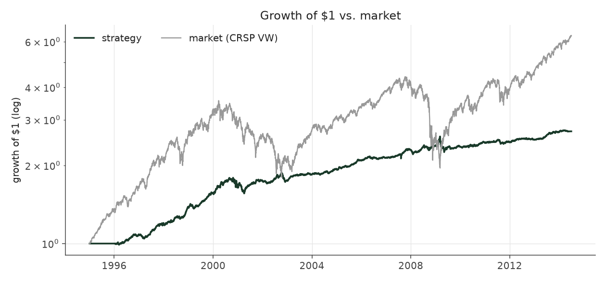
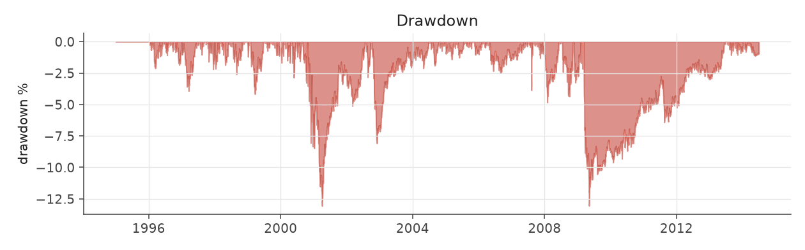
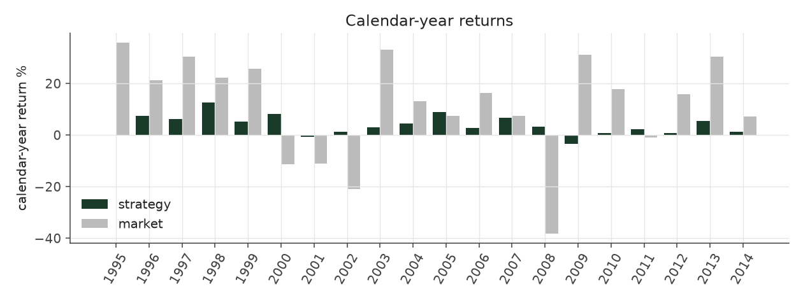
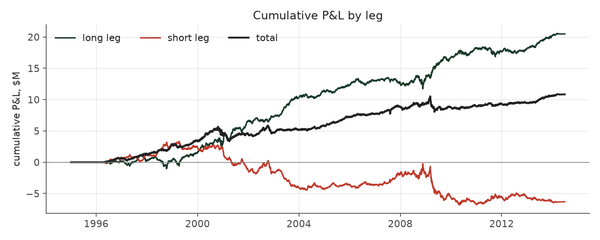
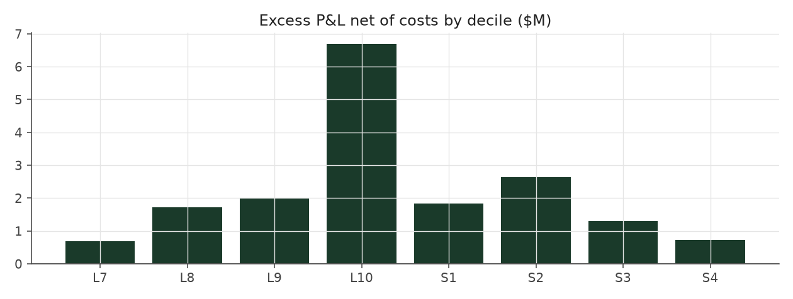

# conviction_tilt

_equity strategy | family: equity-neutralized | status: validated | derived from `graded_bets`_

## What this strategy does

Skip the middle 15% either side of average, lean toward the strongest surprises, balance by size

**Why it should work.** Concentrate capital where the surprise is largest; neutralize size so it is not a hidden bet.

**Design notes** (from the strategy's source file).

Conviction Tilt -- skip the unsure middle, lean on the strongest signals, balance by size.

Built after diagnosing why rank-weighting had the better Sharpe but the worse return: it traded ~4x more positions and saturated the liquidity/leverage caps. This strategy drops the low-conviction middle of the SUE-rank distribution (trim 0.15), leans weight toward the extremes (tilt), keeps size neutrality, and when the leverage cap binds drops the LOWEST-conviction positions first instead of shaving everything equally.

| parameter | value |
|---|---|
| base_unit_fraction | 0.002 |
| max_gross_leverage | 1.5 |
| liquidity_cap_frac | 0.05 |
| return_basis | mktadj |
| cap_mode | priority |
| exposure_cap | open_book |
| beta_overlay | 0.0 |

## Performance

| metric | conviction_tilt | market (CRSP VW) |
|---|---|---|
| Annualized return | 3.84% | 9.94% |
| Annualized volatility | 3.97% | 19.35% |
| Sharpe (NAV-pct) | 0.97 | 0.59 |
| Sortino | 1.38 |  |
| Max drawdown | -14.5% | -55.5% |
| Calmar | 0.26 |  |
| Final NAV ($10M start) | $20,828,564 |  |
| Worst day | -2.23% |  |
| % positive days | 50.8% |  |
| Sharpe 1996-2001 | 1.24 |  |
| Sharpe 2002-2007 | 1.35 |  |
| Sharpe 2008-2013 | 0.41 |  |

Correlation of daily returns with the market: **0.05**.

- best Sharpe among equity: `calm_rank_tilt` (1.47); this one: 0.968
- best return among equity: `market_boost_max` (0.116); this one: 0.0384
- best Calmar among equity: `calm_rank_tilt` (0.442); this one: 0.265

*NAV (log scale)*

*Drawdown from running peak*

*Calendar-year returns*

*Is the edge stable, or concentrated in a few years?*

## Where the return comes from

*Long leg vs. short leg vs. total*

|  | long leg | short leg |
|---|---|---|
| P&L ($M, before costs) | 20.48 | -6.32 |
| P&L after costs ($M) | 18.91 | -8.08 |
| of which common (average-event) component ($M) | 11.70 | -12.47 |
| of which excess / PEAD component ($M) | 8.78 | 6.15 |
| excess minus costs ($M) | 7.21 | 4.39 |
| gross return per $ traded (bp) | 293.19 | -80.20 |
| positions in the money (hit rate) | 0.56 | 0.48 |
| stand-alone Sharpe (leg only) | 1.13 | -0.31 |

Daily P&L correlation between the two legs: **-0.77**.

- **The short leg loses money in absolute terms** (-6.3M before costs) while the long leg earns +20.5M. That is mostly a benchmark effect, not a signal failure: the average earnings-event stock beat the cap-weighted market during its holding window, which flatters the long leg and hurts the short leg by 11.7M / 12.5M. Stripping that common component, the surprise signal itself earned +8.8M on the long side and +6.1M on the short side.
- The two legs' daily P&L are -0.77 correlated: the short leg is the hedge that makes the long leg's variance disappear (stand-alone leg Sharpe 1.13 long / -0.31 short vs 0.97 combined).

### By decile and side (signal-driven part only)

| leg | decile | positions | notional_M | net_pnl_M | excess_M | cost_M | alpha_net_M | alpha_share | alpha_bp_per_$ |
|---|---|---|---|---|---|---|---|---|---|
| long | 7 | 1,924 | 18.30 | 0.35 | 0.09 | 0.05 | 0.04 | 0.4% | 23.37 |
| long | 8 | 8,780 | 109.29 | 2.59 | 0.57 | 0.27 | 0.30 | 2.6% | 27.46 |
| long | 9 | 14,436 | 219.84 | 5.74 | 2.98 | 0.50 | 2.49 | 21.4% | 113.20 |
| long | 10 | 18,880 | 351.14 | 10.23 | 5.13 | 0.76 | 4.38 | 37.7% | 124.64 |
| short | 1 | 17,679 | 366.43 | -3.92 | 2.92 | 0.84 | 2.08 | 17.9% | 56.74 |
| short | 2 | 17,172 | 285.54 | -2.73 | 2.39 | 0.62 | 1.77 | 15.2% | 61.89 |
| short | 3 | 9,826 | 126.90 | -1.32 | 0.82 | 0.27 | 0.54 | 4.7% | 42.86 |
| short | 4 | 989 | 9.50 | -0.11 | 0.02 | 0.02 | 0.00 | 0.0% | 4.24 |

*D10 and the short deciles carry the alpha; the middle of each leg earns little*

### By size quintile (1 = smallest)

| size_quintile | positions | notional_M | net_pnl_M | excess_M | cost_M | alpha_net_M | alpha_share | alpha_bp_per_$ |
|---|---|---|---|---|---|---|---|---|
| 1 | 11,157 | 231.59 | 1.49 | 2.63 | 0.90 | 1.74 | 15.0% | 74.99 |
| 2 | 18,859 | 329.46 | 4.65 | 5.53 | 0.95 | 4.58 | 39.5% | 139.07 |
| 3 | 20,115 | 322.68 | 2.79 | 3.56 | 0.68 | 2.88 | 24.9% | 89.39 |
| 4 | 20,294 | 308.44 | 1.44 | 2.12 | 0.48 | 1.64 | 14.2% | 53.26 |
| 5 | 19,261 | 294.77 | 0.46 | 1.08 | 0.33 | 0.76 | 6.5% | 25.66 |

### By liquidity quintile (1 = least liquid)

| liquidity_quintile | positions | notional_M | net_pnl_M | excess_M | cost_M | alpha_net_M | alpha_share | alpha_bp_per_$ |
|---|---|---|---|---|---|---|---|---|
| 1 | 9,902 | 164.57 | 2.57 | 3.55 | 0.82 | 2.72 | 23.5% | 165.47 |
| 2 | 19,150 | 356.76 | 3.04 | 4.53 | 1.07 | 3.46 | 29.8% | 96.92 |
| 3 | 20,400 | 342.39 | 2.99 | 3.88 | 0.69 | 3.20 | 27.6% | 93.36 |
| 4 | 20,497 | 322.78 | 1.48 | 2.04 | 0.45 | 1.59 | 13.7% | 49.28 |
| 5 | 19,733 | 300.32 | 0.75 | 0.93 | 0.30 | 0.63 | 5.4% | 20.89 |

### By holding-window length

| hold_bucket | positions | notional_M | net_pnl_M | excess_M | cost_M | alpha_net_M | alpha_share | alpha_bp_per_$ |
|---|---|---|---|---|---|---|---|---|
| <=40d | 28,529 | 456.20 | 0.67 | 4.90 | 0.96 | 3.93 | 33.9% | 86.15 |
| 41-60d | 22,791 | 384.98 | 0.37 | 2.19 | 0.90 | 1.29 | 11.1% | 33.48 |
| 61-90d | 30,360 | 502.34 | 5.04 | 3.68 | 1.04 | 2.64 | 22.7% | 52.50 |
| >90d | 8,006 | 143.42 | 4.75 | 4.17 | 0.42 | 3.75 | 32.3% | 261.16 |

### By era

| era | positions | notional_M | net_pnl_M | excess_M | cost_M | alpha_net_M | alpha_share | alpha_bp_per_$ |
|---|---|---|---|---|---|---|---|---|
| 1996-01 | 26,048 | 385.15 | 4.33 | 5.49 | 0.82 | 4.66 | 40.2% | 121.03 |
| 2002-07 | 30,088 | 512.64 | 4.20 | 5.51 | 1.13 | 4.38 | 37.7% | 85.41 |
| 2008-13 | 33,550 | 589.14 | 2.31 | 3.94 | 1.38 | 2.56 | 22.1% | 43.49 |

### By FF12 sector

| ff12_sector | positions | notional_M | net_pnl_M | excess_M | cost_M | alpha_net_M | alpha_share | alpha_bp_per_$ |
|---|---|---|---|---|---|---|---|---|
| BusEq | 16,984 | 287.05 | 2.15 | 1.63 | 0.65 | 0.98 | 8.5% | 34.26 |
| Chems | 1,801 | 28.30 | 0.08 | 0.22 | 0.06 | 0.16 | 1.4% | 56.52 |
| Durbl | 2,142 | 35.56 | 0.33 | 0.54 | 0.08 | 0.45 | 3.9% | 126.95 |
| Enrgy | 4,375 | 71.56 | 0.70 | 1.03 | 0.15 | 0.88 | 7.6% | 122.82 |
| Hlth | 8,573 | 146.42 | 1.01 | 0.99 | 0.37 | 0.62 | 5.4% | 42.40 |
| Manuf | 9,128 | 147.16 | 0.74 | 1.47 | 0.32 | 1.15 | 9.9% | 77.97 |
| Money | 12,717 | 211.84 | 1.21 | 2.65 | 0.46 | 2.19 | 18.9% | 103.39 |
| NoDur | 3,879 | 61.42 | 0.39 | 0.48 | 0.13 | 0.35 | 3.0% | 56.66 |
| Other | 13,824 | 231.05 | 2.13 | 2.90 | 0.56 | 2.34 | 20.2% | 101.42 |
| Shops | 9,776 | 158.08 | 2.03 | 2.35 | 0.35 | 2.00 | 17.2% | 126.42 |
| Telcm | 3,058 | 52.34 | 0.21 | 0.51 | 0.11 | 0.40 | 3.4% | 76.14 |
| Utils | 3,429 | 56.15 | -0.15 | 0.18 | 0.10 | 0.08 | 0.7% | 14.54 |

### By idiosyncratic-volatility tercile

| vol_tercile | positions | notional_M | net_pnl_M | excess_M | cost_M | alpha_net_M | alpha_share | alpha_bp_per_$ |
|---|---|---|---|---|---|---|---|---|
| high vol | 30,116 | 494.54 | 1.34 | 2.64 | 0.99 | 1.65 | 14.2% | 33.29 |
| low vol | 29,650 | 492.29 | 4.60 | 6.32 | 1.22 | 5.10 | 43.9% | 103.55 |
| mid vol | 28,363 | 468.73 | 4.25 | 5.34 | 1.05 | 4.30 | 37.0% | 91.65 |

### Short-borrow sensitivity (not modeled in the backtest)

| borrow_rate | fee_M | annualized_return | drag |
|---|---|---|---|
| 0.0% | 0.0 | 3.84% | 0.00% |
| 0.5% | 0.8 | 3.63% | 0.21% |
| 1.0% | 1.6 | 3.41% | 0.43% |
| 2.0% | 3.3 | 2.94% | 0.90% |
| 5.0% | 8.1 | 1.23% | 2.61% |

The engine charges the same transaction cost on shorts as on longs and no stock-borrow fee. The short leg is concentrated in small, illiquid names, where borrow is scarce and expensive -- read the table as a floor on the cost of running the short leg.
