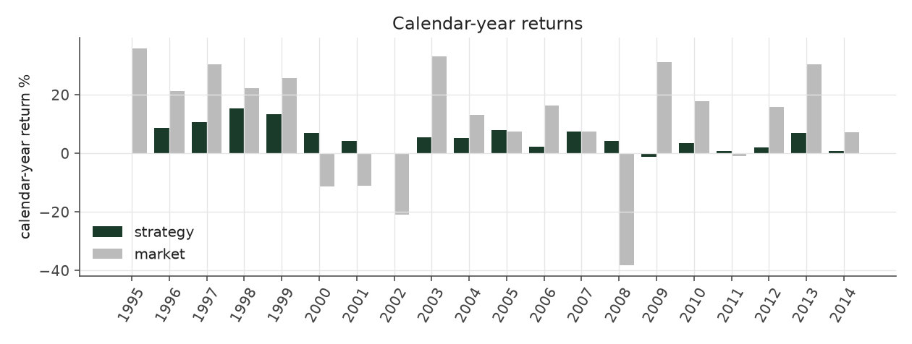
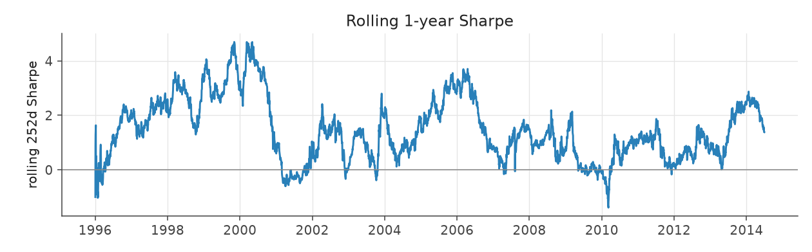
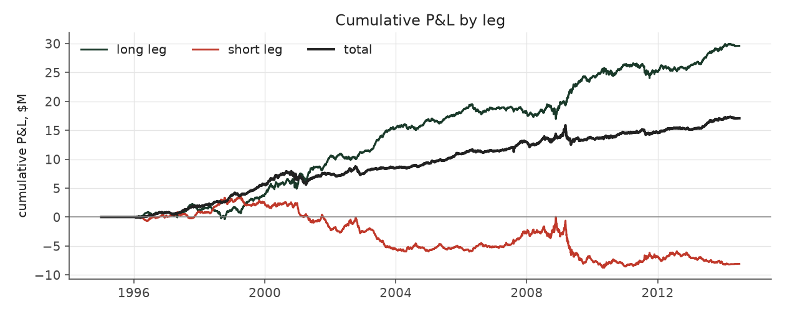

# conviction_tilt_legacy

_equity strategy | family: equity-neutralized | status: reference | derived from `conviction_tilt`_

## What this strategy does

Skip the middle 15% either side of average, lean toward the strongest surprises, balance by size -- ORIGINAL leverage cap (new positions only, open book ignored)

**Why it should work.** Concentrate capital where the surprise is largest; neutralize size so it is not a hidden bet.

**Design notes** (from the strategy's source file).

Conviction Tilt -- skip the unsure middle, lean on the strongest signals, balance by size.

Built after diagnosing why rank-weighting had the better Sharpe but the worse return: it traded ~4x more positions and saturated the liquidity/leverage caps. This strategy drops the low-conviction middle of the SUE-rank distribution (trim 0.15), leans weight toward the extremes (tilt), keeps size neutrality, and when the leverage cap binds drops the LOWEST-conviction positions first instead of shaving everything equally.

| parameter | value |
|---|---|
| base_unit_fraction | 0.002 |
| max_gross_leverage | 1.5 |
| liquidity_cap_frac | 0.05 |
| return_basis | mktadj |
| cap_mode | priority |
| exposure_cap | entry_cohort |
| beta_overlay | 0.0 |

## Performance

| metric | conviction_tilt_legacy | market (CRSP VW) |
|---|---|---|
| Annualized return | 5.25% | 9.94% |
| Annualized volatility | 4.41% | 19.35% |
| Sharpe (NAV-pct) | 1.18 | 0.59 |
| Sortino | 1.70 |  |
| Max drawdown | -13.1% | -55.5% |
| Calmar | 0.40 |  |
| Final NAV ($10M start) | $27,077,292 |  |
| Worst day | -2.43% |  |
| % positive days | 52.3% |  |
| Sharpe 1996-2001 | 1.74 |  |
| Sharpe 2002-2007 | 1.31 |  |
| Sharpe 2008-2013 | 0.60 |  |

Correlation of daily returns with the market: **0.05**.

- best Sharpe among equity: `calm_rank_tilt` (1.47); this one: 1.18
- best return among equity: `market_boost_max` (0.116); this one: 0.0525
- best Calmar among equity: `calm_rank_tilt` (0.442); this one: 0.402

*NAV (log scale)*

*Drawdown from running peak*

*Calendar-year returns*

*Is the edge stable, or concentrated in a few years?*

## Where the return comes from

*Long leg vs. short leg vs. total*

|  | long leg | short leg |
|---|---|---|
| P&L ($M, before costs) | 29.61 | -8.08 |
| P&L after costs ($M) | 27.48 | -10.41 |
| of which common (average-event) component ($M) | 15.95 | -16.41 |
| of which excess / PEAD component ($M) | 13.10 | 8.76 |
| excess minus costs ($M) | 10.98 | 6.45 |
| gross return per $ traded (bp) | 297.54 | -77.04 |
| positions in the money (hit rate) | 0.56 | 0.49 |
| stand-alone Sharpe (leg only) | 1.21 | -0.29 |

Daily P&L correlation between the two legs: **-0.78**.

- **The short leg loses money in absolute terms** (-8.1M before costs) while the long leg earns +29.6M. That is mostly a benchmark effect, not a signal failure: the average earnings-event stock beat the cap-weighted market during its holding window, which flatters the long leg and hurts the short leg by 16.0M / 16.4M. Stripping that common component, the surprise signal itself earned +13.1M on the long side and +8.8M on the short side.
- The two legs' daily P&L are -0.78 correlated: the short leg is the hedge that makes the long leg's variance disappear (stand-alone leg Sharpe 1.21 long / -0.29 short vs 1.18 combined).

### By decile and side (signal-driven part only)

| leg | decile | positions | notional_M | net_pnl_M | excess_M | cost_M | alpha_net_M | alpha_share | alpha_bp_per_$ |
|---|---|---|---|---|---|---|---|---|---|
| long | 7 | 5,109 | 54.41 | 2.00 | 0.77 | 0.13 | 0.64 | 3.7% | 117.71 |
| long | 8 | 15,516 | 217.64 | 5.62 | 2.12 | 0.48 | 1.64 | 9.4% | 75.55 |
| long | 9 | 17,587 | 322.33 | 6.68 | 2.68 | 0.67 | 2.01 | 11.5% | 62.42 |
| long | 10 | 17,044 | 400.78 | 13.19 | 7.52 | 0.84 | 6.67 | 38.3% | 166.49 |
| short | 1 | 16,800 | 412.85 | -4.55 | 2.81 | 0.95 | 1.86 | 10.7% | 45.08 |
| short | 2 | 17,012 | 330.93 | -2.84 | 3.33 | 0.73 | 2.61 | 15.0% | 78.82 |
| short | 3 | 15,637 | 230.86 | -2.49 | 1.77 | 0.50 | 1.27 | 7.3% | 54.96 |
| short | 4 | 7,653 | 74.51 | -0.52 | 0.84 | 0.15 | 0.69 | 4.0% | 93.31 |

*D10 and the short deciles carry the alpha; the middle of each leg earns little*

### By size quintile (1 = smallest)

| size_quintile | positions | notional_M | net_pnl_M | excess_M | cost_M | alpha_net_M | alpha_share | alpha_bp_per_$ |
|---|---|---|---|---|---|---|---|---|
| 1 | 12,635 | 277.38 | 4.88 | 6.56 | 1.07 | 5.49 | 31.5% | 197.86 |
| 2 | 22,249 | 437.74 | 5.40 | 6.60 | 1.26 | 5.33 | 30.6% | 121.88 |
| 3 | 24,545 | 445.39 | 3.82 | 4.55 | 0.93 | 3.62 | 20.8% | 81.28 |
| 4 | 26,161 | 444.26 | 1.90 | 2.56 | 0.69 | 1.87 | 10.7% | 42.16 |
| 5 | 26,768 | 439.55 | 1.08 | 1.57 | 0.48 | 1.09 | 6.2% | 24.71 |

### By liquidity quintile (1 = least liquid)

| liquidity_quintile | positions | notional_M | net_pnl_M | excess_M | cost_M | alpha_net_M | alpha_share | alpha_bp_per_$ |
|---|---|---|---|---|---|---|---|---|
| 1 | 11,936 | 204.63 | 4.83 | 6.17 | 1.02 | 5.15 | 29.5% | 251.49 |
| 2 | 22,441 | 467.78 | 4.88 | 6.82 | 1.40 | 5.41 | 31.1% | 115.73 |
| 3 | 24,862 | 468.24 | 3.94 | 5.10 | 0.94 | 4.16 | 23.9% | 88.86 |
| 4 | 26,282 | 458.63 | 2.03 | 2.50 | 0.64 | 1.86 | 10.7% | 40.48 |
| 5 | 26,832 | 444.91 | 1.39 | 1.27 | 0.45 | 0.83 | 4.7% | 18.59 |

### By holding-window length

| hold_bucket | positions | notional_M | net_pnl_M | excess_M | cost_M | alpha_net_M | alpha_share | alpha_bp_per_$ |
|---|---|---|---|---|---|---|---|---|
| <=40d | 42,328 | 715.87 | -0.58 | 3.89 | 1.32 | 2.56 | 14.7% | 35.83 |
| 41-60d | 24,752 | 462.93 | 2.26 | 2.69 | 1.02 | 1.67 | 9.6% | 35.96 |
| 61-90d | 33,610 | 629.62 | 5.66 | 6.24 | 1.44 | 4.80 | 27.5% | 76.17 |
| >90d | 11,668 | 235.90 | 9.74 | 9.04 | 0.67 | 8.38 | 48.1% | 355.12 |

### By era

| era | positions | notional_M | net_pnl_M | excess_M | cost_M | alpha_net_M | alpha_share | alpha_bp_per_$ |
|---|---|---|---|---|---|---|---|---|
| 1996-01 | 32,693 | 480.63 | 7.06 | 8.09 | 1.01 | 7.08 | 40.6% | 147.33 |
| 2002-07 | 37,768 | 691.10 | 5.43 | 7.05 | 1.48 | 5.57 | 32.0% | 80.66 |
| 2008-13 | 41,897 | 872.59 | 4.59 | 6.71 | 1.96 | 4.75 | 27.2% | 54.41 |

### By FF12 sector

| ff12_sector | positions | notional_M | net_pnl_M | excess_M | cost_M | alpha_net_M | alpha_share | alpha_bp_per_$ |
|---|---|---|---|---|---|---|---|---|
| BusEq | 21,073 | 387.69 | 3.73 | 2.99 | 0.85 | 2.15 | 12.3% | 55.34 |
| Chems | 2,426 | 41.78 | 0.15 | 0.29 | 0.08 | 0.21 | 1.2% | 50.53 |
| Durbl | 2,657 | 48.63 | 0.55 | 0.80 | 0.11 | 0.69 | 4.0% | 142.22 |
| Enrgy | 5,779 | 101.46 | 1.40 | 1.75 | 0.20 | 1.55 | 8.9% | 152.99 |
| Hlth | 10,938 | 200.75 | 2.46 | 2.37 | 0.48 | 1.88 | 10.8% | 93.75 |
| Manuf | 11,395 | 202.91 | 1.11 | 1.91 | 0.43 | 1.48 | 8.5% | 72.85 |
| Money | 16,527 | 302.05 | 2.08 | 3.91 | 0.64 | 3.26 | 18.7% | 108.03 |
| NoDur | 4,812 | 85.02 | 0.71 | 0.82 | 0.17 | 0.65 | 3.7% | 76.39 |
| Other | 17,162 | 317.77 | 2.40 | 3.41 | 0.75 | 2.67 | 15.3% | 83.88 |
| Shops | 11,409 | 209.54 | 2.37 | 2.77 | 0.45 | 2.31 | 13.3% | 110.40 |
| Telcm | 3,788 | 69.14 | 0.10 | 0.49 | 0.14 | 0.35 | 2.0% | 51.03 |
| Utils | 4,392 | 77.58 | 0.01 | 0.33 | 0.14 | 0.20 | 1.1% | 25.51 |

### By idiosyncratic-volatility tercile

| vol_tercile | positions | notional_M | net_pnl_M | excess_M | cost_M | alpha_net_M | alpha_share | alpha_bp_per_$ |
|---|---|---|---|---|---|---|---|---|
| high vol | 37,309 | 677.56 | 3.73 | 5.21 | 1.33 | 3.88 | 22.3% | 57.29 |
| low vol | 37,771 | 683.62 | 6.69 | 8.70 | 1.64 | 7.06 | 40.5% | 103.23 |
| mid vol | 35,726 | 647.23 | 6.25 | 7.66 | 1.41 | 6.25 | 35.9% | 96.62 |

### Short-borrow sensitivity (not modeled in the backtest)

| borrow_rate | fee_M | annualized_return | drag |
|---|---|---|---|
| 0.0% | 0.0 | 5.25% | 0.00% |
| 0.5% | 1.1 | 5.03% | 0.22% |
| 1.0% | 2.2 | 4.80% | 0.45% |
| 2.0% | 4.3 | 4.31% | 0.94% |
| 5.0% | 10.9 | 2.51% | 2.73% |

The engine charges the same transaction cost on shorts as on longs and no stock-borrow fee. The short leg is concentrated in small, illiquid names, where borrow is scarce and expensive -- read the table as a floor on the cost of running the short leg.
