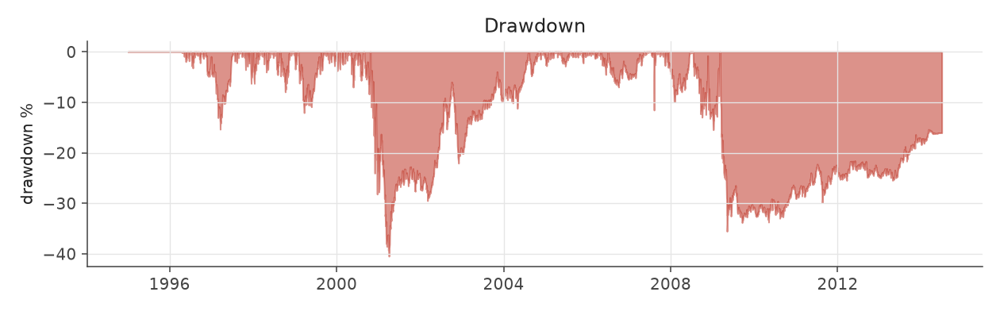
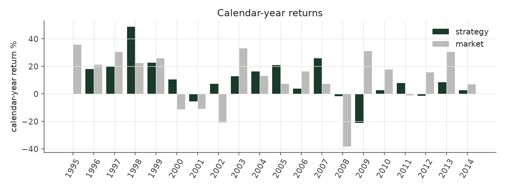

# conviction_tilt_max

_equity strategy | family: equity-max | status: research | derived from `conviction_tilt`_

## What this strategy does

conviction_tilt with bigger bets for more return: base unit 0.007, 6x leverage cap

**Why it should work.** Concentrate capital where the surprise is largest; neutralize size so it is not a hidden bet.

**Design notes** (from the strategy's source file).

Max-size variants ("<name>_max") of the hand-built equity strategies.

Same signal, trim, tilt and neutralization as each base strategy; only the two dials that set how big and how levered the book is change (base_unit_fraction, gross-leverage cap = 6x). The multiplier for each was picked by sweeping 1.5x..12x the original base unit and taking the highest return subject to Sharpe >= 0.6 and max drawdown >= -40% (a worse drawdown is a fund-ending event, not a risk preference). The untouched 5%-of-ADV liquidity cap remains the real capacity constraint, and bites roughly four times as often at this sizing.

These are generated from the base strategy classes, so a change to a base strategy's weights flows through automatically.

| parameter | value |
|---|---|
| base_unit_fraction | 0.007 |
| max_gross_leverage | 6.0 |
| liquidity_cap_frac | 0.05 |
| return_basis | mktadj |
| cap_mode | priority |
| exposure_cap | open_book |
| beta_overlay | 0.0 |

## Performance

| metric | conviction_tilt_max | market (CRSP VW) |
|---|---|---|
| Annualized return | 9.26% | 9.94% |
| Annualized volatility | 12.65% | 19.35% |
| Sharpe (NAV-pct) | 0.76 | 0.59 |
| Sortino | 1.09 |  |
| Max drawdown | -40.5% | -55.5% |
| Calmar | 0.23 |  |
| Final NAV ($10M start) | $56,133,710 |  |
| Worst day | -7.25% |  |
| % positive days | 49.8% |  |
| Sharpe 1996-2001 | 1.08 |  |
| Sharpe 2002-2007 | 1.45 |  |
| Sharpe 2008-2013 | -0.05 |  |

Correlation of daily returns with the market: **0.04**.

- best Sharpe among equity: `calm_rank_tilt` (1.81); this one: 0.764
- best return among equity: `market_boost_max` (0.15); this one: 0.0926
- best Calmar among equity: `calm_rank_tilt` (0.614); this one: 0.229

*NAV (log scale)*

*Drawdown from running peak*

*Calendar-year returns*

*Is the edge stable, or concentrated in a few years?*

## Where the return comes from

*Long leg vs. short leg vs. total*

|  | long leg | short leg |
|---|---|---|
| P&L ($M, before costs) | 106.73 | -40.24 |
| P&L after costs ($M) | 96.86 | -50.72 |
| of which common (average-event) component ($M) | 87.76 | -89.04 |
| of which excess / PEAD component ($M) | 18.97 | 48.80 |
| excess minus costs ($M) | 9.10 | 38.32 |
| gross return per $ traded (bp) | 191.03 | -70.48 |
| positions in the money (hit rate) | 0.56 | 0.48 |
| stand-alone Sharpe (leg only) | 0.91 | -0.23 |

Daily P&L correlation between the two legs: **-0.73**.

- **The short leg loses money in absolute terms** (-40.2M before costs) while the long leg earns +106.7M. That is mostly a benchmark effect, not a signal failure: the average earnings-event stock beat the cap-weighted market during its holding window, which flatters the long leg and hurts the short leg by 87.8M / 89.0M. Stripping that common component, the surprise signal itself earned +19.0M on the long side and +48.8M on the short side.
- The two legs' daily P&L are -0.73 correlated: the short leg is the hedge that makes the long leg's variance disappear (stand-alone leg Sharpe 0.91 long / -0.23 short vs 0.76 combined).

### By decile and side (signal-driven part only)

| leg | decile | positions | notional_M | net_pnl_M | excess_M | cost_M | alpha_net_M | alpha_share | alpha_bp_per_$ |
|---|---|---|---|---|---|---|---|---|---|
| long | 7 | 6,507 | 350.56 | 3.01 | -1.84 | 0.66 | -2.50 | -5.3% | -71.27 |
| long | 8 | 16,600 | 1,189.48 | 17.66 | -0.49 | 2.17 | -2.66 | -5.6% | -22.39 |
| long | 9 | 18,545 | 1,711.44 | 29.11 | 7.42 | 2.99 | 4.43 | 9.3% | 25.91 |
| long | 10 | 20,109 | 2,335.43 | 47.08 | 13.88 | 4.05 | 9.83 | 20.7% | 42.08 |
| short | 1 | 18,252 | 2,270.25 | -19.32 | 22.21 | 4.19 | 18.02 | 38.0% | 79.39 |
| short | 2 | 18,869 | 1,989.82 | -18.24 | 16.46 | 3.62 | 12.84 | 27.1% | 64.53 |
| short | 3 | 15,351 | 1,305.57 | -11.36 | 9.58 | 2.41 | 7.17 | 15.1% | 54.91 |
| short | 4 | 2,369 | 144.14 | -1.81 | 0.55 | 0.26 | 0.29 | 0.6% | 20.03 |

*D10 and the short deciles carry the alpha; the middle of each leg earns little*

### By size quintile (1 = smallest)

| size_quintile | positions | notional_M | net_pnl_M | excess_M | cost_M | alpha_net_M | alpha_share | alpha_bp_per_$ |
|---|---|---|---|---|---|---|---|---|
| 1 | 13,888 | 581.47 | -3.47 | 0.26 | 1.96 | -1.70 | -3.6% | -29.14 |
| 2 | 22,218 | 1,955.10 | 17.75 | 23.86 | 5.03 | 18.83 | 39.7% | 96.32 |
| 3 | 25,033 | 2,760.28 | 17.52 | 21.96 | 5.50 | 16.46 | 34.7% | 59.62 |
| 4 | 27,193 | 2,976.82 | 8.71 | 12.79 | 4.53 | 8.26 | 17.4% | 27.75 |
| 5 | 28,270 | 3,023.01 | 5.62 | 8.88 | 3.32 | 5.57 | 11.7% | 18.41 |

### By liquidity quintile (1 = least liquid)

| liquidity_quintile | positions | notional_M | net_pnl_M | excess_M | cost_M | alpha_net_M | alpha_share | alpha_bp_per_$ |
|---|---|---|---|---|---|---|---|---|
| 1 | 13,205 | 292.93 | 2.77 | 4.75 | 1.47 | 3.29 | 6.9% | 112.14 |
| 2 | 22,552 | 1,802.69 | 8.17 | 16.26 | 5.41 | 10.85 | 22.9% | 60.20 |
| 3 | 25,317 | 3,027.36 | 19.64 | 27.26 | 6.05 | 21.21 | 44.7% | 70.05 |
| 4 | 27,157 | 3,113.17 | 7.07 | 10.93 | 4.36 | 6.58 | 13.9% | 21.12 |
| 5 | 28,366 | 3,059.68 | 8.42 | 8.46 | 3.06 | 5.40 | 11.4% | 17.66 |

### By holding-window length

| hold_bucket | positions | notional_M | net_pnl_M | excess_M | cost_M | alpha_net_M | alpha_share | alpha_bp_per_$ |
|---|---|---|---|---|---|---|---|---|
| <=40d | 41,721 | 3,891.28 | -1.89 | 29.89 | 6.76 | 23.13 | 48.8% | 59.44 |
| 41-60d | 27,618 | 2,783.50 | 4.91 | 16.22 | 5.44 | 10.78 | 22.7% | 38.72 |
| 61-90d | 37,796 | 3,842.48 | 26.99 | 7.72 | 6.29 | 1.43 | 3.0% | 3.72 |
| >90d | 9,467 | 779.43 | 16.12 | 13.94 | 1.85 | 12.08 | 25.5% | 155.01 |

### By era

| era | positions | notional_M | net_pnl_M | excess_M | cost_M | alpha_net_M | alpha_share | alpha_bp_per_$ |
|---|---|---|---|---|---|---|---|---|
| 1996-01 | 32,241 | 1,869.17 | 16.25 | 19.00 | 3.27 | 15.73 | 33.2% | 84.16 |
| 2002-07 | 38,279 | 3,991.48 | 30.95 | 36.58 | 7.08 | 29.50 | 62.2% | 73.89 |
| 2008-13 | 46,082 | 5,436.03 | -1.06 | 12.20 | 10.00 | 2.19 | 4.6% | 4.04 |

### By FF12 sector

| ff12_sector | positions | notional_M | net_pnl_M | excess_M | cost_M | alpha_net_M | alpha_share | alpha_bp_per_$ |
|---|---|---|---|---|---|---|---|---|
| BusEq | 21,113 | 1,970.91 | 10.12 | 4.54 | 3.54 | 1.00 | 2.1% | 5.09 |
| Chems | 2,548 | 253.96 | 0.79 | 1.68 | 0.44 | 1.24 | 2.6% | 48.80 |
| Durbl | 2,821 | 260.62 | 0.26 | 1.56 | 0.48 | 1.07 | 2.3% | 41.25 |
| Enrgy | 6,341 | 631.50 | 6.25 | 8.48 | 1.05 | 7.43 | 15.7% | 117.72 |
| Hlth | 11,395 | 1,036.29 | 5.93 | 4.69 | 1.99 | 2.70 | 5.7% | 26.04 |
| Manuf | 11,900 | 1,128.74 | 1.26 | 5.16 | 2.00 | 3.16 | 6.7% | 28.00 |
| Money | 17,269 | 1,776.47 | 4.13 | 14.28 | 3.17 | 11.11 | 23.4% | 62.53 |
| NoDur | 4,907 | 476.76 | 2.25 | 2.61 | 0.83 | 1.78 | 3.8% | 37.32 |
| Other | 18,047 | 1,743.08 | 9.64 | 13.72 | 3.36 | 10.36 | 21.8% | 59.44 |
| Shops | 11,570 | 1,114.70 | 6.81 | 8.08 | 2.01 | 6.06 | 12.8% | 54.40 |
| Telcm | 3,954 | 391.27 | -0.04 | 2.10 | 0.66 | 1.45 | 3.0% | 36.92 |
| Utils | 4,737 | 512.38 | -1.27 | 0.87 | 0.82 | 0.05 | 0.1% | 1.02 |

### By idiosyncratic-volatility tercile

| vol_tercile | positions | notional_M | net_pnl_M | excess_M | cost_M | alpha_net_M | alpha_share | alpha_bp_per_$ |
|---|---|---|---|---|---|---|---|---|
| high vol | 39,014 | 3,976.12 | 4.41 | 12.98 | 6.56 | 6.42 | 13.5% | 16.16 |
| low vol | 38,900 | 3,571.91 | 19.63 | 27.09 | 7.00 | 20.09 | 42.4% | 56.26 |
| mid vol | 36,898 | 3,595.49 | 20.53 | 26.20 | 6.49 | 19.71 | 41.6% | 54.82 |

### Short-borrow sensitivity (not modeled in the backtest)

| borrow_rate | fee_M | annualized_return | drag |
|---|---|---|---|
| 0.0% | 0.0 | 9.26% | -0.00% |
| 0.5% | 5.6 | 8.67% | 0.59% |
| 1.0% | 11.3 | 8.01% | 1.25% |
| 2.0% | 22.6 | 6.42% | 2.85% |
| 5.0% | 56.4 | -100.00% | 109.26% |

The engine charges the same transaction cost on shorts as on longs and no stock-borrow fee. The short leg is concentrated in small, illiquid names, where borrow is scarce and expensive -- read the table as a floor on the cost of running the short leg.
