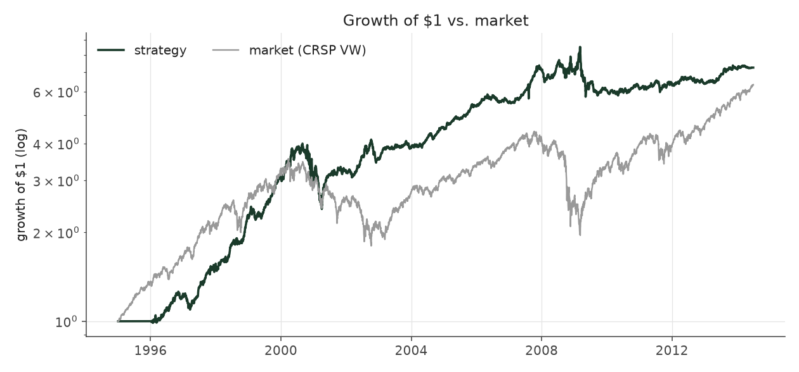
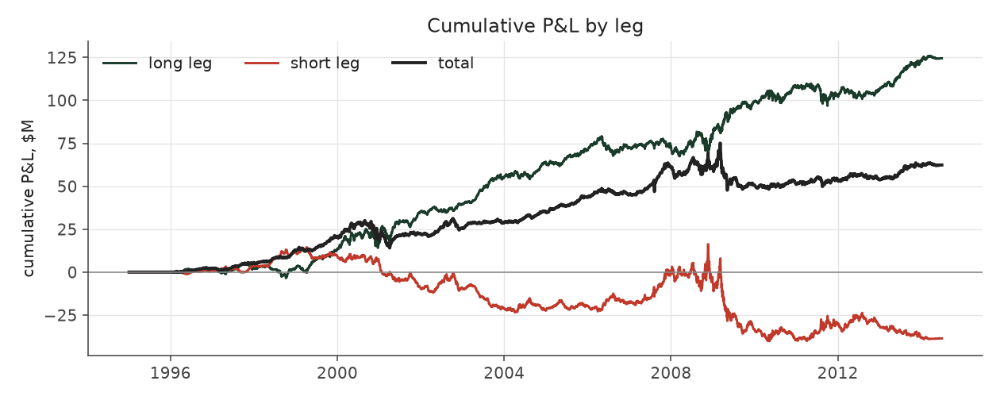

# conviction_tilt_max_legacy

_equity strategy | family: equity-max | status: reference | derived from `conviction_tilt_max`_

## What this strategy does

conviction_tilt with bigger bets for more return: base unit 0.007, 6x leverage cap -- ORIGINAL leverage cap (new positions only, open book ignored)

**Why it should work.** Concentrate capital where the surprise is largest; neutralize size so it is not a hidden bet.

**Design notes** (from the strategy's source file).

Max-size variants ("<name>_max") of the hand-built equity strategies.

Same signal, trim, tilt and neutralization as each base strategy; only the two dials that set how big and how levered the book is change (base_unit_fraction, gross-leverage cap = 6x). The multiplier for each was picked by sweeping 1.5x..12x the original base unit and taking the highest return subject to Sharpe >= 0.6 and max drawdown >= -40% (a worse drawdown is a fund-ending event, not a risk preference). The untouched 5%-of-ADV liquidity cap remains the real capacity constraint, and bites roughly four times as often at this sizing.

These are generated from the base strategy classes, so a change to a base strategy's weights flows through automatically.

| parameter | value |
|---|---|
| base_unit_fraction | 0.007 |
| max_gross_leverage | 6.0 |
| liquidity_cap_frac | 0.05 |
| return_basis | mktadj |
| cap_mode | priority |
| exposure_cap | entry_cohort |
| beta_overlay | 0.0 |

## Performance

| metric | conviction_tilt_max_legacy | market (CRSP VW) |
|---|---|---|
| Annualized return | 10.70% | 9.94% |
| Annualized volatility | 12.25% | 19.35% |
| Sharpe (NAV-pct) | 0.89 | 0.59 |
| Sortino | 1.27 |  |
| Max drawdown | -40.0% | -55.5% |
| Calmar | 0.27 |  |
| Final NAV ($10M start) | $72,371,948 |  |
| Worst day | -6.54% |  |
| % positive days | 51.9% |  |
| Sharpe 1996-2001 | 1.30 |  |
| Sharpe 2002-2007 | 1.54 |  |
| Sharpe 2008-2013 | 0.07 |  |

Correlation of daily returns with the market: **0.03**.

- best Sharpe among equity: `calm_rank_tilt` (1.47); this one: 0.891
- best return among equity: `market_boost_max` (0.116); this one: 0.107
- best Calmar among equity: `calm_rank_tilt` (0.442); this one: 0.267

*NAV (log scale)*

*Drawdown from running peak*

*Calendar-year returns*

*Is the edge stable, or concentrated in a few years?*

## Where the return comes from

*Long leg vs. short leg vs. total*

|  | long leg | short leg |
|---|---|---|
| P&L ($M, before costs) | 124.48 | -38.59 |
| P&L after costs ($M) | 113.18 | -50.81 |
| of which common (average-event) component ($M) | 105.53 | -105.53 |
| of which excess / PEAD component ($M) | 17.78 | 67.56 |
| excess minus costs ($M) | 6.51 | 55.37 |
| gross return per $ traded (bp) | 189.32 | -56.80 |
| positions in the money (hit rate) | 0.56 | 0.49 |
| stand-alone Sharpe (leg only) | 0.95 | -0.15 |

Daily P&L correlation between the two legs: **-0.72**.

- **The short leg loses money in absolute terms** (-38.6M before costs) while the long leg earns +124.5M. That is mostly a benchmark effect, not a signal failure: the average earnings-event stock beat the cap-weighted market during its holding window, which flatters the long leg and hurts the short leg by 105.5M / 105.5M. Stripping that common component, the surprise signal itself earned +17.8M on the long side and +67.6M on the short side.
- The two legs' daily P&L are -0.72 correlated: the short leg is the hedge that makes the long leg's variance disappear (stand-alone leg Sharpe 0.95 long / -0.15 short vs 0.89 combined).

### By decile and side (signal-driven part only)

| leg | decile | positions | notional_M | net_pnl_M | excess_M | cost_M | alpha_net_M | alpha_share | alpha_bp_per_$ |
|---|---|---|---|---|---|---|---|---|---|
| long | 7 | 8,029 | 531.28 | 8.56 | 0.00 | 0.97 | -0.97 | -1.6% | -18.21 |
| long | 8 | 16,588 | 1,498.23 | 26.40 | 3.34 | 2.65 | 0.68 | 1.1% | 4.57 |
| long | 9 | 17,747 | 2,072.79 | 26.15 | -1.52 | 3.50 | -5.02 | -8.1% | -24.23 |
| long | 10 | 17,174 | 2,472.81 | 52.07 | 15.96 | 4.17 | 11.79 | 19.1% | 47.69 |
| short | 1 | 17,169 | 2,422.99 | -18.52 | 21.57 | 4.38 | 17.19 | 27.8% | 70.94 |
| short | 2 | 17,281 | 2,130.37 | -14.14 | 24.39 | 3.77 | 20.62 | 33.3% | 96.78 |
| short | 3 | 15,970 | 1,602.41 | -13.84 | 14.90 | 2.92 | 11.98 | 19.4% | 74.78 |
| short | 4 | 9,171 | 638.34 | -4.31 | 6.70 | 1.15 | 5.55 | 9.0% | 86.95 |

*D10 and the short deciles carry the alpha; the middle of each leg earns little*

### By size quintile (1 = smallest)

| size_quintile | positions | notional_M | net_pnl_M | excess_M | cost_M | alpha_net_M | alpha_share | alpha_bp_per_$ |
|---|---|---|---|---|---|---|---|---|
| 1 | 14,213 | 602.96 | 4.85 | 8.89 | 2.02 | 6.87 | 11.1% | 113.97 |
| 2 | 22,885 | 2,160.87 | 17.58 | 23.66 | 5.48 | 18.18 | 29.4% | 84.14 |
| 3 | 25,501 | 3,273.89 | 21.32 | 25.52 | 6.45 | 19.07 | 30.8% | 58.26 |
| 4 | 27,583 | 3,629.42 | 11.28 | 15.96 | 5.50 | 10.45 | 16.9% | 28.80 |
| 5 | 28,947 | 3,702.08 | 7.34 | 11.31 | 4.06 | 7.25 | 11.7% | 19.58 |

### By liquidity quintile (1 = least liquid)

| liquidity_quintile | positions | notional_M | net_pnl_M | excess_M | cost_M | alpha_net_M | alpha_share | alpha_bp_per_$ |
|---|---|---|---|---|---|---|---|---|
| 1 | 13,650 | 301.82 | 5.97 | 8.06 | 1.51 | 6.55 | 10.6% | 217.01 |
| 2 | 23,084 | 1,899.67 | 12.57 | 20.66 | 5.70 | 14.96 | 24.2% | 78.73 |
| 3 | 25,851 | 3,614.33 | 23.26 | 31.74 | 7.23 | 24.51 | 39.6% | 67.81 |
| 4 | 27,665 | 3,809.07 | 10.53 | 15.10 | 5.33 | 9.76 | 15.8% | 25.63 |
| 5 | 28,874 | 3,743.30 | 10.05 | 9.77 | 3.74 | 6.03 | 9.7% | 16.11 |

### By holding-window length

| hold_bucket | positions | notional_M | net_pnl_M | excess_M | cost_M | alpha_net_M | alpha_share | alpha_bp_per_$ |
|---|---|---|---|---|---|---|---|---|
| <=40d | 45,855 | 5,376.99 | -6.32 | 24.12 | 8.71 | 15.41 | 24.9% | 28.65 |
| 41-60d | 25,652 | 2,972.62 | 15.99 | 14.05 | 5.33 | 8.72 | 14.1% | 29.32 |
| 61-90d | 35,324 | 3,914.33 | 19.92 | 19.75 | 7.17 | 12.58 | 20.3% | 32.14 |
| >90d | 12,298 | 1,105.28 | 32.79 | 27.43 | 2.30 | 25.12 | 40.6% | 227.32 |

### By era

| era | positions | notional_M | net_pnl_M | excess_M | cost_M | alpha_net_M | alpha_share | alpha_bp_per_$ |
|---|---|---|---|---|---|---|---|---|
| 1996-01 | 33,895 | 2,125.65 | 21.61 | 24.00 | 3.67 | 20.33 | 32.9% | 95.65 |
| 2002-07 | 39,956 | 4,622.80 | 35.24 | 41.70 | 8.03 | 33.67 | 54.4% | 72.84 |
| 2008-13 | 45,278 | 6,620.77 | 5.52 | 19.64 | 11.81 | 7.82 | 12.6% | 11.82 |

### By FF12 sector

| ff12_sector | positions | notional_M | net_pnl_M | excess_M | cost_M | alpha_net_M | alpha_share | alpha_bp_per_$ |
|---|---|---|---|---|---|---|---|---|
| BusEq | 22,094 | 2,356.09 | 15.94 | 8.48 | 4.12 | 4.36 | 7.0% | 18.50 |
| Chems | 2,590 | 305.15 | 1.28 | 2.16 | 0.51 | 1.65 | 2.7% | 53.97 |
| Durbl | 2,843 | 306.15 | 0.81 | 2.30 | 0.55 | 1.75 | 2.8% | 57.23 |
| Enrgy | 6,194 | 728.42 | 8.18 | 10.69 | 1.19 | 9.50 | 15.4% | 130.41 |
| Hlth | 11,696 | 1,213.37 | 10.05 | 8.11 | 2.27 | 5.84 | 9.4% | 48.16 |
| Manuf | 12,034 | 1,336.21 | 2.73 | 6.91 | 2.32 | 4.59 | 7.4% | 34.36 |
| Money | 17,583 | 2,118.09 | 7.17 | 19.55 | 3.69 | 15.86 | 25.6% | 74.88 |
| NoDur | 5,081 | 574.32 | 2.52 | 2.88 | 0.98 | 1.90 | 3.1% | 33.13 |
| Other | 18,377 | 2,048.37 | 7.91 | 12.37 | 3.86 | 8.51 | 13.8% | 41.57 |
| Shops | 11,984 | 1,335.59 | 7.65 | 8.85 | 2.35 | 6.50 | 10.5% | 48.68 |
| Telcm | 3,981 | 448.63 | -1.34 | 1.27 | 0.73 | 0.53 | 0.9% | 11.87 |
| Utils | 4,672 | 598.84 | -0.53 | 1.77 | 0.95 | 0.82 | 1.3% | 13.74 |

### By idiosyncratic-volatility tercile

| vol_tercile | positions | notional_M | net_pnl_M | excess_M | cost_M | alpha_net_M | alpha_share | alpha_bp_per_$ |
|---|---|---|---|---|---|---|---|---|
| high vol | 39,523 | 4,710.15 | 10.53 | 19.95 | 7.61 | 12.34 | 19.9% | 26.20 |
| low vol | 40,091 | 4,230.51 | 24.63 | 32.51 | 8.07 | 24.43 | 39.5% | 57.75 |
| mid vol | 37,903 | 4,264.38 | 26.18 | 32.48 | 7.52 | 24.97 | 40.3% | 58.55 |

### Short-borrow sensitivity (not modeled in the backtest)

| borrow_rate | fee_M | annualized_return | drag |
|---|---|---|---|
| 0.0% | 0.0 | 10.70% | 0.00% |
| 0.5% | 6.7 | 10.15% | 0.55% |
| 1.0% | 13.3 | 9.55% | 1.15% |
| 2.0% | 26.6 | 8.12% | 2.58% |
| 5.0% | 66.6 | -2.80% | 13.50% |

The engine charges the same transaction cost on shorts as on longs and no stock-borrow fee. The short leg is concentrated in small, illiquid names, where borrow is scarce and expensive -- read the table as a floor on the cost of running the short leg.
