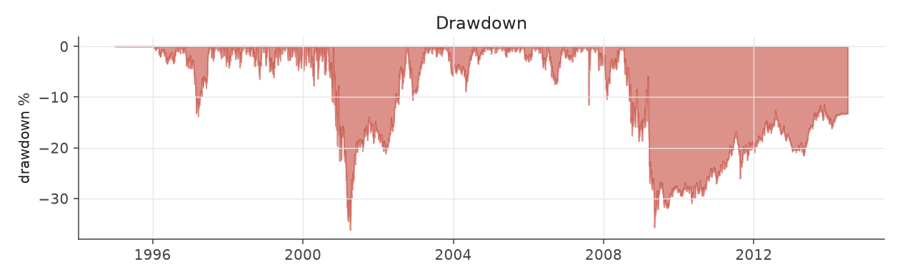
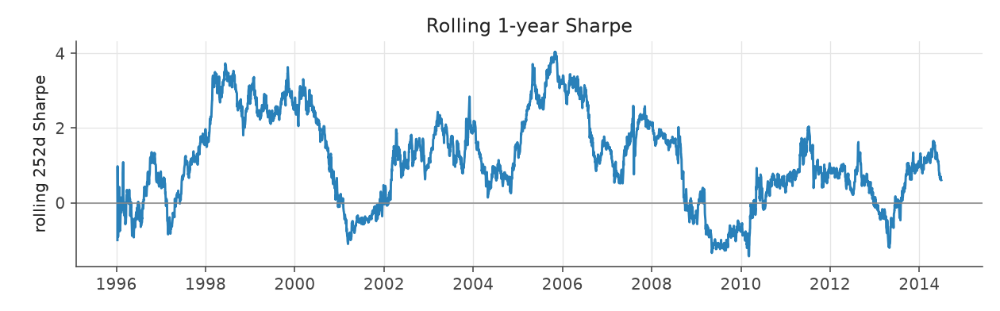

# extreme_decile_aggressive

_equity strategy | family: equity-aggressive | status: research | derived from `extreme_decile`_

## What this strategy does

extreme_decile re-sized for return: base unit 0.009, 6x leverage cap

**Why it should work.** Analysts and investors under-react to earnings news, so stocks with the most positive surprise keep drifting up and the most negative keep drifting down for weeks.

**Design notes** (from the strategy's source file).

Aggressive-sizing variants of the hand-built equity strategies.

Same signal, trim, tilt and neutralization as each base strategy; only the two dials that set how big and how levered the book is change (base_unit_fraction, gross-leverage cap = 6x). The multiplier for each was picked by sweeping 1.5x..12x the original base unit and taking the highest return subject to Sharpe >= 0.6 and max drawdown >= -40% (a worse drawdown is a fund-ending event, not a risk preference). The untouched 5%-of-ADV liquidity cap remains the real capacity constraint, and bites roughly four times as often at this sizing.

These are generated from the base strategy classes, so a change to a base strategy's weights flows through automatically.

| parameter | value |
|---|---|
| base_unit_fraction | 0.009 |
| max_gross_leverage | 6.0 |
| liquidity_cap_frac | 0.05 |
| return_basis | mktadj |
| cap_mode | proportional |
| beta_overlay | 0.0 |

## Performance

| metric | extreme_decile_aggressive | market (CRSP VW) |
|---|---|---|
| Annualized return | 9.53% | 9.94% |
| Annualized volatility | 12.24% | 19.35% |
| Sharpe (NAV-pct) | 0.80 | 0.59 |
| Sortino | 1.15 |  |
| Max drawdown | -36.2% | -55.5% |
| Calmar | 0.26 |  |
| Final NAV ($10M start) | $58,861,263 |  |
| Worst day | -6.52% |  |
| % positive days | 51.5% |  |
| Sharpe 1996-2001 | 1.02 |  |
| Sharpe 2002-2007 | 1.72 |  |
| Sharpe 2008-2013 | -0.01 |  |

Correlation of daily returns with the market: **0.08**.

- best Sharpe among equity: `s10_vol_rank_tilt` (1.81); this one: 0.805
- best return among equity: `s6_beta_overlay_aggressive` (0.15); this one: 0.0953
- best Calmar among equity: `s10_vol_rank_tilt` (0.614); this one: 0.263

*NAV (log scale)*

*Drawdown from running peak*

*Calendar-year returns*

*Is the edge stable, or concentrated in a few years?*

## Where the return comes from

*Long leg vs. short leg vs. total*

|  | long leg | short leg |
|---|---|---|
| P&L ($M, before costs) | 76.54 | -15.40 |
| P&L after costs ($M) | 70.06 | -21.19 |
| of which common (average-event) component ($M) | 60.16 | -44.74 |
| of which excess / PEAD component ($M) | 16.39 | 29.34 |
| excess minus costs ($M) | 9.90 | 23.55 |
| gross return per $ traded (bp) | 180.78 | -45.06 |
| positions in the money (hit rate) | 0.57 | 0.49 |
| stand-alone Sharpe (leg only) | 0.90 | -0.11 |

Daily P&L correlation between the two legs: **-0.58**.

- **The short leg loses money in absolute terms** (-15.4M before costs) while the long leg earns +76.5M. That is mostly a benchmark effect, not a signal failure: the average earnings-event stock beat the cap-weighted market during its holding window, which flatters the long leg and hurts the short leg by 60.2M / 44.7M. Stripping that common component, the surprise signal itself earned +16.4M on the long side and +29.3M on the short side.
- The two legs' daily P&L are -0.58 correlated: the short leg is the hedge that makes the long leg's variance disappear (stand-alone leg Sharpe 0.90 long / -0.11 short vs 0.80 combined).

### By decile and side (signal-driven part only)

| leg | decile | positions | notional_M | net_pnl_M | excess_M | cost_M | alpha_net_M | alpha_share | alpha_bp_per_$ |
|---|---|---|---|---|---|---|---|---|---|
| long | 10 | 17,174 | 4,234.01 | 70.06 | 16.39 | 6.49 | 9.90 | 29.6% | 23.38 |
| short | 1 | 17,169 | 3,417.04 | -21.20 | 29.34 | 5.80 | 23.55 | 70.4% | 68.91 |

*D10 and the short deciles carry the alpha; the middle of each leg earns little*

### By size quintile (1 = smallest)

| size_quintile | positions | notional_M | net_pnl_M | excess_M | cost_M | alpha_net_M | alpha_share | alpha_bp_per_$ |
|---|---|---|---|---|---|---|---|---|
| 1 | 4,832 | 220.50 | 0.17 | 1.86 | 0.71 | 1.15 | 3.4% | 52.18 |
| 2 | 7,159 | 908.69 | 9.55 | 12.17 | 2.14 | 10.03 | 30.0% | 110.41 |
| 3 | 7,735 | 1,847.63 | 20.94 | 21.40 | 3.40 | 18.00 | 53.8% | 97.41 |
| 4 | 7,731 | 2,405.92 | 8.32 | 5.57 | 3.55 | 2.02 | 6.0% | 8.39 |
| 5 | 6,886 | 2,268.31 | 9.87 | 4.73 | 2.49 | 2.25 | 6.7% | 9.91 |

### By liquidity quintile (1 = least liquid)

| liquidity_quintile | positions | notional_M | net_pnl_M | excess_M | cost_M | alpha_net_M | alpha_share | alpha_bp_per_$ |
|---|---|---|---|---|---|---|---|---|
| 1 | 4,357 | 95.80 | 2.67 | 3.37 | 0.48 | 2.89 | 8.6% | 301.44 |
| 2 | 7,223 | 626.17 | 4.82 | 7.36 | 1.88 | 5.48 | 16.4% | 87.49 |
| 3 | 7,834 | 1,940.76 | 24.42 | 27.10 | 3.88 | 23.22 | 69.4% | 119.62 |
| 4 | 7,850 | 2,647.73 | 5.66 | 3.79 | 3.71 | 0.08 | 0.2% | 0.30 |
| 5 | 7,077 | 2,340.15 | 11.38 | 4.21 | 2.34 | 1.87 | 5.6% | 7.99 |

### By holding-window length

| hold_bucket | positions | notional_M | net_pnl_M | excess_M | cost_M | alpha_net_M | alpha_share | alpha_bp_per_$ |
|---|---|---|---|---|---|---|---|---|
| <=40d | 6,338 | 1,868.41 | 2.74 | 14.66 | 2.70 | 11.96 | 35.8% | 64.02 |
| 41-60d | 11,202 | 2,419.23 | 8.85 | 5.99 | 3.85 | 2.14 | 6.4% | 8.84 |
| 61-90d | 12,665 | 2,900.60 | 16.77 | 5.51 | 4.66 | 0.85 | 2.5% | 2.93 |
| >90d | 4,138 | 462.81 | 20.50 | 19.57 | 1.07 | 18.50 | 55.3% | 399.66 |

### By era

| era | positions | notional_M | net_pnl_M | excess_M | cost_M | alpha_net_M | alpha_share | alpha_bp_per_$ |
|---|---|---|---|---|---|---|---|---|
| 1996-01 | 9,920 | 1,084.91 | 13.48 | 11.68 | 1.73 | 9.95 | 29.7% | 91.71 |
| 2002-07 | 11,506 | 2,653.01 | 33.79 | 35.97 | 4.20 | 31.76 | 95.0% | 119.73 |
| 2008-13 | 12,917 | 3,913.13 | 1.59 | -1.91 | 6.35 | -8.27 | -24.7% | -21.13 |

### By FF12 sector

| ff12_sector | positions | notional_M | net_pnl_M | excess_M | cost_M | alpha_net_M | alpha_share | alpha_bp_per_$ |
|---|---|---|---|---|---|---|---|---|
| BusEq | 6,718 | 1,407.28 | 13.17 | 6.26 | 2.22 | 4.04 | 12.1% | 28.73 |
| Chems | 687 | 171.84 | 1.45 | 1.39 | 0.27 | 1.12 | 3.3% | 64.97 |
| Durbl | 869 | 170.15 | -0.97 | -0.39 | 0.29 | -0.68 | -2.0% | -39.78 |
| Enrgy | 1,375 | 314.43 | 5.84 | 6.27 | 0.50 | 5.77 | 17.2% | 183.40 |
| Hlth | 3,037 | 618.07 | 4.15 | 1.26 | 1.01 | 0.25 | 0.7% | 3.98 |
| Manuf | 3,627 | 838.21 | 2.23 | 3.34 | 1.31 | 2.02 | 6.0% | 24.11 |
| Money | 5,366 | 1,308.27 | 3.10 | 8.65 | 2.08 | 6.56 | 19.6% | 50.17 |
| NoDur | 1,540 | 359.64 | 2.63 | 2.36 | 0.57 | 1.79 | 5.3% | 49.72 |
| Other | 5,074 | 1,088.80 | 8.02 | 7.31 | 1.87 | 5.45 | 16.3% | 50.02 |
| Shops | 3,547 | 788.34 | 6.98 | 6.71 | 1.26 | 5.46 | 16.3% | 69.23 |
| Telcm | 1,164 | 241.96 | 1.15 | 1.59 | 0.37 | 1.22 | 3.6% | 50.33 |
| Utils | 1,339 | 344.07 | 1.12 | 0.98 | 0.53 | 0.46 | 1.4% | 13.27 |

### By idiosyncratic-volatility tercile

| vol_tercile | positions | notional_M | net_pnl_M | excess_M | cost_M | alpha_net_M | alpha_share | alpha_bp_per_$ |
|---|---|---|---|---|---|---|---|---|
| high vol | 11,517 | 2,813.22 | 7.28 | 7.16 | 4.20 | 2.96 | 8.9% | 10.53 |
| low vol | 11,554 | 2,327.20 | 21.32 | 21.17 | 4.03 | 17.14 | 51.2% | 73.64 |
| mid vol | 10,730 | 2,427.20 | 20.37 | 17.62 | 3.91 | 13.72 | 41.0% | 56.52 |

### Short-borrow sensitivity (not modeled in the backtest)

| borrow_rate | fee_M | annualized_return | drag |
|---|---|---|---|
| 0.0% | 0.0 | 9.53% | 0.00% |
| 0.5% | 3.6 | 9.17% | 0.36% |
| 1.0% | 7.3 | 8.79% | 0.74% |
| 2.0% | 14.5 | 7.95% | 1.58% |
| 5.0% | 36.3 | 4.28% | 5.25% |

The engine charges the same transaction cost on shorts as on longs and no stock-borrow fee. The short leg is concentrated in small, illiquid names, where borrow is scarce and expensive -- read the table as a floor on the cost of running the short leg.
