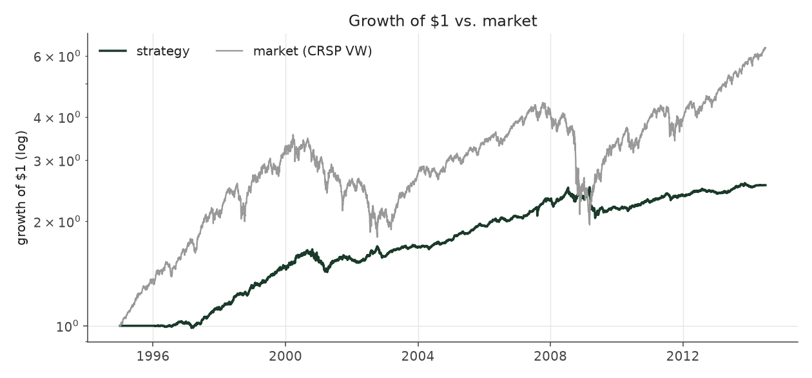
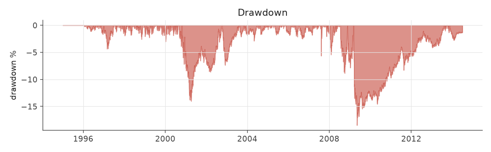
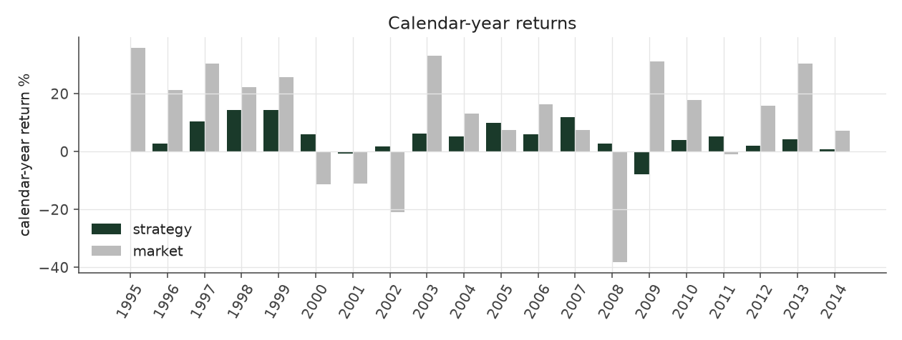
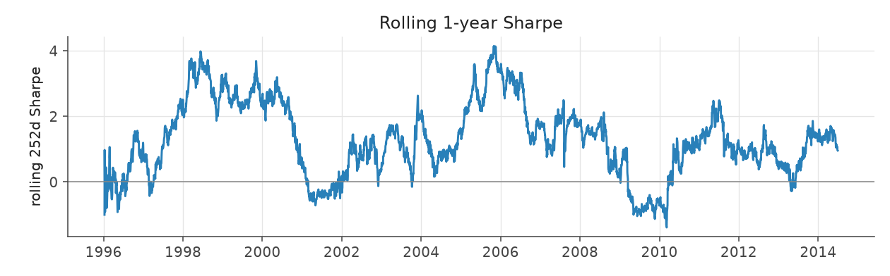
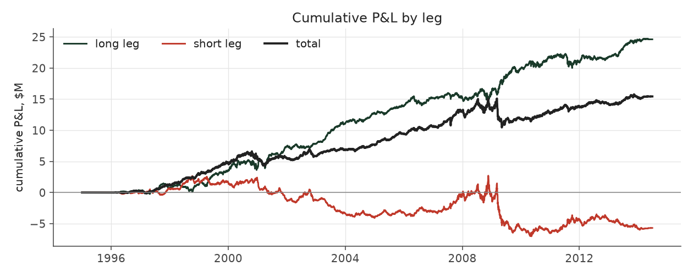
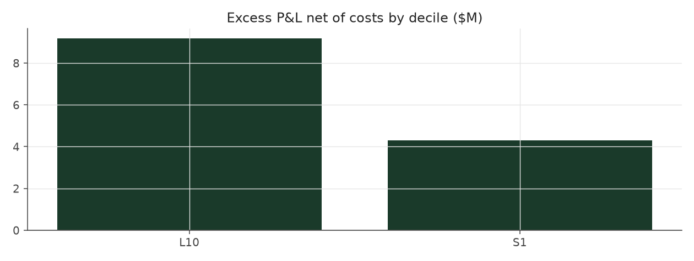

# extreme_picks

_equity strategy | family: equity-baseline | status: validated_

## What this strategy does

Buy the top 10% of earnings surprises, short the bottom 10%, equal bets

**Why it should work.** Analysts and investors under-react to earnings news, so stocks with the most positive surprise keep drifting up and the most negative keep drifting down for weeks.

**Design notes** (from the strategy's source file).

Strategy 1 -- Extreme decile long/short.

The textbook PEAD trade: long the best earnings-surprise decile (D10), short the worst (D1), every event equal-weighted, each held for the number of days its (decile x size x book-to-market) cell's alpha takes to decay (per-cell holding windows, not a fixed horizon).

| parameter | value |
|---|---|
| base_unit_fraction | 0.003 |
| max_gross_leverage | 1.5 |
| liquidity_cap_frac | 0.05 |
| return_basis | mktadj |
| cap_mode | proportional |
| beta_overlay | 0.0 |

## Performance

| metric | extreme_picks | market (CRSP VW) |
|---|---|---|
| Annualized return | 4.91% | 9.94% |
| Annualized volatility | 5.32% | 19.35% |
| Sharpe (NAV-pct) | 0.93 | 0.59 |
| Sortino | 1.28 |  |
| Max drawdown | -18.5% | -55.5% |
| Calmar | 0.27 |  |
| Final NAV ($10M start) | $25,432,376 |  |
| Worst day | -4.78% |  |
| % positive days | 52.0% |  |
| Sharpe 1996-2001 | 1.28 |  |
| Sharpe 2002-2007 | 1.58 |  |
| Sharpe 2008-2013 | 0.28 |  |

Correlation of daily returns with the market: **-0.00**.

- best Sharpe among equity: `calm_rank_tilt` (1.81); this one: 0.927
- best return among equity: `market_boost_max` (0.15); this one: 0.0491
- best Calmar among equity: `calm_rank_tilt` (0.614); this one: 0.266

*NAV (log scale)*

*Drawdown from running peak*

*Calendar-year returns*

*Is the edge stable, or concentrated in a few years?*

## Where the return comes from

*Long leg vs. short leg vs. total*

|  | long leg | short leg |
|---|---|---|
| P&L ($M, before costs) | 24.61 | -5.70 |
| P&L after costs ($M) | 22.94 | -7.50 |
| of which common (average-event) component ($M) | 13.75 | -11.81 |
| of which excess / PEAD component ($M) | 10.86 | 6.11 |
| excess minus costs ($M) | 9.19 | 4.31 |
| gross return per $ traded (bp) | 275.07 | -68.31 |
| positions in the money (hit rate) | 0.57 | 0.49 |
| stand-alone Sharpe (leg only) | 1.14 | -0.20 |

Daily P&L correlation between the two legs: **-0.68**.

- **The short leg loses money in absolute terms** (-5.7M before costs) while the long leg earns +24.6M. That is mostly a benchmark effect, not a signal failure: the average earnings-event stock beat the cap-weighted market during its holding window, which flatters the long leg and hurts the short leg by 13.8M / 11.8M. Stripping that common component, the surprise signal itself earned +10.9M on the long side and +6.1M on the short side.
- The two legs' daily P&L are -0.68 correlated: the short leg is the hedge that makes the long leg's variance disappear (stand-alone leg Sharpe 1.14 long / -0.20 short vs 0.93 combined).

### By decile and side (signal-driven part only)

| leg | decile | positions | notional_M | net_pnl_M | excess_M | cost_M | alpha_net_M | alpha_share | alpha_bp_per_$ |
|---|---|---|---|---|---|---|---|---|---|
| long | 10 | 17,174 | 894.62 | 22.94 | 10.86 | 1.67 | 9.19 | 68.1% | 102.68 |
| short | 1 | 17,169 | 834.45 | -7.50 | 6.11 | 1.80 | 4.31 | 31.9% | 51.63 |

*D10 and the short deciles carry the alpha; the middle of each leg earns little*

### By size quintile (1 = smallest)

| size_quintile | positions | notional_M | net_pnl_M | excess_M | cost_M | alpha_net_M | alpha_share | alpha_bp_per_$ |
|---|---|---|---|---|---|---|---|---|
| 1 | 4,832 | 143.43 | 0.98 | 2.29 | 0.53 | 1.76 | 13.0% | 122.42 |
| 2 | 7,159 | 359.29 | 4.21 | 5.42 | 0.99 | 4.43 | 32.8% | 123.32 |
| 3 | 7,735 | 425.54 | 5.92 | 6.21 | 0.88 | 5.34 | 39.5% | 125.39 |
| 4 | 7,731 | 424.71 | 2.45 | 2.08 | 0.66 | 1.42 | 10.5% | 33.45 |
| 5 | 6,886 | 376.10 | 1.88 | 0.97 | 0.42 | 0.55 | 4.1% | 14.66 |

### By liquidity quintile (1 = least liquid)

| liquidity_quintile | positions | notional_M | net_pnl_M | excess_M | cost_M | alpha_net_M | alpha_share | alpha_bp_per_$ |
|---|---|---|---|---|---|---|---|---|
| 1 | 4,357 | 95.01 | 2.64 | 3.33 | 0.47 | 2.86 | 21.2% | 300.87 |
| 2 | 7,223 | 378.56 | 2.98 | 4.77 | 1.14 | 3.63 | 26.9% | 95.94 |
| 3 | 7,834 | 436.75 | 6.04 | 6.66 | 0.87 | 5.79 | 42.9% | 132.55 |
| 4 | 7,850 | 433.00 | 1.85 | 1.58 | 0.61 | 0.97 | 7.2% | 22.45 |
| 5 | 7,077 | 385.66 | 1.93 | 0.65 | 0.39 | 0.26 | 1.9% | 6.74 |

### By holding-window length

| hold_bucket | positions | notional_M | net_pnl_M | excess_M | cost_M | alpha_net_M | alpha_share | alpha_bp_per_$ |
|---|---|---|---|---|---|---|---|---|
| <=40d | 6,338 | 345.19 | 0.53 | 3.14 | 0.55 | 2.59 | 19.2% | 75.09 |
| 41-60d | 11,202 | 547.71 | 1.83 | 2.01 | 1.11 | 0.91 | 6.7% | 16.54 |
| 61-90d | 12,665 | 663.80 | 5.74 | 4.45 | 1.32 | 3.12 | 23.2% | 47.06 |
| >90d | 4,138 | 172.37 | 7.34 | 7.37 | 0.50 | 6.87 | 50.9% | 398.71 |

### By era

| era | positions | notional_M | net_pnl_M | excess_M | cost_M | alpha_net_M | alpha_share | alpha_bp_per_$ |
|---|---|---|---|---|---|---|---|---|
| 1996-01 | 9,920 | 346.19 | 5.16 | 5.36 | 0.66 | 4.70 | 34.8% | 135.76 |
| 2002-07 | 11,506 | 579.97 | 7.13 | 7.90 | 1.13 | 6.76 | 50.1% | 116.60 |
| 2008-13 | 12,917 | 802.92 | 3.14 | 3.71 | 1.68 | 2.03 | 15.1% | 25.30 |

### By FF12 sector

| ff12_sector | positions | notional_M | net_pnl_M | excess_M | cost_M | alpha_net_M | alpha_share | alpha_bp_per_$ |
|---|---|---|---|---|---|---|---|---|
| BusEq | 6,718 | 324.80 | 3.30 | 2.21 | 0.64 | 1.57 | 11.6% | 48.38 |
| Chems | 687 | 36.46 | -0.23 | -0.21 | 0.07 | -0.28 | -2.0% | -75.55 |
| Durbl | 869 | 42.30 | 0.12 | 0.33 | 0.09 | 0.24 | 1.8% | 56.14 |
| Enrgy | 1,375 | 71.59 | 1.64 | 1.74 | 0.14 | 1.60 | 11.9% | 223.38 |
| Hlth | 3,037 | 146.50 | 1.13 | 0.77 | 0.31 | 0.46 | 3.4% | 31.05 |
| Manuf | 3,627 | 183.49 | 0.83 | 1.33 | 0.36 | 0.97 | 7.2% | 53.10 |
| Money | 5,366 | 284.38 | 1.84 | 3.30 | 0.57 | 2.74 | 20.3% | 96.26 |
| NoDur | 1,540 | 78.98 | 1.08 | 1.08 | 0.15 | 0.93 | 6.9% | 117.52 |
| Other | 5,074 | 258.25 | 2.18 | 2.44 | 0.56 | 1.88 | 13.9% | 72.78 |
| Shops | 3,547 | 176.30 | 2.46 | 2.68 | 0.35 | 2.33 | 17.2% | 132.03 |
| Telcm | 1,164 | 56.60 | 0.77 | 0.93 | 0.11 | 0.82 | 6.1% | 145.21 |
| Utils | 1,339 | 69.44 | 0.31 | 0.36 | 0.12 | 0.24 | 1.8% | 34.24 |

### By idiosyncratic-volatility tercile

| vol_tercile | positions | notional_M | net_pnl_M | excess_M | cost_M | alpha_net_M | alpha_share | alpha_bp_per_$ |
|---|---|---|---|---|---|---|---|---|
| high vol | 11,517 | 585.34 | 2.46 | 2.98 | 1.06 | 1.92 | 14.2% | 32.73 |
| low vol | 11,554 | 575.48 | 6.81 | 7.73 | 1.27 | 6.46 | 47.9% | 112.21 |
| mid vol | 10,730 | 544.68 | 5.76 | 5.90 | 1.09 | 4.81 | 35.6% | 88.25 |

### Short-borrow sensitivity (not modeled in the backtest)

| borrow_rate | fee_M | annualized_return | drag |
|---|---|---|---|
| 0.0% | 0.0 | 4.91% | -0.00% |
| 0.5% | 1.0 | 4.70% | 0.21% |
| 1.0% | 1.9 | 4.49% | 0.42% |
| 2.0% | 3.8 | 4.04% | 0.87% |
| 5.0% | 9.5 | 2.41% | 2.50% |

The engine charges the same transaction cost on shorts as on longs and no stock-borrow fee. The short leg is concentrated in small, illiquid names, where borrow is scarce and expensive -- read the table as a floor on the cost of running the short leg.
