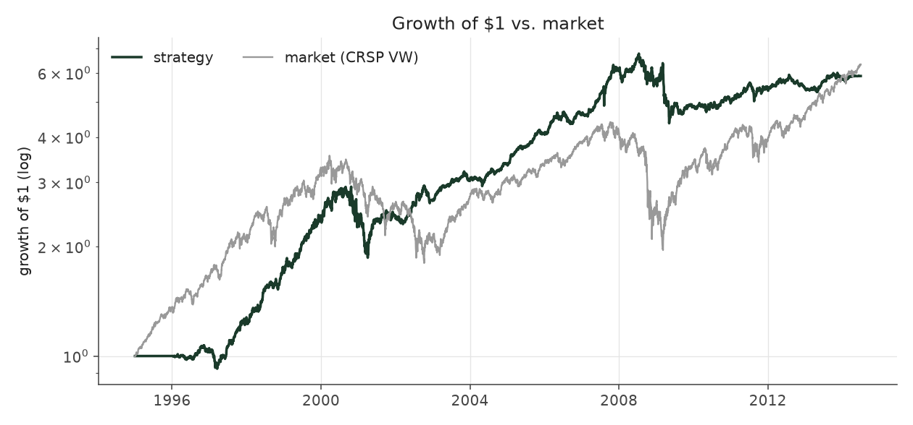
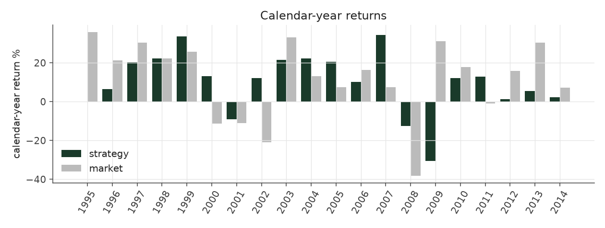
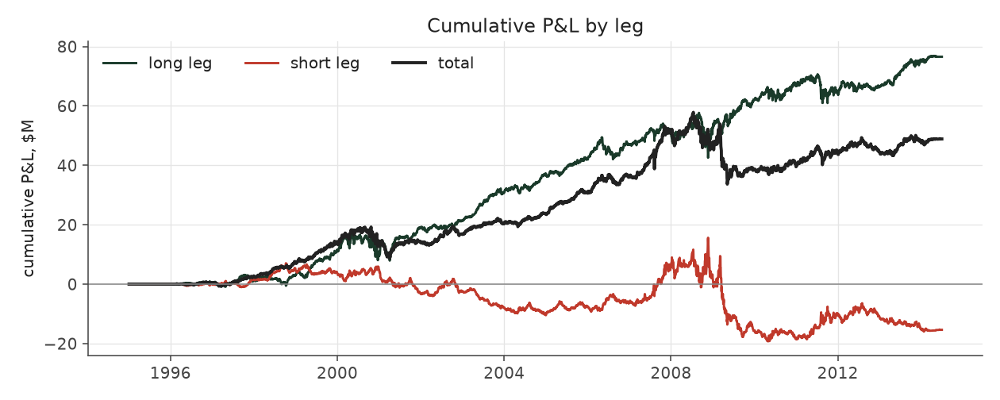
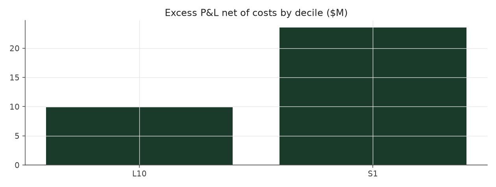

# extreme_picks_max

_equity strategy | family: equity-max | status: research | derived from `extreme_picks`_

## What this strategy does

extreme_picks with bigger bets for more return: base unit 0.009, 6x leverage cap

**Why it should work.** Analysts and investors under-react to earnings news, so stocks with the most positive surprise keep drifting up and the most negative keep drifting down for weeks.

**Design notes** (from the strategy's source file).

Max-size variants ("<name>_max") of the hand-built equity strategies.

Same signal, trim, tilt and neutralization as each base strategy; only the two dials that set how big and how levered the book is change (base_unit_fraction, gross-leverage cap = 6x). The multiplier for each was picked by sweeping 1.5x..12x the original base unit and taking the highest return subject to Sharpe >= 0.6 and max drawdown >= -40% (a worse drawdown is a fund-ending event, not a risk preference). The untouched 5%-of-ADV liquidity cap remains the real capacity constraint, and bites roughly four times as often at this sizing.

These are generated from the base strategy classes, so a change to a base strategy's weights flows through automatically.

| parameter | value |
|---|---|
| base_unit_fraction | 0.009 |
| max_gross_leverage | 6.0 |
| liquidity_cap_frac | 0.05 |
| return_basis | mktadj |
| cap_mode | proportional |
| exposure_cap | open_book |
| beta_overlay | 0.0 |

## Performance

| metric | extreme_picks_max | market (CRSP VW) |
|---|---|---|
| Annualized return | 8.98% | 9.94% |
| Annualized volatility | 15.61% | 19.35% |
| Sharpe (NAV-pct) | 0.63 | 0.59 |
| Sortino | 0.89 |  |
| Max drawdown | -56.4% | -55.5% |
| Calmar | 0.16 |  |
| Final NAV ($10M start) | $53,382,953 |  |
| Worst day | -8.44% |  |
| % positive days | 50.2% |  |
| Sharpe 1996-2001 | 0.78 |  |
| Sharpe 2002-2007 | 1.58 |  |
| Sharpe 2008-2013 | -0.10 |  |

Correlation of daily returns with the market: **0.06**.

- best Sharpe among equity: `calm_rank_tilt` (1.47); this one: 0.629
- best return among equity: `market_boost_max` (0.116); this one: 0.0898
- best Calmar among equity: `calm_rank_tilt` (0.442); this one: 0.159

*NAV (log scale)*

*Drawdown from running peak*

*Calendar-year returns*

*Is the edge stable, or concentrated in a few years?*

## Where the return comes from

*Long leg vs. short leg vs. total*

|  | long leg | short leg |
|---|---|---|
| P&L ($M, before costs) | 78.97 | -21.89 |
| P&L after costs ($M) | 71.54 | -28.16 |
| of which common (average-event) component ($M) | 62.35 | -60.57 |
| of which excess / PEAD component ($M) | 16.62 | 38.68 |
| excess minus costs ($M) | 9.19 | 32.41 |
| gross return per $ traded (bp) | 162.96 | -58.99 |
| positions in the money (hit rate) | 0.57 | 0.49 |
| stand-alone Sharpe (leg only) | 0.84 | -0.22 |

Daily P&L correlation between the two legs: **-0.55**.

- **The short leg loses money in absolute terms** (-21.9M before costs) while the long leg earns +79.0M. That is mostly a benchmark effect, not a signal failure: the average earnings-event stock beat the cap-weighted market during its holding window, which flatters the long leg and hurts the short leg by 62.4M / 60.6M. Stripping that common component, the surprise signal itself earned +16.6M on the long side and +38.7M on the short side.
- The two legs' daily P&L are -0.55 correlated: the short leg is the hedge that makes the long leg's variance disappear (stand-alone leg Sharpe 0.84 long / -0.22 short vs 0.63 combined).

### By decile and side (signal-driven part only)

| leg | decile | positions | notional_M | net_pnl_M | excess_M | cost_M | alpha_net_M | alpha_share | alpha_bp_per_$ |
|---|---|---|---|---|---|---|---|---|---|
| long | 10 | 20,136 | 4,846.00 | 71.54 | 16.62 | 7.42 | 9.19 | 22.1% | 18.97 |
| short | 1 | 18,299 | 3,710.34 | -28.16 | 38.68 | 6.27 | 32.41 | 77.9% | 87.35 |

*D10 and the short deciles carry the alpha; the middle of each leg earns little*

### By size quintile (1 = smallest)

| size_quintile | positions | notional_M | net_pnl_M | excess_M | cost_M | alpha_net_M | alpha_share | alpha_bp_per_$ |
|---|---|---|---|---|---|---|---|---|
| 1 | 5,287 | 241.27 | -5.03 | -2.99 | 0.78 | -3.76 | -9.0% | -155.97 |
| 2 | 7,872 | 1,003.90 | 6.69 | 11.14 | 2.37 | 8.77 | 21.1% | 87.36 |
| 3 | 8,605 | 2,042.34 | 20.63 | 23.93 | 3.77 | 20.16 | 48.5% | 98.73 |
| 4 | 8,744 | 2,686.82 | 8.25 | 9.82 | 3.96 | 5.86 | 14.1% | 21.80 |
| 5 | 7,927 | 2,582.01 | 12.84 | 13.39 | 2.82 | 10.57 | 25.4% | 40.94 |

### By liquidity quintile (1 = least liquid)

| liquidity_quintile | positions | notional_M | net_pnl_M | excess_M | cost_M | alpha_net_M | alpha_share | alpha_bp_per_$ |
|---|---|---|---|---|---|---|---|---|
| 1 | 4,793 | 104.85 | 2.21 | 3.07 | 0.52 | 2.55 | 6.1% | 243.09 |
| 2 | 7,905 | 693.89 | 2.21 | 5.54 | 2.08 | 3.46 | 8.3% | 49.88 |
| 3 | 8,745 | 2,162.63 | 23.78 | 29.34 | 4.33 | 25.02 | 60.1% | 115.68 |
| 4 | 8,837 | 2,925.63 | -0.62 | 2.73 | 4.10 | -1.36 | -3.3% | -4.66 |
| 5 | 8,153 | 2,668.95 | 15.89 | 14.68 | 2.67 | 12.01 | 28.9% | 44.98 |

### By holding-window length

| hold_bucket | positions | notional_M | net_pnl_M | excess_M | cost_M | alpha_net_M | alpha_share | alpha_bp_per_$ |
|---|---|---|---|---|---|---|---|---|
| <=40d | 7,482 | 1,728.62 | 6.18 | 31.82 | 2.74 | 29.09 | 69.9% | 168.27 |
| 41-60d | 11,345 | 2,185.29 | 3.70 | 10.04 | 3.78 | 6.26 | 15.0% | 28.64 |
| 61-90d | 17,258 | 4,310.01 | 21.08 | 3.72 | 6.48 | -2.76 | -6.6% | -6.40 |
| >90d | 2,350 | 332.43 | 12.43 | 9.71 | 0.70 | 9.01 | 21.7% | 271.07 |

### By era

| era | positions | notional_M | net_pnl_M | excess_M | cost_M | alpha_net_M | alpha_share | alpha_bp_per_$ |
|---|---|---|---|---|---|---|---|---|
| 1996-01 | 10,157 | 1,095.89 | 11.45 | 9.88 | 1.75 | 8.13 | 19.5% | 74.15 |
| 2002-07 | 13,612 | 3,277.52 | 40.10 | 41.66 | 5.14 | 36.52 | 87.8% | 111.42 |
| 2008-13 | 14,666 | 4,182.93 | -8.17 | 3.76 | 6.80 | -3.04 | -7.3% | -7.28 |

### By FF12 sector

| ff12_sector | positions | notional_M | net_pnl_M | excess_M | cost_M | alpha_net_M | alpha_share | alpha_bp_per_$ |
|---|---|---|---|---|---|---|---|---|
| BusEq | 7,541 | 1,570.73 | 4.73 | -0.75 | 2.47 | -3.23 | -7.8% | -20.54 |
| Chems | 776 | 194.47 | 2.61 | 3.21 | 0.31 | 2.91 | 7.0% | 149.47 |
| Durbl | 990 | 199.81 | -2.16 | -0.93 | 0.34 | -1.27 | -3.0% | -63.49 |
| Enrgy | 1,529 | 351.45 | 4.16 | 5.34 | 0.56 | 4.78 | 11.5% | 135.88 |
| Hlth | 3,443 | 710.18 | 7.61 | 5.40 | 1.17 | 4.24 | 10.2% | 59.64 |
| Manuf | 4,089 | 949.49 | -0.47 | 3.09 | 1.49 | 1.61 | 3.9% | 16.94 |
| Money | 5,981 | 1,447.54 | 5.03 | 14.17 | 2.29 | 11.88 | 28.6% | 82.06 |
| NoDur | 1,707 | 395.30 | 2.82 | 3.02 | 0.63 | 2.40 | 5.8% | 60.60 |
| Other | 5,674 | 1,204.74 | 10.45 | 11.74 | 2.05 | 9.69 | 23.3% | 80.44 |
| Shops | 3,935 | 887.80 | 5.63 | 6.36 | 1.41 | 4.95 | 11.9% | 55.77 |
| Telcm | 1,293 | 267.54 | 1.15 | 2.19 | 0.41 | 1.78 | 4.3% | 66.46 |
| Utils | 1,477 | 377.28 | 1.82 | 2.45 | 0.58 | 1.87 | 4.5% | 49.63 |

### By idiosyncratic-volatility tercile

| vol_tercile | positions | notional_M | net_pnl_M | excess_M | cost_M | alpha_net_M | alpha_share | alpha_bp_per_$ |
|---|---|---|---|---|---|---|---|---|
| high vol | 12,942 | 3,168.49 | -5.78 | 2.91 | 4.72 | -1.81 | -4.4% | -5.72 |
| low vol | 12,792 | 2,567.86 | 28.49 | 29.70 | 4.43 | 25.26 | 60.7% | 98.38 |
| mid vol | 12,052 | 2,725.08 | 21.28 | 23.39 | 4.37 | 19.01 | 45.7% | 69.77 |

### Short-borrow sensitivity (not modeled in the backtest)

| borrow_rate | fee_M | annualized_return | drag |
|---|---|---|---|
| 0.0% | 0.0 | 8.98% | -0.00% |
| 0.5% | 3.8 | 8.57% | 0.41% |
| 1.0% | 7.5 | 8.13% | 0.85% |
| 2.0% | 15.0 | 7.15% | 1.83% |
| 5.0% | 37.6 | 2.38% | 6.60% |

The engine charges the same transaction cost on shorts as on longs and no stock-borrow fee. The short leg is concentrated in small, illiquid names, where borrow is scarce and expensive -- read the table as a floor on the cost of running the short leg.
