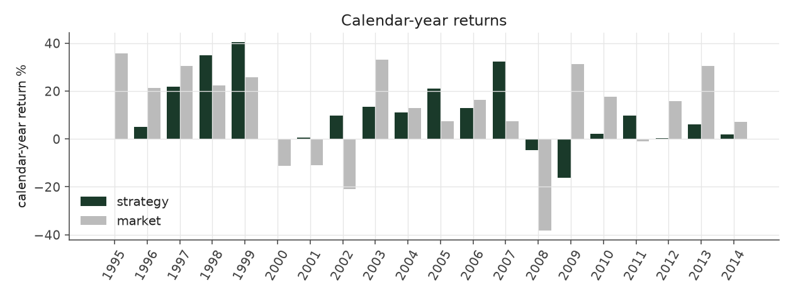

# extreme_picks_max_legacy

_equity strategy | family: equity-max | status: reference | derived from `extreme_picks_max`_

## What this strategy does

extreme_picks with bigger bets for more return: base unit 0.009, 6x leverage cap -- ORIGINAL leverage cap (new positions only, open book ignored)

**Why it should work.** Analysts and investors under-react to earnings news, so stocks with the most positive surprise keep drifting up and the most negative keep drifting down for weeks.

**Design notes** (from the strategy's source file).

Max-size variants ("<name>_max") of the hand-built equity strategies.

Same signal, trim, tilt and neutralization as each base strategy; only the two dials that set how big and how levered the book is change (base_unit_fraction, gross-leverage cap = 6x). The multiplier for each was picked by sweeping 1.5x..12x the original base unit and taking the highest return subject to Sharpe >= 0.6 and max drawdown >= -40% (a worse drawdown is a fund-ending event, not a risk preference). The untouched 5%-of-ADV liquidity cap remains the real capacity constraint, and bites roughly four times as often at this sizing.

These are generated from the base strategy classes, so a change to a base strategy's weights flows through automatically.

| parameter | value |
|---|---|
| base_unit_fraction | 0.009 |
| max_gross_leverage | 6.0 |
| liquidity_cap_frac | 0.05 |
| return_basis | mktadj |
| cap_mode | proportional |
| exposure_cap | entry_cohort |
| beta_overlay | 0.0 |

## Performance

| metric | extreme_picks_max_legacy | market (CRSP VW) |
|---|---|---|
| Annualized return | 9.53% | 9.94% |
| Annualized volatility | 12.24% | 19.35% |
| Sharpe (NAV-pct) | 0.80 | 0.59 |
| Sortino | 1.15 |  |
| Max drawdown | -36.2% | -55.5% |
| Calmar | 0.26 |  |
| Final NAV ($10M start) | $58,861,263 |  |
| Worst day | -6.52% |  |
| % positive days | 51.5% |  |
| Sharpe 1996-2001 | 1.02 |  |
| Sharpe 2002-2007 | 1.72 |  |
| Sharpe 2008-2013 | -0.01 |  |

Correlation of daily returns with the market: **0.08**.

- best Sharpe among equity: `calm_rank_tilt` (1.47); this one: 0.805
- best return among equity: `market_boost_max` (0.116); this one: 0.0953
- best Calmar among equity: `calm_rank_tilt` (0.442); this one: 0.263

*NAV (log scale)*

*Drawdown from running peak*

*Calendar-year returns*

*Is the edge stable, or concentrated in a few years?*

## Where the return comes from

*Long leg vs. short leg vs. total*

|  | long leg | short leg |
|---|---|---|
| P&L ($M, before costs) | 76.54 | -15.40 |
| P&L after costs ($M) | 70.06 | -21.19 |
| of which common (average-event) component ($M) | 60.65 | -45.12 |
| of which excess / PEAD component ($M) | 15.72 | 29.99 |
| excess minus costs ($M) | 9.24 | 24.20 |
| gross return per $ traded (bp) | 180.78 | -45.06 |
| positions in the money (hit rate) | 0.57 | 0.49 |
| stand-alone Sharpe (leg only) | 0.90 | -0.11 |

Daily P&L correlation between the two legs: **-0.58**.

- **The short leg loses money in absolute terms** (-15.4M before costs) while the long leg earns +76.5M. That is mostly a benchmark effect, not a signal failure: the average earnings-event stock beat the cap-weighted market during its holding window, which flatters the long leg and hurts the short leg by 60.7M / 45.1M. Stripping that common component, the surprise signal itself earned +15.7M on the long side and +30.0M on the short side.
- The two legs' daily P&L are -0.58 correlated: the short leg is the hedge that makes the long leg's variance disappear (stand-alone leg Sharpe 0.90 long / -0.11 short vs 0.80 combined).

### By decile and side (signal-driven part only)

| leg | decile | positions | notional_M | net_pnl_M | excess_M | cost_M | alpha_net_M | alpha_share | alpha_bp_per_$ |
|---|---|---|---|---|---|---|---|---|---|
| long | 10 | 17,174 | 4,234.01 | 70.06 | 15.72 | 6.49 | 9.23 | 27.6% | 21.80 |
| short | 1 | 17,169 | 3,417.04 | -21.20 | 29.99 | 5.80 | 24.19 | 72.4% | 70.79 |

*D10 and the short deciles carry the alpha; the middle of each leg earns little*

### By size quintile (1 = smallest)

| size_quintile | positions | notional_M | net_pnl_M | excess_M | cost_M | alpha_net_M | alpha_share | alpha_bp_per_$ |
|---|---|---|---|---|---|---|---|---|
| 1 | 4,832 | 220.50 | 0.17 | 1.97 | 0.71 | 1.27 | 3.8% | 57.39 |
| 2 | 7,159 | 908.69 | 9.55 | 12.14 | 2.14 | 10.01 | 29.9% | 110.11 |
| 3 | 7,735 | 1,847.63 | 20.94 | 21.23 | 3.40 | 17.83 | 53.3% | 96.50 |
| 4 | 7,731 | 2,405.92 | 8.32 | 5.45 | 3.55 | 1.90 | 5.7% | 7.90 |
| 5 | 6,886 | 2,268.31 | 9.87 | 4.91 | 2.49 | 2.42 | 7.2% | 10.66 |

### By liquidity quintile (1 = least liquid)

| liquidity_quintile | positions | notional_M | net_pnl_M | excess_M | cost_M | alpha_net_M | alpha_share | alpha_bp_per_$ |
|---|---|---|---|---|---|---|---|---|
| 1 | 4,357 | 95.80 | 2.67 | 3.36 | 0.48 | 2.88 | 8.6% | 300.67 |
| 2 | 7,223 | 626.17 | 4.82 | 7.35 | 1.88 | 5.47 | 16.4% | 87.37 |
| 3 | 7,834 | 1,940.76 | 24.42 | 27.19 | 3.88 | 23.30 | 69.7% | 120.08 |
| 4 | 7,850 | 2,647.73 | 5.66 | 3.77 | 3.71 | 0.06 | 0.2% | 0.22 |
| 5 | 7,077 | 2,340.15 | 11.38 | 4.13 | 2.34 | 1.79 | 5.4% | 7.65 |

### By holding-window length

| hold_bucket | positions | notional_M | net_pnl_M | excess_M | cost_M | alpha_net_M | alpha_share | alpha_bp_per_$ |
|---|---|---|---|---|---|---|---|---|
| <=40d | 6,338 | 1,868.41 | 2.74 | 14.57 | 2.70 | 11.87 | 35.5% | 63.53 |
| 41-60d | 11,202 | 2,419.23 | 8.85 | 5.94 | 3.85 | 2.09 | 6.3% | 8.64 |
| 61-90d | 12,665 | 2,900.60 | 16.77 | 5.60 | 4.66 | 0.94 | 2.8% | 3.25 |
| >90d | 4,138 | 462.81 | 20.50 | 19.59 | 1.07 | 18.52 | 55.4% | 400.11 |

### By era

| era | positions | notional_M | net_pnl_M | excess_M | cost_M | alpha_net_M | alpha_share | alpha_bp_per_$ |
|---|---|---|---|---|---|---|---|---|
| 1996-01 | 9,920 | 1,084.91 | 13.48 | 11.71 | 1.73 | 9.98 | 29.8% | 91.95 |
| 2002-07 | 11,506 | 2,653.01 | 33.79 | 36.15 | 4.20 | 31.95 | 95.6% | 120.41 |
| 2008-13 | 12,917 | 3,913.13 | 1.59 | -2.15 | 6.35 | -8.50 | -25.4% | -21.72 |

### By FF12 sector

| ff12_sector | positions | notional_M | net_pnl_M | excess_M | cost_M | alpha_net_M | alpha_share | alpha_bp_per_$ |
|---|---|---|---|---|---|---|---|---|
| BusEq | 6,718 | 1,407.28 | 13.17 | 6.14 | 2.22 | 3.93 | 11.7% | 27.89 |
| Chems | 687 | 171.84 | 1.45 | 1.37 | 0.27 | 1.10 | 3.3% | 63.99 |
| Durbl | 869 | 170.15 | -0.97 | -0.36 | 0.29 | -0.65 | -2.0% | -38.38 |
| Enrgy | 1,375 | 314.43 | 5.84 | 6.29 | 0.50 | 5.79 | 17.3% | 184.08 |
| Hlth | 3,037 | 618.07 | 4.15 | 1.12 | 1.01 | 0.11 | 0.3% | 1.72 |
| Manuf | 3,627 | 838.21 | 2.23 | 3.28 | 1.31 | 1.97 | 5.9% | 23.44 |
| Money | 5,366 | 1,308.27 | 3.10 | 8.70 | 2.08 | 6.62 | 19.8% | 50.60 |
| NoDur | 1,540 | 359.64 | 2.63 | 2.32 | 0.57 | 1.75 | 5.2% | 48.65 |
| Other | 5,074 | 1,088.80 | 8.02 | 7.35 | 1.87 | 5.49 | 16.4% | 50.39 |
| Shops | 3,547 | 788.34 | 6.98 | 6.83 | 1.26 | 5.58 | 16.7% | 70.77 |
| Telcm | 1,164 | 241.96 | 1.15 | 1.64 | 0.37 | 1.26 | 3.8% | 52.18 |
| Utils | 1,339 | 344.07 | 1.12 | 1.02 | 0.53 | 0.49 | 1.5% | 14.28 |

### By idiosyncratic-volatility tercile

| vol_tercile | positions | notional_M | net_pnl_M | excess_M | cost_M | alpha_net_M | alpha_share | alpha_bp_per_$ |
|---|---|---|---|---|---|---|---|---|
| high vol | 11,517 | 2,813.22 | 7.28 | 7.24 | 4.20 | 3.04 | 9.1% | 10.81 |
| low vol | 11,554 | 2,327.20 | 21.32 | 21.05 | 4.03 | 17.01 | 50.9% | 73.10 |
| mid vol | 10,730 | 2,427.20 | 20.37 | 17.62 | 3.91 | 13.71 | 41.0% | 56.49 |

### Short-borrow sensitivity (not modeled in the backtest)

| borrow_rate | fee_M | annualized_return | drag |
|---|---|---|---|
| 0.0% | 0.0 | 9.53% | 0.00% |
| 0.5% | 3.6 | 9.17% | 0.36% |
| 1.0% | 7.3 | 8.79% | 0.74% |
| 2.0% | 14.5 | 7.95% | 1.58% |
| 5.0% | 36.3 | 4.28% | 5.25% |

The engine charges the same transaction cost on shorts as on longs and no stock-borrow fee. The short leg is concentrated in small, illiquid names, where borrow is scarce and expensive -- read the table as a floor on the cost of running the short leg.
