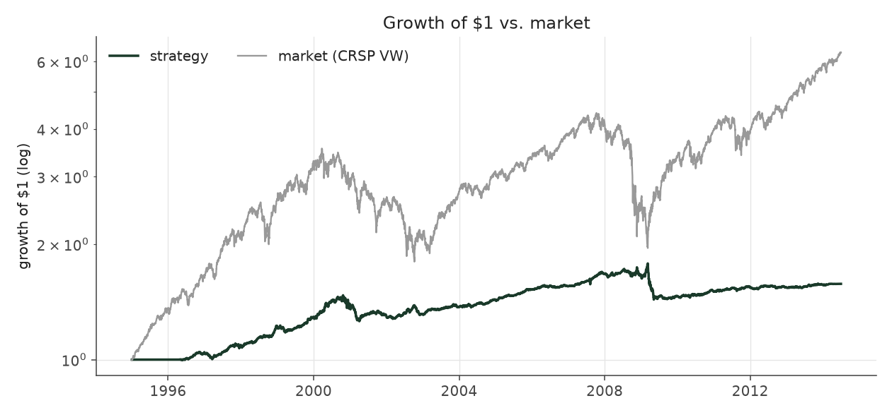
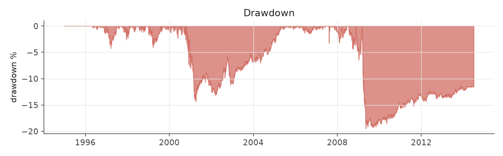
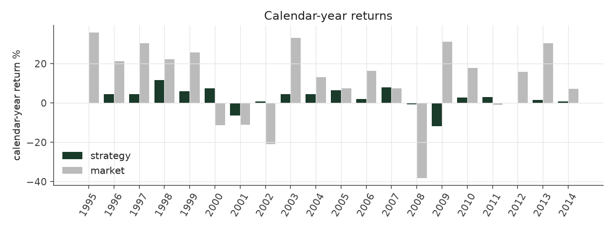
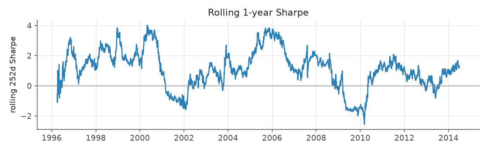
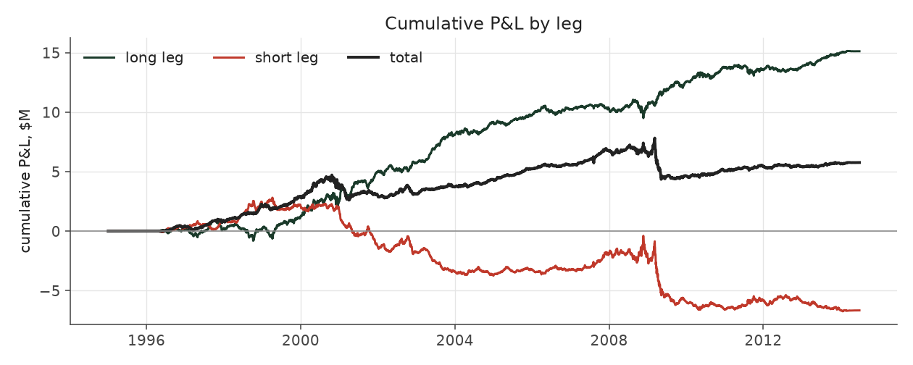

# graded_bets

_equity strategy | family: equity-baseline | status: validated_

## What this strategy does

Bet on every stock; the more extreme the surprise, the bigger the bet

**Why it should work.** Same drift as Extreme Picks but harvested across the whole cross-section for lower variance.

**Design notes** (from the strategy's source file).

Graded Bets -- every stock gets a bet, bigger the further its surprise is from average.

Trades every decile with weight proportional to SUE-rank distance from the median: broader diversification than the extreme-decile book, at the price of ~4x more positions (which saturates the liquidity and leverage caps and dilutes the high-conviction names).

| parameter | value |
|---|---|
| base_unit_fraction | 0.002 |
| max_gross_leverage | 1.5 |
| liquidity_cap_frac | 0.05 |
| return_basis | mktadj |
| cap_mode | proportional |
| exposure_cap | open_book |
| beta_overlay | 0.0 |

## Performance

| metric | graded_bets | market (CRSP VW) |
|---|---|---|
| Annualized return | 2.37% | 9.94% |
| Annualized volatility | 3.91% | 19.35% |
| Sharpe (NAV-pct) | 0.62 | 0.59 |
| Sortino | 0.85 |  |
| Max drawdown | -19.5% | -55.5% |
| Calmar | 0.12 |  |
| Final NAV ($10M start) | $15,766,792 |  |
| Worst day | -2.73% |  |
| % positive days | 50.1% |  |
| Sharpe 1996-2001 | 0.96 |  |
| Sharpe 2002-2007 | 1.52 |  |
| Sharpe 2008-2013 | -0.23 |  |

Correlation of daily returns with the market: **-0.01**.

- best Sharpe among equity: `calm_rank_tilt` (1.81); this one: 0.617
- best return among equity: `market_boost_max` (0.15); this one: 0.0237
- best Calmar among equity: `calm_rank_tilt` (0.614); this one: 0.121

*NAV (log scale)*

*Drawdown from running peak*

*Calendar-year returns*

*Is the edge stable, or concentrated in a few years?*

## Where the return comes from

*Long leg vs. short leg vs. total*

|  | long leg | short leg |
|---|---|---|
| P&L ($M, before costs) | 15.12 | -6.66 |
| P&L after costs ($M) | 13.80 | -8.04 |
| of which common (average-event) component ($M) | 10.32 | -10.64 |
| of which excess / PEAD component ($M) | 4.80 | 3.98 |
| excess minus costs ($M) | 3.49 | 2.61 |
| gross return per $ traded (bp) | 223.40 | -107.45 |
| positions in the money (hit rate) | 0.55 | 0.48 |
| stand-alone Sharpe (leg only) | 1.08 | -0.42 |

Daily P&L correlation between the two legs: **-0.71**.

- **The short leg loses money in absolute terms** (-6.7M before costs) while the long leg earns +15.1M. That is mostly a benchmark effect, not a signal failure: the average earnings-event stock beat the cap-weighted market during its holding window, which flatters the long leg and hurts the short leg by 10.3M / 10.6M. Stripping that common component, the surprise signal itself earned +4.8M on the long side and +4.0M on the short side.
- The two legs' daily P&L are -0.71 correlated: the short leg is the hedge that makes the long leg's variance disappear (stand-alone leg Sharpe 1.08 long / -0.42 short vs 0.62 combined).

### By decile and side (signal-driven part only)

| leg | decile | positions | notional_M | net_pnl_M | excess_M | cost_M | alpha_net_M | alpha_share | alpha_bp_per_$ |
|---|---|---|---|---|---|---|---|---|---|
| long | 6 | 12,092 | 16.62 | 0.09 | -0.05 | 0.04 | -0.08 | -1.4% | -49.68 |
| long | 7 | 20,923 | 85.25 | 0.72 | -0.49 | 0.17 | -0.66 | -10.8% | -77.09 |
| long | 8 | 16,617 | 125.39 | 2.03 | 0.08 | 0.24 | -0.17 | -2.8% | -13.44 |
| long | 9 | 18,570 | 187.17 | 4.08 | 2.01 | 0.36 | 1.65 | 27.1% | 88.38 |
| long | 10 | 20,136 | 262.31 | 6.88 | 3.25 | 0.51 | 2.74 | 44.9% | 104.44 |
| short | 1 | 18,299 | 230.08 | -3.48 | 1.35 | 0.53 | 0.83 | 13.6% | 36.05 |
| short | 2 | 18,907 | 188.38 | -2.23 | 1.39 | 0.41 | 0.97 | 15.9% | 51.48 |
| short | 3 | 15,390 | 110.41 | -1.50 | 0.44 | 0.24 | 0.20 | 3.2% | 17.65 |
| short | 4 | 20,837 | 79.92 | -0.70 | 0.75 | 0.17 | 0.59 | 9.6% | 73.46 |
| short | 5 | 11,143 | 11.40 | -0.12 | 0.05 | 0.02 | 0.03 | 0.5% | 24.41 |

*D10 and the short deciles carry the alpha; the middle of each leg earns little*

### By size quintile (1 = smallest)

| size_quintile | positions | notional_M | net_pnl_M | excess_M | cost_M | alpha_net_M | alpha_share | alpha_bp_per_$ |
|---|---|---|---|---|---|---|---|---|
| 1 | 19,552 | 127.72 | -0.80 | 0.36 | 0.52 | -0.16 | -2.7% | -12.66 |
| 2 | 32,133 | 252.41 | 2.07 | 3.21 | 0.73 | 2.48 | 40.8% | 98.39 |
| 3 | 36,789 | 287.83 | 2.14 | 2.72 | 0.60 | 2.12 | 34.8% | 73.62 |
| 4 | 40,259 | 309.95 | 1.15 | 1.37 | 0.48 | 0.89 | 14.6% | 28.63 |
| 5 | 44,181 | 319.03 | 1.21 | 1.12 | 0.35 | 0.77 | 12.6% | 24.02 |

### By liquidity quintile (1 = least liquid)

| liquidity_quintile | positions | notional_M | net_pnl_M | excess_M | cost_M | alpha_net_M | alpha_share | alpha_bp_per_$ |
|---|---|---|---|---|---|---|---|---|
| 1 | 19,144 | 114.00 | 0.99 | 1.90 | 0.57 | 1.33 | 21.9% | 117.05 |
| 2 | 32,282 | 258.60 | 0.70 | 2.19 | 0.78 | 1.41 | 23.2% | 54.57 |
| 3 | 37,327 | 292.93 | 1.98 | 2.77 | 0.59 | 2.19 | 35.9% | 74.63 |
| 4 | 40,479 | 311.30 | 1.09 | 1.31 | 0.44 | 0.87 | 14.3% | 28.09 |
| 5 | 43,677 | 320.05 | 1.00 | 0.61 | 0.32 | 0.29 | 4.7% | 9.03 |

### By holding-window length

| hold_bucket | positions | notional_M | net_pnl_M | excess_M | cost_M | alpha_net_M | alpha_share | alpha_bp_per_$ |
|---|---|---|---|---|---|---|---|---|
| <=40d | 68,512 | 438.10 | -0.20 | 2.50 | 0.88 | 1.63 | 26.7% | 37.12 |
| 41-60d | 40,665 | 317.83 | 0.14 | 1.67 | 0.71 | 0.96 | 15.7% | 30.15 |
| 61-90d | 47,915 | 438.37 | 3.16 | 2.12 | 0.81 | 1.31 | 21.5% | 29.85 |
| >90d | 15,822 | 102.64 | 2.68 | 2.49 | 0.29 | 2.20 | 36.1% | 214.49 |

### By era

| era | positions | notional_M | net_pnl_M | excess_M | cost_M | alpha_net_M | alpha_share | alpha_bp_per_$ |
|---|---|---|---|---|---|---|---|---|
| 1996-01 | 49,863 | 363.12 | 2.87 | 3.52 | 0.73 | 2.80 | 45.9% | 77.03 |
| 2002-07 | 58,152 | 458.18 | 3.70 | 4.19 | 0.92 | 3.27 | 53.7% | 71.48 |
| 2008-13 | 64,899 | 475.64 | -0.81 | 1.06 | 1.04 | 0.02 | 0.4% | 0.47 |

### By FF12 sector

| ff12_sector | positions | notional_M | net_pnl_M | excess_M | cost_M | alpha_net_M | alpha_share | alpha_bp_per_$ |
|---|---|---|---|---|---|---|---|---|
| BusEq | 32,014 | 245.31 | 1.09 | 0.68 | 0.50 | 0.18 | 3.0% | 7.37 |
| Chems | 3,914 | 28.15 | 0.02 | 0.12 | 0.05 | 0.07 | 1.1% | 23.83 |
| Durbl | 4,045 | 30.90 | 0.17 | 0.32 | 0.07 | 0.26 | 4.2% | 82.71 |
| Enrgy | 9,090 | 63.90 | 0.56 | 0.78 | 0.12 | 0.65 | 10.7% | 102.25 |
| Hlth | 17,523 | 124.41 | 0.68 | 0.70 | 0.28 | 0.42 | 6.9% | 33.66 |
| Manuf | 16,998 | 131.12 | 0.39 | 0.95 | 0.27 | 0.68 | 11.1% | 51.79 |
| Money | 25,762 | 195.29 | 0.80 | 1.87 | 0.40 | 1.47 | 24.1% | 75.11 |
| NoDur | 7,470 | 55.55 | 0.15 | 0.23 | 0.11 | 0.12 | 1.9% | 20.98 |
| Other | 26,552 | 196.77 | 1.12 | 1.76 | 0.44 | 1.31 | 21.6% | 66.85 |
| Shops | 17,482 | 132.16 | 0.87 | 1.12 | 0.27 | 0.85 | 14.0% | 64.41 |
| Telcm | 5,624 | 43.16 | -0.14 | 0.06 | 0.08 | -0.02 | -0.3% | -4.70 |
| Utils | 6,440 | 50.22 | 0.05 | 0.20 | 0.09 | 0.11 | 1.8% | 21.89 |

### By idiosyncratic-volatility tercile

| vol_tercile | positions | notional_M | net_pnl_M | excess_M | cost_M | alpha_net_M | alpha_share | alpha_bp_per_$ |
|---|---|---|---|---|---|---|---|---|
| high vol | 56,962 | 430.97 | -0.56 | 0.47 | 0.80 | -0.33 | -5.4% | -7.58 |
| low vol | 58,063 | 431.85 | 3.41 | 4.52 | 0.99 | 3.53 | 58.0% | 81.82 |
| mid vol | 55,419 | 412.94 | 2.66 | 3.53 | 0.85 | 2.68 | 44.0% | 64.95 |

### Short-borrow sensitivity (not modeled in the backtest)

| borrow_rate | fee_M | annualized_return | drag |
|---|---|---|---|
| 0.0% | 0.0 | 2.37% | 0.00% |
| 0.5% | 0.6 | 2.15% | 0.22% |
| 1.0% | 1.3 | 1.92% | 0.45% |
| 2.0% | 2.6 | 1.44% | 0.93% |
| 5.0% | 6.4 | -0.34% | 2.71% |

The engine charges the same transaction cost on shorts as on longs and no stock-borrow fee. The short leg is concentrated in small, illiquid names, where borrow is scarce and expensive -- read the table as a floor on the cost of running the short leg.
