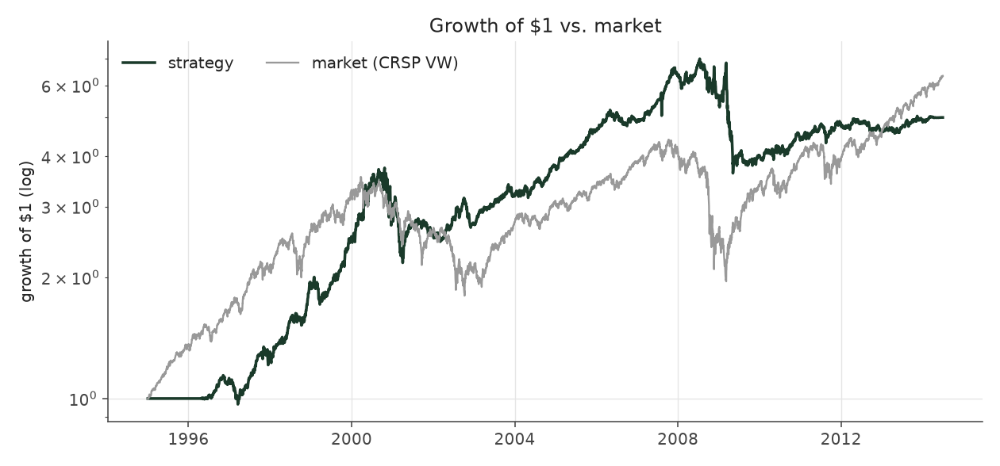
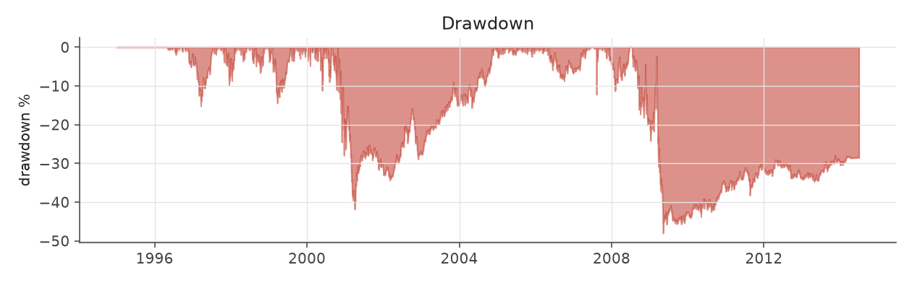
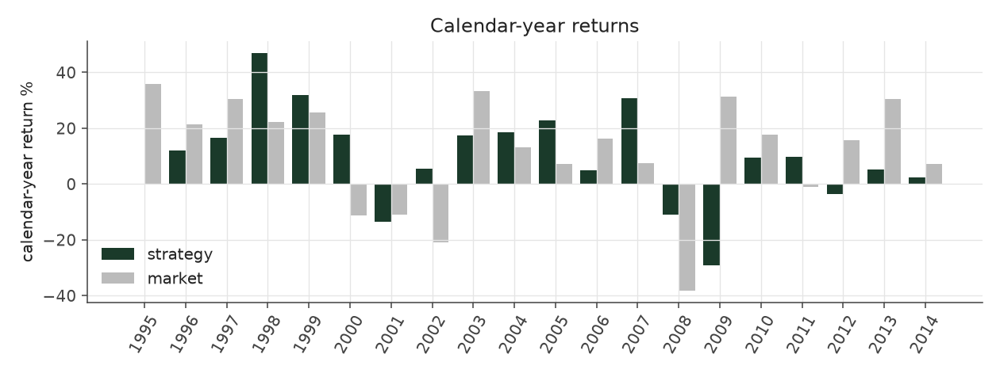
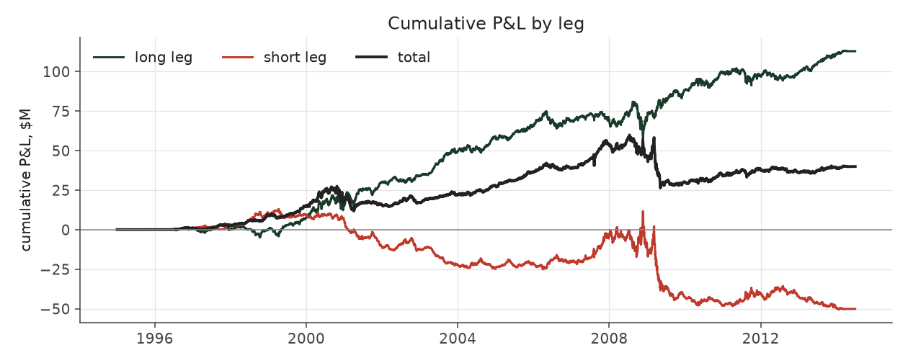
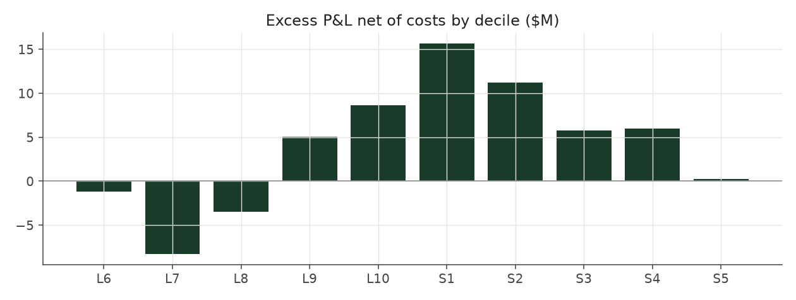

# graded_bets_max

_equity strategy | family: equity-max | status: research | derived from `graded_bets`_

## What this strategy does

graded_bets with bigger bets for more return: base unit 0.005, 6x leverage cap

**Why it should work.** Same drift as Extreme Picks but harvested across the whole cross-section for lower variance.

**Design notes** (from the strategy's source file).

Max-size variants ("<name>_max") of the hand-built equity strategies.

Same signal, trim, tilt and neutralization as each base strategy; only the two dials that set how big and how levered the book is change (base_unit_fraction, gross-leverage cap = 6x). The multiplier for each was picked by sweeping 1.5x..12x the original base unit and taking the highest return subject to Sharpe >= 0.6 and max drawdown >= -40% (a worse drawdown is a fund-ending event, not a risk preference). The untouched 5%-of-ADV liquidity cap remains the real capacity constraint, and bites roughly four times as often at this sizing.

These are generated from the base strategy classes, so a change to a base strategy's weights flows through automatically.

| parameter | value |
|---|---|
| base_unit_fraction | 0.005 |
| max_gross_leverage | 6.0 |
| liquidity_cap_frac | 0.05 |
| return_basis | mktadj |
| cap_mode | proportional |
| exposure_cap | open_book |
| beta_overlay | 0.0 |

## Performance

| metric | graded_bets_max | market (CRSP VW) |
|---|---|---|
| Annualized return | 8.61% | 9.94% |
| Annualized volatility | 14.43% | 19.35% |
| Sharpe (NAV-pct) | 0.64 | 0.59 |
| Sortino | 0.91 |  |
| Max drawdown | -48.0% | -55.5% |
| Calmar | 0.18 |  |
| Final NAV ($10M start) | $49,935,311 |  |
| Worst day | -7.90% |  |
| % positive days | 50.0% |  |
| Sharpe 1996-2001 | 0.97 |  |
| Sharpe 2002-2007 | 1.53 |  |
| Sharpe 2008-2013 | -0.20 |  |

Correlation of daily returns with the market: **0.02**.

- best Sharpe among equity: `calm_rank_tilt` (1.81); this one: 0.645
- best return among equity: `market_boost_max` (0.15); this one: 0.0861
- best Calmar among equity: `calm_rank_tilt` (0.614); this one: 0.179

*NAV (log scale)*

*Drawdown from running peak*

*Calendar-year returns*

*Is the edge stable, or concentrated in a few years?*

## Where the return comes from

*Long leg vs. short leg vs. total*

|  | long leg | short leg |
|---|---|---|
| P&L ($M, before costs) | 112.84 | -50.12 |
| P&L after costs ($M) | 101.20 | -61.26 |
| of which common (average-event) component ($M) | 100.50 | -100.16 |
| of which excess / PEAD component ($M) | 12.34 | 50.05 |
| excess minus costs ($M) | 0.70 | 38.90 |
| gross return per $ traded (bp) | 165.63 | -84.27 |
| positions in the money (hit rate) | 0.55 | 0.48 |
| stand-alone Sharpe (leg only) | 0.90 | -0.30 |

Daily P&L correlation between the two legs: **-0.70**.

- **The short leg loses money in absolute terms** (-50.1M before costs) while the long leg earns +112.8M. That is mostly a benchmark effect, not a signal failure: the average earnings-event stock beat the cap-weighted market during its holding window, which flatters the long leg and hurts the short leg by 100.5M / 100.2M. Stripping that common component, the surprise signal itself earned +12.3M on the long side and +50.0M on the short side.
- The two legs' daily P&L are -0.70 correlated: the short leg is the hedge that makes the long leg's variance disappear (stand-alone leg Sharpe 0.90 long / -0.30 short vs 0.64 combined).

### By decile and side (signal-driven part only)

| leg | decile | positions | notional_M | net_pnl_M | excess_M | cost_M | alpha_net_M | alpha_share | alpha_bp_per_$ |
|---|---|---|---|---|---|---|---|---|---|
| long | 6 | 12,092 | 189.84 | 1.01 | -0.77 | 0.39 | -1.17 | -2.9% | -61.47 |
| long | 7 | 20,923 | 873.44 | 6.24 | -6.71 | 1.59 | -8.30 | -21.0% | -95.02 |
| long | 8 | 16,617 | 1,290.56 | 16.87 | -1.23 | 2.25 | -3.48 | -8.8% | -26.96 |
| long | 9 | 18,570 | 1,870.55 | 30.29 | 8.15 | 3.12 | 5.03 | 12.7% | 26.89 |
| long | 10 | 20,136 | 2,588.20 | 46.79 | 12.91 | 4.29 | 8.62 | 21.8% | 33.29 |
| short | 1 | 18,299 | 2,067.84 | -21.86 | 19.51 | 3.85 | 15.65 | 39.5% | 75.71 |
| short | 2 | 18,907 | 1,786.86 | -19.20 | 14.55 | 3.30 | 11.25 | 28.4% | 62.96 |
| short | 3 | 15,390 | 1,149.57 | -11.73 | 7.90 | 2.16 | 5.74 | 14.5% | 49.91 |
| short | 4 | 20,837 | 829.28 | -7.02 | 7.62 | 1.61 | 6.01 | 15.2% | 72.53 |
| short | 5 | 11,143 | 113.75 | -1.45 | 0.47 | 0.23 | 0.25 | 0.6% | 21.64 |

*D10 and the short deciles carry the alpha; the middle of each leg earns little*

### By size quintile (1 = smallest)

| size_quintile | positions | notional_M | net_pnl_M | excess_M | cost_M | alpha_net_M | alpha_share | alpha_bp_per_$ |
|---|---|---|---|---|---|---|---|---|
| 1 | 19,552 | 593.07 | -5.07 | -0.79 | 2.11 | -2.90 | -7.3% | -48.87 |
| 2 | 32,133 | 2,042.29 | 10.76 | 18.51 | 5.35 | 13.16 | 33.2% | 64.43 |
| 3 | 36,789 | 3,060.07 | 15.71 | 21.98 | 6.11 | 15.87 | 40.1% | 51.85 |
| 4 | 40,259 | 3,476.08 | 9.04 | 12.45 | 5.29 | 7.17 | 18.1% | 20.62 |
| 5 | 44,181 | 3,588.39 | 9.49 | 10.24 | 3.93 | 6.31 | 15.9% | 17.58 |

### By liquidity quintile (1 = least liquid)

| liquidity_quintile | positions | notional_M | net_pnl_M | excess_M | cost_M | alpha_net_M | alpha_share | alpha_bp_per_$ |
|---|---|---|---|---|---|---|---|---|
| 1 | 19,144 | 359.93 | 2.69 | 5.19 | 1.80 | 3.39 | 8.6% | 94.25 |
| 2 | 32,282 | 1,932.64 | 5.36 | 13.93 | 5.80 | 8.13 | 20.5% | 42.09 |
| 3 | 37,327 | 3,303.34 | 17.47 | 26.73 | 6.61 | 20.13 | 50.8% | 60.93 |
| 4 | 40,479 | 3,540.52 | 4.53 | 8.63 | 4.96 | 3.68 | 9.3% | 10.39 |
| 5 | 43,677 | 3,622.95 | 9.88 | 7.87 | 3.62 | 4.25 | 10.7% | 11.72 |

### By holding-window length

| hold_bucket | positions | notional_M | net_pnl_M | excess_M | cost_M | alpha_net_M | alpha_share | alpha_bp_per_$ |
|---|---|---|---|---|---|---|---|---|
| <=40d | 68,512 | 4,427.48 | -3.63 | 24.17 | 7.85 | 16.33 | 41.2% | 36.88 |
| 41-60d | 40,665 | 3,072.43 | 5.51 | 18.75 | 5.94 | 12.81 | 32.3% | 41.69 |
| 61-90d | 47,915 | 4,396.80 | 24.44 | 6.60 | 6.97 | -0.37 | -0.9% | -0.84 |
| >90d | 15,822 | 863.18 | 13.61 | 12.87 | 2.03 | 10.84 | 27.4% | 125.54 |

### By era

| era | positions | notional_M | net_pnl_M | excess_M | cost_M | alpha_net_M | alpha_share | alpha_bp_per_$ |
|---|---|---|---|---|---|---|---|---|
| 1996-01 | 49,863 | 2,068.95 | 15.13 | 15.75 | 3.63 | 12.12 | 30.6% | 58.56 |
| 2002-07 | 58,152 | 4,740.85 | 35.95 | 39.69 | 8.29 | 31.41 | 79.3% | 66.25 |
| 2008-13 | 64,899 | 5,950.10 | -11.14 | 6.95 | 10.87 | -3.92 | -9.9% | -6.58 |

### By FF12 sector

| ff12_sector | positions | notional_M | net_pnl_M | excess_M | cost_M | alpha_net_M | alpha_share | alpha_bp_per_$ |
|---|---|---|---|---|---|---|---|---|
| BusEq | 32,014 | 2,290.43 | 6.72 | 0.71 | 4.06 | -3.35 | -8.4% | -14.60 |
| Chems | 3,914 | 295.35 | 0.95 | 1.92 | 0.50 | 1.43 | 3.6% | 48.23 |
| Durbl | 4,045 | 293.61 | 0.09 | 1.39 | 0.53 | 0.86 | 2.2% | 29.35 |
| Enrgy | 9,090 | 671.43 | 5.88 | 8.21 | 1.10 | 7.11 | 17.9% | 105.84 |
| Hlth | 17,523 | 1,182.32 | 7.34 | 6.45 | 2.24 | 4.20 | 10.6% | 35.54 |
| Manuf | 16,998 | 1,274.80 | -0.24 | 3.80 | 2.23 | 1.56 | 3.9% | 12.25 |
| Money | 25,762 | 2,020.89 | 3.75 | 14.66 | 3.60 | 11.06 | 27.9% | 54.73 |
| NoDur | 7,470 | 554.15 | 2.01 | 2.50 | 0.95 | 1.55 | 3.9% | 27.90 |
| Other | 26,552 | 1,952.36 | 8.79 | 13.33 | 3.74 | 9.59 | 24.2% | 49.12 |
| Shops | 17,482 | 1,282.81 | 5.79 | 6.95 | 2.28 | 4.67 | 11.8% | 36.38 |
| Telcm | 5,624 | 409.78 | -1.22 | 0.63 | 0.69 | -0.06 | -0.2% | -1.48 |
| Utils | 6,440 | 531.98 | 0.08 | 1.84 | 0.85 | 0.99 | 2.5% | 18.63 |

### By idiosyncratic-volatility tercile

| vol_tercile | positions | notional_M | net_pnl_M | excess_M | cost_M | alpha_net_M | alpha_share | alpha_bp_per_$ |
|---|---|---|---|---|---|---|---|---|
| high vol | 56,962 | 4,468.58 | -3.23 | 7.19 | 7.29 | -0.09 | -0.2% | -0.21 |
| low vol | 58,063 | 4,055.47 | 23.12 | 29.47 | 7.89 | 21.58 | 54.5% | 53.20 |
| mid vol | 55,419 | 4,097.00 | 19.68 | 25.50 | 7.32 | 18.18 | 45.9% | 44.37 |

### Short-borrow sensitivity (not modeled in the backtest)

| borrow_rate | fee_M | annualized_return | drag |
|---|---|---|---|
| 0.0% | 0.0 | 8.61% | -0.00% |
| 0.5% | 6.0 | 7.90% | 0.71% |
| 1.0% | 12.0 | 7.09% | 1.52% |
| 2.0% | 24.0 | 5.02% | 3.58% |
| 5.0% | 59.9 | -100.00% | 108.61% |

The engine charges the same transaction cost on shorts as on longs and no stock-borrow fee. The short leg is concentrated in small, illiquid names, where borrow is scarce and expensive -- read the table as a floor on the cost of running the short leg.
