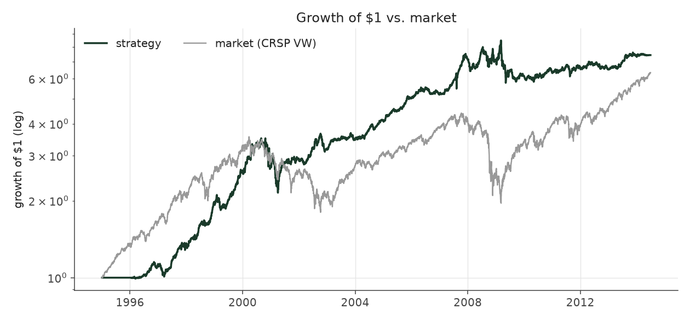
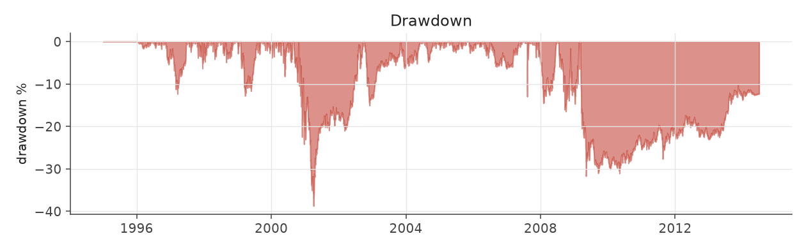
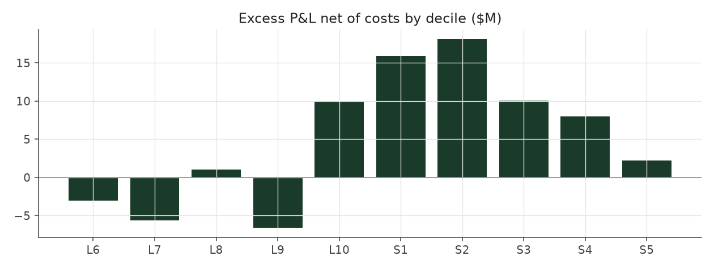

# graded_bets_max_legacy

_equity strategy | family: equity-max | status: reference | derived from `graded_bets_max`_

## What this strategy does

graded_bets with bigger bets for more return: base unit 0.005, 6x leverage cap -- ORIGINAL leverage cap (new positions only, open book ignored)

**Why it should work.** Same drift as Extreme Picks but harvested across the whole cross-section for lower variance.

**Design notes** (from the strategy's source file).

Max-size variants ("<name>_max") of the hand-built equity strategies.

Same signal, trim, tilt and neutralization as each base strategy; only the two dials that set how big and how levered the book is change (base_unit_fraction, gross-leverage cap = 6x). The multiplier for each was picked by sweeping 1.5x..12x the original base unit and taking the highest return subject to Sharpe >= 0.6 and max drawdown >= -40% (a worse drawdown is a fund-ending event, not a risk preference). The untouched 5%-of-ADV liquidity cap remains the real capacity constraint, and bites roughly four times as often at this sizing.

These are generated from the base strategy classes, so a change to a base strategy's weights flows through automatically.

| parameter | value |
|---|---|
| base_unit_fraction | 0.005 |
| max_gross_leverage | 6.0 |
| liquidity_cap_frac | 0.05 |
| return_basis | mktadj |
| cap_mode | proportional |
| exposure_cap | entry_cohort |
| beta_overlay | 0.0 |

## Performance

| metric | graded_bets_max_legacy | market (CRSP VW) |
|---|---|---|
| Annualized return | 10.84% | 9.94% |
| Annualized volatility | 12.40% | 19.35% |
| Sharpe (NAV-pct) | 0.89 | 0.59 |
| Sortino | 1.28 |  |
| Max drawdown | -38.8% | -55.5% |
| Calmar | 0.28 |  |
| Final NAV ($10M start) | $74,180,822 |  |
| Worst day | -8.03% |  |
| % positive days | 51.5% |  |
| Sharpe 1996-2001 | 1.24 |  |
| Sharpe 2002-2007 | 1.63 |  |
| Sharpe 2008-2013 | 0.09 |  |

Correlation of daily returns with the market: **0.03**.

- best Sharpe among equity: `calm_rank_tilt` (1.47); this one: 0.892
- best return among equity: `market_boost_max` (0.116); this one: 0.108
- best Calmar among equity: `calm_rank_tilt` (0.442); this one: 0.28

*NAV (log scale)*

*Drawdown from running peak*

*Calendar-year returns*

*Is the edge stable, or concentrated in a few years?*

## Where the return comes from

*Long leg vs. short leg vs. total*

|  | long leg | short leg |
|---|---|---|
| P&L ($M, before costs) | 134.38 | -42.37 |
| P&L after costs ($M) | 120.38 | -56.20 |
| of which common (average-event) component ($M) | 124.23 | -110.08 |
| of which excess / PEAD component ($M) | 9.69 | 68.09 |
| excess minus costs ($M) | -4.29 | 54.28 |
| gross return per $ traded (bp) | 161.80 | -56.51 |
| positions in the money (hit rate) | 0.55 | 0.48 |
| stand-alone Sharpe (leg only) | 0.94 | -0.18 |

Daily P&L correlation between the two legs: **-0.77**.

- **The short leg loses money in absolute terms** (-42.4M before costs) while the long leg earns +134.4M. That is mostly a benchmark effect, not a signal failure: the average earnings-event stock beat the cap-weighted market during its holding window, which flatters the long leg and hurts the short leg by 124.2M / 110.1M. Stripping that common component, the surprise signal itself earned +9.7M on the long side and +68.1M on the short side.
- The two legs' daily P&L are -0.77 correlated: the short leg is the hedge that makes the long leg's variance disappear (stand-alone leg Sharpe 0.94 long / -0.18 short vs 0.89 combined).

### By decile and side (signal-driven part only)

| leg | decile | positions | notional_M | net_pnl_M | excess_M | cost_M | alpha_net_M | alpha_share | alpha_bp_per_$ |
|---|---|---|---|---|---|---|---|---|---|
| long | 6 | 18,256 | 446.78 | 2.58 | -2.16 | 0.87 | -3.03 | -6.1% | -67.91 |
| long | 7 | 17,431 | 1,034.12 | 12.39 | -3.81 | 1.85 | -5.66 | -11.3% | -54.75 |
| long | 8 | 16,588 | 1,679.35 | 27.38 | 3.90 | 2.86 | 1.04 | 2.1% | 6.20 |
| long | 9 | 17,747 | 2,343.83 | 26.13 | -2.79 | 3.83 | -6.62 | -13.2% | -28.24 |
| long | 10 | 17,174 | 2,801.07 | 51.89 | 14.55 | 4.58 | 9.97 | 19.9% | 35.60 |
| short | 1 | 17,169 | 2,357.06 | -16.78 | 20.22 | 4.32 | 15.90 | 31.8% | 67.45 |
| short | 2 | 17,281 | 2,060.53 | -13.14 | 21.82 | 3.71 | 18.11 | 36.2% | 87.90 |
| short | 3 | 15,970 | 1,559.44 | -13.10 | 12.92 | 2.89 | 10.03 | 20.1% | 64.30 |
| short | 4 | 21,469 | 1,213.21 | -9.67 | 10.29 | 2.29 | 8.00 | 16.0% | 65.96 |
| short | 5 | 14,319 | 307.57 | -3.50 | 2.83 | 0.60 | 2.23 | 4.5% | 72.34 |

*D10 and the short deciles carry the alpha; the middle of each leg earns little*

### By size quintile (1 = smallest)

| size_quintile | positions | notional_M | net_pnl_M | excess_M | cost_M | alpha_net_M | alpha_share | alpha_bp_per_$ |
|---|---|---|---|---|---|---|---|---|
| 1 | 19,578 | 681.66 | 3.56 | 8.34 | 2.41 | 5.93 | 11.9% | 86.94 |
| 2 | 32,212 | 2,419.67 | 14.98 | 22.47 | 6.28 | 16.18 | 32.4% | 66.89 |
| 3 | 36,915 | 3,811.99 | 20.93 | 25.43 | 7.56 | 17.87 | 35.8% | 46.88 |
| 4 | 40,327 | 4,383.17 | 12.96 | 12.87 | 6.64 | 6.22 | 12.5% | 14.20 |
| 5 | 44,372 | 4,506.47 | 11.76 | 8.69 | 4.93 | 3.76 | 7.5% | 8.34 |

### By liquidity quintile (1 = least liquid)

| liquidity_quintile | positions | notional_M | net_pnl_M | excess_M | cost_M | alpha_net_M | alpha_share | alpha_bp_per_$ |
|---|---|---|---|---|---|---|---|---|
| 1 | 19,171 | 404.49 | 5.73 | 8.48 | 2.02 | 6.46 | 12.9% | 159.65 |
| 2 | 32,362 | 2,234.14 | 12.87 | 22.01 | 6.70 | 15.31 | 30.6% | 68.51 |
| 3 | 37,415 | 4,138.94 | 21.90 | 30.16 | 8.28 | 21.88 | 43.8% | 52.86 |
| 4 | 40,575 | 4,479.25 | 10.63 | 10.88 | 6.27 | 4.61 | 9.2% | 10.29 |
| 5 | 43,876 | 4,545.40 | 13.07 | 6.24 | 4.54 | 1.70 | 3.4% | 3.73 |

### By holding-window length

| hold_bucket | positions | notional_M | net_pnl_M | excess_M | cost_M | alpha_net_M | alpha_share | alpha_bp_per_$ |
|---|---|---|---|---|---|---|---|---|
| <=40d | 77,748 | 6,570.82 | -7.15 | 13.24 | 10.82 | 2.42 | 4.8% | 3.67 |
| 41-60d | 33,200 | 3,470.48 | 17.71 | 14.64 | 6.18 | 8.46 | 16.9% | 24.39 |
| 61-90d | 48,100 | 4,513.69 | 18.35 | 21.08 | 8.24 | 12.84 | 25.7% | 28.45 |
| >90d | 14,356 | 1,247.97 | 35.26 | 28.82 | 2.58 | 26.24 | 52.5% | 210.29 |

### By era

| era | positions | notional_M | net_pnl_M | excess_M | cost_M | alpha_net_M | alpha_share | alpha_bp_per_$ |
|---|---|---|---|---|---|---|---|---|
| 1996-01 | 50,364 | 2,077.53 | 18.41 | 18.87 | 3.65 | 15.21 | 30.4% | 73.23 |
| 2002-07 | 58,164 | 5,345.18 | 38.34 | 46.08 | 9.31 | 36.77 | 73.6% | 68.80 |
| 2008-13 | 64,876 | 8,380.25 | 7.43 | 12.83 | 14.86 | -2.03 | -4.1% | -2.42 |

### By FF12 sector

| ff12_sector | positions | notional_M | net_pnl_M | excess_M | cost_M | alpha_net_M | alpha_share | alpha_bp_per_$ |
|---|---|---|---|---|---|---|---|---|
| BusEq | 32,133 | 2,767.05 | 15.00 | 6.05 | 4.85 | 1.21 | 2.4% | 4.36 |
| Chems | 3,926 | 372.28 | 1.82 | 2.61 | 0.62 | 1.99 | 4.0% | 53.51 |
| Durbl | 4,066 | 360.55 | 1.02 | 2.28 | 0.65 | 1.63 | 3.3% | 45.20 |
| Enrgy | 9,095 | 851.68 | 9.11 | 11.08 | 1.38 | 9.70 | 19.4% | 113.91 |
| Hlth | 17,555 | 1,448.28 | 9.86 | 7.55 | 2.71 | 4.84 | 9.7% | 33.41 |
| Manuf | 17,051 | 1,579.69 | 2.10 | 5.39 | 2.72 | 2.66 | 5.3% | 16.86 |
| Money | 25,815 | 2,535.78 | 7.39 | 18.28 | 4.45 | 13.84 | 27.7% | 54.56 |
| NoDur | 7,510 | 686.61 | 2.43 | 2.25 | 1.17 | 1.09 | 2.2% | 15.84 |
| Other | 26,581 | 2,448.64 | 9.02 | 12.50 | 4.62 | 7.88 | 15.8% | 32.19 |
| Shops | 17,607 | 1,587.20 | 7.84 | 7.85 | 2.77 | 5.08 | 10.2% | 31.99 |
| Telcm | 5,624 | 491.57 | -1.29 | 0.74 | 0.82 | -0.08 | -0.2% | -1.55 |
| Utils | 6,441 | 673.63 | -0.12 | 1.20 | 1.07 | 0.12 | 0.2% | 1.83 |

### By idiosyncratic-volatility tercile

| vol_tercile | positions | notional_M | net_pnl_M | excess_M | cost_M | alpha_net_M | alpha_share | alpha_bp_per_$ |
|---|---|---|---|---|---|---|---|---|
| high vol | 57,238 | 5,515.57 | 11.43 | 17.20 | 8.91 | 8.28 | 16.6% | 15.02 |
| low vol | 58,337 | 5,073.50 | 25.96 | 31.12 | 9.67 | 21.45 | 42.9% | 42.27 |
| mid vol | 55,592 | 5,058.35 | 26.71 | 29.59 | 8.92 | 20.67 | 41.3% | 40.86 |

### Short-borrow sensitivity (not modeled in the backtest)

| borrow_rate | fee_M | annualized_return | drag |
|---|---|---|---|
| 0.0% | 0.0 | 10.84% | 0.00% |
| 0.5% | 7.5 | 10.23% | 0.60% |
| 1.0% | 14.9 | 9.56% | 1.27% |
| 2.0% | 29.9 | 7.94% | 2.90% |
| 5.0% | 74.7 | -100.00% | 110.84% |

The engine charges the same transaction cost on shorts as on longs and no stock-borrow fee. The short leg is concentrated in small, illiquid names, where borrow is scarce and expensive -- read the table as a floor on the cost of running the short leg.
