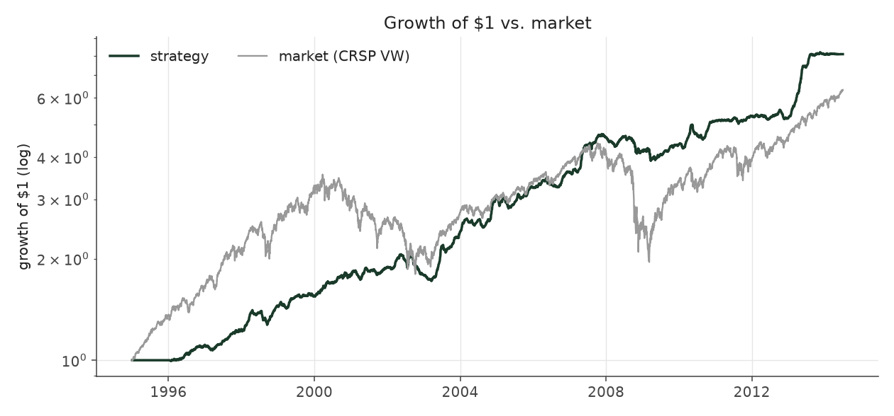
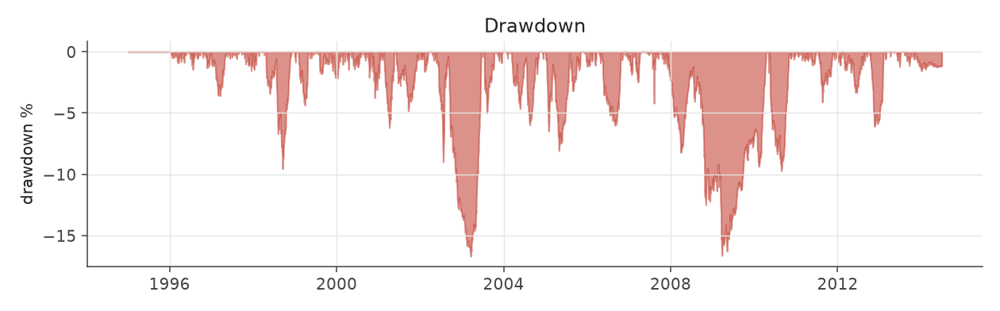
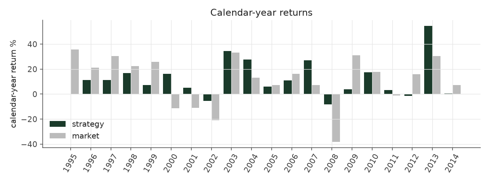
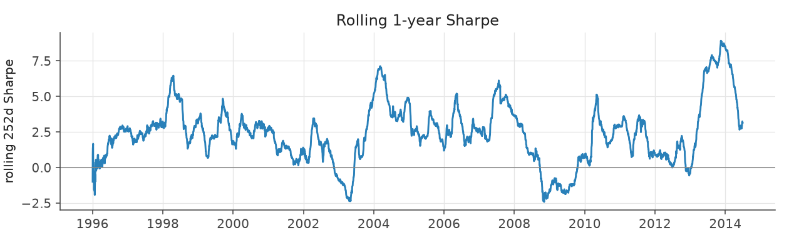
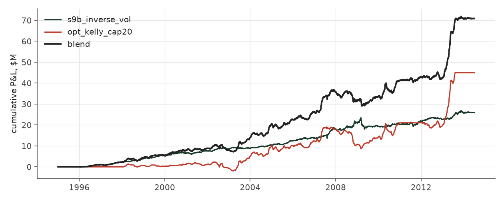

# hedged_blend

_portfolio strategy | family: portfolio | status: validated | derived from `calm_weighted`_

## What this strategy does

Market-neutral inverse-vol equity book (0.8x) + corrected-quote Kelly options book (1.6x), on one NAV

**Why it should work.** The sleeves are uncorrelated with each other (about -0.05) and with the market (~0 / 0.18): equity alpha earned most of its return in 1996-2003 and made +10% in 2008 when the options book lost; options earned most after 2003. Weights set so each sleeve contributes equal stand-alone risk, scaled to ~5% portfolio volatility.

**Design notes** (from the strategy's source file).

PortfolioStrategy: a fixed-weight, daily-rebalanced blend of other registered strategies.

A sleeve weight is a multiple of fund NAV allocated to that strategy's own sizing: weight 1.0 runs the strategy exactly as backtested on the whole NAV, 0.8 runs it 20% smaller. Weights need not sum to one -- the sleeves are low-correlation books that each use only part of their capital (the options sleeve spends at most its premium budget, the equity sleeve is margin-financed long/short), so they can share one NAV. Returns compound daily: r_p = sum(w_i r_i), NAV_t = NAV_{t-1} (1 + r_p).

Sleeve results come from the strategy registry itself (re-run in-process, ~seconds), so the blend always reflects the current sleeve definitions. Days with no sleeve activity (options in 2011, where the source file is corrupt) contribute zero for that sleeve.

| parameter | value |
|---|---|
| w_calm_weighted | 0.8 |
| w_options_cap20 | 1.6 |

## Performance

| metric | hedged_blend | market (CRSP VW) |
|---|---|---|
| Annualized return | 11.33% | 9.94% |
| Annualized volatility | 4.83% | 19.35% |
| Sharpe (NAV-pct) | 2.25 | 0.59 |
| Sortino | 3.58 |  |
| Max drawdown | -16.7% | -55.5% |
| Calmar | 0.68 |  |
| Final NAV ($10M start) | $80,879,071 |  |
| Worst day | -2.65% |  |
| % positive days | 54.0% |  |
| Sharpe 1996-2001 | 2.41 |  |
| Sharpe 2002-2007 | 2.70 |  |
| Sharpe 2008-2013 | 1.91 |  |

Correlation of daily returns with the market: **0.13**.

- best Sharpe among portfolio: `calm_blend` (2.5); this one: 2.25
- best return among portfolio: `calm_blend` (0.124); this one: 0.113
- best Calmar among portfolio: `calm_blend` (0.802); this one: 0.679

*NAV (log scale)*

*Drawdown from running peak*

*Calendar-year returns*

*Is the edge stable, or concentrated in a few years?*

## Where the return comes from

*Each sleeve's contribution to the blend's cumulative P&L*

| sleeve | weight | pnl_M | share_of_pnl |
|---|---|---|---|
| calm_weighted | 0.80 | 25.93 | 36.6% |
| options_cap20 | 1.60 | 44.95 | 63.4% |

- Correlation between the sleeves' daily returns: **-0.05**.
- Blend market beta 0.033, correlation to the market 0.13.

Return, volatility and Sharpe of the blend are in the Performance table above; the cross-strategy report (`python -m pead compare`) shows the full weight frontier, the walk-forward (out-of-sample) weights and the volatility-target table.
