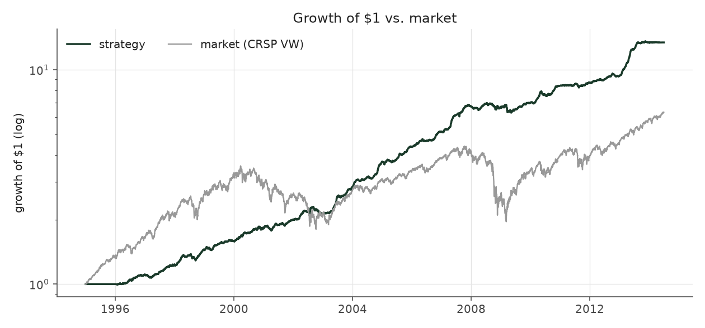
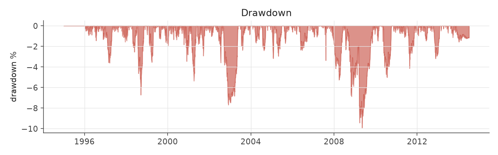
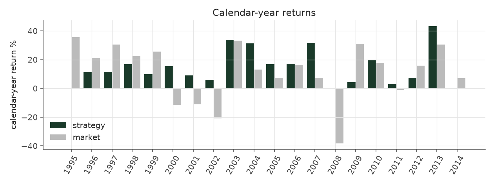
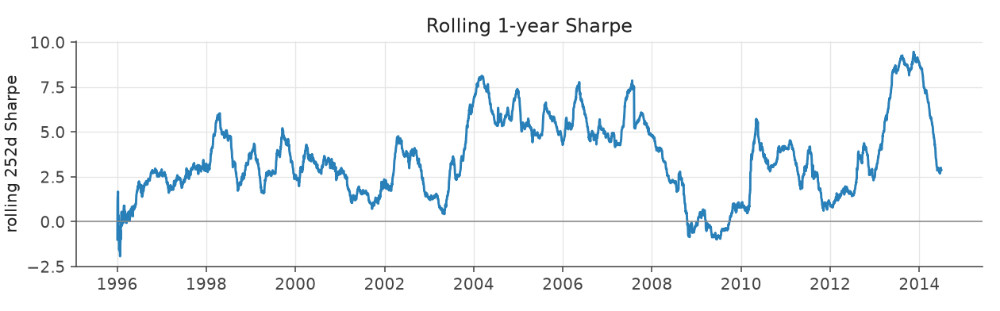
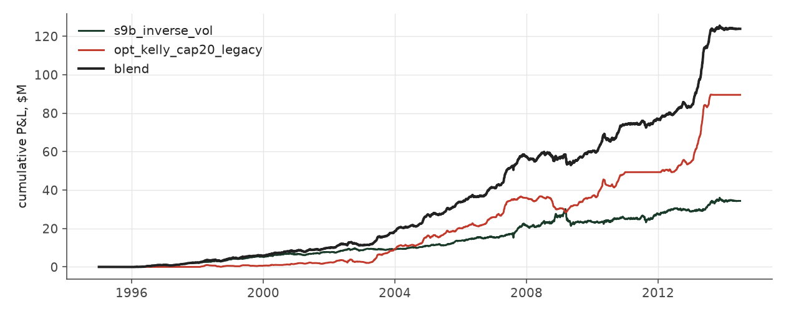

# hedged_blend_legacy_options

_portfolio strategy | family: portfolio | status: reference | derived from `hedged_blend`_

## What this strategy does

The blend with the options book as originally reported (dead quotes carried forward) -- an overstated upper bound

**Why it should work.** Shows how much of the blend's Sharpe came from the options sleeve's quote-marking convention.

**Design notes** (from the strategy's source file).

PortfolioStrategy: a fixed-weight, daily-rebalanced blend of other registered strategies.

A sleeve weight is a multiple of fund NAV allocated to that strategy's own sizing: weight 1.0 runs the strategy exactly as backtested on the whole NAV, 0.8 runs it 20% smaller. Weights need not sum to one -- the sleeves are low-correlation books that each use only part of their capital (the options sleeve spends at most its premium budget, the equity sleeve is margin-financed long/short), so they can share one NAV. Returns compound daily: r_p = sum(w_i r_i), NAV_t = NAV_{t-1} (1 + r_p).

Sleeve results come from the strategy registry itself (re-run in-process, ~seconds), so the blend always reflects the current sleeve definitions. Days with no sleeve activity (options in 2011, where the source file is corrupt) contribute zero for that sleeve.

| parameter | value |
|---|---|
| w_s9b_inverse_vol | 0.8 |
| w_opt_kelly_cap20_legacy | 1.15 |

## Performance

| metric | hedged_blend_legacy_options | market (CRSP VW) |
|---|---|---|
| Annualized return | 14.25% | 9.94% |
| Annualized volatility | 4.18% | 19.35% |
| Sharpe (NAV-pct) | 3.21 | 0.59 |
| Sortino | 5.28 |  |
| Max drawdown | -9.9% | -55.5% |
| Calmar | 1.44 |  |
| Final NAV ($10M start) | $133,847,106 |  |
| Worst day | -2.66% |  |
| % positive days | 56.6% |  |
| Sharpe 1996-2001 | 2.79 |  |
| Sharpe 2002-2007 | 4.64 |  |
| Sharpe 2008-2013 | 2.61 |  |

Correlation of daily returns with the market: **0.10**.

- best Sharpe among portfolio: `hedged_blend_s10` (2.5); this one: 3.21
- best return among portfolio: `hedged_blend_s10` (0.124); this one: 0.142
- best Calmar among portfolio: `hedged_blend_s10` (0.802); this one: 1.44

*NAV (log scale)*

*Drawdown from running peak*

*Calendar-year returns*

*Is the edge stable, or concentrated in a few years?*

## Where the return comes from

*Each sleeve's contribution to the blend's cumulative P&L*

| sleeve | weight | pnl_M | share_of_pnl |
|---|---|---|---|
| s9b_inverse_vol | 0.80 | 34.34 | 27.7% |
| opt_kelly_cap20_legacy | 1.15 | 89.51 | 72.3% |

- Correlation between the sleeves' daily returns: **-0.05**.
- Blend market beta 0.022, correlation to the market 0.10.

Return, volatility and Sharpe of the blend are in the Performance table above; the cross-strategy report (`python -m pead compare`) shows the full weight frontier, the walk-forward (out-of-sample) weights and the volatility-target table.
