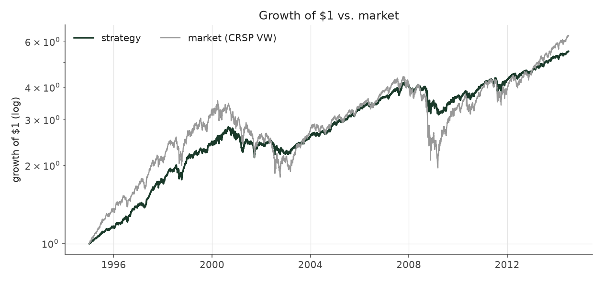
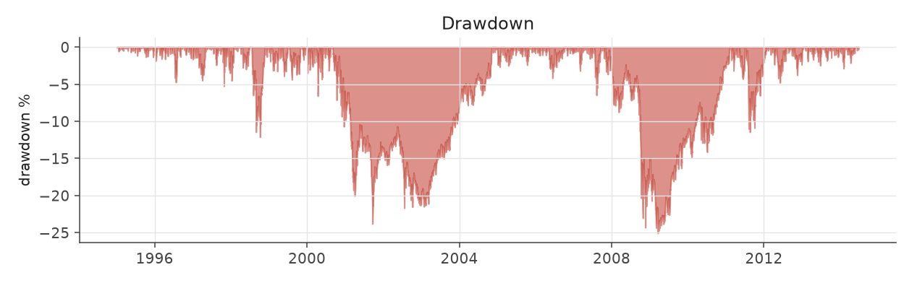
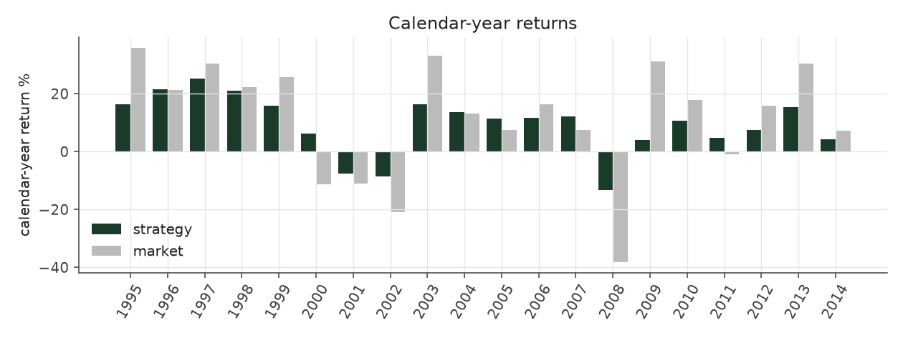
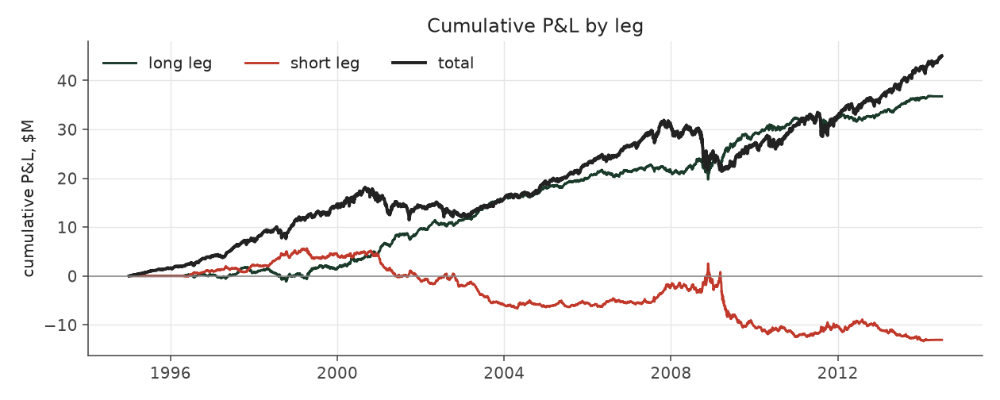
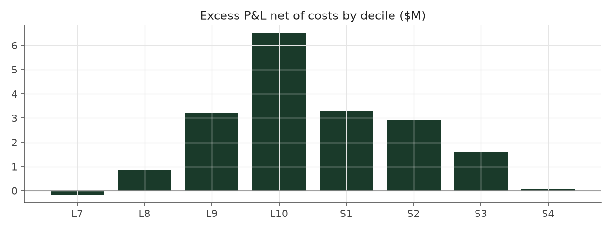

# market_boost

_equity strategy | family: equity-overlay | status: validated | derived from `balanced_leverage`_

## What this strategy does

Balanced Leverage plus a market position worth half the account

**Why it should work.** Alpha book earns the drift; the overlay earns the equity risk premium on the same capital.

**Design notes** (from the strategy's source file).

Market Boost -- Balanced Leverage plus a half-size position in the overall stock market.

Keeps Balanced Leverage's book completely untouched and holds a separate synthetic market-index position of 0.5x trailing NAV beside it (re-sized quarterly, 2bps cost) -- the 130/30-style long-extension structure real funds use to add market exposure without distorting the alpha signal. This is how the equity side clears the S&P 500's return in this sample.

| parameter | value |
|---|---|
| base_unit_fraction | 0.003 |
| max_gross_leverage | 2.5 |
| liquidity_cap_frac | 0.05 |
| return_basis | mktadj |
| cap_mode | priority |
| exposure_cap | open_book |
| beta_overlay | 0.5 |

## Performance

| metric | market_boost | market (CRSP VW) |
|---|---|---|
| Annualized return | 9.15% | 9.94% |
| Annualized volatility | 10.39% | 19.35% |
| Sharpe (NAV-pct) | 0.90 | 0.59 |
| Sortino | 1.29 |  |
| Max drawdown | -25.1% | -55.5% |
| Calmar | 0.36 |  |
| Final NAV ($10M start) | $55,034,354 |  |
| Worst day | -4.84% |  |
| % positive days | 55.3% |  |
| Sharpe 1996-2001 | 1.20 |  |
| Sharpe 2002-2007 | 1.10 |  |
| Sharpe 2008-2013 | 0.40 |  |

Correlation of daily returns with the market: **0.94**.

- best Sharpe among equity: `calm_rank_tilt` (1.47); this one: 0.895
- best return among equity: `market_boost_max` (0.116); this one: 0.0915
- best Calmar among equity: `calm_rank_tilt` (0.442); this one: 0.365

*NAV (log scale)*

*Drawdown from running peak*

*Calendar-year returns*

*Is the edge stable, or concentrated in a few years?*

## Where the return comes from

*Long leg vs. short leg vs. total*

|  | long leg | short leg |
|---|---|---|
| P&L ($M, before costs) | 36.74 | -13.08 |
| P&L after costs ($M) | 33.86 | -16.13 |
| of which common (average-event) component ($M) | 23.41 | -24.03 |
| of which excess / PEAD component ($M) | 13.34 | 10.96 |
| excess minus costs ($M) | 10.45 | 7.91 |
| gross return per $ traded (bp) | 252.72 | -87.98 |
| positions in the money (hit rate) | 0.56 | 0.48 |
| stand-alone Sharpe (leg only) | 1.17 | -0.32 |

Daily P&L correlation between the two legs: **-0.80**.

- **The short leg loses money in absolute terms** (-13.1M before costs) while the long leg earns +36.7M. That is mostly a benchmark effect, not a signal failure: the average earnings-event stock beat the cap-weighted market during its holding window, which flatters the long leg and hurts the short leg by 23.4M / 24.0M. Stripping that common component, the surprise signal itself earned +13.3M on the long side and +11.0M on the short side.
- The two legs' daily P&L are -0.80 correlated: the short leg is the hedge that makes the long leg's variance disappear (stand-alone leg Sharpe 1.17 long / -0.32 short vs 0.90 combined).

### By decile and side (signal-driven part only)

| leg | decile | positions | notional_M | net_pnl_M | excess_M | cost_M | alpha_net_M | alpha_share | alpha_bp_per_$ |
|---|---|---|---|---|---|---|---|---|---|
| long | 7 | 5,756 | 95.09 | 1.46 | 0.03 | 0.19 | -0.17 | -0.9% | -17.41 |
| long | 8 | 15,259 | 315.71 | 6.61 | 1.51 | 0.63 | 0.88 | 4.8% | 27.90 |
| long | 9 | 17,582 | 447.52 | 9.52 | 4.12 | 0.88 | 3.24 | 17.6% | 72.33 |
| long | 10 | 19,546 | 595.59 | 16.27 | 7.68 | 1.18 | 6.50 | 35.4% | 109.09 |
| short | 1 | 17,711 | 595.10 | -6.77 | 4.58 | 1.27 | 3.31 | 18.0% | 55.59 |
| short | 2 | 17,925 | 511.12 | -5.46 | 3.94 | 1.03 | 2.91 | 15.8% | 56.88 |
| short | 3 | 14,022 | 338.63 | -3.40 | 2.29 | 0.68 | 1.62 | 8.8% | 47.74 |
| short | 4 | 2,169 | 41.38 | -0.50 | 0.15 | 0.08 | 0.08 | 0.4% | 18.55 |

*D10 and the short deciles carry the alpha; the middle of each leg earns little*

### By size quintile (1 = smallest)

| size_quintile | positions | notional_M | net_pnl_M | excess_M | cost_M | alpha_net_M | alpha_share | alpha_bp_per_$ |
|---|---|---|---|---|---|---|---|---|
| 1 | 13,094 | 277.14 | 0.12 | 1.83 | 1.06 | 0.77 | 4.2% | 27.79 |
| 2 | 21,037 | 558.41 | 6.62 | 8.55 | 1.56 | 6.98 | 38.0% | 125.07 |
| 3 | 23,664 | 672.81 | 5.00 | 6.42 | 1.41 | 5.01 | 27.3% | 74.49 |
| 4 | 25,541 | 712.39 | 3.70 | 4.61 | 1.11 | 3.49 | 19.0% | 49.05 |
| 5 | 26,634 | 719.38 | 2.29 | 2.89 | 0.79 | 2.10 | 11.4% | 29.18 |

### By liquidity quintile (1 = least liquid)

| liquidity_quintile | positions | notional_M | net_pnl_M | excess_M | cost_M | alpha_net_M | alpha_share | alpha_bp_per_$ |
|---|---|---|---|---|---|---|---|---|
| 1 | 12,373 | 201.26 | 2.28 | 3.67 | 1.01 | 2.67 | 14.5% | 132.52 |
| 2 | 21,374 | 594.43 | 4.04 | 6.62 | 1.78 | 4.84 | 26.4% | 81.40 |
| 3 | 23,903 | 716.16 | 5.43 | 7.18 | 1.43 | 5.75 | 31.3% | 80.22 |
| 4 | 25,542 | 717.00 | 3.84 | 4.39 | 1.00 | 3.39 | 18.4% | 47.22 |
| 5 | 26,774 | 711.11 | 2.13 | 2.42 | 0.71 | 1.70 | 9.3% | 23.97 |

### By holding-window length

| hold_bucket | positions | notional_M | net_pnl_M | excess_M | cost_M | alpha_net_M | alpha_share | alpha_bp_per_$ |
|---|---|---|---|---|---|---|---|---|
| <=40d | 38,892 | 1,003.09 | 0.23 | 7.87 | 1.91 | 5.96 | 32.5% | 59.44 |
| 41-60d | 26,124 | 736.12 | 2.12 | 5.39 | 1.61 | 3.78 | 20.6% | 51.39 |
| 61-90d | 35,980 | 971.10 | 9.61 | 6.14 | 1.78 | 4.35 | 23.7% | 44.84 |
| >90d | 8,974 | 229.82 | 5.76 | 4.90 | 0.64 | 4.26 | 23.2% | 185.34 |

### By era

| era | positions | notional_M | net_pnl_M | excess_M | cost_M | alpha_net_M | alpha_share | alpha_bp_per_$ |
|---|---|---|---|---|---|---|---|---|
| 1996-01 | 32,082 | 648.44 | 7.56 | 9.08 | 1.28 | 7.81 | 42.5% | 120.38 |
| 2002-07 | 36,273 | 996.05 | 8.23 | 10.09 | 1.97 | 8.12 | 44.2% | 81.55 |
| 2008-13 | 41,615 | 1,295.64 | 1.94 | 5.12 | 2.69 | 2.43 | 13.2% | 18.75 |

### By FF12 sector

| ff12_sector | positions | notional_M | net_pnl_M | excess_M | cost_M | alpha_net_M | alpha_share | alpha_bp_per_$ |
|---|---|---|---|---|---|---|---|---|
| BusEq | 19,612 | 276.98 | 0.79 | 1.35 | 0.58 | 0.77 | 4.2% | 27.70 |
| Chems | 2,545 | 200.33 | 0.95 | 1.33 | 0.36 | 0.97 | 5.3% | 48.46 |
| Durbl | 2,812 | 217.25 | 1.56 | 2.10 | 0.40 | 1.70 | 9.2% | 78.15 |
| Enrgy | 6,250 | 246.54 | 3.05 | 3.55 | 0.47 | 3.08 | 16.8% | 124.98 |
| Hlth | 10,936 | 280.00 | 1.24 | 1.86 | 0.59 | 1.27 | 6.9% | 45.36 |
| Manuf | 11,449 | 262.67 | 1.40 | 2.01 | 0.55 | 1.46 | 7.9% | 55.51 |
| Money | 15,175 | 240.41 | 1.92 | 2.55 | 0.55 | 2.00 | 10.9% | 83.10 |
| NoDur | 4,887 | 242.43 | 1.08 | 1.49 | 0.47 | 1.02 | 5.6% | 42.24 |
| Other | 16,350 | 265.41 | 1.89 | 2.56 | 0.59 | 1.97 | 10.7% | 74.26 |
| Shops | 11,320 | 275.81 | 2.69 | 3.28 | 0.57 | 2.70 | 14.7% | 98.05 |
| Telcm | 3,942 | 242.50 | 1.36 | 1.86 | 0.45 | 1.41 | 7.7% | 58.27 |
| Utils | 4,692 | 189.81 | -0.21 | 0.36 | 0.35 | 0.00 | 0.0% | 0.20 |

### By idiosyncratic-volatility tercile

| vol_tercile | positions | notional_M | net_pnl_M | excess_M | cost_M | alpha_net_M | alpha_share | alpha_bp_per_$ |
|---|---|---|---|---|---|---|---|---|
| high vol | 36,794 | 943.20 | 1.67 | 4.44 | 1.72 | 2.73 | 14.9% | 28.92 |
| low vol | 36,578 | 998.17 | 8.19 | 10.51 | 2.22 | 8.29 | 45.2% | 83.09 |
| mid vol | 34,866 | 948.23 | 7.19 | 8.60 | 1.90 | 6.70 | 36.5% | 70.69 |

### Short-borrow sensitivity (not modeled in the backtest)

| borrow_rate | fee_M | annualized_return | drag |
|---|---|---|---|
| 0.0% | 0.0 | 9.15% | -0.00% |
| 0.5% | 1.5 | 9.00% | 0.15% |
| 1.0% | 3.0 | 8.84% | 0.31% |
| 2.0% | 6.0 | 8.51% | 0.64% |
| 5.0% | 15.0 | 7.39% | 1.77% |

The engine charges the same transaction cost on shorts as on longs and no stock-borrow fee. The short leg is concentrated in small, illiquid names, where borrow is scarce and expensive -- read the table as a floor on the cost of running the short leg.
