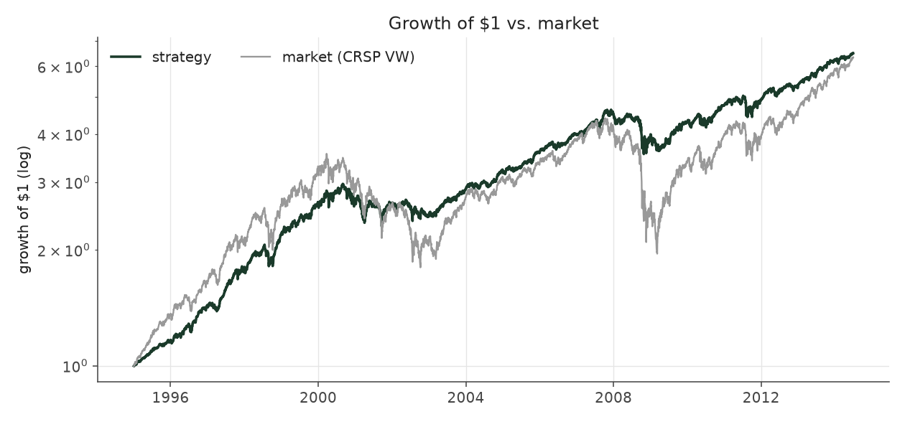
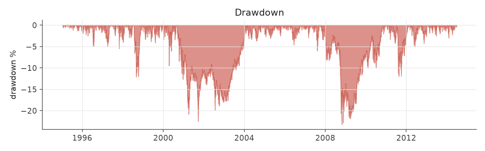
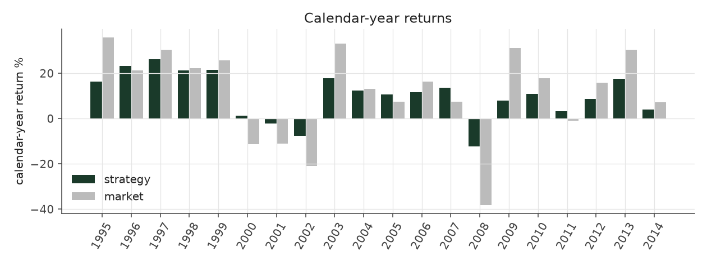
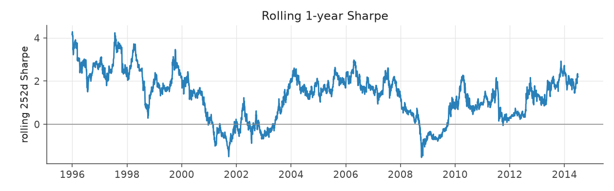
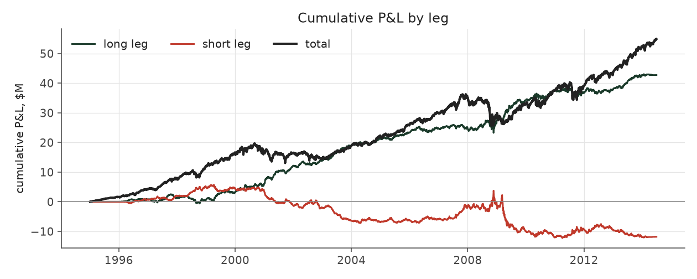
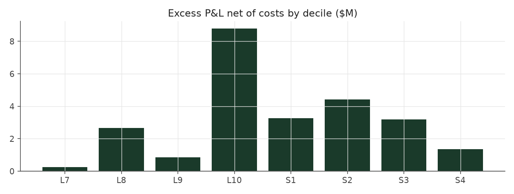

# market_boost_legacy

_equity strategy | family: equity-overlay | status: reference | derived from `market_boost`_

## What this strategy does

Balanced Leverage plus a market position worth half the account -- ORIGINAL leverage cap (new positions only, open book ignored)

**Why it should work.** Alpha book earns the drift; the overlay earns the equity risk premium on the same capital.

**Design notes** (from the strategy's source file).

Market Boost -- Balanced Leverage plus a half-size position in the overall stock market.

Keeps Balanced Leverage's book completely untouched and holds a separate synthetic market-index position of 0.5x trailing NAV beside it (re-sized quarterly, 2bps cost) -- the 130/30-style long-extension structure real funds use to add market exposure without distorting the alpha signal. This is how the equity side clears the S&P 500's return in this sample.

| parameter | value |
|---|---|
| base_unit_fraction | 0.003 |
| max_gross_leverage | 2.5 |
| liquidity_cap_frac | 0.05 |
| return_basis | mktadj |
| cap_mode | priority |
| exposure_cap | entry_cohort |
| beta_overlay | 0.5 |

## Performance

| metric | market_boost_legacy | market (CRSP VW) |
|---|---|---|
| Annualized return | 10.08% | 9.94% |
| Annualized volatility | 10.51% | 19.35% |
| Sharpe (NAV-pct) | 0.97 | 0.59 |
| Sortino | 1.40 |  |
| Max drawdown | -23.2% | -55.5% |
| Calmar | 0.43 |  |
| Final NAV ($10M start) | $64,912,423 |  |
| Worst day | -4.66% |  |
| % positive days | 55.4% |  |
| Sharpe 1996-2001 | 1.30 |  |
| Sharpe 2002-2007 | 1.14 |  |
| Sharpe 2008-2013 | 0.48 |  |

Correlation of daily returns with the market: **0.94**.

- best Sharpe among equity: `calm_rank_tilt` (1.47); this one: 0.966
- best return among equity: `market_boost_max` (0.116); this one: 0.101
- best Calmar among equity: `calm_rank_tilt` (0.442); this one: 0.434

*NAV (log scale)*

*Drawdown from running peak*

*Calendar-year returns*

*Is the edge stable, or concentrated in a few years?*

## Where the return comes from

*Long leg vs. short leg vs. total*

|  | long leg | short leg |
|---|---|---|
| P&L ($M, before costs) | 42.74 | -11.85 |
| P&L after costs ($M) | 39.45 | -15.40 |
| of which common (average-event) component ($M) | 26.45 | -27.25 |
| of which excess / PEAD component ($M) | 15.84 | 15.74 |
| excess minus costs ($M) | 12.55 | 12.21 |
| gross return per $ traded (bp) | 253.36 | -68.44 |
| positions in the money (hit rate) | 0.56 | 0.49 |
| stand-alone Sharpe (leg only) | 1.20 | -0.24 |

Daily P&L correlation between the two legs: **-0.81**.

- **The short leg loses money in absolute terms** (-11.8M before costs) while the long leg earns +42.7M. That is mostly a benchmark effect, not a signal failure: the average earnings-event stock beat the cap-weighted market during its holding window, which flatters the long leg and hurts the short leg by 26.4M / 27.2M. Stripping that common component, the surprise signal itself earned +15.8M on the long side and +15.7M on the short side.
- The two legs' daily P&L are -0.81 correlated: the short leg is the hedge that makes the long leg's variance disappear (stand-alone leg Sharpe 1.20 long / -0.24 short vs 0.97 combined).

### By decile and side (signal-driven part only)

| leg | decile | positions | notional_M | net_pnl_M | excess_M | cost_M | alpha_net_M | alpha_share | alpha_bp_per_$ |
|---|---|---|---|---|---|---|---|---|---|
| long | 7 | 8,029 | 148.61 | 3.03 | 0.54 | 0.29 | 0.25 | 1.0% | 16.67 |
| long | 8 | 16,588 | 394.76 | 9.19 | 3.43 | 0.78 | 2.65 | 10.7% | 67.26 |
| long | 9 | 17,747 | 522.21 | 8.37 | 1.85 | 1.01 | 0.85 | 3.4% | 16.24 |
| long | 10 | 17,174 | 621.45 | 18.85 | 10.01 | 1.22 | 8.79 | 35.5% | 141.44 |
| short | 1 | 17,169 | 624.20 | -6.03 | 4.58 | 1.33 | 3.25 | 13.1% | 52.11 |
| short | 2 | 17,281 | 539.87 | -4.65 | 5.50 | 1.09 | 4.41 | 17.8% | 81.65 |
| short | 3 | 15,970 | 404.59 | -3.39 | 4.00 | 0.81 | 3.18 | 12.9% | 78.66 |
| short | 4 | 9,171 | 162.59 | -1.33 | 1.66 | 0.31 | 1.35 | 5.4% | 82.86 |

*D10 and the short deciles carry the alpha; the middle of each leg earns little*

### By size quintile (1 = smallest)

| size_quintile | positions | notional_M | net_pnl_M | excess_M | cost_M | alpha_net_M | alpha_share | alpha_bp_per_$ |
|---|---|---|---|---|---|---|---|---|
| 1 | 14,213 | 306.96 | 5.45 | 7.49 | 1.18 | 6.31 | 25.5% | 205.66 |
| 2 | 22,885 | 641.27 | 6.15 | 8.27 | 1.80 | 6.47 | 26.2% | 100.97 |
| 3 | 25,501 | 785.23 | 6.22 | 7.64 | 1.64 | 6.01 | 24.3% | 76.51 |
| 4 | 27,583 | 839.10 | 3.71 | 4.83 | 1.31 | 3.52 | 14.2% | 42.01 |
| 5 | 28,947 | 845.72 | 2.51 | 3.34 | 0.93 | 2.41 | 9.7% | 28.50 |

### By liquidity quintile (1 = least liquid)

| liquidity_quintile | positions | notional_M | net_pnl_M | excess_M | cost_M | alpha_net_M | alpha_share | alpha_bp_per_$ |
|---|---|---|---|---|---|---|---|---|
| 1 | 13,650 | 225.40 | 5.20 | 6.75 | 1.13 | 5.62 | 22.7% | 249.54 |
| 2 | 23,084 | 676.60 | 5.79 | 8.71 | 2.03 | 6.68 | 27.0% | 98.69 |
| 3 | 25,851 | 834.81 | 6.30 | 8.40 | 1.67 | 6.73 | 27.2% | 80.67 |
| 4 | 27,665 | 843.84 | 4.54 | 5.12 | 1.18 | 3.94 | 15.9% | 46.70 |
| 5 | 28,874 | 837.44 | 2.21 | 2.58 | 0.84 | 1.75 | 7.1% | 20.86 |

### By holding-window length

| hold_bucket | positions | notional_M | net_pnl_M | excess_M | cost_M | alpha_net_M | alpha_share | alpha_bp_per_$ |
|---|---|---|---|---|---|---|---|---|
| <=40d | 45,855 | 1,296.80 | -0.36 | 7.00 | 2.28 | 4.73 | 19.1% | 36.45 |
| 41-60d | 25,652 | 773.42 | 4.67 | 4.78 | 1.58 | 3.20 | 12.9% | 41.38 |
| 61-90d | 35,324 | 1,006.66 | 7.13 | 8.56 | 2.12 | 6.44 | 26.0% | 63.94 |
| >90d | 12,298 | 341.40 | 12.61 | 11.24 | 0.87 | 10.37 | 41.9% | 303.70 |

### By era

| era | positions | notional_M | net_pnl_M | excess_M | cost_M | alpha_net_M | alpha_share | alpha_bp_per_$ |
|---|---|---|---|---|---|---|---|---|
| 1996-01 | 33,895 | 702.89 | 9.20 | 10.74 | 1.38 | 9.37 | 37.8% | 133.30 |
| 2002-07 | 39,956 | 1,131.98 | 10.13 | 12.34 | 2.22 | 10.12 | 40.9% | 89.41 |
| 2008-13 | 45,278 | 1,583.40 | 4.72 | 8.49 | 3.25 | 5.24 | 21.2% | 33.09 |

### By FF12 sector

| ff12_sector | positions | notional_M | net_pnl_M | excess_M | cost_M | alpha_net_M | alpha_share | alpha_bp_per_$ |
|---|---|---|---|---|---|---|---|---|
| BusEq | 22,094 | 335.42 | 1.77 | 2.50 | 0.71 | 1.79 | 7.2% | 53.41 |
| Chems | 2,590 | 227.57 | 1.44 | 1.79 | 0.40 | 1.39 | 5.6% | 60.97 |
| Durbl | 2,843 | 245.81 | 2.39 | 2.91 | 0.45 | 2.46 | 9.9% | 100.05 |
| Enrgy | 6,194 | 278.68 | 3.95 | 4.55 | 0.52 | 4.03 | 16.3% | 144.65 |
| Hlth | 11,696 | 325.36 | 2.67 | 3.34 | 0.68 | 2.66 | 10.7% | 81.65 |
| Manuf | 12,034 | 304.84 | 1.76 | 2.43 | 0.63 | 1.80 | 7.3% | 59.08 |
| Money | 17,583 | 299.07 | 2.59 | 3.42 | 0.67 | 2.75 | 11.1% | 91.86 |
| NoDur | 5,081 | 274.80 | 1.38 | 1.87 | 0.52 | 1.34 | 5.4% | 48.94 |
| Other | 18,377 | 325.08 | 2.31 | 3.18 | 0.72 | 2.45 | 9.9% | 75.48 |
| Shops | 11,984 | 317.62 | 3.13 | 3.79 | 0.65 | 3.14 | 12.7% | 98.89 |
| Telcm | 3,981 | 270.57 | 0.18 | 0.72 | 0.49 | 0.23 | 0.9% | 8.64 |
| Utils | 4,672 | 213.45 | 0.48 | 1.08 | 0.39 | 0.68 | 2.8% | 32.03 |

### By idiosyncratic-volatility tercile

| vol_tercile | positions | notional_M | net_pnl_M | excess_M | cost_M | alpha_net_M | alpha_share | alpha_bp_per_$ |
|---|---|---|---|---|---|---|---|---|
| high vol | 39,523 | 1,094.31 | 4.11 | 7.37 | 1.98 | 5.39 | 21.8% | 49.25 |
| low vol | 40,091 | 1,165.68 | 10.19 | 12.82 | 2.56 | 10.25 | 41.4% | 87.96 |
| mid vol | 37,903 | 1,105.61 | 9.59 | 11.30 | 2.19 | 9.11 | 36.8% | 82.36 |

### Short-borrow sensitivity (not modeled in the backtest)

| borrow_rate | fee_M | annualized_return | drag |
|---|---|---|---|
| 0.0% | 0.0 | 10.08% | -0.00% |
| 0.5% | 1.8 | 9.93% | 0.15% |
| 1.0% | 3.5 | 9.77% | 0.31% |
| 2.0% | 7.0 | 9.44% | 0.64% |
| 5.0% | 17.5 | 8.32% | 1.76% |

The engine charges the same transaction cost on shorts as on longs and no stock-borrow fee. The short leg is concentrated in small, illiquid names, where borrow is scarce and expensive -- read the table as a floor on the cost of running the short leg.
