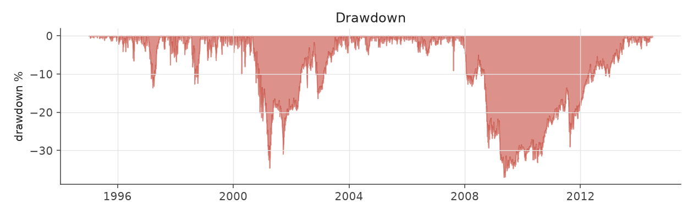
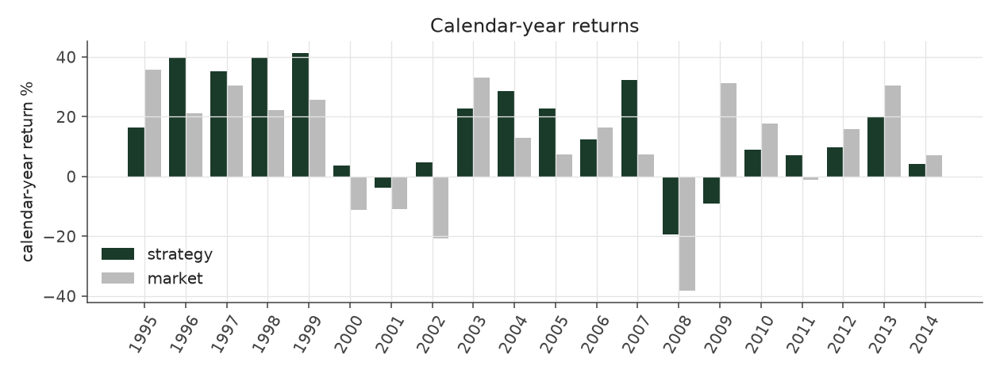
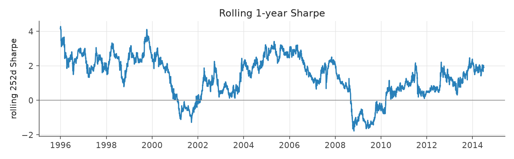

# market_boost_max_legacy

_equity strategy | family: equity-max | status: reference | derived from `market_boost_max`_

## What this strategy does

Balanced Leverage Max plus the same half-size market position -- ORIGINAL leverage cap (new positions only, open book ignored)

**Why it should work.** Market-neutral earnings drift with enough gross exposure to matter; the neutrality is the hedge.

**Design notes** (from the strategy's source file).

Max-size variants ("<name>_max") of the hand-built equity strategies.

Same signal, trim, tilt and neutralization as each base strategy; only the two dials that set how big and how levered the book is change (base_unit_fraction, gross-leverage cap = 6x). The multiplier for each was picked by sweeping 1.5x..12x the original base unit and taking the highest return subject to Sharpe >= 0.6 and max drawdown >= -40% (a worse drawdown is a fund-ending event, not a risk preference). The untouched 5%-of-ADV liquidity cap remains the real capacity constraint, and bites roughly four times as often at this sizing.

These are generated from the base strategy classes, so a change to a base strategy's weights flows through automatically.

| parameter | value |
|---|---|
| base_unit_fraction | 0.012 |
| max_gross_leverage | 6.0 |
| liquidity_cap_frac | 0.05 |
| return_basis | mktadj |
| cap_mode | priority |
| exposure_cap | entry_cohort |
| beta_overlay | 0.5 |

## Performance

| metric | market_boost_max_legacy | market (CRSP VW) |
|---|---|---|
| Annualized return | 15.01% | 9.94% |
| Annualized volatility | 13.70% | 19.35% |
| Sharpe (NAV-pct) | 1.09 | 0.59 |
| Sortino | 1.60 |  |
| Max drawdown | -37.0% | -55.5% |
| Calmar | 0.41 |  |
| Final NAV ($10M start) | $152,255,386 |  |
| Worst day | -5.91% |  |
| % positive days | 55.1% |  |
| Sharpe 1996-2001 | 1.39 |  |
| Sharpe 2002-2007 | 1.73 |  |
| Sharpe 2008-2013 | 0.21 |  |

Correlation of daily returns with the market: **0.68**.

- best Sharpe among equity: `calm_rank_tilt` (1.47); this one: 1.09
- best return among equity: `market_boost_max` (0.116); this one: 0.15
- best Calmar among equity: `calm_rank_tilt` (0.442); this one: 0.406

*NAV (log scale)*

*Drawdown from running peak*

*Calendar-year returns*

*Is the edge stable, or concentrated in a few years?*

## Where the return comes from

*Long leg vs. short leg vs. total*

|  | long leg | short leg |
|---|---|---|
| P&L ($M, before costs) | 185.98 | -67.62 |
| P&L after costs ($M) | 168.87 | -85.60 |
| of which common (average-event) component ($M) | 175.41 | -173.00 |
| of which excess / PEAD component ($M) | 9.52 | 105.97 |
| excess minus costs ($M) | -7.56 | 88.03 |
| gross return per $ traded (bp) | 166.77 | -59.88 |
| positions in the money (hit rate) | 0.56 | 0.49 |
| stand-alone Sharpe (leg only) | 1.06 | -0.25 |

Daily P&L correlation between the two legs: **-0.77**.

- **The short leg loses money in absolute terms** (-67.6M before costs) while the long leg earns +186.0M. That is mostly a benchmark effect, not a signal failure: the average earnings-event stock beat the cap-weighted market during its holding window, which flatters the long leg and hurts the short leg by 175.4M / 173.0M. Stripping that common component, the surprise signal itself earned +9.5M on the long side and +106.0M on the short side.
- The two legs' daily P&L are -0.77 correlated: the short leg is the hedge that makes the long leg's variance disappear (stand-alone leg Sharpe 1.06 long / -0.25 short vs 1.09 combined).

### By decile and side (signal-driven part only)

| leg | decile | positions | notional_M | net_pnl_M | excess_M | cost_M | alpha_net_M | alpha_share | alpha_bp_per_$ |
|---|---|---|---|---|---|---|---|---|---|
| long | 7 | 7,718 | 1,052.78 | 11.28 | -5.18 | 1.67 | -6.85 | -8.5% | -65.07 |
| long | 8 | 16,225 | 2,721.85 | 42.43 | 2.34 | 4.23 | -1.89 | -2.3% | -6.95 |
| long | 9 | 17,480 | 3,520.62 | 43.56 | -3.69 | 5.32 | -9.01 | -11.2% | -25.59 |
| long | 10 | 16,939 | 3,857.22 | 71.60 | 16.06 | 5.90 | 10.16 | 12.6% | 26.33 |
| short | 1 | 16,755 | 3,662.36 | -27.10 | 29.32 | 5.92 | 23.40 | 29.1% | 63.89 |
| short | 2 | 16,916 | 3,529.55 | -24.03 | 39.18 | 5.54 | 33.64 | 41.8% | 95.32 |
| short | 3 | 15,579 | 2,858.54 | -23.05 | 27.22 | 4.57 | 22.65 | 28.1% | 79.22 |
| short | 4 | 9,015 | 1,241.23 | -11.41 | 10.25 | 1.95 | 8.30 | 10.3% | 66.91 |

*D10 and the short deciles carry the alpha; the middle of each leg earns little*

### By size quintile (1 = smallest)

| size_quintile | positions | notional_M | net_pnl_M | excess_M | cost_M | alpha_net_M | alpha_share | alpha_bp_per_$ |
|---|---|---|---|---|---|---|---|---|
| 1 | 12,943 | 580.43 | 4.74 | 8.80 | 1.91 | 6.89 | 8.6% | 118.74 |
| 2 | 22,307 | 2,425.20 | 15.93 | 23.41 | 5.94 | 17.47 | 21.7% | 72.03 |
| 3 | 25,252 | 4,605.79 | 25.85 | 32.96 | 8.66 | 24.31 | 30.2% | 52.78 |
| 4 | 27,425 | 6,685.72 | 17.20 | 24.36 | 9.76 | 14.60 | 18.1% | 21.84 |
| 5 | 28,700 | 8,147.02 | 19.55 | 25.97 | 8.84 | 17.13 | 21.3% | 21.03 |

### By liquidity quintile (1 = least liquid)

| liquidity_quintile | positions | notional_M | net_pnl_M | excess_M | cost_M | alpha_net_M | alpha_share | alpha_bp_per_$ |
|---|---|---|---|---|---|---|---|---|
| 1 | 11,934 | 272.18 | 5.63 | 7.61 | 1.36 | 6.25 | 7.8% | 229.46 |
| 2 | 22,802 | 1,937.75 | 12.15 | 20.53 | 5.81 | 14.71 | 18.3% | 75.93 |
| 3 | 25,740 | 4,782.62 | 26.45 | 37.55 | 9.56 | 27.99 | 34.8% | 58.52 |
| 4 | 27,494 | 7,253.58 | 21.14 | 28.67 | 10.15 | 18.51 | 23.0% | 25.52 |
| 5 | 28,652 | 8,196.33 | 17.81 | 21.03 | 8.20 | 12.83 | 15.9% | 15.65 |

### By holding-window length

| hold_bucket | positions | notional_M | net_pnl_M | excess_M | cost_M | alpha_net_M | alpha_share | alpha_bp_per_$ |
|---|---|---|---|---|---|---|---|---|
| <=40d | 45,165 | 9,600.44 | -14.15 | 35.15 | 14.06 | 21.09 | 26.2% | 21.97 |
| 41-60d | 25,072 | 4,938.28 | 27.47 | 18.39 | 7.84 | 10.56 | 13.1% | 21.38 |
| 61-90d | 34,592 | 6,224.84 | 23.02 | 26.24 | 10.15 | 16.09 | 20.0% | 25.84 |
| >90d | 11,798 | 1,680.60 | 46.93 | 35.71 | 3.04 | 32.67 | 40.6% | 194.40 |

### By era

| era | positions | notional_M | net_pnl_M | excess_M | cost_M | alpha_net_M | alpha_share | alpha_bp_per_$ |
|---|---|---|---|---|---|---|---|---|
| 1996-01 | 32,056 | 3,008.84 | 26.65 | 30.08 | 4.72 | 25.36 | 31.5% | 84.28 |
| 2002-07 | 39,668 | 7,889.54 | 61.23 | 69.53 | 12.19 | 57.34 | 71.3% | 72.68 |
| 2008-13 | 44,903 | 11,545.77 | -4.60 | 15.88 | 18.18 | -2.30 | -2.9% | -1.99 |

### By FF12 sector

| ff12_sector | positions | notional_M | net_pnl_M | excess_M | cost_M | alpha_net_M | alpha_share | alpha_bp_per_$ |
|---|---|---|---|---|---|---|---|---|
| BusEq | 21,429 | 2,583.01 | 6.03 | 8.57 | 4.33 | 4.24 | 5.3% | 16.40 |
| Chems | 2,571 | 1,235.93 | 7.33 | 8.92 | 1.67 | 7.26 | 9.0% | 58.73 |
| Durbl | 2,800 | 1,290.38 | 2.69 | 4.58 | 1.78 | 2.81 | 3.5% | 21.73 |
| Enrgy | 6,106 | 1,767.37 | 16.94 | 20.27 | 2.50 | 17.77 | 22.1% | 100.55 |
| Hlth | 11,413 | 2,280.39 | 12.88 | 14.71 | 3.68 | 11.03 | 13.7% | 48.37 |
| Manuf | 11,825 | 2,139.00 | 5.43 | 8.60 | 3.40 | 5.20 | 6.5% | 24.31 |
| Money | 17,141 | 2,149.44 | 11.87 | 16.66 | 3.75 | 12.91 | 16.0% | 60.07 |
| NoDur | 5,000 | 1,595.65 | 5.49 | 6.46 | 2.31 | 4.15 | 5.2% | 26.03 |
| Other | 18,022 | 2,447.24 | 8.16 | 13.06 | 4.30 | 8.76 | 10.9% | 35.78 |
| Shops | 11,767 | 2,235.81 | 13.10 | 15.48 | 3.56 | 11.93 | 14.8% | 53.34 |
| Telcm | 3,932 | 1,386.74 | -7.51 | -4.84 | 1.87 | -6.71 | -8.3% | -48.41 |
| Utils | 4,621 | 1,333.20 | 0.86 | 3.03 | 1.96 | 1.06 | 1.3% | 7.98 |

### By idiosyncratic-volatility tercile

| vol_tercile | positions | notional_M | net_pnl_M | excess_M | cost_M | alpha_net_M | alpha_share | alpha_bp_per_$ |
|---|---|---|---|---|---|---|---|---|
| high vol | 38,814 | 8,085.79 | 2.77 | 19.33 | 11.77 | 7.57 | 9.4% | 9.36 |
| low vol | 39,075 | 6,848.95 | 38.30 | 46.76 | 11.52 | 35.24 | 43.8% | 51.45 |
| mid vol | 37,173 | 7,280.81 | 41.91 | 49.66 | 11.41 | 38.26 | 47.5% | 52.54 |

### Short-borrow sensitivity (not modeled in the backtest)

| borrow_rate | fee_M | annualized_return | drag |
|---|---|---|---|
| 0.0% | 0.0 | 15.01% | 0.00% |
| 0.5% | 10.7 | 14.57% | 0.43% |
| 1.0% | 21.5 | 14.11% | 0.89% |
| 2.0% | 43.0 | 13.06% | 1.94% |
| 5.0% | 107.4 | 8.01% | 6.99% |

The engine charges the same transaction cost on shorts as on longs and no stock-borrow fee. The short leg is concentrated in small, illiquid names, where borrow is scarce and expensive -- read the table as a floor on the cost of running the short leg.
