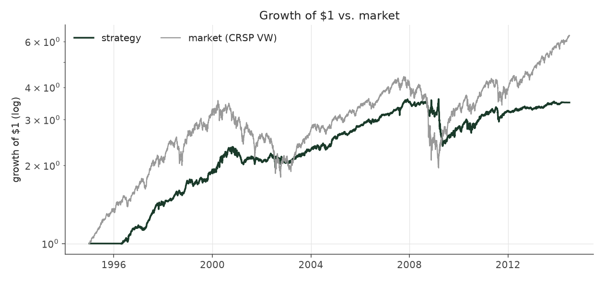
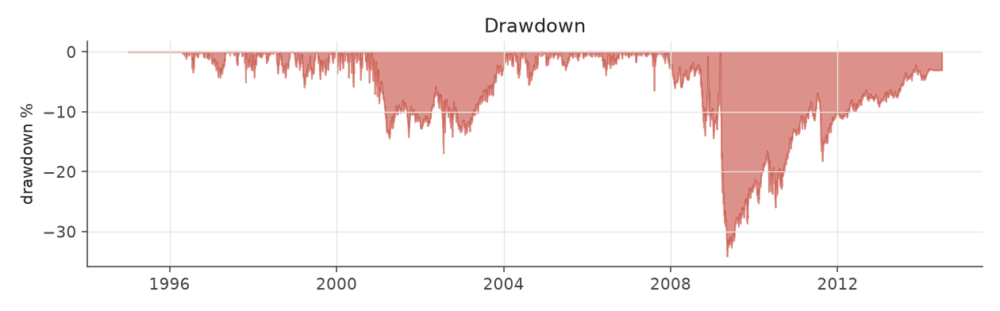
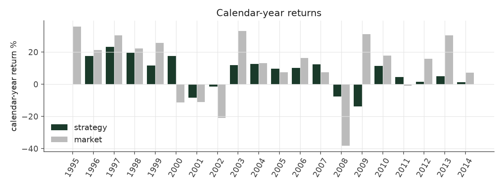
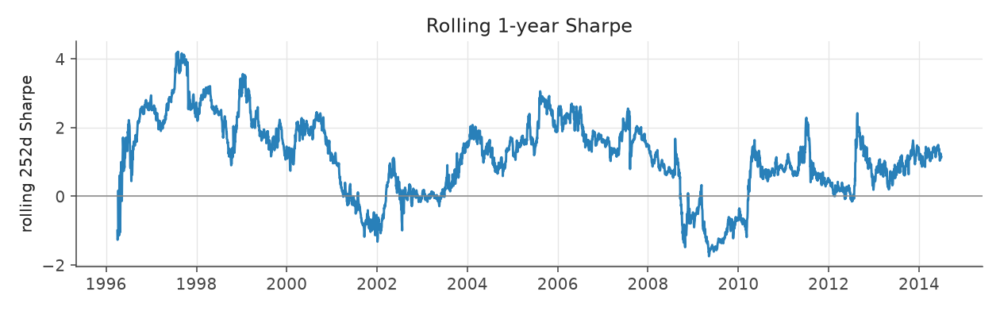
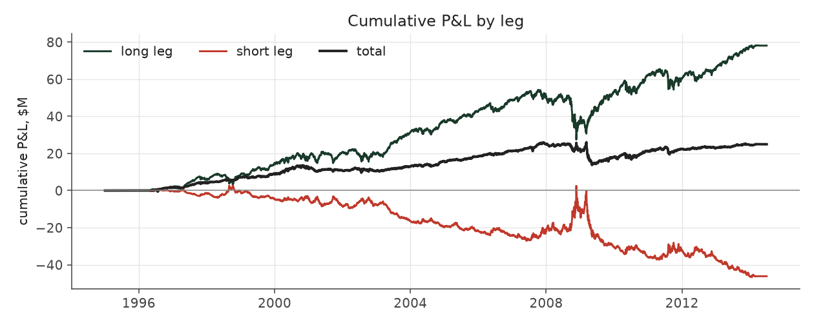

# market_exposed

_equity strategy | family: equity-directional | status: reference | derived from `balanced_leverage`_

## What this strategy does

Balanced Leverage signal, longs and shorts not forced to match, market moves left in

**Why it should work.** Let net exposure float with the signal; empirically this smuggles in uncontrolled market beta.

**Design notes** (from the strategy's source file).

Market Exposed -- like Balanced Leverage, but longs and shorts need not match, so it rides the market (cautionary result).

Balanced Leverage's signal, but the long and short legs are no longer forced to equal dollar totals, and returns are RAW so real market beta is carried. Net dollar exposure is only ~10% of gross (as in every other book) yet the book is 0.52-correlated with the market, because raw returns carry each stock's own beta and equal dollars long and short are not equal BETA: high-SUE and low-SUE firms differ in beta. Kept as a documented counter-example to the explicit beta overlay.

| parameter | value |
|---|---|
| base_unit_fraction | 0.003 |
| max_gross_leverage | 2.5 |
| liquidity_cap_frac | 0.05 |
| return_basis | raw |
| cap_mode | priority |
| exposure_cap | open_book |
| beta_overlay | 0.0 |

## Performance

| metric | market_exposed | market (CRSP VW) |
|---|---|---|
| Annualized return | 6.63% | 9.94% |
| Annualized volatility | 9.48% | 19.35% |
| Sharpe (NAV-pct) | 0.72 | 0.59 |
| Sortino | 1.04 |  |
| Max drawdown | -34.1% | -55.5% |
| Calmar | 0.19 |  |
| Final NAV ($10M start) | $34,939,442 |  |
| Worst day | -5.74% |  |
| % positive days | 50.8% |  |
| Sharpe 1996-2001 | 1.42 |  |
| Sharpe 2002-2007 | 1.10 |  |
| Sharpe 2008-2013 | 0.04 |  |

Correlation of daily returns with the market: **0.42**.

- best Sharpe among equity: `calm_rank_tilt` (1.81); this one: 0.725
- best return among equity: `market_boost_max` (0.15); this one: 0.0663
- best Calmar among equity: `calm_rank_tilt` (0.614); this one: 0.194

*NAV (log scale)*

*Drawdown from running peak*

*Calendar-year returns*

*Is the edge stable, or concentrated in a few years?*

## Where the return comes from

*Long leg vs. short leg vs. total*

|  | long leg | short leg |
|---|---|---|
| P&L ($M, before costs) | 78.12 | -46.20 |
| P&L after costs ($M) | 74.73 | -49.79 |
| of which common (average-event) component ($M) | 26.20 | -27.67 |
| of which excess / PEAD component ($M) | 14.23 | 12.13 |
| excess minus costs ($M) | 10.84 | 8.54 |
| gross return per $ traded (bp) | 433.32 | -273.29 |
| positions in the money (hit rate) | 0.63 | 0.41 |
| stand-alone Sharpe (leg only) | 0.79 | -0.49 |

Daily P&L correlation between the two legs: **-0.92**.

- **The short leg loses money in absolute terms** (-46.2M before costs) while the long leg earns +78.1M. That is mostly a benchmark effect, not a signal failure: the average earnings-event stock beat the cap-weighted market during its holding window, which flatters the long leg and hurts the short leg by 26.2M / 27.7M. Stripping that common component, the surprise signal itself earned +14.2M on the long side and +12.1M on the short side.
- The two legs' daily P&L are -0.92 correlated: the short leg is the hedge that makes the long leg's variance disappear (stand-alone leg Sharpe 0.79 long / -0.49 short vs 0.72 combined).

### By decile and side (signal-driven part only)

| leg | decile | positions | notional_M | net_pnl_M | excess_M | cost_M | alpha_net_M | alpha_share | alpha_bp_per_$ |
|---|---|---|---|---|---|---|---|---|---|
| long | 7 | 5,802 | 107.28 | 3.69 | 0.12 | 0.21 | -0.09 | -0.4% | -8.06 |
| long | 8 | 15,566 | 383.31 | 12.63 | 0.86 | 0.72 | 0.14 | 0.7% | 3.64 |
| long | 9 | 17,940 | 554.30 | 25.43 | 4.55 | 1.03 | 3.52 | 18.2% | 63.53 |
| long | 10 | 19,840 | 757.86 | 32.98 | 8.69 | 1.43 | 7.26 | 37.5% | 95.86 |
| short | 1 | 17,896 | 694.92 | -19.91 | 5.34 | 1.51 | 3.83 | 19.8% | 55.10 |
| short | 2 | 18,153 | 578.82 | -17.37 | 4.16 | 1.21 | 2.94 | 15.2% | 50.88 |
| short | 3 | 14,184 | 374.03 | -10.93 | 2.48 | 0.78 | 1.70 | 8.8% | 45.49 |
| short | 4 | 2,199 | 42.74 | -1.59 | 0.15 | 0.08 | 0.06 | 0.3% | 14.59 |

*D10 and the short deciles carry the alpha; the middle of each leg earns little*

### By size quintile (1 = smallest)

| size_quintile | positions | notional_M | net_pnl_M | excess_M | cost_M | alpha_net_M | alpha_share | alpha_bp_per_$ |
|---|---|---|---|---|---|---|---|---|
| 1 | 13,175 | 314.23 | -3.82 | 0.54 | 1.19 | -0.65 | -3.4% | -20.73 |
| 2 | 21,312 | 660.09 | 6.88 | 9.53 | 1.84 | 7.69 | 39.7% | 116.54 |
| 3 | 23,953 | 804.93 | 6.59 | 7.20 | 1.68 | 5.53 | 28.5% | 68.63 |
| 4 | 25,847 | 851.91 | 6.20 | 5.04 | 1.33 | 3.71 | 19.1% | 43.52 |
| 5 | 27,293 | 862.11 | 9.09 | 4.05 | 0.95 | 3.10 | 16.0% | 35.99 |

### By liquidity quintile (1 = least liquid)

| liquidity_quintile | positions | notional_M | net_pnl_M | excess_M | cost_M | alpha_net_M | alpha_share | alpha_bp_per_$ |
|---|---|---|---|---|---|---|---|---|
| 1 | 12,413 | 219.91 | 1.34 | 3.65 | 1.10 | 2.55 | 13.1% | 115.83 |
| 2 | 21,654 | 699.24 | 3.13 | 7.04 | 2.10 | 4.95 | 25.5% | 70.74 |
| 3 | 24,201 | 860.33 | 5.06 | 7.98 | 1.72 | 6.26 | 32.3% | 72.79 |
| 4 | 25,927 | 861.30 | 5.71 | 3.88 | 1.21 | 2.68 | 13.8% | 31.08 |
| 5 | 27,381 | 852.23 | 9.68 | 3.77 | 0.85 | 2.92 | 15.1% | 34.25 |

### By holding-window length

| hold_bucket | positions | notional_M | net_pnl_M | excess_M | cost_M | alpha_net_M | alpha_share | alpha_bp_per_$ |
|---|---|---|---|---|---|---|---|---|
| <=40d | 39,328 | 1,128.13 | -3.52 | 9.43 | 2.16 | 7.27 | 37.5% | 64.44 |
| 41-60d | 26,409 | 864.40 | -2.77 | 4.45 | 1.89 | 2.56 | 13.2% | 29.60 |
| 61-90d | 36,795 | 1,243.02 | 21.53 | 7.82 | 2.22 | 5.60 | 28.9% | 45.08 |
| >90d | 9,048 | 257.72 | 9.71 | 4.65 | 0.70 | 3.94 | 20.4% | 153.06 |

### By era

| era | positions | notional_M | net_pnl_M | excess_M | cost_M | alpha_net_M | alpha_share | alpha_bp_per_$ |
|---|---|---|---|---|---|---|---|---|
| 1996-01 | 32,241 | 738.10 | 10.88 | 9.54 | 1.44 | 8.11 | 41.8% | 109.81 |
| 2002-07 | 37,016 | 1,223.09 | 13.44 | 12.32 | 2.39 | 9.93 | 51.2% | 81.17 |
| 2008-13 | 42,323 | 1,532.07 | 0.61 | 4.49 | 3.15 | 1.34 | 6.9% | 8.78 |

### By FF12 sector

| ff12_sector | positions | notional_M | net_pnl_M | excess_M | cost_M | alpha_net_M | alpha_share | alpha_bp_per_$ |
|---|---|---|---|---|---|---|---|---|
| BusEq | 20,031 | 330.71 | 5.42 | 1.49 | 0.69 | 0.80 | 4.1% | 24.09 |
| Chems | 2,548 | 237.47 | 1.50 | 1.97 | 0.42 | 1.56 | 8.0% | 65.54 |
| Durbl | 2,811 | 261.85 | 0.64 | 1.62 | 0.48 | 1.15 | 5.9% | 43.87 |
| Enrgy | 6,311 | 294.62 | 2.45 | 4.54 | 0.56 | 3.98 | 20.5% | 135.06 |
| Hlth | 11,094 | 332.77 | 3.19 | 1.72 | 0.69 | 1.02 | 5.3% | 30.73 |
| Manuf | 11,639 | 311.18 | 1.72 | 2.08 | 0.65 | 1.44 | 7.4% | 46.18 |
| Money | 15,536 | 286.26 | 2.26 | 3.30 | 0.65 | 2.65 | 13.7% | 92.57 |
| NoDur | 4,893 | 285.87 | 2.80 | 1.82 | 0.54 | 1.28 | 6.6% | 44.70 |
| Other | 16,625 | 316.91 | 2.44 | 2.68 | 0.70 | 1.98 | 10.2% | 62.57 |
| Shops | 11,424 | 326.50 | 3.36 | 2.85 | 0.67 | 2.18 | 11.2% | 66.67 |
| Telcm | 3,941 | 285.79 | -0.29 | 1.85 | 0.52 | 1.33 | 6.9% | 46.53 |
| Utils | 4,727 | 223.34 | -0.53 | 0.43 | 0.41 | 0.02 | 0.1% | 0.84 |

### By idiosyncratic-volatility tercile

| vol_tercile | positions | notional_M | net_pnl_M | excess_M | cost_M | alpha_net_M | alpha_share | alpha_bp_per_$ |
|---|---|---|---|---|---|---|---|---|
| high vol | 37,378 | 1,127.54 | 0.91 | 4.25 | 2.04 | 2.21 | 11.4% | 19.59 |
| low vol | 37,090 | 1,179.72 | 13.43 | 12.57 | 2.58 | 9.98 | 51.5% | 84.64 |
| mid vol | 35,370 | 1,129.96 | 9.91 | 8.86 | 2.23 | 6.63 | 34.2% | 58.67 |

### Short-borrow sensitivity (not modeled in the backtest)

| borrow_rate | fee_M | annualized_return | drag |
|---|---|---|---|
| 0.0% | 0.0 | 6.63% | 0.00% |
| 0.5% | 1.7 | 6.36% | 0.28% |
| 1.0% | 3.4 | 6.07% | 0.57% |
| 2.0% | 6.9 | 5.44% | 1.20% |
| 5.0% | 17.2 | 2.98% | 3.66% |

The engine charges the same transaction cost on shorts as on longs and no stock-borrow fee. The short leg is concentrated in small, illiquid names, where borrow is scarce and expensive -- read the table as a floor on the cost of running the short leg.
