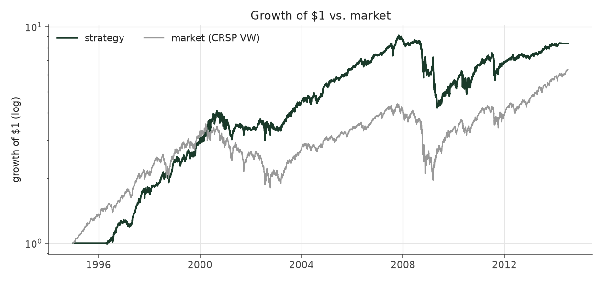
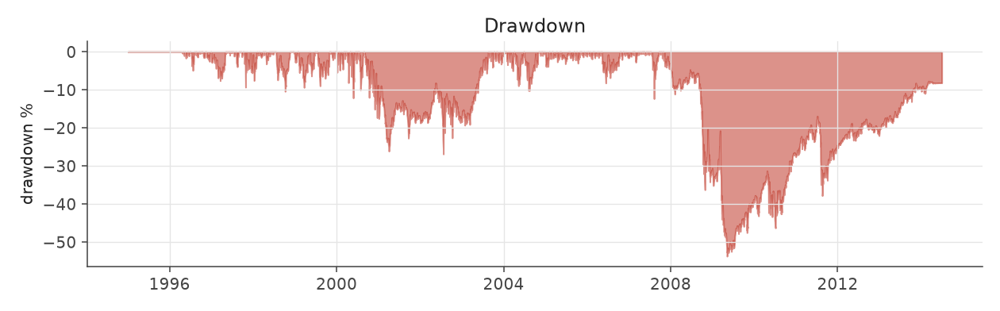
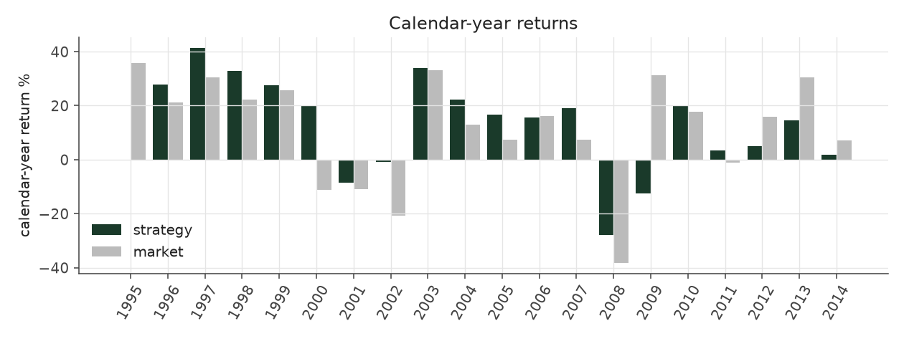
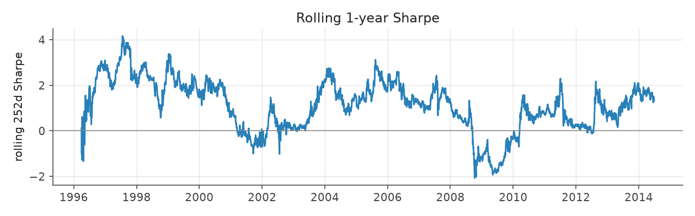
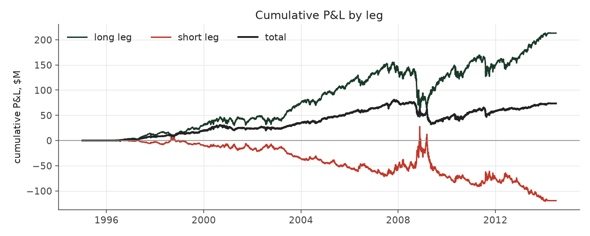
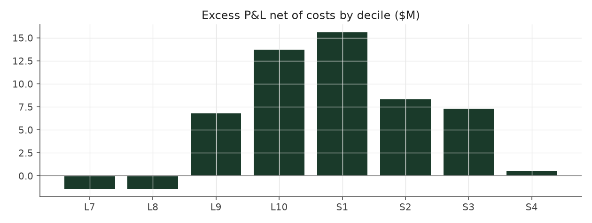

# market_exposed_max

_equity strategy | family: equity-max | status: research | derived from `market_exposed`_

## What this strategy does

market_exposed with bigger bets for more return: base unit 0.006, 6x leverage cap

**Why it should work.** Let net exposure float with the signal; empirically this smuggles in uncontrolled market beta.

**Design notes** (from the strategy's source file).

Max-size variants ("<name>_max") of the hand-built equity strategies.

Same signal, trim, tilt and neutralization as each base strategy; only the two dials that set how big and how levered the book is change (base_unit_fraction, gross-leverage cap = 6x). The multiplier for each was picked by sweeping 1.5x..12x the original base unit and taking the highest return subject to Sharpe >= 0.6 and max drawdown >= -40% (a worse drawdown is a fund-ending event, not a risk preference). The untouched 5%-of-ADV liquidity cap remains the real capacity constraint, and bites roughly four times as often at this sizing.

These are generated from the base strategy classes, so a change to a base strategy's weights flows through automatically.

| parameter | value |
|---|---|
| base_unit_fraction | 0.006 |
| max_gross_leverage | 6.0 |
| liquidity_cap_frac | 0.05 |
| return_basis | raw |
| cap_mode | priority |
| exposure_cap | open_book |
| beta_overlay | 0.0 |

## Performance

| metric | market_exposed_max | market (CRSP VW) |
|---|---|---|
| Annualized return | 11.52% | 9.94% |
| Annualized volatility | 17.21% | 19.35% |
| Sharpe (NAV-pct) | 0.72 | 0.59 |
| Sortino | 1.04 |  |
| Max drawdown | -53.8% | -55.5% |
| Calmar | 0.21 |  |
| Final NAV ($10M start) | $83,607,608 |  |
| Worst day | -8.00% |  |
| % positive days | 51.0% |  |
| Sharpe 1996-2001 | 1.33 |  |
| Sharpe 2002-2007 | 1.13 |  |
| Sharpe 2008-2013 | 0.06 |  |

Correlation of daily returns with the market: **0.57**.

- best Sharpe among equity: `calm_rank_tilt` (1.81); this one: 0.72
- best return among equity: `market_boost_max` (0.15); this one: 0.115
- best Calmar among equity: `calm_rank_tilt` (0.614); this one: 0.214

*NAV (log scale)*

*Drawdown from running peak*

*Calendar-year returns*

*Is the edge stable, or concentrated in a few years?*

## Where the return comes from

*Long leg vs. short leg vs. total*

|  | long leg | short leg |
|---|---|---|
| P&L ($M, before costs) | 213.13 | -119.36 |
| P&L after costs ($M) | 202.85 | -129.25 |
| of which common (average-event) component ($M) | 80.70 | -81.39 |
| of which excess / PEAD component ($M) | 27.98 | 41.62 |
| excess minus costs ($M) | 17.70 | 31.73 |
| gross return per $ traded (bp) | 345.33 | -221.21 |
| positions in the money (hit rate) | 0.62 | 0.42 |
| stand-alone Sharpe (leg only) | 0.70 | -0.44 |

Daily P&L correlation between the two legs: **-0.93**.

- **The short leg loses money in absolute terms** (-119.4M before costs) while the long leg earns +213.1M. That is mostly a benchmark effect, not a signal failure: the average earnings-event stock beat the cap-weighted market during its holding window, which flatters the long leg and hurts the short leg by 80.7M / 81.4M. Stripping that common component, the surprise signal itself earned +28.0M on the long side and +41.6M on the short side.
- The two legs' daily P&L are -0.93 correlated: the short leg is the hedge that makes the long leg's variance disappear (stand-alone leg Sharpe 0.70 long / -0.44 short vs 0.72 combined).

### By decile and side (signal-driven part only)

| leg | decile | positions | notional_M | net_pnl_M | excess_M | cost_M | alpha_net_M | alpha_share | alpha_bp_per_$ |
|---|---|---|---|---|---|---|---|---|---|
| long | 7 | 6,527 | 417.61 | 9.33 | -0.69 | 0.72 | -1.42 | -2.9% | -33.91 |
| long | 8 | 16,617 | 1,361.28 | 35.85 | 0.93 | 2.31 | -1.38 | -2.8% | -10.14 |
| long | 9 | 18,570 | 1,900.65 | 72.53 | 9.90 | 3.12 | 6.78 | 13.7% | 35.68 |
| long | 10 | 20,136 | 2,492.30 | 85.14 | 17.84 | 4.13 | 13.71 | 27.7% | 55.02 |
| short | 1 | 18,299 | 2,083.38 | -46.96 | 19.47 | 3.88 | 15.60 | 31.6% | 74.86 |
| short | 2 | 18,907 | 1,863.87 | -48.19 | 11.70 | 3.38 | 8.32 | 16.8% | 44.65 |
| short | 3 | 15,390 | 1,301.49 | -29.54 | 9.67 | 2.38 | 7.29 | 14.7% | 56.00 |
| short | 4 | 2,374 | 146.98 | -4.56 | 0.78 | 0.26 | 0.53 | 1.1% | 35.69 |

*D10 and the short deciles carry the alpha; the middle of each leg earns little*

### By size quintile (1 = smallest)

| size_quintile | positions | notional_M | net_pnl_M | excess_M | cost_M | alpha_net_M | alpha_share | alpha_bp_per_$ |
|---|---|---|---|---|---|---|---|---|
| 1 | 14,061 | 528.31 | -7.27 | -0.21 | 1.85 | -2.05 | -4.2% | -38.87 |
| 2 | 22,253 | 1,721.50 | 13.34 | 18.59 | 4.47 | 14.12 | 28.6% | 81.99 |
| 3 | 25,035 | 2,626.97 | 18.91 | 19.10 | 5.18 | 13.92 | 28.2% | 53.01 |
| 4 | 27,193 | 3,241.88 | 18.08 | 16.09 | 4.90 | 11.18 | 22.6% | 34.49 |
| 5 | 28,278 | 3,448.91 | 30.55 | 16.03 | 3.77 | 12.26 | 24.8% | 35.55 |

### By liquidity quintile (1 = least liquid)

| liquidity_quintile | positions | notional_M | net_pnl_M | excess_M | cost_M | alpha_net_M | alpha_share | alpha_bp_per_$ |
|---|---|---|---|---|---|---|---|---|
| 1 | 13,415 | 298.06 | 2.03 | 4.96 | 1.49 | 3.47 | 7.0% | 116.36 |
| 2 | 22,552 | 1,606.91 | 7.47 | 14.23 | 4.82 | 9.41 | 19.0% | 58.54 |
| 3 | 25,317 | 2,835.55 | 16.87 | 24.56 | 5.67 | 18.89 | 38.2% | 66.62 |
| 4 | 27,157 | 3,397.79 | 13.94 | 10.68 | 4.76 | 5.92 | 12.0% | 17.42 |
| 5 | 28,374 | 3,428.39 | 33.21 | 15.06 | 3.43 | 11.63 | 23.5% | 33.93 |

### By holding-window length

| hold_bucket | positions | notional_M | net_pnl_M | excess_M | cost_M | alpha_net_M | alpha_share | alpha_bp_per_$ |
|---|---|---|---|---|---|---|---|---|
| <=40d | 41,781 | 3,901.53 | -13.11 | 27.28 | 6.64 | 20.64 | 41.8% | 52.91 |
| 41-60d | 27,668 | 2,697.81 | -2.50 | 15.18 | 5.20 | 9.98 | 20.2% | 36.98 |
| 61-90d | 37,860 | 4,270.22 | 64.61 | 16.01 | 6.67 | 9.34 | 18.9% | 21.87 |
| >90d | 9,511 | 698.02 | 24.61 | 11.14 | 1.66 | 9.47 | 19.2% | 135.69 |

### By era

| era | positions | notional_M | net_pnl_M | excess_M | cost_M | alpha_net_M | alpha_share | alpha_bp_per_$ |
|---|---|---|---|---|---|---|---|---|
| 1996-01 | 32,241 | 1,734.36 | 24.05 | 19.18 | 3.00 | 16.18 | 32.7% | 93.32 |
| 2002-07 | 38,279 | 4,245.29 | 48.63 | 38.84 | 7.24 | 31.60 | 63.9% | 74.44 |
| 2008-13 | 46,300 | 5,587.92 | 0.92 | 11.57 | 9.94 | 1.64 | 3.3% | 2.94 |

### By FF12 sector

| ff12_sector | positions | notional_M | net_pnl_M | excess_M | cost_M | alpha_net_M | alpha_share | alpha_bp_per_$ |
|---|---|---|---|---|---|---|---|---|
| BusEq | 21,153 | 1,230.94 | 17.81 | 4.34 | 2.31 | 2.04 | 4.1% | 16.54 |
| Chems | 2,553 | 695.48 | 5.74 | 6.58 | 1.04 | 5.54 | 11.2% | 79.62 |
| Durbl | 2,830 | 759.82 | -1.46 | 1.25 | 1.16 | 0.09 | 0.2% | 1.23 |
| Enrgy | 6,352 | 934.06 | 6.22 | 12.56 | 1.50 | 11.07 | 22.4% | 118.48 |
| Hlth | 11,421 | 1,155.97 | 11.45 | 5.78 | 2.12 | 3.66 | 7.4% | 31.67 |
| Manuf | 11,913 | 1,060.18 | 4.41 | 4.72 | 1.90 | 2.83 | 5.7% | 26.65 |
| Money | 17,299 | 1,052.35 | 5.96 | 8.54 | 2.06 | 6.47 | 13.1% | 61.53 |
| NoDur | 4,908 | 876.08 | 8.36 | 5.26 | 1.42 | 3.84 | 7.8% | 43.83 |
| Other | 18,107 | 1,179.78 | 10.00 | 10.24 | 2.32 | 7.92 | 16.0% | 67.09 |
| Shops | 11,583 | 1,114.80 | 9.28 | 7.06 | 1.99 | 5.08 | 10.3% | 45.54 |
| Telcm | 3,961 | 799.00 | -3.92 | 1.90 | 1.21 | 0.69 | 1.4% | 8.63 |
| Utils | 4,740 | 709.11 | -0.24 | 1.36 | 1.15 | 0.21 | 0.4% | 3.00 |

### By idiosyncratic-volatility tercile

| vol_tercile | positions | notional_M | net_pnl_M | excess_M | cost_M | alpha_net_M | alpha_share | alpha_bp_per_$ |
|---|---|---|---|---|---|---|---|---|
| high vol | 39,072 | 3,975.49 | 2.33 | 11.01 | 6.38 | 4.63 | 9.4% | 11.65 |
| low vol | 38,994 | 3,691.64 | 38.90 | 32.77 | 6.98 | 25.79 | 52.2% | 69.87 |
| mid vol | 36,964 | 3,759.99 | 31.67 | 25.27 | 6.53 | 18.74 | 37.9% | 49.85 |

### Short-borrow sensitivity (not modeled in the backtest)

| borrow_rate | fee_M | annualized_return | drag |
|---|---|---|---|
| 0.0% | 0.0 | 11.52% | 0.00% |
| 0.5% | 5.3 | 11.14% | 0.38% |
| 1.0% | 10.7 | 10.74% | 0.78% |
| 2.0% | 21.3 | 9.85% | 1.67% |
| 5.0% | 53.3 | 5.85% | 5.67% |

The engine charges the same transaction cost on shorts as on longs and no stock-borrow fee. The short leg is concentrated in small, illiquid names, where borrow is scarce and expensive -- read the table as a floor on the cost of running the short leg.
