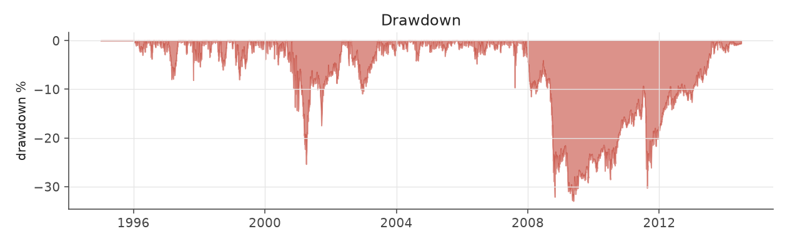
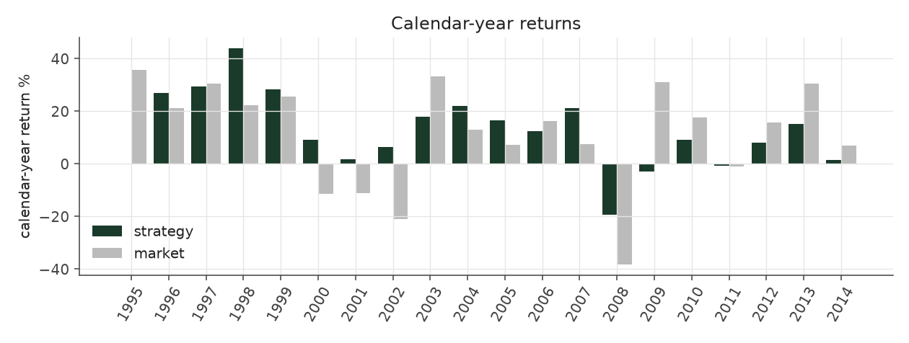
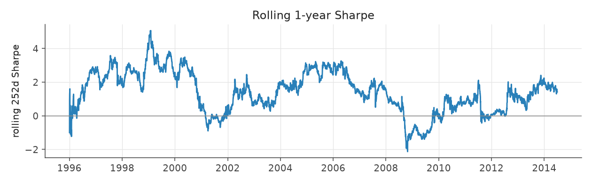
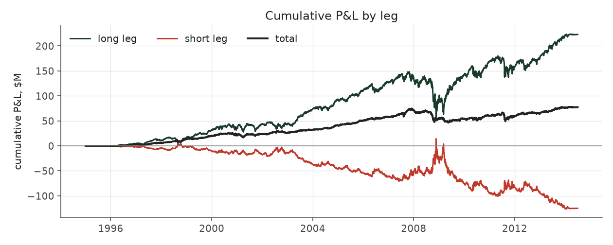

# market_exposed_max_legacy

_equity strategy | family: equity-max | status: reference | derived from `market_exposed_max`_

## What this strategy does

market_exposed with bigger bets for more return: base unit 0.006, 6x leverage cap -- ORIGINAL leverage cap (new positions only, open book ignored)

**Why it should work.** Let net exposure float with the signal; empirically this smuggles in uncontrolled market beta.

**Design notes** (from the strategy's source file).

Max-size variants ("<name>_max") of the hand-built equity strategies.

Same signal, trim, tilt and neutralization as each base strategy; only the two dials that set how big and how levered the book is change (base_unit_fraction, gross-leverage cap = 6x). The multiplier for each was picked by sweeping 1.5x..12x the original base unit and taking the highest return subject to Sharpe >= 0.6 and max drawdown >= -40% (a worse drawdown is a fund-ending event, not a risk preference). The untouched 5%-of-ADV liquidity cap remains the real capacity constraint, and bites roughly four times as often at this sizing.

These are generated from the base strategy classes, so a change to a base strategy's weights flows through automatically.

| parameter | value |
|---|---|
| base_unit_fraction | 0.006 |
| max_gross_leverage | 6.0 |
| liquidity_cap_frac | 0.05 |
| return_basis | raw |
| cap_mode | priority |
| exposure_cap | entry_cohort |
| beta_overlay | 0.0 |

## Performance

| metric | market_exposed_max_legacy | market (CRSP VW) |
|---|---|---|
| Annualized return | 11.78% | 9.94% |
| Annualized volatility | 11.85% | 19.35% |
| Sharpe (NAV-pct) | 1.00 | 0.59 |
| Sortino | 1.45 |  |
| Max drawdown | -33.0% | -55.5% |
| Calmar | 0.36 |  |
| Final NAV ($10M start) | $87,451,313 |  |
| Worst day | -7.17% |  |
| % positive days | 51.9% |  |
| Sharpe 1996-2001 | 1.64 |  |
| Sharpe 2002-2007 | 1.65 |  |
| Sharpe 2008-2013 | 0.13 |  |

Correlation of daily returns with the market: **0.66**.

- best Sharpe among equity: `calm_rank_tilt` (1.47); this one: 0.999
- best return among equity: `market_boost_max` (0.116); this one: 0.118
- best Calmar among equity: `calm_rank_tilt` (0.442); this one: 0.357

*NAV (log scale)*

*Drawdown from running peak*

*Calendar-year returns*

*Is the edge stable, or concentrated in a few years?*

## Where the return comes from

*Long leg vs. short leg vs. total*

|  | long leg | short leg |
|---|---|---|
| P&L ($M, before costs) | 222.73 | -124.99 |
| P&L after costs ($M) | 212.73 | -135.28 |
| of which common (average-event) component ($M) | 88.61 | -80.23 |
| of which excess / PEAD component ($M) | 19.82 | 48.82 |
| excess minus costs ($M) | 9.85 | 38.55 |
| gross return per $ traded (bp) | 370.11 | -222.37 |
| positions in the money (hit rate) | 0.63 | 0.42 |
| stand-alone Sharpe (leg only) | 0.73 | -0.46 |

Daily P&L correlation between the two legs: **-0.97**.

- **The short leg loses money in absolute terms** (-125.0M before costs) while the long leg earns +222.7M. That is mostly a benchmark effect, not a signal failure: the average earnings-event stock beat the cap-weighted market during its holding window, which flatters the long leg and hurts the short leg by 88.6M / 80.2M. Stripping that common component, the surprise signal itself earned +19.8M on the long side and +48.8M on the short side.
- The two legs' daily P&L are -0.97 correlated: the short leg is the hedge that makes the long leg's variance disappear (stand-alone leg Sharpe 0.73 long / -0.46 short vs 1.00 combined).

### By decile and side (signal-driven part only)

| leg | decile | positions | notional_M | net_pnl_M | excess_M | cost_M | alpha_net_M | alpha_share | alpha_bp_per_$ |
|---|---|---|---|---|---|---|---|---|---|
| long | 7 | 8,029 | 514.45 | 18.09 | -0.75 | 0.88 | -1.63 | -3.4% | -31.70 |
| long | 8 | 16,588 | 1,409.31 | 53.03 | 5.10 | 2.38 | 2.72 | 5.6% | 19.33 |
| long | 9 | 17,747 | 1,906.30 | 56.00 | 0.49 | 3.11 | -2.62 | -5.4% | -13.76 |
| long | 10 | 17,174 | 2,187.84 | 85.60 | 14.98 | 3.63 | 11.35 | 23.5% | 51.90 |
| short | 1 | 17,169 | 1,947.43 | -49.31 | 15.10 | 3.63 | 11.47 | 23.7% | 58.88 |
| short | 2 | 17,281 | 1,766.20 | -41.46 | 18.43 | 3.18 | 15.26 | 31.5% | 86.37 |
| short | 3 | 15,970 | 1,363.24 | -31.22 | 10.50 | 2.50 | 8.00 | 16.5% | 58.69 |
| short | 4 | 9,171 | 543.72 | -13.28 | 4.79 | 0.98 | 3.81 | 7.9% | 69.97 |

*D10 and the short deciles carry the alpha; the middle of each leg earns little*

### By size quintile (1 = smallest)

| size_quintile | positions | notional_M | net_pnl_M | excess_M | cost_M | alpha_net_M | alpha_share | alpha_bp_per_$ |
|---|---|---|---|---|---|---|---|---|
| 1 | 14,213 | 527.66 | 4.45 | 7.94 | 1.84 | 6.09 | 12.6% | 115.50 |
| 2 | 22,885 | 1,725.66 | 9.74 | 17.59 | 4.49 | 13.10 | 27.1% | 75.90 |
| 3 | 25,501 | 2,640.37 | 17.24 | 19.80 | 5.21 | 14.59 | 30.1% | 55.25 |
| 4 | 27,583 | 3,267.00 | 18.85 | 13.14 | 4.94 | 8.20 | 16.9% | 25.09 |
| 5 | 28,947 | 3,477.79 | 27.17 | 10.17 | 3.80 | 6.37 | 13.2% | 18.32 |

### By liquidity quintile (1 = least liquid)

| liquidity_quintile | positions | notional_M | net_pnl_M | excess_M | cost_M | alpha_net_M | alpha_share | alpha_bp_per_$ |
|---|---|---|---|---|---|---|---|---|
| 1 | 13,650 | 300.19 | 6.42 | 8.08 | 1.50 | 6.58 | 13.6% | 219.04 |
| 2 | 23,084 | 1,613.35 | 9.98 | 17.20 | 4.84 | 12.36 | 25.5% | 76.58 |
| 3 | 25,851 | 2,851.47 | 15.67 | 24.14 | 5.70 | 18.44 | 38.1% | 64.67 |
| 4 | 27,665 | 3,422.28 | 16.70 | 10.55 | 4.79 | 5.76 | 11.9% | 16.84 |
| 5 | 28,874 | 3,450.23 | 28.63 | 8.61 | 3.45 | 5.16 | 10.7% | 14.94 |

### By holding-window length

| hold_bucket | positions | notional_M | net_pnl_M | excess_M | cost_M | alpha_net_M | alpha_share | alpha_bp_per_$ |
|---|---|---|---|---|---|---|---|---|
| <=40d | 45,855 | 4,666.77 | -12.92 | 16.72 | 7.52 | 9.20 | 19.0% | 19.72 |
| 41-60d | 25,652 | 2,632.78 | 22.99 | 11.63 | 4.64 | 6.99 | 14.4% | 26.55 |
| 61-90d | 35,324 | 3,344.89 | 17.09 | 18.65 | 6.09 | 12.57 | 26.0% | 37.57 |
| >90d | 12,298 | 994.04 | 50.29 | 21.63 | 2.04 | 19.59 | 40.5% | 197.09 |

### By era

| era | positions | notional_M | net_pnl_M | excess_M | cost_M | alpha_net_M | alpha_share | alpha_bp_per_$ |
|---|---|---|---|---|---|---|---|---|
| 1996-01 | 33,895 | 1,718.35 | 23.31 | 20.69 | 3.00 | 17.69 | 36.5% | 102.94 |
| 2002-07 | 39,956 | 4,116.20 | 43.81 | 38.71 | 7.05 | 31.66 | 65.4% | 76.93 |
| 2008-13 | 45,278 | 5,803.94 | 10.33 | 9.24 | 10.24 | -1.00 | -2.1% | -1.73 |

### By FF12 sector

| ff12_sector | positions | notional_M | net_pnl_M | excess_M | cost_M | alpha_net_M | alpha_share | alpha_bp_per_$ |
|---|---|---|---|---|---|---|---|---|
| BusEq | 22,094 | 1,238.86 | 20.07 | 5.86 | 2.33 | 3.53 | 7.3% | 28.51 |
| Chems | 2,590 | 701.65 | 6.49 | 6.16 | 1.05 | 5.11 | 10.6% | 72.86 |
| Durbl | 2,843 | 766.16 | -0.97 | 1.45 | 1.16 | 0.29 | 0.6% | 3.79 |
| Enrgy | 6,194 | 937.74 | 5.51 | 12.22 | 1.50 | 10.72 | 22.2% | 114.33 |
| Hlth | 11,696 | 1,162.56 | 14.23 | 6.96 | 2.13 | 4.83 | 10.0% | 41.57 |
| Manuf | 12,034 | 1,066.72 | 5.86 | 5.11 | 1.91 | 3.20 | 6.6% | 30.04 |
| Money | 17,583 | 1,062.83 | 6.91 | 9.72 | 2.08 | 7.64 | 15.8% | 71.87 |
| NoDur | 5,081 | 882.91 | 8.96 | 4.82 | 1.43 | 3.39 | 7.0% | 38.37 |
| Other | 18,377 | 1,189.85 | 8.11 | 8.43 | 2.35 | 6.08 | 12.6% | 51.12 |
| Shops | 11,984 | 1,123.54 | 9.69 | 7.25 | 2.00 | 5.25 | 10.9% | 46.74 |
| Telcm | 3,981 | 796.70 | -7.22 | -0.34 | 1.21 | -1.55 | -3.2% | -19.47 |
| Utils | 4,672 | 708.98 | -0.19 | 1.00 | 1.15 | -0.15 | -0.3% | -2.11 |

### By idiosyncratic-volatility tercile

| vol_tercile | positions | notional_M | net_pnl_M | excess_M | cost_M | alpha_net_M | alpha_share | alpha_bp_per_$ |
|---|---|---|---|---|---|---|---|---|
| high vol | 39,523 | 3,964.97 | 9.35 | 14.19 | 6.36 | 7.83 | 16.2% | 19.74 |
| low vol | 40,091 | 3,751.90 | 35.21 | 29.49 | 7.09 | 22.39 | 46.3% | 59.68 |
| mid vol | 37,903 | 3,786.09 | 32.34 | 25.15 | 6.57 | 18.58 | 38.4% | 49.07 |

### Short-borrow sensitivity (not modeled in the backtest)

| borrow_rate | fee_M | annualized_return | drag |
|---|---|---|---|
| 0.0% | 0.0 | 11.78% | -0.00% |
| 0.5% | 5.5 | 11.40% | 0.38% |
| 1.0% | 11.1 | 11.00% | 0.78% |
| 2.0% | 22.2 | 10.11% | 1.67% |
| 5.0% | 55.4 | 6.16% | 5.62% |

The engine charges the same transaction cost on shorts as on longs and no stock-borrow fee. The short leg is concentrated in small, illiquid names, where borrow is scarce and expensive -- read the table as a floor on the cost of running the short leg.
