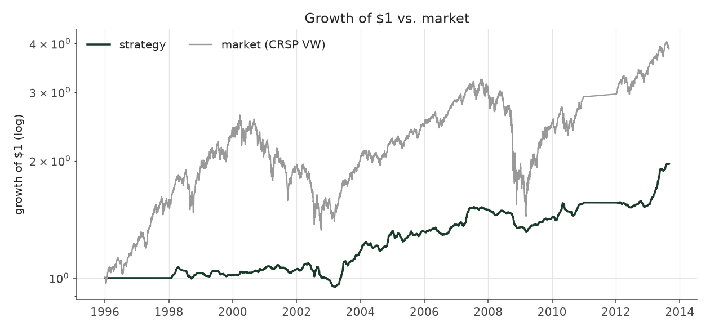
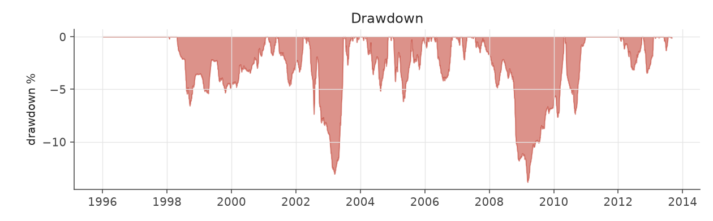
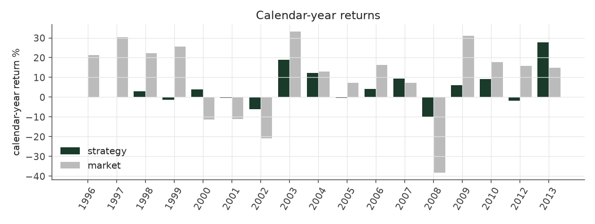
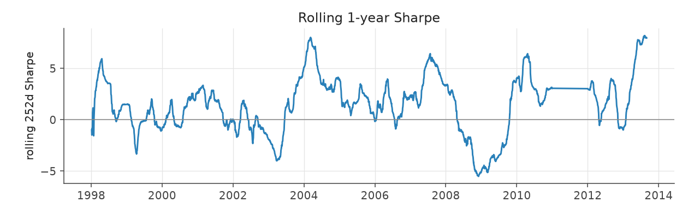
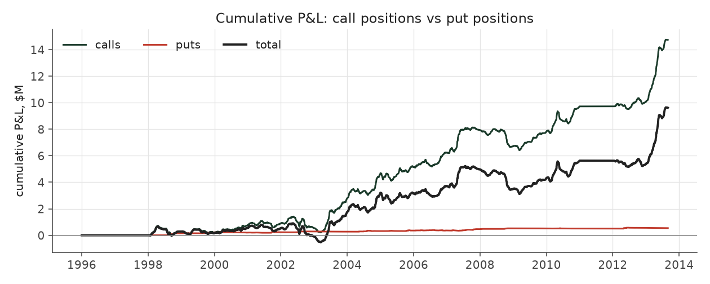

# options_cap20

_options strategy | family: options-kelly | status: validated_

## What this strategy does

Kelly picks, 20% premium cap, dead quotes marked at half-ask, >= $0.05/share cost

**Why it should work.** Buy the contract whose payoff profile best matches the SUE-conditioned return distribution, sized by Kelly, spread across hundreds of independent events.

**Design notes** (from the strategy's source file).

Options strategies -- Kelly-optimal contract selection around earnings.

WHAT IT DOES. For every earnings announcement, look at the whole option chain (every strike, calls AND puts, ~13 contracts/event on average, up to 60) on the announcement day and buy the single contract with the highest expected LOG growth under an empirical, walk-forward distribution of the stock's 60-day return conditional on its SUE decile. The direction is never hard-coded: the math picks puts for bad surprises and calls for good ones on its own (32% puts in D1 vs 5% in D10).

WHY KELLY AND NOT EXPECTED VALUE. A naive "maximize E[return]" selector loves deep-OTM lottery tickets (huge payoff x tiny probability = big mean) that lose money on almost every draw. Scoring each contract by max over f of E[log(1 + f*R)] penalizes ruin: a lottery ticket is still scored, it just earns a tiny optimal fraction f* and negligible growth. The selector therefore prefers contracts whose payoff is large exactly in the scenarios the SUE decile makes likely.

HOW IT IS SIZED. Only events whose best contract has positive expected log growth are traded. Each such event's size is HALF its own Kelly fraction (full Kelly over-bets when the distribution is itself an estimate), then the quarter's candidates share a premium budget (`max_premium_frac` of trailing NAV minus premium still outstanding from earlier quarters) in proportion to those fractions.

WHERE THE RETURN COMES FROM (see the generated report): OTM calls on low-volatility, high-SUE stocks -- the post-announcement upside tail is under-priced relative to the drift -- diversified across ~1,200 mostly independent single-stock bets per quarter (Grinold's breadth), which is what turns a modest per-trade edge into a Sharpe of 3+.

THE BACKTEST CONVENTION THAT WAS WRONG, AND THE FIX. The original backtest valued a position at each checkpoint (+1, 5, 10, 20, 40, 60 trading days) from the contract's mid quote and, when the quote was missing, CARRIED THE PREVIOUS QUOTE FORWARD. 22% of picks have no quote at 60 days, and 93% of those are not missing at all: the bid is ZERO (best_offer ~ $0.10) -- the option has died and nobody will buy it. Carrying its last live price forward never marks a dying option down. The strategies below value a zero-bid checkpoint at half the ask (or at zero, for the conservative bound) using the quotes now kept by the forward-price prep stage. Effect on the 20%-premium-cap book: 8.58% / Sharpe 3.78 as originally reported -> 5.87% / 2.50 with the corrected mark -> 4.12% / 1.77 once each contract also pays at least one $0.05 tick round trip -> 2.34% / 0.99 if dead options are worth nothing.

REMAINING CAVEATS: no market impact; the early walk-forward distributions rest on only 8 quarters of history; ~4,600 trades a year would meet real capacity limits; most of the profit comes from 2003 and 2013.

| parameter | value |
|---|---|
| hold_horizon | 60 |
| half_kelly | 0.5 |
| max_premium_frac | 0.2 |
| roundtrip_cost_pct | 0.03 |
| dead_quote_mark | zero_bid_half_ask |
| min_roundtrip_cost_per_share | 0.05 |
| min_premium | 0.0 |

## Performance

| metric | options_cap20 | market (CRSP VW) |
|---|---|---|
| Annualized return | 4.12% | 8.48% |
| Annualized volatility | 2.30% | 19.86% |
| Sharpe (NAV-pct) | 1.77 | 0.51 |
| Sortino | 3.00 |  |
| Max drawdown | -13.8% | -55.5% |
| Calmar | 0.30 |  |
| Final NAV ($10M start) | $19,625,123 |  |
| Worst day | -0.83% |  |
| % positive days | 47.0% |  |
| Sharpe 1996-2001 | 0.69 |  |
| Sharpe 2002-2007 | 2.04 |  |
| Sharpe 2008-2013 | 2.39 |  |

Correlation of daily returns with the market: **0.19**.

- best Sharpe among options: this strategy; this one: 1.77
- best return among options: `options_cap30` (0.0569); this one: 0.0412
- best Calmar among options: this strategy; this one: 0.298

*NAV (log scale)*

*Drawdown from running peak*

*Calendar-year returns*

*Is the edge stable, or concentrated in a few years?*

## Where the return comes from

*Call leg vs put leg*

- **98.2% of funded trades are calls** and they produce **96.5%** of gross P&L -- even in the worst-surprise deciles, where the selector's best contract is usually still a call (a cheap OTM call has more convexity per dollar than a put once the bad news is in the price).
- Hit rate is only 39.5% and the median trade returns -23.7% on premium, yet the mean is 24.8%: a classic convex pay-off. The best 1% of trades produce **65%** of gross P&L and the best 10% produce 169%.
- Read the moneyness, volatility and premium tables together: the profit is concentrated in cheap out-of-the-money calls on low-volatility stocks -- exactly the contracts whose real-world bid/ask costs are hardest to model.

### By contract side

| leg | trades | premium_M | gross_M | cost_M | net_M | share_of_net | roi_on_premium | hit_rate |
|---|---|---|---|---|---|---|---|---|
| call | 63,827 | 60.64 | 14.74 | 5.49 | 9.25 | 96.1% | 24.3% | 39.7% |
| put | 1,176 | 0.90 | 0.54 | 0.17 | 0.38 | 3.9% | 60.6% | 25.9% |

### By SUE decile

| decile | trades | premium_M | gross_M | cost_M | net_M | share_of_net | roi_on_premium | hit_rate |
|---|---|---|---|---|---|---|---|---|
| 1 | 4,546 | 2.78 | 0.97 | 0.44 | 0.53 | 5.5% | 35.0% | 29.6% |
| 2 | 4,724 | 2.86 | 0.97 | 0.46 | 0.51 | 5.3% | 33.8% | 32.8% |
| 3 | 5,170 | 3.57 | 1.28 | 0.46 | 0.82 | 8.5% | 35.8% | 37.9% |
| 4 | 6,331 | 4.18 | 1.05 | 0.59 | 0.46 | 4.8% | 25.1% | 34.6% |
| 5 | 5,845 | 4.94 | 1.56 | 0.49 | 1.06 | 11.1% | 31.5% | 41.0% |
| 6 | 6,638 | 5.18 | 1.10 | 0.54 | 0.56 | 5.8% | 21.2% | 37.5% |
| 7 | 6,266 | 5.12 | 1.42 | 0.53 | 0.89 | 9.2% | 27.7% | 39.5% |
| 8 | 7,851 | 8.61 | 1.72 | 0.63 | 1.09 | 11.4% | 20.0% | 42.7% |
| 9 | 8,813 | 10.94 | 2.19 | 0.72 | 1.47 | 15.3% | 20.0% | 43.3% |
| 10 | 8,819 | 13.37 | 3.03 | 0.80 | 2.23 | 23.2% | 22.7% | 46.2% |

### By side and moneyness (strike / spot)

| leg | moneyness_bucket | trades | premium_M | gross_M | cost_M | net_M | share_of_net | roi_on_premium | hit_rate |
|---|---|---|---|---|---|---|---|---|---|
| call | deep ITM <0.8 | 21,051 | 28.15 | 1.29 | 0.84 | 0.45 | 4.7% | 4.6% | 51.4% |
| call | ITM 0.8-0.9 | 5,153 | 4.99 | 0.68 | 0.15 | 0.53 | 5.5% | 13.6% | 50.6% |
| call | ITM 0.9-0.97 | 2,136 | 2.14 | 0.47 | 0.08 | 0.39 | 4.1% | 22.0% | 51.1% |
| call | ATM 0.97-1.03 | 2,553 | 3.12 | 1.09 | 0.20 | 0.90 | 9.3% | 35.0% | 46.5% |
| call | OTM 1.03-1.1 | 6,132 | 6.82 | 3.44 | 0.68 | 2.77 | 28.7% | 50.4% | 39.0% |
| call | OTM 1.1-1.2 | 11,636 | 9.00 | 5.02 | 1.62 | 3.40 | 35.4% | 55.8% | 32.1% |
| call | far OTM >1.2 | 15,166 | 6.41 | 2.73 | 1.93 | 0.81 | 8.4% | 42.7% | 23.1% |
| put | deep ITM <0.8 | 298 | 0.11 | 0.15 | 0.03 | 0.13 | 1.3% | 139.9% | 25.5% |
| put | ITM 0.8-0.9 | 418 | 0.25 | 0.18 | 0.05 | 0.13 | 1.4% | 72.8% | 26.3% |
| put | ITM 0.9-0.97 | 213 | 0.22 | 0.17 | 0.04 | 0.12 | 1.3% | 75.4% | 26.3% |
| put | ATM 0.97-1.03 | 135 | 0.23 | 0.03 | 0.04 | -0.01 | -0.1% | 14.0% | 16.3% |
| put | OTM 1.03-1.1 | 65 | 0.07 | 0.01 | 0.00 | 0.01 | 0.1% | 15.0% | 35.4% |
| put | OTM 1.1-1.2 | 28 | 0.01 | 0.00 | 0.00 | 0.00 | 0.0% | 13.3% | 42.9% |
| put | far OTM >1.2 | 19 | 0.01 | -0.00 | 0.00 | -0.00 | -0.0% | -13.0% | 31.6% |

### By the stock's pre-event volatility tercile

| vol_tercile | trades | premium_M | gross_M | cost_M | net_M | share_of_net | roi_on_premium | hit_rate |
|---|---|---|---|---|---|---|---|---|
| low vol | 21,662 | 19.07 | 9.74 | 2.94 | 6.80 | 70.6% | 51.1% | 35.1% |
| mid vol | 21,661 | 16.81 | 3.68 | 1.51 | 2.17 | 22.5% | 21.9% | 38.4% |
| high vol | 21,662 | 25.63 | 1.86 | 1.21 | 0.66 | 6.8% | 7.3% | 44.9% |

### Calls only: volatility x moneyness

| vol_tercile | moneyness_bucket | trades | premium_M | gross_M | cost_M | net_M | share_of_net | roi_on_premium | hit_rate |
|---|---|---|---|---|---|---|---|---|---|
| low vol | deep ITM <0.8 | 721 | 0.81 | 0.08 | 0.02 | 0.06 | 0.6% | 10.4% | 60.2% |
| low vol | ITM 0.8-0.9 | 767 | 0.80 | 0.11 | 0.02 | 0.08 | 0.9% | 13.5% | 54.6% |
| low vol | ITM 0.9-0.97 | 790 | 0.93 | 0.23 | 0.03 | 0.20 | 2.1% | 25.0% | 55.1% |
| low vol | ATM 0.97-1.03 | 1,624 | 2.12 | 0.81 | 0.11 | 0.70 | 7.5% | 38.2% | 49.2% |
| low vol | OTM 1.03-1.1 | 4,338 | 5.11 | 2.90 | 0.52 | 2.38 | 25.7% | 56.7% | 39.0% |
| low vol | OTM 1.1-1.2 | 7,588 | 6.41 | 4.00 | 1.31 | 2.69 | 29.1% | 62.3% | 31.8% |
| low vol | far OTM >1.2 | 5,282 | 2.47 | 1.40 | 0.84 | 0.56 | 6.0% | 56.4% | 24.0% |
| mid vol | deep ITM <0.8 | 5,397 | 6.49 | 0.35 | 0.20 | 0.16 | 1.7% | 5.4% | 53.3% |
| mid vol | ITM 0.8-0.9 | 2,363 | 2.36 | 0.31 | 0.07 | 0.24 | 2.5% | 13.0% | 51.1% |
| mid vol | ITM 0.9-0.97 | 886 | 0.81 | 0.17 | 0.03 | 0.14 | 1.5% | 20.7% | 50.2% |
| mid vol | ATM 0.97-1.03 | 639 | 0.65 | 0.18 | 0.04 | 0.14 | 1.5% | 28.2% | 42.6% |
| mid vol | OTM 1.03-1.1 | 1,442 | 1.31 | 0.47 | 0.10 | 0.37 | 4.0% | 35.8% | 40.4% |
| mid vol | OTM 1.1-1.2 | 3,348 | 2.13 | 0.88 | 0.25 | 0.63 | 6.8% | 41.5% | 33.1% |
| mid vol | far OTM >1.2 | 7,214 | 2.84 | 1.11 | 0.78 | 0.33 | 3.6% | 39.1% | 23.8% |
| high vol | deep ITM <0.8 | 14,926 | 20.84 | 0.86 | 0.63 | 0.23 | 2.5% | 4.1% | 50.3% |
| high vol | ITM 0.8-0.9 | 2,022 | 1.83 | 0.27 | 0.06 | 0.21 | 2.3% | 14.6% | 48.5% |
| high vol | ITM 0.9-0.97 | 459 | 0.40 | 0.07 | 0.02 | 0.05 | 0.6% | 17.3% | 46.0% |
| high vol | ATM 0.97-1.03 | 289 | 0.34 | 0.10 | 0.04 | 0.06 | 0.7% | 28.3% | 39.8% |
| high vol | OTM 1.03-1.1 | 352 | 0.40 | 0.07 | 0.06 | 0.02 | 0.2% | 18.7% | 33.5% |
| high vol | OTM 1.1-1.2 | 694 | 0.46 | 0.14 | 0.06 | 0.08 | 0.9% | 30.5% | 30.7% |
| high vol | far OTM >1.2 | 2,668 | 1.10 | 0.23 | 0.30 | -0.07 | -0.8% | 20.9% | 19.5% |

### By premium per share

| premium_bucket | trades | premium_M | gross_M | cost_M | net_M | share_of_net | roi_on_premium | hit_rate |
|---|---|---|---|---|---|---|---|---|
| <$0.25 | 14,108 | 8.43 | 6.08 | 3.06 | 3.01 | 31.3% | 72.1% | 24.5% |
| $0.25-0.5 | 9,217 | 6.43 | 3.17 | 0.89 | 2.27 | 23.6% | 49.2% | 29.8% |
| $0.5-1 | 7,753 | 6.34 | 2.35 | 0.45 | 1.90 | 19.7% | 37.0% | 34.8% |
| $1-2 | 5,776 | 4.99 | 1.38 | 0.18 | 1.19 | 12.4% | 27.6% | 43.0% |
| $2-5 | 11,513 | 10.60 | 1.41 | 0.32 | 1.09 | 11.3% | 13.3% | 50.7% |
| >$5 | 16,636 | 24.74 | 0.90 | 0.74 | 0.16 | 1.7% | 3.7% | 50.6% |

### By year

| year | trades | premium_M | gross_M | cost_M | net_M | share_of_net | roi_on_premium | hit_rate |
|---|---|---|---|---|---|---|---|---|
| 1998 | 2,754 | 3.31 | 0.42 | 0.13 | 0.29 | 3.0% | 12.6% | 41.5% |
| 1999 | 2,580 | 3.20 | 0.06 | 0.13 | -0.07 | -0.7% | 1.9% | 35.4% |
| 2000 | 2,262 | 3.33 | 0.59 | 0.14 | 0.45 | 4.7% | 17.8% | 44.8% |
| 2001 | 2,839 | 3.48 | 0.03 | 0.20 | -0.17 | -1.8% | 1.0% | 34.7% |
| 2002 | 3,253 | 3.78 | -0.44 | 0.33 | -0.76 | -7.9% | -11.6% | 25.4% |
| 2003 | 4,223 | 3.72 | 2.86 | 0.38 | 2.48 | 25.8% | 76.9% | 53.3% |
| 2004 | 5,082 | 4.38 | 1.03 | 0.48 | 0.55 | 5.7% | 23.6% | 34.0% |
| 2005 | 5,497 | 4.69 | 1.09 | 0.56 | 0.53 | 5.5% | 23.2% | 38.2% |
| 2006 | 5,525 | 4.53 | 1.06 | 0.54 | 0.53 | 5.5% | 23.5% | 34.6% |
| 2007 | 5,886 | 4.80 | 1.55 | 0.55 | 1.00 | 10.4% | 32.3% | 32.3% |
| 2008 | 3,936 | 4.75 | -1.04 | 0.31 | -1.35 | -14.1% | -22.0% | 23.9% |
| 2009 | 4,065 | 4.24 | 1.07 | 0.30 | 0.78 | 8.0% | 25.3% | 53.4% |
| 2010 | 6,330 | 4.96 | 1.94 | 0.55 | 1.38 | 14.4% | 39.1% | 46.8% |
| 2012 | 6,802 | 5.39 | 1.15 | 0.66 | 0.48 | 5.0% | 21.3% | 38.9% |
| 2013 | 3,969 | 2.98 | 3.91 | 0.39 | 3.51 | 36.5% | 131.2% | 54.3% |

### Execution sensitivity (the backtest assumes a flat 3% round-trip cost)

| case | annualized_return | annualized_vol | sharpe | max_drawdown | trades |
|---|---|---|---|---|---|
| as registered | 4.12% | 2.30% | 1.77 | -13.8% | 65,003 |
| ORIGINAL convention: dead quotes carried forward, flat 3% cost | 8.58% | 2.18% | 3.78 | -10.3% | 70,167 |
| dead quotes at half-ask, flat 3% cost (no tick floor) | 5.87% | 2.29% | 2.50 | -12.7% | 67,294 |
| dead quotes worth zero (pessimistic bound) | 2.34% | 2.37% | 0.99 | -17.1% | 62,581 |
| + $0.10/share minimum cost | 1.98% | 2.32% | 0.86 | -16.5% | 62,288 |
| skip contracts under $0.25 | 3.58% | 1.94% | 1.83 | -12.9% | 52,686 |
| skip contracts under $0.50 | 2.79% | 1.72% | 1.61 | -13.7% | 43,993 |
| flat 10% round-trip cost | 2.75% | 2.31% | 1.18 | -18.7% | 62,809 |

Each row re-runs the identical picks and quote history with a harsher cost of getting into the contract. A flat percentage understates the cost of $0.10-$0.50 contracts, whose bid/ask spread is often a multiple of the 3% assumed.
