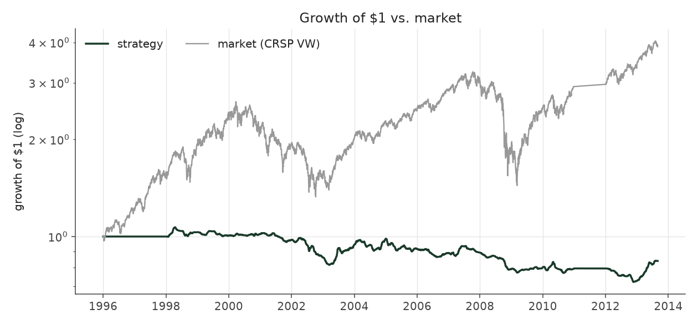
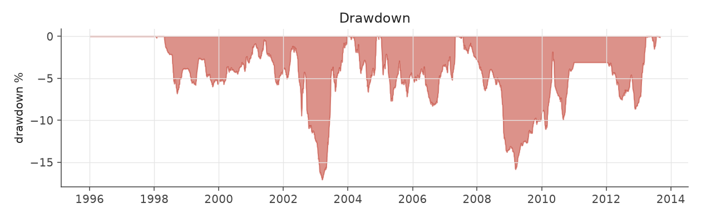
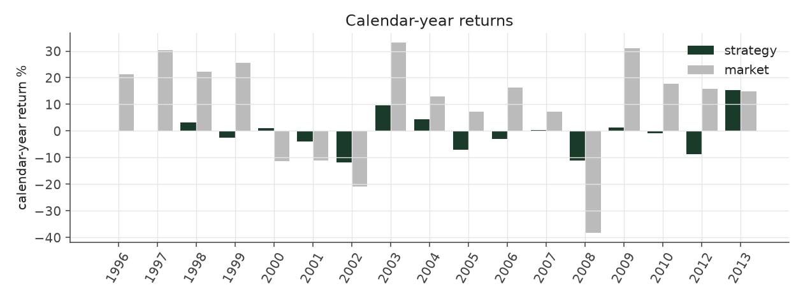
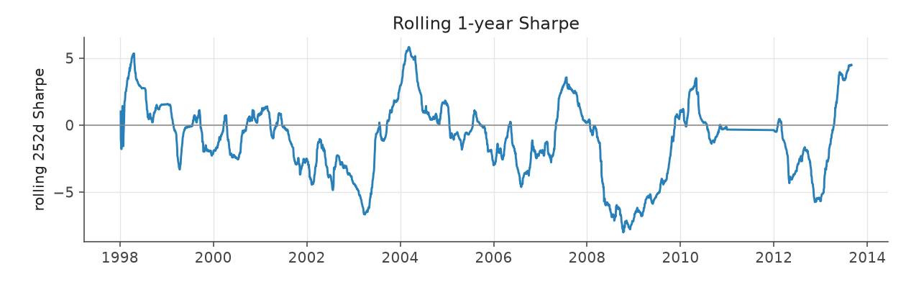
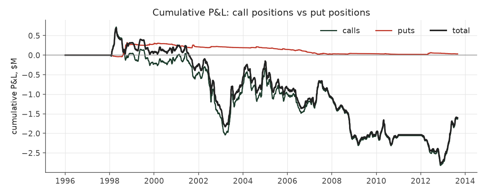

# options_worst_case

_options strategy | family: options-kelly | status: research | derived from `options_cap20`_

## What this strategy does

options_cap20 with dead quotes worth zero -- the pessimistic bound

**Why it should work.** Buy the contract whose payoff profile best matches the SUE-conditioned return distribution, sized by Kelly, spread across hundreds of independent events.

**Design notes** (from the strategy's source file).

Options strategies -- Kelly-optimal contract selection around earnings.

WHAT IT DOES. For every earnings announcement, look at the whole option chain (every strike, calls AND puts, ~13 contracts/event on average, up to 60) on the announcement day and buy the single contract with the highest expected LOG growth under an empirical, walk-forward distribution of the stock's 60-day return conditional on its SUE decile. The direction is never hard-coded: the math picks puts for bad surprises and calls for good ones on its own (in practice, on the corrected run, about 97% of funded trades are calls).

WHY KELLY AND NOT EXPECTED VALUE. A naive "maximize E[return]" selector loves deep-OTM lottery tickets (huge payoff x tiny probability = big mean) that lose money on almost every draw. Scoring each contract by max over f of E[log(1 + f*R)] penalizes ruin: a lottery ticket is still scored, it just earns a tiny optimal fraction f* and negligible growth. The selector therefore prefers contracts whose payoff is large exactly in the scenarios the SUE decile makes likely.

HOW IT IS SIZED. Only events whose best contract has positive expected log growth are traded. Each such event's size is HALF its own Kelly fraction (full Kelly over-bets when the distribution is itself an estimate), then the quarter's candidates share a premium budget (`max_premium_frac` of trailing NAV minus premium still outstanding from earlier quarters) in proportion to those fractions.

WHERE THE RETURN COMES FROM, AND HOW MUCH THERE IS. Filled at the quoted ask and sold at the quoted bid (the default since the 2026-10 fixes), the 20%-cap book earns about 0.3% a year at Sharpe 0.16: no measurable edge (see docs/FIXES.md and the generated report for the breakdown by moneyness, volatility and year). The pre-fix picture -- OTM calls on low-volatility, high-SUE stocks, ~1,200 single-stock bets per quarter, Sharpe above 3 -- came from the mid-fill and dead-quote conventions below, not from a real premium.

THE BACKTEST CONVENTIONS THAT WERE WRONG, AND THE FIXES. The original backtest valued a position at each checkpoint (+1, 5, 10, 20, 40, 60 trading days) from the contract's mid quote and, when the quote was missing, CARRIED THE PREVIOUS QUOTE FORWARD. 22% of picks have no quote at 60 days, and 93% of those (a one-year pre-fix check, not repeated) are not missing at all: the bid is ZERO (best_offer ~ $0.10) -- the option has died and nobody will buy it. Carrying its last live price forward never marks a dying option down. The strategies below value a zero-bid checkpoint at half the ask (or at zero, for the conservative bound) using the quotes now kept by the forward-price prep stage. Effect on the 20%-premium-cap book: 8.58% / Sharpe 3.78 as originally reported -> 5.87% / 2.50 with the corrected mark -> 4.12% / 1.77 once each contract also pays at least one $0.05 tick round trip -> 2.34% / 0.99 if dead options are worth nothing (all four figures pre-fix). Buying at the real ask and selling at the real bid then takes the book to 0.28% / 0.16 (corrected run).

REMAINING CAVEATS: no market impact; the early walk-forward distributions rest on only 8 quarters of history; ~4,000 trades a year would meet real capacity limits; what little profit there is comes from 2003 and 2013.

| parameter | value |
|---|---|
| hold_horizon | 60 |
| half_kelly | 0.5 |
| max_premium_frac | 0.2 |
| roundtrip_cost_pct | 0.0 |
| dead_quote_mark | zero_bid_zero |
| fill_mode | bid_ask |
| min_roundtrip_cost_per_share | 0.0 |
| min_premium | 0.0 |

## Performance

| metric | options_worst_case | market (CRSP VW) |
|---|---|---|
| Annualized return | -1.04% | 8.48% |
| Annualized volatility | 1.99% | 19.86% |
| Sharpe (NAV-pct) | -0.52 | 0.51 |
| Sortino | -0.73 |  |
| Max drawdown | -32.3% | -55.5% |
| Calmar | -0.03 |  |
| Final NAV ($10M start) | $8,396,413 |  |
| Worst day | -0.85% |  |
| % positive days | 41.3% |  |
| Sharpe 1996-2001 | -0.30 |  |
| Sharpe 2002-2007 | -0.58 |  |
| Sharpe 2008-2013 | -0.66 |  |

Correlation of daily returns with the market: **0.20**.

- best Sharpe among options: `options_cap20` (0.156); this one: -0.517
- best return among options: `options_cap20` (0.00282); this one: -0.0104
- best Calmar among options: `options_cap20` (0.015); this one: -0.0322

*NAV (log scale)*

*Drawdown from running peak*

*Calendar-year returns*

*Is the edge stable, or concentrated in a few years?*

## Where the return comes from

*Call leg vs put leg*

- **97.1% of funded trades are calls** and they produce **102.0%** of gross P&L -- even in the worst-surprise deciles, where the selector's best contract is usually still a call (a cheap OTM call has more convexity per dollar than a put once the bad news is in the price).
- Hit rate is only 29.7% and the median trade returns -56.2% on premium, yet the mean is -3.8%: a classic convex pay-off. The best 1% of trades produce **-312%** of gross P&L and the best 10% produce -852%.
- Read the moneyness, volatility and premium tables together: the profit is concentrated in cheap out-of-the-money calls on low-volatility stocks -- exactly the contracts whose real-world bid/ask costs are hardest to model.

### By contract side

| leg | trades | premium_M | gross_M | cost_M | net_M | share_of_net | roi_on_premium | hit_rate |
|---|---|---|---|---|---|---|---|---|
| call | 55,418 | 40.92 | -1.64 | 0.00 | -1.64 | 102.0% | -4.0% | 30.0% |
| put | 1,684 | 1.00 | 0.03 | 0.00 | 0.03 | -2.0% | 3.2% | 18.9% |

### By SUE decile

| decile | trades | premium_M | gross_M | cost_M | net_M | share_of_net | roi_on_premium | hit_rate |
|---|---|---|---|---|---|---|---|---|
| 1 | 4,837 | 2.33 | -0.48 | 0.00 | -0.48 | 30.3% | -20.8% | 20.4% |
| 2 | 4,497 | 2.10 | -0.31 | 0.00 | -0.31 | 19.6% | -15.0% | 21.3% |
| 3 | 4,277 | 2.01 | -0.12 | 0.00 | -0.12 | 7.7% | -6.1% | 25.3% |
| 4 | 6,025 | 3.12 | -0.51 | 0.00 | -0.51 | 31.7% | -16.3% | 24.2% |
| 5 | 2,889 | 1.65 | 0.00 | 0.00 | 0.00 | -0.2% | 0.2% | 28.7% |
| 6 | 3,425 | 2.07 | 0.15 | 0.00 | 0.15 | -9.6% | 7.5% | 30.9% |
| 7 | 6,118 | 3.73 | -0.50 | 0.00 | -0.50 | 31.1% | -13.4% | 27.1% |
| 8 | 7,206 | 6.07 | -0.25 | 0.00 | -0.25 | 15.5% | -4.1% | 33.7% |
| 9 | 7,901 | 7.38 | 0.03 | 0.00 | 0.03 | -1.8% | 0.4% | 34.1% |
| 10 | 9,927 | 11.46 | 0.39 | 0.00 | 0.39 | -24.1% | 3.4% | 38.3% |

### By side and moneyness (strike / spot)

| leg | moneyness_bucket | trades | premium_M | gross_M | cost_M | net_M | share_of_net | roi_on_premium | hit_rate |
|---|---|---|---|---|---|---|---|---|---|
| call | deep ITM <0.8 | 14,232 | 16.84 | -0.54 | 0.00 | -0.54 | 33.4% | -3.2% | 44.1% |
| call | ITM 0.8-0.9 | 4,015 | 3.52 | -0.04 | 0.00 | -0.04 | 2.5% | -1.1% | 42.1% |
| call | ITM 0.9-0.97 | 1,812 | 1.52 | -0.02 | 0.00 | -0.02 | 1.3% | -1.3% | 38.4% |
| call | ATM 0.97-1.03 | 2,382 | 2.20 | 0.02 | 0.00 | 0.02 | -1.4% | 1.0% | 35.5% |
| call | OTM 1.03-1.1 | 5,986 | 5.07 | 0.21 | 0.00 | 0.21 | -13.0% | 4.1% | 31.2% |
| call | OTM 1.1-1.2 | 11,603 | 6.84 | -0.15 | 0.00 | -0.15 | 9.5% | -2.2% | 24.5% |
| call | far OTM >1.2 | 15,388 | 4.92 | -1.12 | 0.00 | -1.12 | 69.7% | -22.7% | 15.8% |
| put | deep ITM <0.8 | 473 | 0.16 | 0.05 | 0.00 | 0.05 | -3.0% | 30.3% | 15.2% |
| put | ITM 0.8-0.9 | 672 | 0.35 | 0.09 | 0.00 | 0.09 | -5.9% | 27.1% | 20.7% |
| put | ITM 0.9-0.97 | 281 | 0.21 | -0.03 | 0.00 | -0.03 | 2.0% | -14.6% | 21.0% |
| put | ATM 0.97-1.03 | 148 | 0.19 | -0.07 | 0.00 | -0.07 | 4.4% | -37.0% | 11.5% |
| put | OTM 1.03-1.1 | 68 | 0.06 | -0.01 | 0.00 | -0.01 | 0.6% | -17.8% | 22.1% |
| put | OTM 1.1-1.2 | 22 | 0.01 | 0.01 | 0.00 | 0.01 | -0.3% | 40.1% | 50.0% |
| put | far OTM >1.2 | 20 | 0.01 | -0.00 | 0.00 | -0.00 | 0.2% | -29.7% | 25.0% |

### By the stock's pre-event volatility tercile

| vol_tercile | trades | premium_M | gross_M | cost_M | net_M | share_of_net | roi_on_premium | hit_rate |
|---|---|---|---|---|---|---|---|---|
| low vol | 19,029 | 12.46 | 0.02 | 0.00 | 0.02 | -1.1% | 0.1% | 25.3% |
| mid vol | 19,028 | 10.96 | -0.49 | 0.00 | -0.49 | 30.7% | -4.5% | 28.2% |
| high vol | 19,029 | 18.48 | -1.13 | 0.00 | -1.13 | 70.3% | -6.1% | 35.6% |

### Calls only: volatility x moneyness

| vol_tercile | moneyness_bucket | trades | premium_M | gross_M | cost_M | net_M | share_of_net | roi_on_premium | hit_rate |
|---|---|---|---|---|---|---|---|---|---|
| low vol | deep ITM <0.8 | 281 | 0.23 | -0.01 | 0.00 | -0.01 | 0.5% | -3.9% | 43.1% |
| low vol | ITM 0.8-0.9 | 448 | 0.40 | -0.04 | 0.00 | -0.04 | 2.5% | -10.1% | 34.6% |
| low vol | ITM 0.9-0.97 | 591 | 0.52 | -0.03 | 0.00 | -0.03 | 1.7% | -5.2% | 37.9% |
| low vol | ATM 0.97-1.03 | 1,429 | 1.39 | 0.06 | 0.00 | 0.06 | -3.7% | 4.4% | 37.7% |
| low vol | OTM 1.03-1.1 | 4,015 | 3.55 | 0.30 | 0.00 | 0.30 | -18.4% | 8.5% | 31.1% |
| low vol | OTM 1.1-1.2 | 7,006 | 4.41 | -0.03 | 0.00 | -0.03 | 1.7% | -0.6% | 23.7% |
| low vol | far OTM >1.2 | 4,582 | 1.56 | -0.20 | 0.00 | -0.20 | 12.4% | -13.0% | 16.6% |
| mid vol | deep ITM <0.8 | 2,868 | 2.77 | -0.12 | 0.00 | -0.12 | 7.2% | -4.2% | 46.0% |
| mid vol | ITM 0.8-0.9 | 1,691 | 1.53 | -0.03 | 0.00 | -0.03 | 1.7% | -1.8% | 44.1% |
| mid vol | ITM 0.9-0.97 | 764 | 0.65 | 0.04 | 0.00 | 0.04 | -2.6% | 6.5% | 41.1% |
| mid vol | ATM 0.97-1.03 | 637 | 0.52 | -0.00 | 0.00 | -0.00 | 0.2% | -0.5% | 33.0% |
| mid vol | OTM 1.03-1.1 | 1,525 | 1.10 | 0.01 | 0.00 | 0.01 | -0.4% | 0.6% | 32.5% |
| mid vol | OTM 1.1-1.2 | 3,665 | 1.91 | -0.06 | 0.00 | -0.06 | 3.5% | -3.0% | 26.1% |
| mid vol | far OTM >1.2 | 7,272 | 2.17 | -0.47 | 0.00 | -0.47 | 28.6% | -21.6% | 16.2% |
| high vol | deep ITM <0.8 | 11,079 | 13.84 | -0.41 | 0.00 | -0.41 | 25.2% | -3.0% | 43.6% |
| high vol | ITM 0.8-0.9 | 1,875 | 1.58 | 0.03 | 0.00 | 0.03 | -1.8% | 1.9% | 42.1% |
| high vol | ITM 0.9-0.97 | 456 | 0.35 | -0.04 | 0.00 | -0.04 | 2.2% | -10.1% | 34.2% |
| high vol | ATM 0.97-1.03 | 315 | 0.29 | -0.04 | 0.00 | -0.04 | 2.2% | -12.3% | 30.8% |
| high vol | OTM 1.03-1.1 | 446 | 0.42 | -0.10 | 0.00 | -0.10 | 6.1% | -23.4% | 27.1% |
| high vol | OTM 1.1-1.2 | 927 | 0.52 | -0.07 | 0.00 | -0.07 | 4.1% | -12.9% | 23.5% |
| high vol | far OTM >1.2 | 3,530 | 1.19 | -0.45 | 0.00 | -0.45 | 27.3% | -37.5% | 13.8% |

### By premium per share

| premium_bucket | trades | premium_M | gross_M | cost_M | net_M | share_of_net | roi_on_premium | hit_rate |
|---|---|---|---|---|---|---|---|---|
| <$0.25 | 14,378 | 6.18 | -0.64 | 0.00 | -0.64 | 39.7% | -10.3% | 16.0% |
| $0.25-0.5 | 9,456 | 5.03 | -0.35 | 0.00 | -0.35 | 22.0% | -7.0% | 21.8% |
| $0.5-1 | 7,914 | 4.91 | -0.09 | 0.00 | -0.09 | 5.3% | -1.7% | 27.2% |
| $1-2 | 5,548 | 3.68 | 0.06 | 0.00 | 0.06 | -3.4% | 1.5% | 34.8% |
| $2-5 | 9,032 | 6.95 | -0.10 | 0.00 | -0.10 | 6.0% | -1.4% | 41.5% |
| >$5 | 10,774 | 15.17 | -0.49 | 0.00 | -0.49 | 30.4% | -3.2% | 44.2% |

### By year

| year | trades | premium_M | gross_M | cost_M | net_M | share_of_net | roi_on_premium | hit_rate |
|---|---|---|---|---|---|---|---|---|
| 1998 | 2,449 | 3.48 | 0.31 | 0.00 | 0.31 | -19.1% | 8.8% | 38.4% |
| 1999 | 2,474 | 3.26 | -0.21 | 0.00 | -0.21 | 12.9% | -6.3% | 31.7% |
| 2000 | 2,203 | 3.30 | 0.11 | 0.00 | 0.11 | -6.6% | 3.2% | 40.0% |
| 2001 | 2,654 | 3.33 | -0.55 | 0.00 | -0.55 | 34.0% | -16.4% | 29.0% |
| 2002 | 3,147 | 3.35 | -1.24 | 0.00 | -1.24 | 77.3% | -37.0% | 21.1% |
| 2003 | 4,018 | 3.05 | 1.28 | 0.00 | 1.28 | -79.8% | 42.0% | 45.7% |
| 2004 | 4,838 | 3.30 | -0.24 | 0.00 | -0.24 | 15.1% | -7.3% | 26.8% |
| 2005 | 5,164 | 3.25 | -0.30 | 0.00 | -0.30 | 18.8% | -9.3% | 29.6% |
| 2006 | 4,987 | 2.83 | -0.27 | 0.00 | -0.27 | 16.6% | -9.4% | 25.9% |
| 2007 | 5,219 | 2.73 | -0.08 | 0.00 | -0.08 | 5.0% | -3.0% | 23.4% |
| 2008 | 3,108 | 2.47 | -0.93 | 0.00 | -0.93 | 57.7% | -37.5% | 16.2% |
| 2009 | 3,092 | 1.96 | 0.07 | 0.00 | 0.07 | -4.1% | 3.3% | 38.2% |
| 2010 | 5,150 | 2.23 | 0.01 | 0.00 | 0.01 | -0.8% | 0.6% | 31.7% |
| 2012 | 5,367 | 2.22 | -0.39 | 0.00 | -0.39 | 24.2% | -17.4% | 21.8% |
| 2013 | 3,232 | 1.16 | 0.82 | 0.00 | 0.82 | -51.2% | 70.9% | 39.0% |

### Execution sensitivity (the backtest assumes a flat 3% round-trip cost)

| case | annualized_return | annualized_vol | sharpe | max_drawdown | trades |
|---|---|---|---|---|---|
| as registered | -1.04% | 1.99% | -0.52 | -32.3% | 57,102 |
| ORIGINAL convention: dead quotes carried forward, flat 3% cost | 2.45% | 1.82% | 1.33 | -12.9% | 62,494 |
| dead quotes at half-ask, flat 3% cost (no tick floor) | -1.04% | 1.99% | -0.52 | -32.3% | 57,102 |
| dead quotes worth zero (pessimistic bound) | -1.04% | 1.99% | -0.52 | -32.3% | 57,102 |
| + $0.10/share minimum cost | -4.60% | 2.06% | -2.27 | -61.8% | 51,718 |
| skip contracts under $0.25 | -0.66% | 1.77% | -0.37 | -22.9% | 46,218 |
| skip contracts under $0.50 | -0.39% | 1.62% | -0.23 | -20.2% | 38,851 |
| flat 10% round-trip cost | -3.54% | 2.01% | -1.78 | -54.6% | 52,477 |

Each row re-runs the identical picks and quote history with a harsher cost of getting into the contract. A flat percentage understates the cost of $0.10-$0.50 contracts, whose bid/ask spread is often a multiple of the 3% assumed.
