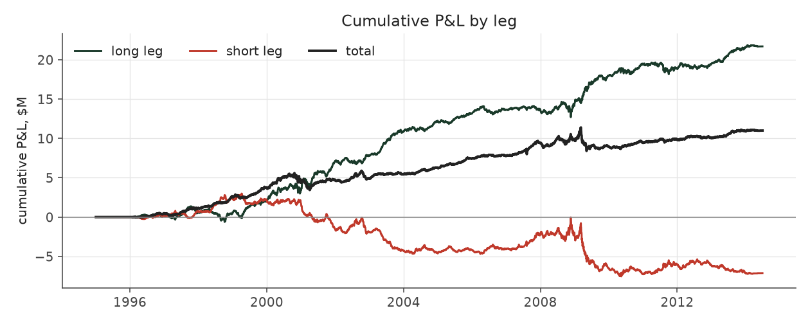
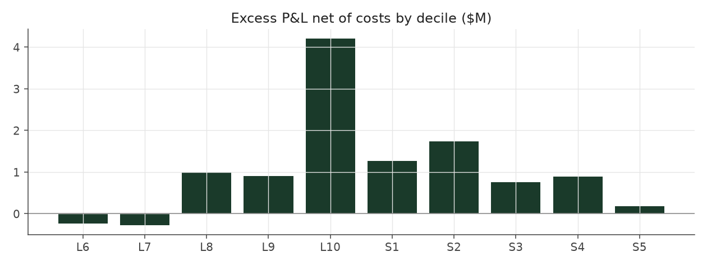

# rank_weighted

_equity strategy | family: equity-baseline | status: validated_

## What this strategy does

All 10 deciles, continuous SUE-rank weight

**Why it should work.** Same drift as Strategy 1 but harvested across the whole cross-section for lower variance.

**Design notes** (from the strategy's source file).

Strategy 2 -- Rank-weighted.

Trades every decile with weight proportional to SUE-rank distance from the median: broader diversification than the extreme-decile book, at the price of ~4x more positions (which saturates the liquidity and leverage caps and dilutes the high-conviction names).

| parameter | value |
|---|---|
| base_unit_fraction | 0.002 |
| max_gross_leverage | 1.5 |
| liquidity_cap_frac | 0.05 |
| return_basis | mktadj |
| cap_mode | proportional |
| beta_overlay | 0.0 |

## Performance

| metric | rank_weighted | market (CRSP VW) |
|---|---|---|
| Annualized return | 3.88% | 9.94% |
| Annualized volatility | 3.86% | 19.35% |
| Sharpe (NAV-pct) | 1.01 | 0.59 |
| Sortino | 1.42 |  |
| Max drawdown | -14.0% | -55.5% |
| Calmar | 0.28 |  |
| Final NAV ($10M start) | $20,996,808 |  |
| Worst day | -2.34% |  |
| % positive days | 52.4% |  |
| Sharpe 1996-2001 | 1.39 |  |
| Sharpe 2002-2007 | 1.55 |  |
| Sharpe 2008-2013 | 0.32 |  |

Correlation of daily returns with the market: **0.01**.

- best Sharpe among equity: `s10_vol_rank_tilt` (1.81); this one: 1.01
- best return among equity: `s6_beta_overlay_aggressive` (0.15); this one: 0.0388
- best Calmar among equity: `s10_vol_rank_tilt` (0.614); this one: 0.278

*NAV (log scale)*

*Drawdown from running peak*

*Calendar-year returns*

*Is the edge stable, or concentrated in a few years?*

## Where the return comes from

*Long leg vs. short leg vs. total*

|  | long leg | short leg |
|---|---|---|
| P&L ($M, before costs) | 21.70 | -7.13 |
| P&L after costs ($M) | 20.00 | -9.00 |
| of which common (average-event) component ($M) | 14.40 | -13.84 |
| of which excess / PEAD component ($M) | 7.30 | 6.72 |
| excess minus costs ($M) | 5.61 | 4.84 |
| gross return per $ traded (bp) | 248.49 | -83.56 |
| positions in the money (hit rate) | 0.55 | 0.48 |
| stand-alone Sharpe (leg only) | 1.19 | -0.33 |

Daily P&L correlation between the two legs: **-0.79**.

- **The short leg loses money in absolute terms** (-7.1M before costs) while the long leg earns +21.7M. That is mostly a benchmark effect, not a signal failure: the average earnings-event stock beat the cap-weighted market during its holding window, which flatters the long leg and hurts the short leg by 14.4M / 13.8M. Stripping that common component, the surprise signal itself earned +7.3M on the long side and +6.7M on the short side.
- The two legs' daily P&L are -0.79 correlated: the short leg is the hedge that makes the long leg's variance disappear (stand-alone leg Sharpe 1.19 long / -0.33 short vs 1.01 combined).

### By decile and side (signal-driven part only)

| leg | decile | positions | notional_M | net_pnl_M | excess_M | cost_M | alpha_net_M | alpha_share | alpha_bp_per_$ |
|---|---|---|---|---|---|---|---|---|---|
| long | 6 | 18,256 | 41.69 | 0.34 | -0.14 | 0.09 | -0.23 | -2.2% | -55.42 |
| long | 7 | 17,431 | 104.34 | 1.62 | -0.07 | 0.20 | -0.28 | -2.7% | -26.66 |
| long | 8 | 16,588 | 169.97 | 3.99 | 1.34 | 0.33 | 1.00 | 9.6% | 59.08 |
| long | 9 | 17,747 | 248.03 | 4.65 | 1.38 | 0.47 | 0.90 | 8.7% | 36.43 |
| long | 10 | 17,174 | 309.23 | 9.39 | 4.81 | 0.60 | 4.21 | 40.3% | 136.06 |
| short | 1 | 17,169 | 295.94 | -3.37 | 1.94 | 0.68 | 1.26 | 12.1% | 42.72 |
| short | 2 | 17,281 | 238.00 | -2.19 | 2.27 | 0.52 | 1.74 | 16.7% | 73.23 |
| short | 3 | 15,970 | 163.81 | -1.95 | 1.12 | 0.36 | 0.76 | 7.3% | 46.33 |
| short | 4 | 21,469 | 125.93 | -1.12 | 1.16 | 0.26 | 0.90 | 8.6% | 71.17 |
| short | 5 | 14,319 | 29.09 | -0.37 | 0.24 | 0.06 | 0.18 | 1.7% | 60.57 |

*D10 and the short deciles carry the alpha; the middle of each leg earns little*

### By size quintile (1 = smallest)

| size_quintile | positions | notional_M | net_pnl_M | excess_M | cost_M | alpha_net_M | alpha_share | alpha_bp_per_$ |
|---|---|---|---|---|---|---|---|---|
| 1 | 19,578 | 167.94 | 1.68 | 3.12 | 0.68 | 2.44 | 23.4% | 145.50 |
| 2 | 32,212 | 338.94 | 3.21 | 4.54 | 0.98 | 3.56 | 34.0% | 104.91 |
| 3 | 36,915 | 385.67 | 3.11 | 3.66 | 0.81 | 2.85 | 27.3% | 74.00 |
| 4 | 40,327 | 411.63 | 1.71 | 1.76 | 0.64 | 1.12 | 10.7% | 27.27 |
| 5 | 44,372 | 421.85 | 1.28 | 0.93 | 0.47 | 0.47 | 4.5% | 11.11 |

### By liquidity quintile (1 = least liquid)

| liquidity_quintile | positions | notional_M | net_pnl_M | excess_M | cost_M | alpha_net_M | alpha_share | alpha_bp_per_$ |
|---|---|---|---|---|---|---|---|---|
| 1 | 19,171 | 149.55 | 2.93 | 4.06 | 0.75 | 3.32 | 31.8% | 221.76 |
| 2 | 32,362 | 347.80 | 2.17 | 3.98 | 1.04 | 2.93 | 28.1% | 84.30 |
| 3 | 37,415 | 391.66 | 2.82 | 3.69 | 0.78 | 2.91 | 27.9% | 74.34 |
| 4 | 40,575 | 413.50 | 1.82 | 1.82 | 0.58 | 1.24 | 11.8% | 29.92 |
| 5 | 43,876 | 423.44 | 1.27 | 0.47 | 0.42 | 0.05 | 0.5% | 1.18 |

### By holding-window length

| hold_bucket | positions | notional_M | net_pnl_M | excess_M | cost_M | alpha_net_M | alpha_share | alpha_bp_per_$ |
|---|---|---|---|---|---|---|---|---|
| <=40d | 77,748 | 665.87 | -0.91 | 1.83 | 1.22 | 0.60 | 5.8% | 9.09 |
| 41-60d | 33,200 | 382.82 | 2.00 | 2.13 | 0.81 | 1.32 | 12.6% | 34.43 |
| 61-90d | 48,100 | 512.60 | 3.48 | 4.25 | 1.11 | 3.13 | 30.0% | 61.13 |
| >90d | 14,356 | 164.75 | 6.44 | 5.82 | 0.44 | 5.39 | 51.6% | 327.00 |

### By era

| era | positions | notional_M | net_pnl_M | excess_M | cost_M | alpha_net_M | alpha_share | alpha_bp_per_$ |
|---|---|---|---|---|---|---|---|---|
| 1996-01 | 50,364 | 426.09 | 4.45 | 5.15 | 0.85 | 4.30 | 41.1% | 100.86 |
| 2002-07 | 58,164 | 591.79 | 4.61 | 5.74 | 1.19 | 4.55 | 43.6% | 76.91 |
| 2008-13 | 64,876 | 708.16 | 1.94 | 3.13 | 1.54 | 1.59 | 15.3% | 22.53 |

### By FF12 sector

| ff12_sector | positions | notional_M | net_pnl_M | excess_M | cost_M | alpha_net_M | alpha_share | alpha_bp_per_$ |
|---|---|---|---|---|---|---|---|---|
| BusEq | 32,133 | 320.84 | 2.65 | 1.97 | 0.66 | 1.31 | 12.5% | 40.71 |
| Chems | 3,926 | 37.70 | 0.07 | 0.17 | 0.07 | 0.10 | 1.0% | 27.76 |
| Durbl | 4,066 | 40.94 | 0.35 | 0.53 | 0.09 | 0.44 | 4.2% | 107.52 |
| Enrgy | 9,095 | 85.98 | 0.87 | 1.08 | 0.16 | 0.91 | 8.7% | 106.13 |
| Hlth | 17,555 | 165.49 | 1.56 | 1.52 | 0.38 | 1.14 | 10.9% | 69.01 |
| Manuf | 17,051 | 173.75 | 0.65 | 1.30 | 0.35 | 0.94 | 9.0% | 54.30 |
| Money | 25,815 | 263.22 | 1.47 | 2.73 | 0.54 | 2.19 | 21.0% | 83.22 |
| NoDur | 7,510 | 73.82 | 0.38 | 0.44 | 0.14 | 0.30 | 2.9% | 40.66 |
| Other | 26,581 | 265.30 | 1.49 | 2.17 | 0.60 | 1.57 | 15.0% | 59.13 |
| Shops | 17,607 | 175.59 | 1.48 | 1.73 | 0.36 | 1.37 | 13.1% | 77.81 |
| Telcm | 5,624 | 56.27 | -0.05 | 0.18 | 0.11 | 0.07 | 0.7% | 13.38 |
| Utils | 6,441 | 67.13 | 0.08 | 0.21 | 0.12 | 0.09 | 0.9% | 14.04 |

### By idiosyncratic-volatility tercile

| vol_tercile | positions | notional_M | net_pnl_M | excess_M | cost_M | alpha_net_M | alpha_share | alpha_bp_per_$ |
|---|---|---|---|---|---|---|---|---|
| high vol | 57,238 | 573.05 | 1.82 | 2.58 | 1.06 | 1.52 | 14.5% | 26.47 |
| low vol | 58,337 | 579.75 | 4.55 | 5.97 | 1.32 | 4.65 | 44.5% | 80.16 |
| mid vol | 55,592 | 550.31 | 4.42 | 5.25 | 1.14 | 4.11 | 39.4% | 74.71 |

### Short-borrow sensitivity (not modeled in the backtest)

| borrow_rate | fee_M | annualized_return | drag |
|---|---|---|---|
| 0.0% | 0.0 | 3.88% | 0.00% |
| 0.5% | 0.9 | 3.65% | 0.23% |
| 1.0% | 1.8 | 3.41% | 0.47% |
| 2.0% | 3.5 | 2.90% | 0.98% |
| 5.0% | 8.8 | 1.01% | 2.87% |

The engine charges the same transaction cost on shorts as on longs and no stock-borrow fee. The short leg is concentrated in small, illiquid names, where borrow is scarce and expensive -- read the table as a floor on the cost of running the short leg.
