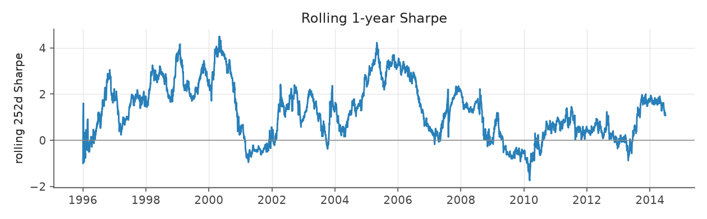
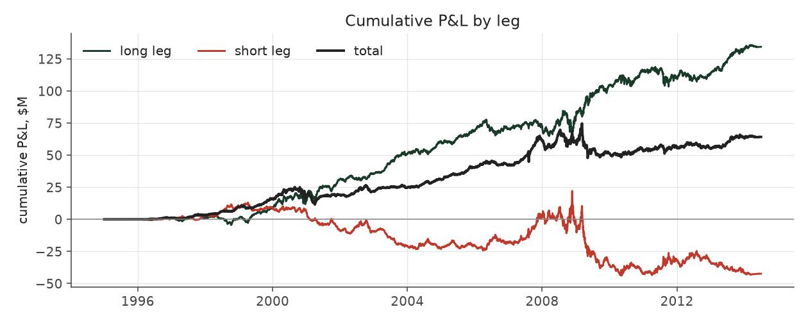
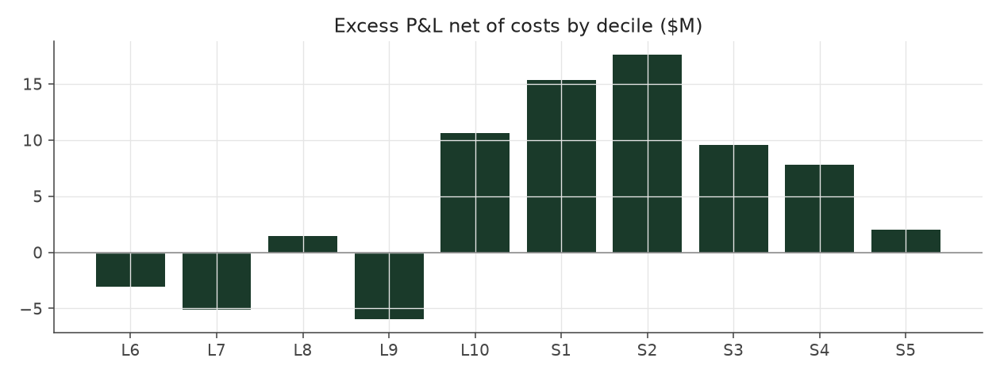

# rank_weighted_aggressive

_equity strategy | family: equity-aggressive | status: research | derived from `rank_weighted`_

## What this strategy does

rank_weighted re-sized for return: base unit 0.005, 6x leverage cap

**Why it should work.** Same drift as Strategy 1 but harvested across the whole cross-section for lower variance.

**Design notes** (from the strategy's source file).

Aggressive-sizing variants of the hand-built equity strategies.

Same signal, trim, tilt and neutralization as each base strategy; only the two dials that set how big and how levered the book is change (base_unit_fraction, gross-leverage cap = 6x). The multiplier for each was picked by sweeping 1.5x..12x the original base unit and taking the highest return subject to Sharpe >= 0.6 and max drawdown >= -40% (a worse drawdown is a fund-ending event, not a risk preference). The untouched 5%-of-ADV liquidity cap remains the real capacity constraint, and bites roughly four times as often at this sizing.

These are generated from the base strategy classes, so a change to a base strategy's weights flows through automatically.

| parameter | value |
|---|---|
| base_unit_fraction | 0.005 |
| max_gross_leverage | 6.0 |
| liquidity_cap_frac | 0.05 |
| return_basis | mktadj |
| cap_mode | proportional |
| beta_overlay | 0.0 |

## Performance

| metric | rank_weighted_aggressive | market (CRSP VW) |
|---|---|---|
| Annualized return | 10.84% | 9.94% |
| Annualized volatility | 12.40% | 19.35% |
| Sharpe (NAV-pct) | 0.89 | 0.59 |
| Sortino | 1.28 |  |
| Max drawdown | -38.8% | -55.5% |
| Calmar | 0.28 |  |
| Final NAV ($10M start) | $74,180,822 |  |
| Worst day | -8.03% |  |
| % positive days | 51.5% |  |
| Sharpe 1996-2001 | 1.24 |  |
| Sharpe 2002-2007 | 1.63 |  |
| Sharpe 2008-2013 | 0.09 |  |

Correlation of daily returns with the market: **0.03**.

- best Sharpe among equity: `s10_vol_rank_tilt` (1.81); this one: 0.892
- best return among equity: `s6_beta_overlay_aggressive` (0.15); this one: 0.108
- best Calmar among equity: `s10_vol_rank_tilt` (0.614); this one: 0.28

*NAV (log scale)*

*Drawdown from running peak*

*Calendar-year returns*

*Is the edge stable, or concentrated in a few years?*

## Where the return comes from

*Long leg vs. short leg vs. total*

|  | long leg | short leg |
|---|---|---|
| P&L ($M, before costs) | 134.38 | -42.37 |
| P&L after costs ($M) | 120.38 | -56.20 |
| of which common (average-event) component ($M) | 122.45 | -108.49 |
| of which excess / PEAD component ($M) | 11.93 | 66.11 |
| excess minus costs ($M) | -2.07 | 52.29 |
| gross return per $ traded (bp) | 161.80 | -56.51 |
| positions in the money (hit rate) | 0.55 | 0.48 |
| stand-alone Sharpe (leg only) | 0.94 | -0.18 |

Daily P&L correlation between the two legs: **-0.77**.

- **The short leg loses money in absolute terms** (-42.4M before costs) while the long leg earns +134.4M. That is mostly a benchmark effect, not a signal failure: the average earnings-event stock beat the cap-weighted market during its holding window, which flatters the long leg and hurts the short leg by 122.5M / 108.5M. Stripping that common component, the surprise signal itself earned +11.9M on the long side and +66.1M on the short side.
- The two legs' daily P&L are -0.77 correlated: the short leg is the hedge that makes the long leg's variance disappear (stand-alone leg Sharpe 0.94 long / -0.18 short vs 0.89 combined).

### By decile and side (signal-driven part only)

| leg | decile | positions | notional_M | net_pnl_M | excess_M | cost_M | alpha_net_M | alpha_share | alpha_bp_per_$ |
|---|---|---|---|---|---|---|---|---|---|
| long | 6 | 18,256 | 446.78 | 2.58 | -2.18 | 0.87 | -3.05 | -6.1% | -68.25 |
| long | 7 | 17,431 | 1,034.12 | 12.39 | -3.26 | 1.85 | -5.11 | -10.2% | -49.45 |
| long | 8 | 16,588 | 1,679.35 | 27.38 | 4.31 | 2.86 | 1.45 | 2.9% | 8.62 |
| long | 9 | 17,747 | 2,343.83 | 26.13 | -2.14 | 3.83 | -5.97 | -11.9% | -25.47 |
| long | 10 | 17,174 | 2,801.07 | 51.89 | 15.19 | 4.58 | 10.61 | 21.1% | 37.89 |
| short | 1 | 17,169 | 2,357.06 | -16.78 | 19.64 | 4.32 | 15.32 | 30.5% | 64.99 |
| short | 2 | 17,281 | 2,060.53 | -13.14 | 21.30 | 3.71 | 17.59 | 35.0% | 85.38 |
| short | 3 | 15,970 | 1,559.44 | -13.10 | 12.46 | 2.89 | 9.56 | 19.0% | 61.32 |
| short | 4 | 21,469 | 1,213.21 | -9.67 | 10.10 | 2.29 | 7.81 | 15.6% | 64.39 |
| short | 5 | 14,319 | 307.57 | -3.50 | 2.61 | 0.60 | 2.00 | 4.0% | 65.15 |

*D10 and the short deciles carry the alpha; the middle of each leg earns little*

### By size quintile (1 = smallest)

| size_quintile | positions | notional_M | net_pnl_M | excess_M | cost_M | alpha_net_M | alpha_share | alpha_bp_per_$ |
|---|---|---|---|---|---|---|---|---|
| 1 | 19,578 | 681.66 | 3.56 | 8.25 | 2.41 | 5.84 | 11.6% | 85.63 |
| 2 | 32,212 | 2,419.67 | 14.98 | 22.54 | 6.28 | 16.26 | 32.4% | 67.19 |
| 3 | 36,915 | 3,811.99 | 20.93 | 25.53 | 7.56 | 17.97 | 35.8% | 47.15 |
| 4 | 40,327 | 4,383.17 | 12.96 | 13.06 | 6.64 | 6.42 | 12.8% | 14.65 |
| 5 | 44,372 | 4,506.47 | 11.76 | 8.66 | 4.93 | 3.73 | 7.4% | 8.27 |

### By liquidity quintile (1 = least liquid)

| liquidity_quintile | positions | notional_M | net_pnl_M | excess_M | cost_M | alpha_net_M | alpha_share | alpha_bp_per_$ |
|---|---|---|---|---|---|---|---|---|
| 1 | 19,171 | 404.49 | 5.73 | 8.47 | 2.02 | 6.45 | 12.8% | 159.37 |
| 2 | 32,362 | 2,234.14 | 12.87 | 22.03 | 6.70 | 15.33 | 30.5% | 68.61 |
| 3 | 37,415 | 4,138.94 | 21.90 | 30.24 | 8.28 | 21.96 | 43.7% | 53.06 |
| 4 | 40,575 | 4,479.25 | 10.63 | 10.93 | 6.27 | 4.66 | 9.3% | 10.40 |
| 5 | 43,876 | 4,545.40 | 13.07 | 6.36 | 4.54 | 1.81 | 3.6% | 3.99 |

### By holding-window length

| hold_bucket | positions | notional_M | net_pnl_M | excess_M | cost_M | alpha_net_M | alpha_share | alpha_bp_per_$ |
|---|---|---|---|---|---|---|---|---|
| <=40d | 77,748 | 6,570.82 | -7.15 | 13.23 | 10.82 | 2.41 | 4.8% | 3.67 |
| 41-60d | 33,200 | 3,470.48 | 17.71 | 14.80 | 6.18 | 8.62 | 17.2% | 24.85 |
| 61-90d | 48,100 | 4,513.69 | 18.35 | 21.00 | 8.24 | 12.77 | 25.4% | 28.28 |
| >90d | 14,356 | 1,247.97 | 35.26 | 29.00 | 2.58 | 26.42 | 52.6% | 211.68 |

### By era

| era | positions | notional_M | net_pnl_M | excess_M | cost_M | alpha_net_M | alpha_share | alpha_bp_per_$ |
|---|---|---|---|---|---|---|---|---|
| 1996-01 | 50,364 | 2,077.53 | 18.41 | 18.96 | 3.65 | 15.30 | 30.5% | 73.65 |
| 2002-07 | 58,164 | 5,345.18 | 38.34 | 45.99 | 9.31 | 36.68 | 73.0% | 68.62 |
| 2008-13 | 64,876 | 8,380.25 | 7.43 | 13.09 | 14.86 | -1.76 | -3.5% | -2.10 |

### By FF12 sector

| ff12_sector | positions | notional_M | net_pnl_M | excess_M | cost_M | alpha_net_M | alpha_share | alpha_bp_per_$ |
|---|---|---|---|---|---|---|---|---|
| BusEq | 32,133 | 2,767.05 | 15.00 | 6.52 | 4.85 | 1.67 | 3.3% | 6.03 |
| Chems | 3,926 | 372.28 | 1.82 | 2.63 | 0.62 | 2.01 | 4.0% | 54.11 |
| Durbl | 4,066 | 360.55 | 1.02 | 2.24 | 0.65 | 1.60 | 3.2% | 44.27 |
| Enrgy | 9,095 | 851.68 | 9.11 | 10.97 | 1.38 | 9.59 | 19.1% | 112.58 |
| Hlth | 17,555 | 1,448.28 | 9.86 | 7.71 | 2.71 | 5.00 | 9.9% | 34.49 |
| Manuf | 17,051 | 1,579.69 | 2.10 | 5.47 | 2.72 | 2.75 | 5.5% | 17.38 |
| Money | 25,815 | 2,535.78 | 7.39 | 18.14 | 4.45 | 13.70 | 27.3% | 54.01 |
| NoDur | 7,510 | 686.61 | 2.43 | 2.32 | 1.17 | 1.16 | 2.3% | 16.85 |
| Other | 26,581 | 2,448.64 | 9.02 | 12.40 | 4.62 | 7.78 | 15.5% | 31.76 |
| Shops | 17,607 | 1,587.20 | 7.84 | 7.83 | 2.77 | 5.06 | 10.1% | 31.90 |
| Telcm | 5,624 | 491.57 | -1.29 | 0.67 | 0.82 | -0.15 | -0.3% | -3.16 |
| Utils | 6,441 | 673.63 | -0.12 | 1.15 | 1.07 | 0.07 | 0.1% | 1.08 |

### By idiosyncratic-volatility tercile

| vol_tercile | positions | notional_M | net_pnl_M | excess_M | cost_M | alpha_net_M | alpha_share | alpha_bp_per_$ |
|---|---|---|---|---|---|---|---|---|
| high vol | 57,238 | 5,515.57 | 11.43 | 17.04 | 8.91 | 8.13 | 16.2% | 14.74 |
| low vol | 58,337 | 5,073.50 | 25.96 | 31.35 | 9.67 | 21.67 | 43.2% | 42.72 |
| mid vol | 55,592 | 5,058.35 | 26.71 | 29.65 | 8.92 | 20.73 | 41.3% | 40.99 |

### Short-borrow sensitivity (not modeled in the backtest)

| borrow_rate | fee_M | annualized_return | drag |
|---|---|---|---|
| 0.0% | 0.0 | 10.84% | 0.00% |
| 0.5% | 7.5 | 10.23% | 0.60% |
| 1.0% | 14.9 | 9.56% | 1.27% |
| 2.0% | 29.9 | 7.94% | 2.90% |
| 5.0% | 74.7 | -100.00% | 110.84% |

The engine charges the same transaction cost on shorts as on longs and no stock-borrow fee. The short leg is concentrated in small, illiquid names, where borrow is scarce and expensive -- read the table as a floor on the cost of running the short leg.
