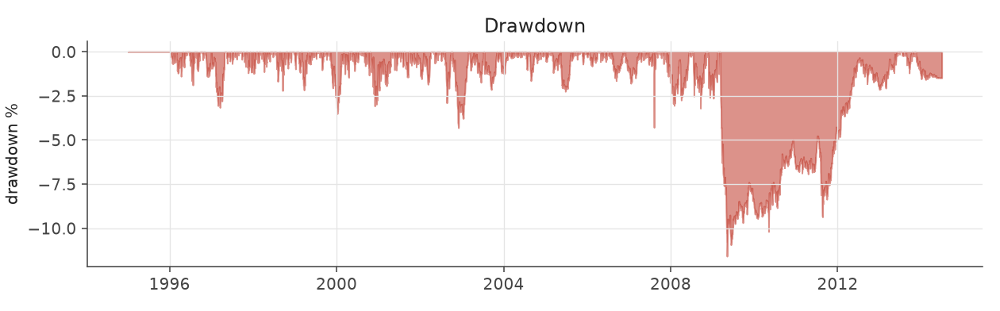
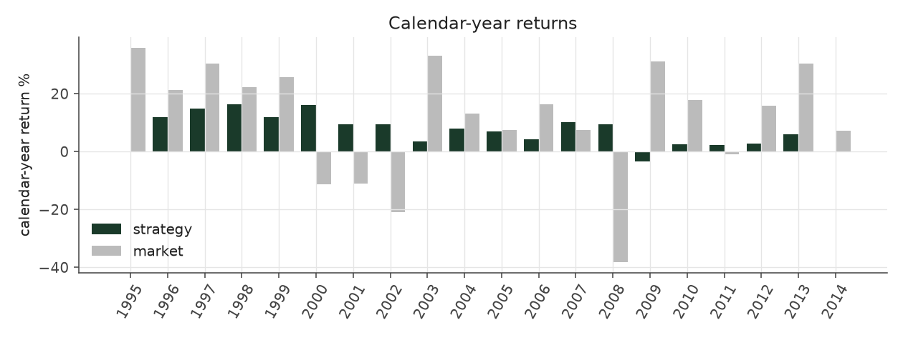
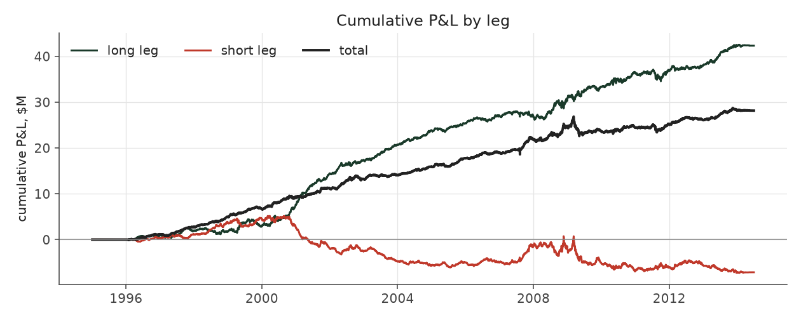

# s10_vol_rank_tilt

_equity strategy | family: equity-volatility | status: research | derived from `s9b_inverse_vol`_

## What this strategy does

Strategy 6 weights x (1.02 - prior-quarter ivol percentile)^2 inside each neutralization cell

**Why it should work.** PEAD alpha per dollar is highest in calm stocks; rank-weight toward them without depending on vol levels.

**Design notes** (from the strategy's source file).

Strategy 10 -- Strategy 6 tilted toward calm stocks by volatility RANK (research).

Strategy 9b sized each event by 1/idiosyncratic-vol (Sharpe 1.30 -> 1.47). The attribution work showed that PEAD alpha per dollar is concentrated in low-volatility names and almost absent in the wildest tercile, and that the 1/vol weight, being linear in the vol LEVEL, only mildly demotes the high-vol tail. Weighting by (1.02 - vol percentile)^2 -- where the percentile is measured against the previous quarter's cross-section within the stock's size quintile -- demotes it hard while staying smooth:

Sharpe 1.30 (S6) -> 1.47 (9b) -> 1.81; max drawdown -16.6% -> -11.6%; every era improves split-sample check: exponent picked on 1996-2004 data alone (best k ~ 3) lifts 2005-2013 Sharpe 0.93 -> 1.10, the same as the full-sample best, so the gain is not an artifact of one period.

Lower volatility buys room: `s10_vol_rank_tilt_levered` spends it on 1.7x the base unit and a 4x gross cap for ~9% a year at ~5% vol (a market-neutral book clearing the S&P 500's return in this sample). More sizing than that stops paying: the 5%-of-ADV liquidity cap starts to bind and 2008-13 Sharpe decays.

STATUS research: the exponent and sizing were chosen after seeing 9b's full-sample results (the split-sample check above is the only out-of-sample evidence), and the levered variant leans on small-cap capacity.

| parameter | value |
|---|---|
| base_unit_fraction | 0.003 |
| max_gross_leverage | 2.5 |
| liquidity_cap_frac | 0.05 |
| return_basis | mktadj |
| cap_mode | priority |
| beta_overlay | 0.0 |

## Performance

| metric | s10_vol_rank_tilt | market (CRSP VW) |
|---|---|---|
| Annualized return | 7.12% | 9.94% |
| Annualized volatility | 3.83% | 19.35% |
| Sharpe (NAV-pct) | 1.81 | 0.59 |
| Sortino | 2.77 |  |
| Max drawdown | -11.6% | -55.5% |
| Calmar | 0.61 |  |
| Final NAV ($10M start) | $38,141,081 |  |
| Worst day | -2.55% |  |
| % positive days | 52.7% |  |
| Sharpe 1996-2001 | 2.94 |  |
| Sharpe 2002-2007 | 1.89 |  |
| Sharpe 2008-2013 | 0.78 |  |

Correlation of daily returns with the market: **-0.01**.

- best Sharpe among equity: this strategy; this one: 1.81
- best return among equity: `s6_beta_overlay_aggressive` (0.15); this one: 0.0712
- best Calmar among equity: this strategy; this one: 0.614

*NAV (log scale)*

*Drawdown from running peak*

*Calendar-year returns*

*Is the edge stable, or concentrated in a few years?*

## Where the return comes from

*Long leg vs. short leg vs. total*

|  | long leg | short leg |
|---|---|---|
| P&L ($M, before costs) | 42.31 | -7.14 |
| P&L after costs ($M) | 38.92 | -10.78 |
| of which common (average-event) component ($M) | 27.61 | -27.83 |
| of which excess / PEAD component ($M) | 14.70 | 20.69 |
| excess minus costs ($M) | 11.31 | 17.05 |
| gross return per $ traded (bp) | 244.60 | -40.33 |
| positions in the money (hit rate) | 0.56 | 0.49 |
| stand-alone Sharpe (leg only) | 1.48 | -0.16 |

Daily P&L correlation between the two legs: **-0.79**.

- **The short leg loses money in absolute terms** (-7.1M before costs) while the long leg earns +42.3M. That is mostly a benchmark effect, not a signal failure: the average earnings-event stock beat the cap-weighted market during its holding window, which flatters the long leg and hurts the short leg by 27.6M / 27.8M. Stripping that common component, the surprise signal itself earned +14.7M on the long side and +20.7M on the short side.
- The two legs' daily P&L are -0.79 correlated: the short leg is the hedge that makes the long leg's variance disappear (stand-alone leg Sharpe 1.48 long / -0.16 short vs 1.81 combined).

### By decile and side (signal-driven part only)

| leg | decile | positions | notional_M | net_pnl_M | excess_M | cost_M | alpha_net_M | alpha_share | alpha_bp_per_$ |
|---|---|---|---|---|---|---|---|---|---|
| long | 7 | 8,029 | 158.66 | 2.31 | -0.42 | 0.31 | -0.73 | -2.6% | -45.85 |
| long | 8 | 16,588 | 415.11 | 8.24 | 2.15 | 0.82 | 1.34 | 4.7% | 32.24 |
| long | 9 | 17,747 | 535.73 | 9.62 | 2.89 | 1.03 | 1.85 | 6.5% | 34.61 |
| long | 10 | 17,174 | 620.10 | 18.75 | 10.07 | 1.22 | 8.85 | 31.2% | 142.70 |
| short | 1 | 17,169 | 611.53 | -2.46 | 7.54 | 1.31 | 6.23 | 22.0% | 101.86 |
| short | 2 | 17,281 | 543.16 | -3.69 | 6.66 | 1.11 | 5.55 | 19.6% | 102.21 |
| short | 3 | 15,970 | 433.58 | -3.41 | 4.45 | 0.87 | 3.58 | 12.6% | 82.48 |
| short | 4 | 9,171 | 182.37 | -1.23 | 2.04 | 0.35 | 1.69 | 6.0% | 92.85 |

*D10 and the short deciles carry the alpha; the middle of each leg earns little*

### By size quintile (1 = smallest)

| size_quintile | positions | notional_M | net_pnl_M | excess_M | cost_M | alpha_net_M | alpha_share | alpha_bp_per_$ |
|---|---|---|---|---|---|---|---|---|
| 1 | 14,213 | 258.09 | 5.07 | 6.67 | 1.01 | 5.66 | 20.0% | 219.35 |
| 2 | 22,885 | 608.55 | 6.10 | 8.01 | 1.76 | 6.25 | 22.0% | 102.75 |
| 3 | 25,501 | 801.21 | 7.23 | 8.75 | 1.75 | 7.00 | 24.7% | 87.41 |
| 4 | 27,583 | 905.05 | 6.03 | 7.37 | 1.48 | 5.89 | 20.8% | 65.06 |
| 5 | 28,947 | 927.33 | 3.71 | 4.59 | 1.03 | 3.56 | 12.5% | 38.35 |

### By liquidity quintile (1 = least liquid)

| liquidity_quintile | positions | notional_M | net_pnl_M | excess_M | cost_M | alpha_net_M | alpha_share | alpha_bp_per_$ |
|---|---|---|---|---|---|---|---|---|
| 1 | 13,650 | 208.10 | 4.29 | 5.68 | 1.04 | 4.64 | 16.3% | 222.79 |
| 2 | 23,084 | 716.85 | 6.64 | 9.78 | 2.15 | 7.63 | 26.9% | 106.44 |
| 3 | 25,851 | 912.90 | 8.09 | 10.05 | 1.83 | 8.22 | 29.0% | 90.08 |
| 4 | 27,665 | 861.29 | 5.41 | 5.79 | 1.21 | 4.59 | 16.2% | 53.26 |
| 5 | 28,874 | 800.98 | 3.71 | 4.07 | 0.80 | 3.27 | 11.5% | 40.82 |

### By holding-window length

| hold_bucket | positions | notional_M | net_pnl_M | excess_M | cost_M | alpha_net_M | alpha_share | alpha_bp_per_$ |
|---|---|---|---|---|---|---|---|---|
| <=40d | 45,855 | 1,393.64 | 2.33 | 9.87 | 2.49 | 7.38 | 26.0% | 52.97 |
| 41-60d | 25,652 | 807.71 | 6.04 | 5.82 | 1.65 | 4.17 | 14.7% | 51.66 |
| 61-90d | 35,324 | 966.11 | 8.08 | 9.29 | 2.05 | 7.24 | 25.5% | 74.92 |
| >90d | 12,298 | 332.76 | 11.69 | 10.40 | 0.83 | 9.57 | 33.7% | 287.61 |

### By era

| era | positions | notional_M | net_pnl_M | excess_M | cost_M | alpha_net_M | alpha_share | alpha_bp_per_$ |
|---|---|---|---|---|---|---|---|---|
| 1996-01 | 33,895 | 660.14 | 11.04 | 12.55 | 1.31 | 11.24 | 39.6% | 170.30 |
| 2002-07 | 39,956 | 1,201.49 | 10.83 | 12.96 | 2.37 | 10.60 | 37.4% | 88.18 |
| 2008-13 | 45,278 | 1,638.60 | 6.27 | 9.88 | 3.35 | 6.53 | 23.0% | 39.83 |

### By FF12 sector

| ff12_sector | positions | notional_M | net_pnl_M | excess_M | cost_M | alpha_net_M | alpha_share | alpha_bp_per_$ |
|---|---|---|---|---|---|---|---|---|
| BusEq | 22,094 | 348.54 | 3.31 | 3.97 | 0.76 | 3.22 | 11.3% | 92.28 |
| Chems | 2,590 | 232.45 | 1.79 | 2.14 | 0.40 | 1.74 | 6.1% | 74.80 |
| Durbl | 2,843 | 247.37 | 1.98 | 2.43 | 0.44 | 1.98 | 7.0% | 80.17 |
| Enrgy | 6,194 | 273.83 | 3.43 | 4.04 | 0.51 | 3.52 | 12.4% | 128.69 |
| Hlth | 11,696 | 332.40 | 2.17 | 2.80 | 0.69 | 2.11 | 7.4% | 63.45 |
| Manuf | 12,034 | 318.17 | 2.01 | 2.84 | 0.66 | 2.18 | 7.7% | 68.42 |
| Money | 17,583 | 315.04 | 2.93 | 3.72 | 0.71 | 3.01 | 10.6% | 95.42 |
| NoDur | 5,081 | 282.00 | 1.73 | 2.19 | 0.53 | 1.66 | 5.9% | 59.01 |
| Other | 18,377 | 338.29 | 3.08 | 3.92 | 0.76 | 3.15 | 11.1% | 93.22 |
| Shops | 11,984 | 326.93 | 3.01 | 3.63 | 0.68 | 2.96 | 10.4% | 90.41 |
| Telcm | 3,981 | 259.18 | 1.94 | 2.38 | 0.46 | 1.92 | 6.8% | 74.07 |
| Utils | 4,672 | 226.03 | 0.76 | 1.33 | 0.41 | 0.92 | 3.2% | 40.51 |

### By idiosyncratic-volatility tercile

| vol_tercile | positions | notional_M | net_pnl_M | excess_M | cost_M | alpha_net_M | alpha_share | alpha_bp_per_$ |
|---|---|---|---|---|---|---|---|---|
| high vol | 39,523 | 293.11 | 3.29 | 4.05 | 0.55 | 3.50 | 12.4% | 119.56 |
| low vol | 40,091 | 1,985.36 | 14.71 | 19.31 | 4.09 | 15.22 | 53.6% | 76.64 |
| mid vol | 37,903 | 1,165.50 | 9.67 | 11.45 | 2.26 | 9.18 | 32.4% | 78.80 |

### Short-borrow sensitivity (not modeled in the backtest)

| borrow_rate | fee_M | annualized_return | drag |
|---|---|---|---|
| 0.0% | 0.0 | 7.12% | 0.00% |
| 0.5% | 1.8 | 6.85% | 0.26% |
| 1.0% | 3.5 | 6.58% | 0.53% |
| 2.0% | 7.1 | 5.99% | 1.12% |
| 5.0% | 17.7 | 3.74% | 3.37% |

The engine charges the same transaction cost on shorts as on longs and no stock-borrow fee. The short leg is concentrated in small, illiquid names, where borrow is scarce and expensive -- read the table as a floor on the cost of running the short leg.
