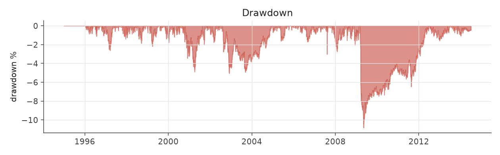
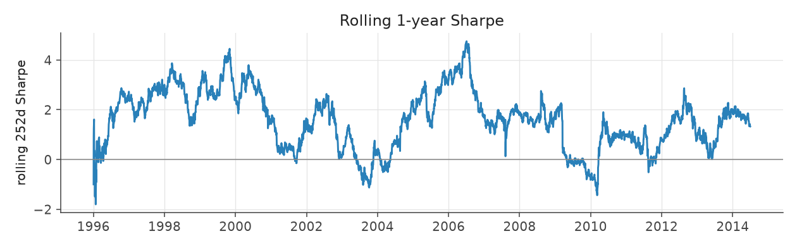
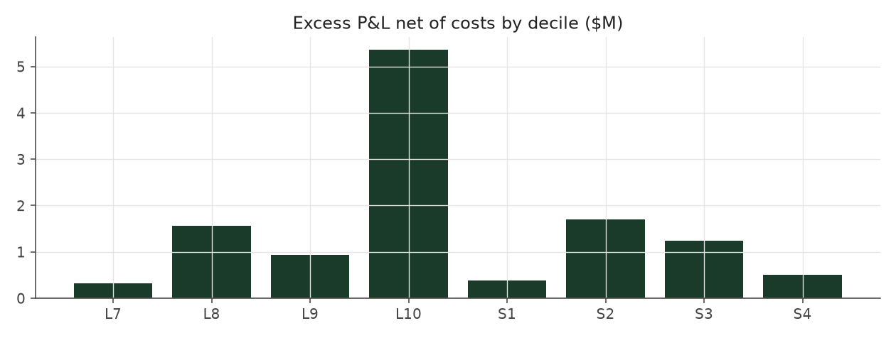

# s5_sector_neutral

_equity strategy | family: equity-neutralized | status: validated | derived from `s4_tilted_size_neutral`_

## What this strategy does

Trim 0.15, linear tilt, size x FF12-sector neutral, 1.5x leverage cap

**Why it should work.** Same drift, with sector and size risk diversified away so only the earnings signal is left.

**Design notes** (from the strategy's source file).

Strategy 5 -- Strategy 4 + FF12-sector neutrality.

A diagnostic found Strategy 4's book putting up to 29% of gross weight in one FF12 sector in some quarters (8.3% if spread evenly): an unpriced bet unrelated to earnings drift. Neutralizing each (side, size, sector) cell to an equal budget removes it. Best Sharpe / shallowest drawdown of the hand-built strategies at its conservative 1.5x leverage cap.

| parameter | value |
|---|---|
| base_unit_fraction | 0.0015 |
| max_gross_leverage | 1.5 |
| liquidity_cap_frac | 0.05 |
| return_basis | mktadj |
| cap_mode | priority |
| beta_overlay | 0.0 |

## Performance

| metric | s5_sector_neutral | market (CRSP VW) |
|---|---|---|
| Annualized return | 4.06% | 9.94% |
| Annualized volatility | 3.02% | 19.35% |
| Sharpe (NAV-pct) | 1.33 | 0.59 |
| Sortino | 1.88 |  |
| Max drawdown | -10.8% | -55.5% |
| Calmar | 0.37 |  |
| Final NAV ($10M start) | $21,709,852 |  |
| Worst day | -3.95% |  |
| % positive days | 52.3% |  |
| Sharpe 1996-2001 | 2.19 |  |
| Sharpe 2002-2007 | 1.34 |  |
| Sharpe 2008-2013 | 0.66 |  |

Correlation of daily returns with the market: **0.03**.

- best Sharpe among equity: `s10_vol_rank_tilt` (1.81); this one: 1.33
- best return among equity: `s6_beta_overlay_aggressive` (0.15); this one: 0.0406
- best Calmar among equity: `s10_vol_rank_tilt` (0.614); this one: 0.375

*NAV (log scale)*

*Drawdown from running peak*

*Calendar-year returns*

*Is the edge stable, or concentrated in a few years?*

## Where the return comes from

*Long leg vs. short leg vs. total*

|  | long leg | short leg |
|---|---|---|
| P&L ($M, before costs) | 19.96 | -5.40 |
| P&L after costs ($M) | 18.59 | -6.88 |
| of which common (average-event) component ($M) | 10.40 | -10.71 |
| of which excess / PEAD component ($M) | 9.56 | 5.31 |
| excess minus costs ($M) | 8.18 | 3.83 |
| gross return per $ traded (bp) | 304.72 | -80.72 |
| positions in the money (hit rate) | 0.56 | 0.49 |
| stand-alone Sharpe (leg only) | 1.32 | -0.31 |

Daily P&L correlation between the two legs: **-0.79**.

- **The short leg loses money in absolute terms** (-5.4M before costs) while the long leg earns +20.0M. That is mostly a benchmark effect, not a signal failure: the average earnings-event stock beat the cap-weighted market during its holding window, which flatters the long leg and hurts the short leg by 10.4M / 10.7M. Stripping that common component, the surprise signal itself earned +9.6M on the long side and +5.3M on the short side.
- The two legs' daily P&L are -0.79 correlated: the short leg is the hedge that makes the long leg's variance disappear (stand-alone leg Sharpe 1.32 long / -0.31 short vs 1.33 combined).

### By decile and side (signal-driven part only)

| leg | decile | positions | notional_M | net_pnl_M | excess_M | cost_M | alpha_net_M | alpha_share | alpha_bp_per_$ |
|---|---|---|---|---|---|---|---|---|---|
| long | 7 | 8,029 | 56.48 | 1.39 | 0.44 | 0.12 | 0.32 | 2.7% | 56.82 |
| long | 8 | 16,588 | 151.86 | 4.08 | 1.88 | 0.32 | 1.56 | 13.0% | 102.79 |
| long | 9 | 17,747 | 202.60 | 3.85 | 1.36 | 0.42 | 0.94 | 7.8% | 46.36 |
| long | 10 | 17,174 | 244.17 | 9.27 | 5.88 | 0.52 | 5.36 | 44.6% | 219.67 |
| short | 1 | 17,169 | 247.53 | -3.33 | 0.96 | 0.57 | 0.39 | 3.2% | 15.64 |
| short | 2 | 17,281 | 208.23 | -1.82 | 2.15 | 0.45 | 1.70 | 14.1% | 81.65 |
| short | 3 | 15,970 | 152.89 | -1.24 | 1.57 | 0.33 | 1.25 | 10.4% | 81.44 |
| short | 4 | 9,171 | 60.77 | -0.48 | 0.62 | 0.12 | 0.50 | 4.2% | 82.45 |

*D10 and the short deciles carry the alpha; the middle of each leg earns little*

### By size quintile (1 = smallest)

| size_quintile | positions | notional_M | net_pnl_M | excess_M | cost_M | alpha_net_M | alpha_share | alpha_bp_per_$ |
|---|---|---|---|---|---|---|---|---|
| 1 | 14,213 | 164.15 | 4.46 | 5.45 | 0.66 | 4.79 | 39.9% | 291.79 |
| 2 | 22,885 | 262.98 | 2.30 | 3.15 | 0.76 | 2.40 | 19.9% | 91.10 |
| 3 | 25,501 | 294.17 | 2.65 | 3.24 | 0.63 | 2.61 | 21.7% | 88.78 |
| 4 | 27,583 | 301.86 | 1.36 | 1.81 | 0.47 | 1.34 | 11.1% | 44.33 |
| 5 | 28,947 | 301.38 | 0.94 | 1.22 | 0.33 | 0.88 | 7.3% | 29.31 |

### By liquidity quintile (1 = least liquid)

| liquidity_quintile | positions | notional_M | net_pnl_M | excess_M | cost_M | alpha_net_M | alpha_share | alpha_bp_per_$ |
|---|---|---|---|---|---|---|---|---|
| 1 | 13,650 | 130.20 | 3.85 | 4.71 | 0.65 | 4.06 | 33.8% | 312.06 |
| 2 | 23,084 | 287.52 | 2.88 | 4.06 | 0.86 | 3.20 | 26.6% | 111.25 |
| 3 | 25,851 | 308.05 | 2.25 | 3.00 | 0.62 | 2.39 | 19.9% | 77.54 |
| 4 | 27,665 | 300.81 | 1.87 | 2.08 | 0.42 | 1.66 | 13.8% | 55.08 |
| 5 | 28,874 | 297.88 | 0.86 | 1.01 | 0.30 | 0.71 | 5.9% | 23.82 |

### By holding-window length

| hold_bucket | positions | notional_M | net_pnl_M | excess_M | cost_M | alpha_net_M | alpha_share | alpha_bp_per_$ |
|---|---|---|---|---|---|---|---|---|
| <=40d | 45,855 | 481.23 | 0.05 | 2.79 | 0.88 | 1.91 | 15.9% | 39.62 |
| 41-60d | 25,652 | 300.47 | 1.88 | 2.18 | 0.66 | 1.52 | 12.6% | 50.59 |
| 61-90d | 35,324 | 395.08 | 2.86 | 3.57 | 0.90 | 2.68 | 22.3% | 67.74 |
| >90d | 12,298 | 147.76 | 6.92 | 6.33 | 0.41 | 5.92 | 49.2% | 400.37 |

### By era

| era | positions | notional_M | net_pnl_M | excess_M | cost_M | alpha_net_M | alpha_share | alpha_bp_per_$ |
|---|---|---|---|---|---|---|---|---|
| 1996-01 | 33,895 | 328.62 | 4.94 | 5.76 | 0.69 | 5.07 | 42.2% | 154.33 |
| 2002-07 | 39,956 | 438.83 | 4.14 | 5.12 | 0.92 | 4.19 | 34.9% | 95.58 |
| 2008-13 | 45,278 | 557.10 | 2.64 | 3.99 | 1.24 | 2.75 | 22.9% | 49.41 |

### By FF12 sector

| ff12_sector | positions | notional_M | net_pnl_M | excess_M | cost_M | alpha_net_M | alpha_share | alpha_bp_per_$ |
|---|---|---|---|---|---|---|---|---|
| BusEq | 22,094 | 124.11 | 1.01 | 1.28 | 0.27 | 1.01 | 8.4% | 81.08 |
| Chems | 2,590 | 92.50 | 0.28 | 0.50 | 0.18 | 0.32 | 2.7% | 34.65 |
| Durbl | 2,843 | 101.51 | 1.37 | 1.60 | 0.21 | 1.39 | 11.6% | 137.24 |
| Enrgy | 6,194 | 109.07 | 1.62 | 1.88 | 0.22 | 1.65 | 13.7% | 151.51 |
| Hlth | 11,696 | 121.82 | 1.26 | 1.55 | 0.27 | 1.28 | 10.7% | 105.12 |
| Manuf | 12,034 | 116.86 | 0.99 | 1.31 | 0.26 | 1.05 | 8.8% | 90.15 |
| Money | 17,583 | 114.16 | 1.27 | 1.58 | 0.27 | 1.30 | 10.8% | 114.23 |
| NoDur | 5,081 | 108.74 | 0.87 | 1.08 | 0.23 | 0.85 | 7.1% | 78.58 |
| Other | 18,377 | 121.67 | 1.17 | 1.49 | 0.28 | 1.21 | 10.0% | 99.03 |
| Shops | 11,984 | 120.09 | 1.49 | 1.76 | 0.26 | 1.50 | 12.5% | 124.88 |
| Telcm | 3,981 | 108.87 | 0.26 | 0.49 | 0.22 | 0.28 | 2.3% | 25.25 |
| Utils | 4,672 | 85.15 | 0.11 | 0.34 | 0.17 | 0.17 | 1.4% | 20.45 |

### By idiosyncratic-volatility tercile

| vol_tercile | positions | notional_M | net_pnl_M | excess_M | cost_M | alpha_net_M | alpha_share | alpha_bp_per_$ |
|---|---|---|---|---|---|---|---|---|
| high vol | 39,523 | 411.62 | 2.13 | 3.39 | 0.80 | 2.60 | 21.6% | 63.04 |
| low vol | 40,091 | 462.76 | 4.81 | 5.96 | 1.10 | 4.87 | 40.5% | 105.17 |
| mid vol | 37,903 | 425.63 | 4.61 | 5.28 | 0.90 | 4.38 | 36.4% | 102.89 |

### Short-borrow sensitivity (not modeled in the backtest)

| borrow_rate | fee_M | annualized_return | drag |
|---|---|---|---|
| 0.0% | 0.0 | 4.06% | 0.00% |
| 0.5% | 0.7 | 3.89% | 0.17% |
| 1.0% | 1.4 | 3.71% | 0.35% |
| 2.0% | 2.8 | 3.34% | 0.72% |
| 5.0% | 6.9 | 2.04% | 2.02% |

The engine charges the same transaction cost on shorts as on longs and no stock-borrow fee. The short leg is concentrated in small, illiquid names, where borrow is scarce and expensive -- read the table as a floor on the cost of running the short leg.
