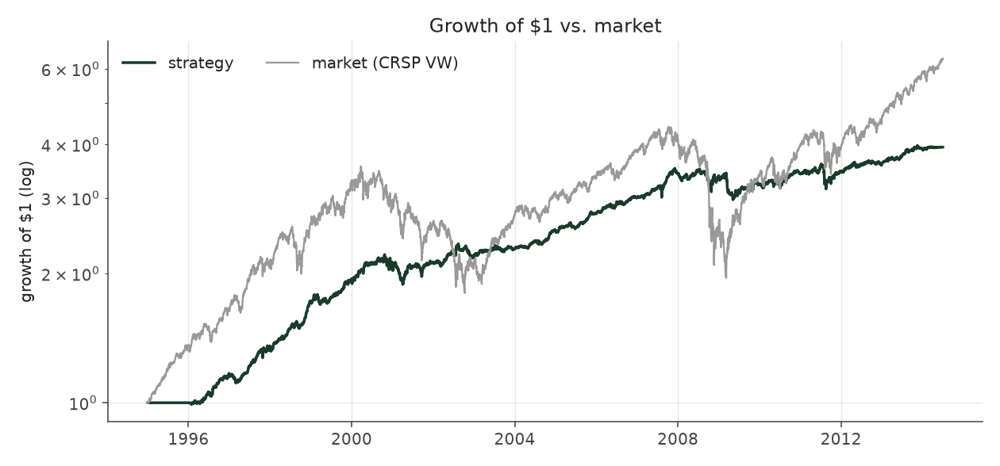
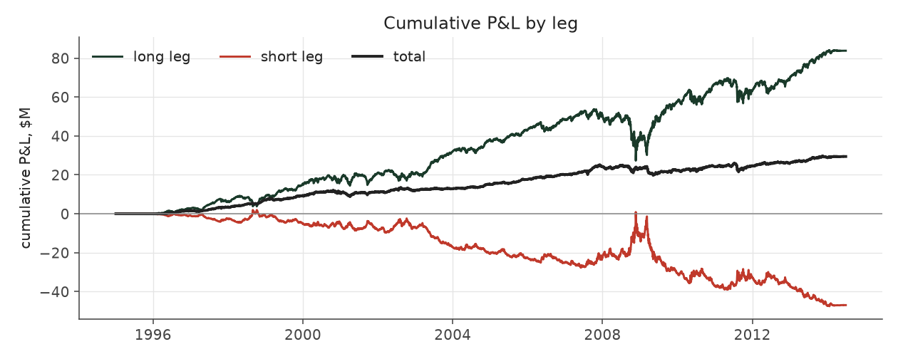

# s7_directional

_equity strategy | family: equity-directional | status: reference | derived from `s6_neutral_levered`_

## What this strategy does

Strategy 6 signal, cells neutralized across sides together, raw returns

**Why it should work.** Let net exposure float with the signal; empirically this smuggles in uncontrolled market beta.

**Design notes** (from the strategy's source file).

Strategy 7 -- Unconstrained net exposure (cautionary result).

Strategy 5/6's signal, but the long and short legs are no longer forced to equal dollar totals, and returns are RAW so real market beta is carried. Net dollar exposure is only ~10% of gross (as in every other book) yet the book is 0.52-correlated with the market, because raw returns carry each stock's own beta and equal dollars long and short are not equal BETA: high-SUE and low-SUE firms differ in beta. Kept as a documented counter-example to the explicit beta overlay.

| parameter | value |
|---|---|
| base_unit_fraction | 0.003 |
| max_gross_leverage | 2.5 |
| liquidity_cap_frac | 0.05 |
| return_basis | raw |
| cap_mode | priority |
| beta_overlay | 0.0 |

## Performance

| metric | s7_directional | market (CRSP VW) |
|---|---|---|
| Annualized return | 7.30% | 9.94% |
| Annualized volatility | 6.56% | 19.35% |
| Sharpe (NAV-pct) | 1.11 | 0.59 |
| Sortino | 1.61 |  |
| Max drawdown | -15.5% | -55.5% |
| Calmar | 0.47 |  |
| Final NAV ($10M start) | $39,420,102 |  |
| Worst day | -3.54% |  |
| % positive days | 51.7% |  |
| Sharpe 1996-2001 | 1.79 |  |
| Sharpe 2002-2007 | 1.48 |  |
| Sharpe 2008-2013 | 0.32 |  |

Correlation of daily returns with the market: **0.52**.

- best Sharpe among equity: `s10_vol_rank_tilt` (1.81); this one: 1.11
- best return among equity: `s6_beta_overlay_aggressive` (0.15); this one: 0.073
- best Calmar among equity: `s10_vol_rank_tilt` (0.614); this one: 0.47

*NAV (log scale)*

*Drawdown from running peak*

*Calendar-year returns*

*Is the edge stable, or concentrated in a few years?*

## Where the return comes from

*Long leg vs. short leg vs. total*

|  | long leg | short leg |
|---|---|---|
| P&L ($M, before costs) | 83.80 | -46.97 |
| P&L after costs ($M) | 80.33 | -50.91 |
| of which common (average-event) component ($M) | 29.35 | -28.46 |
| of which excess / PEAD component ($M) | 14.08 | 16.52 |
| excess minus costs ($M) | 10.61 | 12.58 |
| gross return per $ traded (bp) | 453.74 | -252.30 |
| positions in the money (hit rate) | 0.63 | 0.42 |
| stand-alone Sharpe (leg only) | 0.80 | -0.48 |

Daily P&L correlation between the two legs: **-0.97**.

- **The short leg loses money in absolute terms** (-47.0M before costs) while the long leg earns +83.8M. That is mostly a benchmark effect, not a signal failure: the average earnings-event stock beat the cap-weighted market during its holding window, which flatters the long leg and hurts the short leg by 29.3M / 28.5M. Stripping that common component, the surprise signal itself earned +14.1M on the long side and +16.5M on the short side.
- The two legs' daily P&L are -0.97 correlated: the short leg is the hedge that makes the long leg's variance disappear (stand-alone leg Sharpe 0.80 long / -0.48 short vs 1.11 combined).

### By decile and side (signal-driven part only)

| leg | decile | positions | notional_M | net_pnl_M | excess_M | cost_M | alpha_net_M | alpha_share | alpha_bp_per_$ |
|---|---|---|---|---|---|---|---|---|---|
| long | 7 | 8,029 | 151.48 | 6.63 | 0.35 | 0.29 | 0.06 | 0.3% | 3.97 |
| long | 8 | 16,588 | 419.95 | 18.91 | 3.06 | 0.80 | 2.26 | 9.8% | 53.88 |
| long | 9 | 17,747 | 579.02 | 19.40 | 1.20 | 1.07 | 0.13 | 0.6% | 2.31 |
| long | 10 | 17,174 | 696.43 | 35.39 | 9.47 | 1.32 | 8.16 | 35.2% | 117.11 |
| short | 1 | 17,169 | 687.39 | -20.20 | 5.02 | 1.50 | 3.52 | 15.2% | 51.23 |
| short | 2 | 17,281 | 581.80 | -15.87 | 5.95 | 1.21 | 4.74 | 20.4% | 81.42 |
| short | 3 | 15,970 | 427.74 | -10.65 | 3.77 | 0.90 | 2.88 | 12.4% | 67.22 |
| short | 4 | 9,171 | 164.64 | -4.20 | 1.78 | 0.33 | 1.45 | 6.2% | 87.75 |

*D10 and the short deciles carry the alpha; the middle of each leg earns little*

### By size quintile (1 = smallest)

| size_quintile | positions | notional_M | net_pnl_M | excess_M | cost_M | alpha_net_M | alpha_share | alpha_bp_per_$ |
|---|---|---|---|---|---|---|---|---|
| 1 | 14,213 | 331.20 | 4.24 | 6.76 | 1.26 | 5.50 | 23.7% | 165.93 |
| 2 | 22,885 | 698.98 | 5.38 | 9.21 | 1.95 | 7.25 | 31.3% | 103.78 |
| 3 | 25,501 | 855.45 | 6.19 | 7.74 | 1.78 | 5.96 | 25.7% | 69.68 |
| 4 | 27,583 | 908.68 | 5.87 | 4.34 | 1.42 | 2.92 | 12.6% | 32.19 |
| 5 | 28,947 | 914.14 | 7.73 | 2.56 | 1.00 | 1.56 | 6.7% | 17.02 |

### By liquidity quintile (1 = least liquid)

| liquidity_quintile | positions | notional_M | net_pnl_M | excess_M | cost_M | alpha_net_M | alpha_share | alpha_bp_per_$ |
|---|---|---|---|---|---|---|---|---|
| 1 | 13,650 | 237.22 | 5.30 | 6.80 | 1.19 | 5.62 | 24.2% | 236.80 |
| 2 | 23,084 | 737.56 | 4.92 | 8.93 | 2.21 | 6.71 | 28.9% | 91.03 |
| 3 | 25,851 | 913.89 | 5.24 | 8.96 | 1.83 | 7.13 | 30.7% | 78.03 |
| 4 | 27,665 | 916.54 | 5.74 | 3.57 | 1.28 | 2.28 | 9.8% | 24.92 |
| 5 | 28,874 | 902.97 | 8.23 | 2.34 | 0.90 | 1.43 | 6.2% | 15.87 |

### By holding-window length

| hold_bucket | positions | notional_M | net_pnl_M | excess_M | cost_M | alpha_net_M | alpha_share | alpha_bp_per_$ |
|---|---|---|---|---|---|---|---|---|
| <=40d | 45,855 | 1,393.00 | -4.21 | 6.41 | 2.48 | 3.94 | 17.0% | 28.25 |
| 41-60d | 25,652 | 849.98 | 5.63 | 4.14 | 1.72 | 2.42 | 10.4% | 28.42 |
| 61-90d | 35,324 | 1,098.83 | 6.54 | 8.83 | 2.31 | 6.52 | 28.1% | 59.36 |
| >90d | 12,298 | 366.64 | 21.45 | 11.23 | 0.91 | 10.32 | 44.5% | 281.39 |

### By era

| era | positions | notional_M | net_pnl_M | excess_M | cost_M | alpha_net_M | alpha_share | alpha_bp_per_$ |
|---|---|---|---|---|---|---|---|---|
| 1996-01 | 33,895 | 747.21 | 10.90 | 10.75 | 1.46 | 9.29 | 40.0% | 124.27 |
| 2002-07 | 39,956 | 1,240.62 | 12.89 | 13.29 | 2.43 | 10.86 | 46.8% | 87.54 |
| 2008-13 | 45,278 | 1,720.62 | 5.63 | 6.57 | 3.52 | 3.04 | 13.1% | 17.69 |

### By FF12 sector

| ff12_sector | positions | notional_M | net_pnl_M | excess_M | cost_M | alpha_net_M | alpha_share | alpha_bp_per_$ |
|---|---|---|---|---|---|---|---|---|
| BusEq | 22,094 | 361.52 | 6.68 | 2.57 | 0.76 | 1.81 | 7.8% | 50.15 |
| Chems | 2,590 | 247.25 | 1.86 | 2.15 | 0.43 | 1.72 | 7.4% | 69.57 |
| Durbl | 2,843 | 271.20 | 0.82 | 1.73 | 0.49 | 1.24 | 5.3% | 45.72 |
| Enrgy | 6,194 | 306.46 | 2.68 | 5.02 | 0.58 | 4.44 | 19.1% | 144.91 |
| Hlth | 11,696 | 351.27 | 4.78 | 2.91 | 0.74 | 2.17 | 9.4% | 61.85 |
| Manuf | 12,034 | 328.49 | 2.00 | 2.35 | 0.68 | 1.68 | 7.2% | 50.98 |
| Money | 17,583 | 324.19 | 2.90 | 3.92 | 0.73 | 3.19 | 13.8% | 98.48 |
| NoDur | 5,081 | 297.45 | 3.35 | 2.32 | 0.56 | 1.75 | 7.6% | 58.95 |
| Other | 18,377 | 351.79 | 2.42 | 2.83 | 0.78 | 2.05 | 8.8% | 58.33 |
| Shops | 11,984 | 342.63 | 3.79 | 3.25 | 0.70 | 2.55 | 11.0% | 74.45 |
| Telcm | 3,981 | 294.61 | -1.67 | 0.89 | 0.54 | 0.35 | 1.5% | 12.02 |
| Utils | 4,672 | 231.59 | -0.19 | 0.65 | 0.42 | 0.23 | 1.0% | 9.79 |

### By idiosyncratic-volatility tercile

| vol_tercile | positions | notional_M | net_pnl_M | excess_M | cost_M | alpha_net_M | alpha_share | alpha_bp_per_$ |
|---|---|---|---|---|---|---|---|---|
| high vol | 39,523 | 1,190.47 | 5.04 | 7.43 | 2.16 | 5.27 | 22.7% | 44.28 |
| low vol | 40,091 | 1,262.78 | 13.29 | 12.95 | 2.76 | 10.19 | 43.9% | 80.68 |
| mid vol | 37,903 | 1,199.44 | 10.75 | 9.87 | 2.38 | 7.49 | 32.3% | 62.46 |

### Short-borrow sensitivity (not modeled in the backtest)

| borrow_rate | fee_M | annualized_return | drag |
|---|---|---|---|
| 0.0% | 0.0 | 7.30% | 0.00% |
| 0.5% | 1.9 | 7.02% | 0.27% |
| 1.0% | 3.8 | 6.74% | 0.56% |
| 2.0% | 7.6 | 6.12% | 1.18% |
| 5.0% | 19.1 | 3.72% | 3.58% |

The engine charges the same transaction cost on shorts as on longs and no stock-borrow fee. The short leg is concentrated in small, illiquid names, where borrow is scarce and expensive -- read the table as a floor on the cost of running the short leg.
