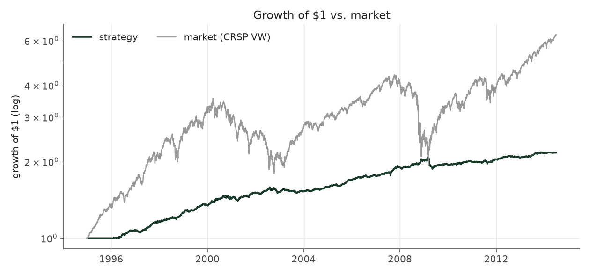
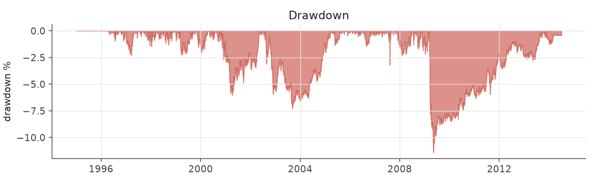
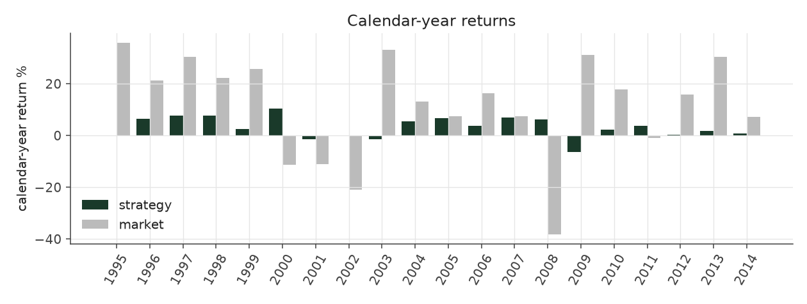
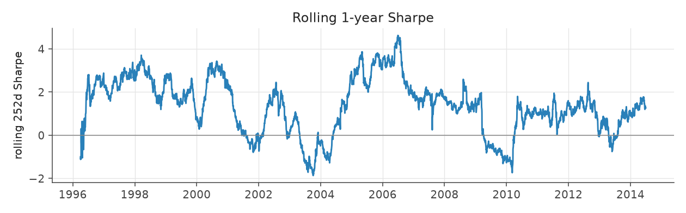
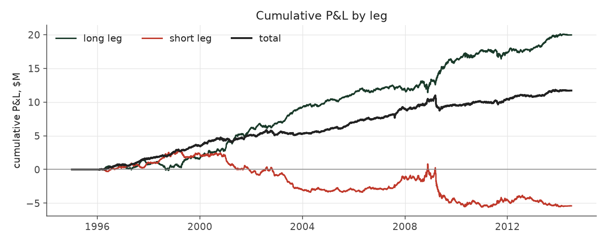

# sector_balanced

_equity strategy | family: equity-neutralized | status: validated | derived from `conviction_tilt`_

## What this strategy does

Conviction Tilt, also balanced across 12 industry groups; conservative 1.5x borrowing limit

**Why it should work.** Same drift, with sector and size risk diversified away so only the earnings signal is left.

**Design notes** (from the strategy's source file).

Sector Balanced -- Conviction Tilt plus an equal budget for each industry group.

A diagnostic found Conviction Tilt's book putting up to 29% of gross weight in one FF12 sector in some quarters (8.3% if spread evenly): an unpriced bet unrelated to earnings drift. Neutralizing each (side, size, sector) cell to an equal budget removes it. Best Sharpe / shallowest drawdown of the hand-built strategies at its conservative 1.5x leverage cap.

| parameter | value |
|---|---|
| base_unit_fraction | 0.0015 |
| max_gross_leverage | 1.5 |
| liquidity_cap_frac | 0.05 |
| return_basis | mktadj |
| cap_mode | priority |
| exposure_cap | open_book |
| beta_overlay | 0.0 |

## Performance

| metric | sector_balanced | market (CRSP VW) |
|---|---|---|
| Annualized return | 3.14% | 9.94% |
| Annualized volatility | 2.89% | 19.35% |
| Sharpe (NAV-pct) | 1.08 | 0.59 |
| Sortino | 1.52 |  |
| Max drawdown | -11.4% | -55.5% |
| Calmar | 0.28 |  |
| Final NAV ($10M start) | $18,260,949 |  |
| Worst day | -3.27% |  |
| % positive days | 50.8% |  |
| Sharpe 1996-2001 | 1.72 |  |
| Sharpe 2002-2007 | 1.25 |  |
| Sharpe 2008-2013 | 0.41 |  |

Correlation of daily returns with the market: **-0.00**.

- best Sharpe among equity: `calm_rank_tilt` (1.47); this one: 1.08
- best return among equity: `market_boost_max` (0.116); this one: 0.0314
- best Calmar among equity: `calm_rank_tilt` (0.442); this one: 0.275

*NAV (log scale)*

*Drawdown from running peak*

*Calendar-year returns*

*Is the edge stable, or concentrated in a few years?*

## Where the return comes from

*Long leg vs. short leg vs. total*

|  | long leg | short leg |
|---|---|---|
| P&L ($M, before costs) | 16.19 | -5.39 |
| P&L after costs ($M) | 14.95 | -6.69 |
| of which common (average-event) component ($M) | 8.99 | -9.21 |
| of which excess / PEAD component ($M) | 7.20 | 3.82 |
| excess minus costs ($M) | 5.96 | 2.51 |
| gross return per $ traded (bp) | 277.94 | -90.79 |
| positions in the money (hit rate) | 0.56 | 0.48 |
| stand-alone Sharpe (leg only) | 1.26 | -0.36 |

Daily P&L correlation between the two legs: **-0.79**.

- **The short leg loses money in absolute terms** (-5.4M before costs) while the long leg earns +16.2M. That is mostly a benchmark effect, not a signal failure: the average earnings-event stock beat the cap-weighted market during its holding window, which flatters the long leg and hurts the short leg by 9.0M / 9.2M. Stripping that common component, the surprise signal itself earned +7.2M on the long side and +3.8M on the short side.
- The two legs' daily P&L are -0.79 correlated: the short leg is the hedge that makes the long leg's variance disappear (stand-alone leg Sharpe 1.26 long / -0.36 short vs 1.08 combined).

### By decile and side (signal-driven part only)

| leg | decile | positions | notional_M | net_pnl_M | excess_M | cost_M | alpha_net_M | alpha_share | alpha_bp_per_$ |
|---|---|---|---|---|---|---|---|---|---|
| long | 7 | 6,082 | 37.83 | 0.76 | 0.23 | 0.08 | 0.14 | 1.7% | 38.00 |
| long | 8 | 16,057 | 127.06 | 2.81 | 0.81 | 0.27 | 0.54 | 6.4% | 42.58 |
| long | 9 | 18,361 | 179.68 | 4.19 | 2.23 | 0.38 | 1.85 | 21.8% | 102.81 |
| long | 10 | 20,072 | 238.05 | 7.19 | 3.94 | 0.51 | 3.43 | 40.5% | 144.16 |
| short | 1 | 18,251 | 239.38 | -3.19 | 1.31 | 0.55 | 0.76 | 9.0% | 31.85 |
| short | 2 | 18,738 | 203.97 | -1.97 | 1.65 | 0.44 | 1.21 | 14.3% | 59.32 |
| short | 3 | 14,800 | 133.12 | -1.39 | 0.75 | 0.28 | 0.47 | 5.5% | 35.11 |
| short | 4 | 2,262 | 16.74 | -0.14 | 0.11 | 0.03 | 0.07 | 0.9% | 44.07 |

*D10 and the short deciles carry the alpha; the middle of each leg earns little*

### By size quintile (1 = smallest)

| size_quintile | positions | notional_M | net_pnl_M | excess_M | cost_M | alpha_net_M | alpha_share | alpha_bp_per_$ |
|---|---|---|---|---|---|---|---|---|
| 1 | 13,854 | 150.43 | 1.21 | 2.08 | 0.60 | 1.48 | 17.4% | 98.20 |
| 2 | 21,876 | 234.74 | 2.57 | 3.32 | 0.68 | 2.64 | 31.2% | 112.65 |
| 3 | 24,597 | 259.69 | 2.16 | 2.71 | 0.56 | 2.15 | 25.4% | 82.86 |
| 4 | 26,557 | 265.14 | 1.43 | 1.79 | 0.42 | 1.37 | 16.2% | 51.79 |
| 5 | 27,739 | 265.83 | 0.89 | 1.12 | 0.29 | 0.83 | 9.8% | 31.26 |

### By liquidity quintile (1 = least liquid)

| liquidity_quintile | positions | notional_M | net_pnl_M | excess_M | cost_M | alpha_net_M | alpha_share | alpha_bp_per_$ |
|---|---|---|---|---|---|---|---|---|
| 1 | 13,187 | 119.70 | 1.96 | 2.75 | 0.60 | 2.15 | 25.4% | 179.53 |
| 2 | 22,184 | 257.13 | 2.03 | 3.06 | 0.77 | 2.29 | 27.1% | 89.20 |
| 3 | 24,828 | 271.79 | 1.83 | 2.44 | 0.54 | 1.89 | 22.3% | 69.63 |
| 4 | 26,579 | 265.11 | 1.61 | 1.83 | 0.37 | 1.46 | 17.2% | 55.13 |
| 5 | 27,841 | 262.03 | 0.82 | 0.94 | 0.26 | 0.68 | 8.0% | 25.79 |

### By holding-window length

| hold_bucket | positions | notional_M | net_pnl_M | excess_M | cost_M | alpha_net_M | alpha_share | alpha_bp_per_$ |
|---|---|---|---|---|---|---|---|---|
| <=40d | 40,606 | 393.78 | 0.32 | 3.08 | 0.80 | 2.29 | 27.0% | 58.04 |
| 41-60d | 27,196 | 297.47 | 1.18 | 2.56 | 0.69 | 1.86 | 22.0% | 62.59 |
| 61-90d | 37,427 | 381.34 | 3.58 | 2.62 | 0.75 | 1.87 | 22.1% | 49.12 |
| >90d | 9,394 | 103.24 | 3.18 | 2.77 | 0.31 | 2.46 | 29.0% | 237.99 |

### By era

| era | positions | notional_M | net_pnl_M | excess_M | cost_M | alpha_net_M | alpha_share | alpha_bp_per_$ |
|---|---|---|---|---|---|---|---|---|
| 1996-01 | 32,241 | 304.99 | 3.68 | 4.40 | 0.65 | 3.75 | 44.3% | 123.05 |
| 2002-07 | 37,882 | 393.27 | 3.11 | 3.98 | 0.83 | 3.14 | 37.1% | 79.95 |
| 2008-13 | 44,500 | 477.57 | 1.47 | 2.65 | 1.07 | 1.58 | 18.6% | 33.09 |

### By FF12 sector

| ff12_sector | positions | notional_M | net_pnl_M | excess_M | cost_M | alpha_net_M | alpha_share | alpha_bp_per_$ |
|---|---|---|---|---|---|---|---|---|
| BusEq | 20,671 | 108.71 | 0.44 | 0.67 | 0.24 | 0.43 | 5.1% | 39.70 |
| Chems | 2,553 | 82.04 | 0.28 | 0.48 | 0.16 | 0.32 | 3.8% | 39.15 |
| Durbl | 2,829 | 90.23 | 0.96 | 1.18 | 0.19 | 1.00 | 11.7% | 110.33 |
| Enrgy | 6,341 | 98.29 | 1.18 | 1.39 | 0.20 | 1.19 | 14.0% | 120.86 |
| Hlth | 11,339 | 108.11 | 0.50 | 0.75 | 0.24 | 0.51 | 6.0% | 47.18 |
| Manuf | 11,787 | 103.70 | 0.70 | 0.97 | 0.23 | 0.74 | 8.7% | 71.03 |
| Money | 16,516 | 99.52 | 1.01 | 1.28 | 0.24 | 1.03 | 12.2% | 103.99 |
| NoDur | 4,907 | 97.23 | 0.47 | 0.64 | 0.21 | 0.43 | 5.1% | 44.73 |
| Other | 17,460 | 106.30 | 0.99 | 1.26 | 0.25 | 1.01 | 11.9% | 95.03 |
| Shops | 11,520 | 106.61 | 1.26 | 1.50 | 0.23 | 1.27 | 15.0% | 119.04 |
| Telcm | 3,960 | 98.15 | 0.70 | 0.91 | 0.20 | 0.71 | 8.3% | 72.10 |
| Utils | 4,740 | 76.93 | -0.23 | -0.01 | 0.15 | -0.16 | -1.9% | -21.11 |

### By idiosyncratic-volatility tercile

| vol_tercile | positions | notional_M | net_pnl_M | excess_M | cost_M | alpha_net_M | alpha_share | alpha_bp_per_$ |
|---|---|---|---|---|---|---|---|---|
| high vol | 38,373 | 366.60 | 0.83 | 1.93 | 0.71 | 1.22 | 14.4% | 33.27 |
| low vol | 38,203 | 409.42 | 3.77 | 4.83 | 0.98 | 3.85 | 45.4% | 93.98 |
| mid vol | 36,279 | 376.16 | 3.32 | 3.89 | 0.80 | 3.09 | 36.5% | 82.15 |

### Short-borrow sensitivity (not modeled in the backtest)

| borrow_rate | fee_M | annualized_return | drag |
|---|---|---|---|
| 0.0% | 0.0 | 3.14% | -0.00% |
| 0.5% | 0.6 | 2.96% | 0.18% |
| 1.0% | 1.2 | 2.78% | 0.36% |
| 2.0% | 2.4 | 2.39% | 0.75% |
| 5.0% | 6.1 | 1.02% | 2.12% |

The engine charges the same transaction cost on shorts as on longs and no stock-borrow fee. The short leg is concentrated in small, illiquid names, where borrow is scarce and expensive -- read the table as a floor on the cost of running the short leg.
