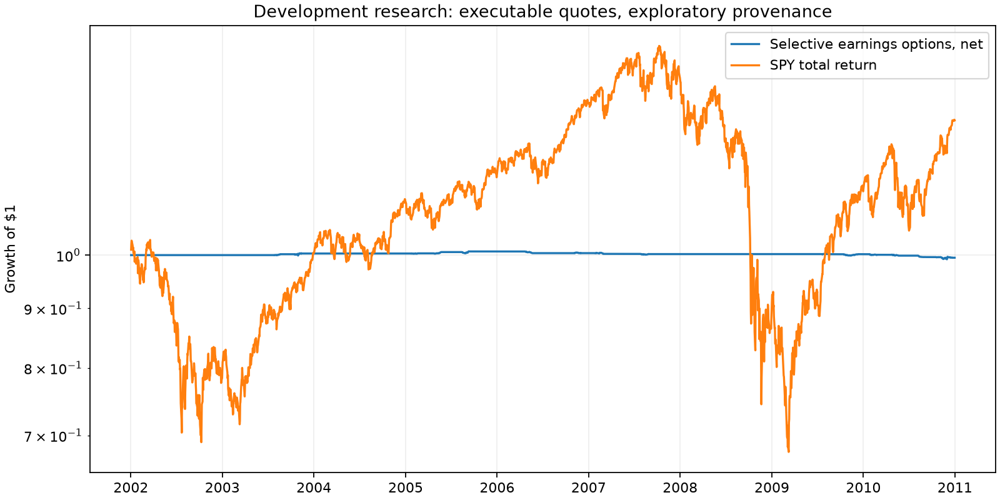

# Selective Earnings Options: research result

Status: **NOT APPROVED FOR INVESTMENT**.
Mode: exploratory proxies; sample 2002-01-02 to 2010-12-31.
Fixed parameters; expanding matured-history price model; no test-period parameter search.

| Metric | Strategy, net | SPY total return |
|---|---:|---:|
| CAGR | -0.06% | 3.01% |
| Sharpe (zero cash rate) | -0.18 | 0.24 |
| Maximum drawdown | -1.56% | -55.20% |

Closed positions: 23. Market-model alpha: -0.07%/year.
Config fingerprint: `971168006dd48609`.

## Interpretation

Daily EOD buys at ask and sales at bid; $0.65/contract/side commissions; integer lots;
previous-session volume and OI; maximum-loss and collateral budgets; idle cash earns zero.
Commission is an assumption, not a broker schedule. Missing marks receive contractual
worst-loss reserves and invalidate execution. These are not asserted trade fills.
Assignment, corporate-action and historical calendar/identifier validation remain open.
The reversal sleeve cannot trade without a historical known-at-the-time schedule and
independent event-window price model. This adapter deliberately does not invent them.
Market alpha is not multifactor alpha. Paired monthly-block intervals do not replace
issuer/date cluster inference. This is development research, not an untouched holdout.

## Investment gates

- execution_valid: FAIL
- benchmark_total_return: pass
- minimum_three_years: pass
- cagr: FAIL
- sharpe: FAIL
- alpha: FAIL
- alpha_confidence: FAIL
- drawdown: pass
- canonical_provenance: FAIL
- minimum_100_trades: FAIL
- multifactor_and_issuer_cluster_inference: FAIL
- genuine_untouched_holdout: FAIL

## Skipped candidates

- underlying_liquidity: 189,123
- no_chain: 29,757
- no_asof_pre_event_schedule: 26,253
- unconfirmed_direction: 22,421
- no_liquid_structure: 194
- forecast_does_not_cover_option_cost: 101
- missing_rv: 8
- iv_not_rich: 2
