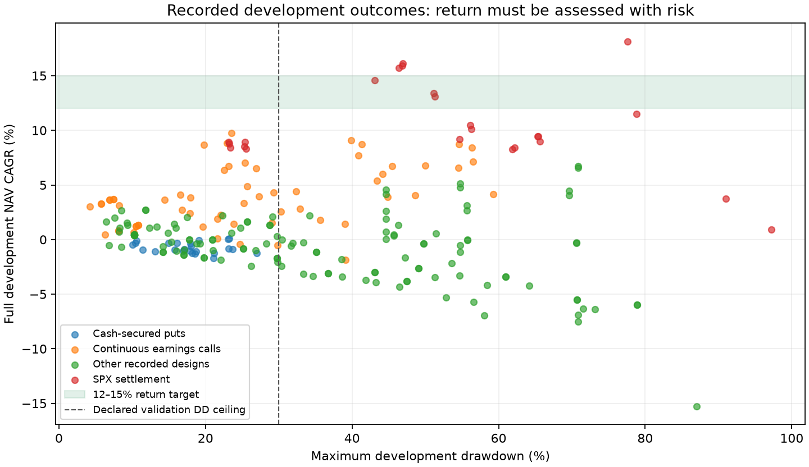
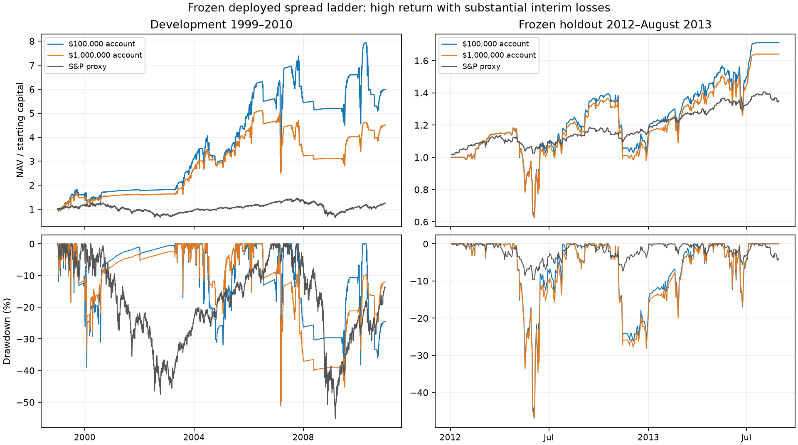

# Earnings-options research: both account sizes

## Current decision

The expanded research can clear the numerical return hurdle by deploying more short-volatility risk. That does not establish consistent annual profits or investment readiness. High-return profiles must be judged with their drawdowns, later-period returns, execution stresses and selection history.

| Development profile | Capital | Full CAGR | Full drawdown | 2008–2010 CAGR |
|---|---:|---:|---:|---:|
| selective_earnings_index_settlement_risk_exit / deployed_100k | $100,000 | 16.11% | -46.94% | 2.86% |
| selective_earnings_index_settlement_risk_exit / deployed_1000k | $1,000,000 | 13.38% | -51.17% | 10.93% |
| selective_earnings_index_settlement_risk_exit / moderate_100k | $100,000 | 8.51% | -25.31% | 0.17% |
| selective_earnings_index_settlement_risk_exit_double_fee / deployed_100k | $100,000 | 15.91% | -46.83% | 2.69% |
| selective_earnings_index_settlement_risk_exit_zero_floor / deployed_100k | $100,000 | 15.69% | -46.38% | 2.61% |
| selective_earnings_carry_intrinsic_trend_cash_ceiling / car5_100k | $100,000 | 9.73% | -23.54% | 4.67% |

The declared validation selector retains a 30% drawdown ceiling. An aggressive profile failing that ceiling is a high-risk research candidate, not the validation-approved winner. Repeated development redesigns also mean these results are not pristine out-of-sample evidence.



## Settlement and implementation findings

Native SET SECID118963 supplies all 144 monthly opening settlements in 1999–2010. Traditional monthly SPX uses actual SOQ cash payoff, not the ordinary index close. Monthly historical Saturday expirations fall on days 16–22; an earlier menu incorrectly excluded day 22. The first January session now uses the actual December quote for prior Greeks and liquidity. Earlier vintages remain separately named.

The pure settlement ladder makes its cash-secured worst loss explicit and promises no early exit. The risk-exit version initiates liquidation when the existing lagged market trend is negative or lagged realized volatility exceeds30%; earnings breadth still gates entry. Exits are staged against the two legs and their shared prior-volume/OI capacity. They preserve pending exit intent and cannot spend collateral reserved for another position. Contracts still open at SOQ resolve to actual cash payoff.

Continuous single-name calls carry across calendar years, use prior-session Greeks or an explicitly Greek-free intrinsic selector, normalize costs to stock-equivalent value, and share capacity across eight strike/maturity tickets. The 80% ceiling variant allows extreme company concentration. It improves affordability, not the stock forecast.


For the index candidate,30% per ticket/cohort and80% aggregate are maximum-loss admission limits. They are not a cap on future drawdown or a continuously rebalanced fraction of current NAV. Cash secures contractual width, but several overlapping expiries can lose together. Risk-off liquidation can take several sessions because participation is constrained.

## Annual consistency and independent cash audit

Long-run CAGR is not an annual floor. The fixed candidate has the following development-year outcomes:

| Account | Profitable years | Losing years | Worst calendar year |
|---|---:|---:|---:|
| deployed_1000k | 10 | 2 | 2007: -29.12% |
| deployed_100k | 9 | 3 | 2010: -7.32% |

Independent entry/exit price and native SET payoff audit: 1382 closed trade records, maximum P&L discrepancy $0.0000000000. This validates the implemented arithmetic against its source quotes; it does not validate quote-size availability or market impact.

## Entry-price and liquidity audit

This is a post-run diagnostic; it does not filter or reprice historical entries. The native stock close can follow the option quote, so the intrinsic-value check is not an executable arbitrage test.

| Profile | Closed records | Ask below close-intrinsic by>1%stock | Records requiring one-lot floor | P&L on those records |
|---|---:|---:|---:|---:|
| selective_earnings_carry_intrinsic_trend_cash_ceiling/car5_100k | 527 | 0 | 383 | $22,932.10 |
| selective_earnings_carry_lagged_cash/car5_100k | 686 | 0 | 507 | $-22,663.10 |

PnL attributed to these records is not the portfolio return that would result from deleting them. Removing an order changes cash, later contract choices and compounding.

## Preparation-only or incomplete runs

These preserved folders have policy metadata but no completed comparison table; they are excluded from the completed-trial count and must not be represented as measured portfolio performance.

- selective_earnings_carry
- selective_earnings_carry_normalized
- selective_earnings_carry_trend

## Frozen holdout: January 2012–August 30, 2013

The deployed 30/30/80% risk profile was fixed before this evaluation, including code hashes, both capitals, actual SET and capacity-controlled market-risk exits. Native options and SET both end August 30, 2013; the S&P comparator ends on the same day. 2011 has no native option extract, so the first January 2012 weekly entry has no prior Greeks and is safely skipped. No policy was retuned after viewing the holdout. The original 30% drawdown selector still rejects this candidate; a high holdout return does not override its risk failure.

| Capital | Holdout CAGR | Drawdown | S&P proxy CAGR | Distinct entry weeks |
|---|---:|---:|---:|---:|
| $100,000 | 38.24% | -45.73% | 19.61% | 33 |
| $1,000,000 | 34.76% | -47.06% | 19.61% | 38 |

Risk-adjusted comparison: the S&P proxy had9.69% maximum drawdown and Sharpe1.52. The candidate had Sharpe0.86/0.81 and estimated annual market alpha of−11.86%/−15.12% at100K/1M. Its higher raw CAGR therefore does not establish positive risk-adjusted alpha. The short-sample block-bootstrap intervals are wide and include negative CAGR and alpha; see the saved holdout summaries.


Both holdout ledgers have zero missing marks and zero terminal reserve exits. The large holdout drawdowns are therefore quoted option liabilities, not missing-data write-offs. For example, the $100K account fell from a $117,862 peak to $63,960 on June 4, 2012 before recovering. The two-year partial sample is short and mostly a rising equity market; it does not establish consistent annual returns, current-market viability or immunity to another crash.



This is the complete development-trial register. No failed profile or prior result vintage has been removed. A numerically attractive later-window return is not a validated investment strategy. The original source and ignored caches remain in their worktree; raw OptionMetrics files remain read-only on D:.

Completed register: 267 scenario/vintage pairs, 1026 period observations. Vintages share data and are not independent experiments. Cash reconciliation maximum absolute residual: $0.00000054.

Chronology: 1999–2004 discovery, 2005–2007 validation, 2008–2010 later development test. SPY options only existed from January 10, 2005, so SPY call history starts in 2005. A high-risk candidate was frozen before evaluation on January 2012–August 30, 2013; that holdout is now consumed and reported separately above. Repeated redesigns have already consumed the earlier development data; none of these are a pristine new final holdout.

## Validation-selected profiles

Selections use validation Sharpe, minimum trade counts and declared drawdown limits. The v2 $100K case transfers the fixed $1M-selected profile; later families select separately by capital. A selection can still have negative returns. “None” means no profile cleared the selection filters. All percentages below are NAV CAGR after quoted entry/exit costs and commissions.

| Experiment/vintage | Capital | Selected profile | Validation CAGR | 2008–2010 CAGR | Full-history CAGR |
|---|---:|---|---:|---:|---:|
| selective_earnings_calls | $100,000 | None | — | — | — |
| selective_earnings_calls | $1,000,000 | recovery_1.5x_1000k | -1.81% | 2.79% | 0.47% |
| selective_earnings_calls_deferred | $100,000 | None | — | — | — |
| selective_earnings_calls_deferred | $1,000,000 | recovery_1.5x_1000k | -1.81% | 2.79% | 0.47% |
| selective_earnings_calls_deferred_capacity | $100,000 | None | — | — | — |
| selective_earnings_calls_deferred_capacity | $1,000,000 | None | — | — | — |
| selective_earnings_carry_intrinsic | $100,000 | car5_100k | 18.68% | -4.79% | 7.12% |
| selective_earnings_carry_intrinsic | $1,000,000 | car8_1000k | 7.10% | -4.43% | 1.16% |
| selective_earnings_carry_intrinsic_cash | $100,000 | car5_100k | 23.37% | -6.44% | 8.71% |
| selective_earnings_carry_intrinsic_cash | $1,000,000 | car8_1000k | 9.63% | -2.80% | 3.63% |
| selective_earnings_carry_intrinsic_trend | $100,000 | car5_100k | 7.58% | 4.95% | 6.37% |
| selective_earnings_carry_intrinsic_trend | $1,000,000 | car3_1000k | 0.94% | 1.32% | 1.33% |
| selective_earnings_carry_intrinsic_trend_cash | $100,000 | car5_100k | 11.74% | 4.00% | 8.69% |
| selective_earnings_carry_intrinsic_trend_cash | $1,000,000 | car8_1000k | 5.42% | 1.13% | 3.30% |
| selective_earnings_carry_intrinsic_trend_cash_ceiling | $100,000 | car5_100k | 16.66% | 4.67% | 9.73% |
| selective_earnings_carry_intrinsic_trend_cash_ceiling | $1,000,000 | car8_1000k | 5.42% | 1.13% | 3.30% |
| selective_earnings_carry_intrinsic_trend_ceiling | $100,000 | car5_100k | 11.40% | 4.63% | 6.75% |
| selective_earnings_carry_intrinsic_trend_ceiling | $1,000,000 | car3_1000k | 0.94% | 1.32% | 1.33% |
| selective_earnings_carry_lagged | $100,000 | car5_100k | 13.12% | -2.93% | 7.70% |
| selective_earnings_carry_lagged | $1,000,000 | car8_1000k | 1.81% | -6.01% | -0.44% |
| selective_earnings_carry_lagged_cash | $100,000 | car5_100k | 14.16% | -4.17% | 9.07% |
| selective_earnings_carry_lagged_cash | $1,000,000 | car8_1000k | 5.43% | -3.86% | 2.41% |
| selective_earnings_carry_lagged_trend | $100,000 | car5_100k | 8.46% | 4.53% | 7.01% |
| selective_earnings_carry_lagged_trend | $1,000,000 | car3_1000k | -0.27% | -0.89% | 0.10% |
| selective_earnings_carry_lagged_trend_cash | $100,000 | car5_100k | 9.72% | 4.70% | 8.81% |
| selective_earnings_carry_lagged_trend_cash | $1,000,000 | car8_1000k | 4.29% | 1.30% | 3.03% |
| selective_earnings_carry_lagged_zero_rf | $100,000 | car5_100k | 13.12% | -2.93% | 7.70% |
| selective_earnings_carry_lagged_zero_rf | $1,000,000 | car8_1000k | 1.81% | -6.01% | -0.44% |
| selective_earnings_cash_puts | $100,000 | drift_all_100k | -0.53% | -1.13% | 0.08% |
| selective_earnings_cash_puts | $1,000,000 | income_trend_1000k | -1.14% | -0.19% | -1.04% |
| selective_earnings_cash_puts_actions | $100,000 | drift_trend_100k | -0.36% | 0.13% | -0.08% |
| selective_earnings_cash_puts_actions | $1,000,000 | income_trend_1000k | -1.16% | -0.19% | -0.31% |
| selective_earnings_index | $100,000 | active_trend_100k | -2.87% | 4.27% | 2.10% |
| selective_earnings_index | $1,000,000 | trend_carry_1000k | 0.80% | 0.75% | 1.55% |
| selective_earnings_index_directional | $100,000 | trend_1x_100k | -1.63% | -0.29% | -1.15% |
| selective_earnings_index_directional | $1,000,000 | trend_15x_1000k | -0.34% | -3.19% | -0.82% |
| selective_earnings_index_directional_partial | $100,000 | trend_1x_100k | -1.63% | -0.29% | -1.15% |
| selective_earnings_index_directional_partial | $1,000,000 | trend_15x_1000k | -0.34% | -3.19% | -0.82% |
| selective_earnings_index_directional_partial_cash | $100,000 | trend_2x_100k | -0.84% | 3.13% | 0.58% |
| selective_earnings_index_directional_partial_cash | $1,000,000 | trend_15x_1000k | 3.49% | -4.23% | 1.08% |
| selective_earnings_index_settlement | $100,000 | moderate_100k | 26.86% | -16.69% | 10.09% |
| selective_earnings_index_settlement | $1,000,000 | moderate_1000k | 21.77% | -16.07% | 10.46% |
| selective_earnings_index_settlement_boundary | $100,000 | moderate_100k | 26.99% | -16.75% | 10.00% |
| selective_earnings_index_settlement_boundary | $1,000,000 | moderate_1000k | 22.15% | -15.99% | 10.99% |
| selective_earnings_index_settlement_risk_exit | $100,000 | moderate_100k | 11.76% | 0.17% | 8.51% |
| selective_earnings_index_settlement_risk_exit | $1,000,000 | moderate_1000k | 9.94% | 2.10% | 8.93% |
| selective_earnings_index_settlement_risk_exit_double_fee | $100,000 | moderate_100k | 11.52% | 0.04% | 8.30% |
| selective_earnings_index_settlement_risk_exit_double_fee | $1,000,000 | moderate_1000k | 9.71% | 1.96% | 8.77% |
| selective_earnings_index_settlement_risk_exit_double_fee_pre_funding | $100,000 | moderate_100k | 11.52% | 0.04% | 8.30% |
| selective_earnings_index_settlement_risk_exit_double_fee_pre_funding | $1,000,000 | moderate_1000k | 9.71% | 1.96% | 8.77% |
| selective_earnings_index_settlement_risk_exit_pre_funding | $100,000 | moderate_100k | 11.76% | 0.17% | 8.51% |
| selective_earnings_index_settlement_risk_exit_pre_funding | $1,000,000 | moderate_1000k | 9.94% | 2.10% | 8.93% |
| selective_earnings_index_settlement_risk_exit_zero_floor | $100,000 | moderate_100k | 12.94% | 0.02% | 8.93% |
| selective_earnings_index_settlement_risk_exit_zero_floor | $1,000,000 | moderate_1000k | 10.23% | -0.26% | 8.40% |
| selective_earnings_long_calls | $100,000 | car5_100k | -3.67% | -6.28% | -3.32% |
| selective_earnings_long_calls | $1,000,000 | car3_1000k | 1.02% | -1.18% | 0.01% |
| selective_earnings_long_calls_concentrated_actions | $100,000 | car8_100k | 1.60% | -8.80% | -0.36% |
| selective_earnings_long_calls_concentrated_actions | $1,000,000 | car3_1000k | -1.78% | 0.24% | 1.33% |
| selective_earnings_long_calls_concentrated_basis_fix_actions | $100,000 | car8_100k | 1.60% | -8.80% | -0.36% |
| selective_earnings_long_calls_concentrated_basis_fix_actions | $1,000,000 | car3_1000k | -1.78% | 0.24% | 1.33% |
| selective_earnings_long_calls_concentrated_basis_fix_trend_actions | $100,000 | car8_100k | -6.08% | -2.76% | 0.01% |
| selective_earnings_long_calls_concentrated_basis_fix_trend_actions | $1,000,000 | car3_1000k | -3.19% | -2.11% | -0.29% |
| selective_earnings_long_calls_funded | $100,000 | car8_100k | -2.41% | -5.90% | -2.15% |
| selective_earnings_long_calls_funded | $1,000,000 | car3_1000k | 1.90% | 0.73% | 0.60% |
| selective_earnings_long_calls_funded_trend | $100,000 | car8_100k | -3.89% | -2.96% | -0.35% |
| selective_earnings_long_calls_funded_trend | $1,000,000 | car3_1000k | -0.55% | -1.71% | -0.98% |
| selective_earnings_long_calls_trend | $100,000 | car5_100k | -4.85% | -3.22% | -3.39% |
| selective_earnings_long_calls_trend | $1,000,000 | car3_1000k | -1.05% | -0.43% | -0.63% |
| selective_earnings_options_v2 | $1,000,000 | cautious | -0.62% | -4.74% | -1.87% |
| selective_earnings_options_v2 | $100,000 | cautious_100k | -3.48% | -7.68% | -3.73% |

## Why utilization and returns are low

The original $1M portfolio made only 25 directional trades in 1999–2010, held about 99.97% cash on average, and lost 0.056% annualized. In the 2007 audit, 8,685 events had raw option quotes; 2,034 survived the old premium/spread/OI/volume filters, but only 143 had the fixed two-leg delta pair. That is a contract-construction bottleneck, not proof that the rejected opportunities were profitable.

The v2 redesign expanded to 317,562 actual quoted candidate outcomes, alternative directions and holding rules, whole-structure friction screens, and prior-matured payoff forecasts. It generated hundreds to thousands of trades but lost money. Independent candidate labels reconcile all 2,838 balanced trades within $2e-12 per trade. More activity therefore exposed weak unit economics rather than curing them.

Small accounts cannot buy fractional contracts; a $3,000 premium limit excludes an otherwise eligible $4,000 call. Larger accounts can buy that call but may face only one or a few assumed executable contracts. Thus the two accounts select different contracts and do not earn scaled copies of the same return. Capacity-aware selection improves allocation but does not create an underlying forecasting edge.

Long options pay time value and implicit financing, and bear the volatility change after earnings. Short options receive that premium while retaining adverse stock and volatility risk. A quoted spread costs money on entry and exit; a higher win rate or a large return on premium is insufficient. Portfolio CAGR must include idle cash, simultaneous positions, integer lots, all losses and costs.

## What was changed

- Flexible debit/credit verticals and condors; direct net-payoff learning from only prior-matured observations.
- Native SPX credit spreads, explicit delta-targeted long-dated spreads, fully paid SPY stock-replacement calls.
- Cash-secured post-earnings puts with a lagged non-event volatility forecast, split-consistent prior prices, quoted exit-friction proxy and explicit downside-jump stress.
- Fully paid deep-ITM calls on positive earnings-reaction stocks; three fixed news thresholds, two funding budgets, and a fixed market-risk gate sensitivity.
- Shared same-day entry capacity, feasible contract selection at both capitals, current-value risk budgets and partial integer-lot trims.
- Missing quotes distinguished from executable exits: pessimistic reserve marks, entry freeze, deferred exits and a terminal contract boundary.

A crossed March 17, 2005 SPY call market (e.g. option 23955057 bid35.5/ask35.4) previously caused immediate permanent full-premium write-offs. Deferred exits avoid claiming that such a sale occurred. They retain pessimistic NAV reserves and fail execution validation. Those reserve drawdowns must not be presented as measured tradable market drawdowns. Earlier immediate-reserve vintages remain in this register.

## Limits that prevent an investment claim

- EOD bid/ask is a simulated taker-execution assumption; intraday quote size, latency and market impact are not validated. Entry participation does not prove that an accumulated position can exit at the same participation rate.
- Single-name source links are conditional and historical EPS share bases are mostly assumed. The price-only designs avoid EPS dependence but do not repair the entire historical universe.
- A cash-secured American put reserves the full strike cash. Its stock handoff on early assignment, dividends and corporate-action deliverables still require a complete path model. The European zero-rate screen is an approximation.
- Long call buyers have no short-option assignment liability. SPY eligibility uses prior-known stock prices; same-day stock closes are used only for mark plausibility, not entry selection.
- Missing-mark diagnostics count marking calls, not unique bad dates. Terminal reserves remain explicitly flagged.
- Cash-sweep sensitivities use a full-prior-month Treasury-rate proxy with a 10bp/year allowance. Interest is separately reconciled and is not option alpha.
- Historical data end in 2013. These tests do not establish performance in the current market.

## Reproduction

Use the worktree Python 3.12 / pandas3 environment. All output paths are under this worktree. Do not remove, archive, prune or clean the worktree: ignored caches are research assets.

```powershell
& ./.venv/Scripts/python.exe -m pytest tests -q
& ./.venv/Scripts/python.exe -m pead.earnings_options.research_v2 --help
& ./.venv/Scripts/python.exe -m pead.earnings_options.index_research
& ./.venv/Scripts/python.exe -m pead.earnings_options.index_directional
& ./.venv/Scripts/python.exe -m pead.earnings_options.index_directional --cash-sweep
& ./.venv/Scripts/python.exe -m pead.earnings_options.index_calls
& ./.venv/Scripts/python.exe -m pead.earnings_options.index_calls --capacity-selection
& ./.venv/Scripts/python.exe -m pead.earnings_options.cash_puts
& ./.venv/Scripts/python.exe -m pead.earnings_options.earnings_calls
& ./.venv/Scripts/python.exe -m pead.earnings_options.earnings_calls --funding-stress
& ./.venv/Scripts/python.exe -m pead.earnings_options.earnings_calls --market-gate
& ./.venv/Scripts/python.exe -m pead.earnings_options.earnings_calls --funding-stress --market-gate
& ./.venv/Scripts/python.exe -m pead.earnings_options.earnings_carry --intrinsic --market-gate --cash-sweep --capacity-ceiling
& ./.venv/Scripts/python.exe -m pead.earnings_options.index_settlement --risk-exit
& ./.venv/Scripts/python.exe -m pead.earnings_options.index_settlement --risk-exit --double-fee
& ./.venv/Scripts/python.exe -m pead.earnings_options.index_settlement --risk-exit --zero-floor
& ./.venv/Scripts/python.exe -m pead.earnings_options.index_holdout
& ./.venv/Scripts/python.exe -m pead.earnings_options.research_audit
& ./.venv/Scripts/python.exe -m pead.earnings_options.research_report
```

## References and interpretation

[OptionMetrics vendor manual](https://lib.tsinghua.edu.cn/PDF/OptionMetricsshiyongzhinan.pdf) establishes contract adjustment and lagged open-interest semantics. [Cboe SPY listing date](https://datashop.cboe.com/faqs) prevents a fictitious pre-2005 SPY option history. [Cboe SPX specifications](https://www.cboe.com/tradable-products/sp-500/spx-options/spx-specifications/) support the European cash-settled index design and pre-expiry exit buffers.

[Chung and Louis](https://papers.ssrn.com/sol3/papers.cfm?abstract_id=2886040) motivate post-announcement volatility overpricing; their finding does not establish this implementation's investable CAGR. [OIC cash-secured puts](https://www.optionseducation.org/strategies/all-strategies/cash-secured-put) explains full stock-purchase cash and assignment. [French factor documentation](https://mba.tuck.dartmouth.edu/pages/faculty/ken.french/data_library/f-f_factors.html) documents the Treasury proxy.

The user's 12–15% target is an absolute NAV return hurdle at either $100K or $1M. Contemporaneous SPY returned about -2.78% annualized in 2008–2010; beating that period alone is insufficient. A low positive CAGR still makes nominal money; it can nevertheless miss the objective by a large margin. For example, 3% CAGR compounds $100K to about $142.6K over twelve years, versus $535.0K at15%. Inflation and taxes are not deducted from that illustration.
