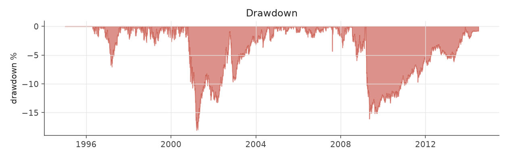
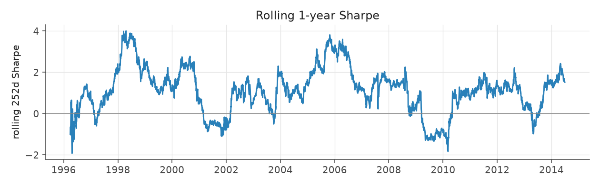
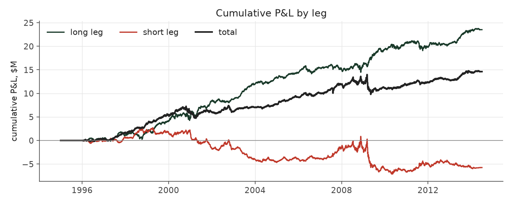
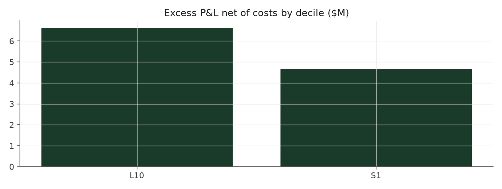

# size_balanced

_equity strategy | family: equity-baseline | status: validated | derived from `extreme_picks`_

## What this strategy does

Extreme Picks, with an equal budget for each of the five company sizes

**Why it should work.** PEAD is stronger in small caps; balancing by size keeps the edge but removes a size bet.

**Design notes** (from the strategy's source file).

Size Balanced -- Extreme Picks with an equal budget for each company-size group.

Extreme Picks' trade, but each leg's budget is spread evenly over the size quintiles present that quarter, so micro-caps (where most extreme surprises happen) cannot dominate the book.

| parameter | value |
|---|---|
| base_unit_fraction | 0.003 |
| max_gross_leverage | 1.5 |
| liquidity_cap_frac | 0.05 |
| return_basis | mktadj |
| cap_mode | proportional |
| exposure_cap | open_book |
| beta_overlay | 0.0 |

## Performance

| metric | size_balanced | market (CRSP VW) |
|---|---|---|
| Annualized return | 3.82% | 9.94% |
| Annualized volatility | 4.77% | 19.35% |
| Sharpe (NAV-pct) | 0.81 | 0.59 |
| Sortino | 1.13 |  |
| Max drawdown | -18.1% | -55.5% |
| Calmar | 0.21 |  |
| Final NAV ($10M start) | $20,749,649 |  |
| Worst day | -2.56% |  |
| % positive days | 50.7% |  |
| Sharpe 1996-2001 | 0.93 |  |
| Sharpe 2002-2007 | 1.44 |  |
| Sharpe 2008-2013 | 0.24 |  |

Correlation of daily returns with the market: **0.01**.

- best Sharpe among equity: `calm_rank_tilt` (1.47); this one: 0.81
- best return among equity: `market_boost_max` (0.116); this one: 0.0382
- best Calmar among equity: `calm_rank_tilt` (0.442); this one: 0.212

*NAV (log scale)*

*Drawdown from running peak*

*Calendar-year returns*

*Is the edge stable, or concentrated in a few years?*

## Where the return comes from

*Long leg vs. short leg vs. total*

|  | long leg | short leg |
|---|---|---|
| P&L ($M, before costs) | 18.69 | -5.14 |
| P&L after costs ($M) | 17.36 | -6.61 |
| of which common (average-event) component ($M) | 10.73 | -11.29 |
| of which excess / PEAD component ($M) | 7.96 | 6.15 |
| excess minus costs ($M) | 6.64 | 4.67 |
| gross return per $ traded (bp) | 276.40 | -72.18 |
| positions in the money (hit rate) | 0.57 | 0.49 |
| stand-alone Sharpe (leg only) | 1.09 | -0.27 |

Daily P&L correlation between the two legs: **-0.66**.

- **The short leg loses money in absolute terms** (-5.1M before costs) while the long leg earns +18.7M. That is mostly a benchmark effect, not a signal failure: the average earnings-event stock beat the cap-weighted market during its holding window, which flatters the long leg and hurts the short leg by 10.7M / 11.3M. Stripping that common component, the surprise signal itself earned +8.0M on the long side and +6.1M on the short side.
- The two legs' daily P&L are -0.66 correlated: the short leg is the hedge that makes the long leg's variance disappear (stand-alone leg Sharpe 1.09 long / -0.27 short vs 0.81 combined).

### By decile and side (signal-driven part only)

| leg | decile | positions | notional_M | net_pnl_M | excess_M | cost_M | alpha_net_M | alpha_share | alpha_bp_per_$ |
|---|---|---|---|---|---|---|---|---|---|
| long | 10 | 20,136 | 676.22 | 17.36 | 7.96 | 1.33 | 6.63 | 58.7% | 98.12 |
| short | 1 | 18,299 | 711.41 | -6.61 | 6.15 | 1.48 | 4.67 | 41.3% | 65.69 |

*D10 and the short deciles carry the alpha; the middle of each leg earns little*

### By size quintile (1 = smallest)

| size_quintile | positions | notional_M | net_pnl_M | excess_M | cost_M | alpha_net_M | alpha_share | alpha_bp_per_$ |
|---|---|---|---|---|---|---|---|---|
| 1 | 5,287 | 137.15 | -0.50 | 0.55 | 0.50 | 0.05 | 0.5% | 3.85 |
| 2 | 7,872 | 290.58 | 4.00 | 4.90 | 0.80 | 4.10 | 36.2% | 141.04 |
| 3 | 8,605 | 315.31 | 3.94 | 4.50 | 0.65 | 3.85 | 34.1% | 122.22 |
| 4 | 8,744 | 321.55 | 1.92 | 2.42 | 0.50 | 1.92 | 16.9% | 59.55 |
| 5 | 7,927 | 323.05 | 1.39 | 1.75 | 0.36 | 1.39 | 12.3% | 42.99 |

### By liquidity quintile (1 = least liquid)

| liquidity_quintile | positions | notional_M | net_pnl_M | excess_M | cost_M | alpha_net_M | alpha_share | alpha_bp_per_$ |
|---|---|---|---|---|---|---|---|---|
| 1 | 4,793 | 86.25 | 1.63 | 2.37 | 0.43 | 1.94 | 17.2% | 225.26 |
| 2 | 7,905 | 297.87 | 1.45 | 2.82 | 0.89 | 1.93 | 17.1% | 64.75 |
| 3 | 8,745 | 341.48 | 4.54 | 5.37 | 0.68 | 4.69 | 41.5% | 137.36 |
| 4 | 8,837 | 339.62 | 1.21 | 1.71 | 0.47 | 1.23 | 10.9% | 36.30 |
| 5 | 8,153 | 322.31 | 1.94 | 1.86 | 0.32 | 1.53 | 13.6% | 47.64 |

### By holding-window length

| hold_bucket | positions | notional_M | net_pnl_M | excess_M | cost_M | alpha_net_M | alpha_share | alpha_bp_per_$ |
|---|---|---|---|---|---|---|---|---|
| <=40d | 7,482 | 325.98 | 0.95 | 5.04 | 0.61 | 4.42 | 39.1% | 135.71 |
| 41-60d | 11,345 | 387.22 | -0.23 | 1.45 | 0.86 | 0.58 | 5.2% | 15.05 |
| 61-90d | 17,258 | 600.32 | 6.54 | 4.93 | 1.13 | 3.80 | 33.6% | 63.34 |
| >90d | 2,350 | 74.11 | 3.49 | 2.70 | 0.20 | 2.50 | 22.1% | 337.12 |

### By era

| era | positions | notional_M | net_pnl_M | excess_M | cost_M | alpha_net_M | alpha_share | alpha_bp_per_$ |
|---|---|---|---|---|---|---|---|---|
| 1996-01 | 10,157 | 351.52 | 3.80 | 4.59 | 0.67 | 3.92 | 34.7% | 111.48 |
| 2002-07 | 13,612 | 479.65 | 5.38 | 6.39 | 0.96 | 5.44 | 48.1% | 113.34 |
| 2008-13 | 14,666 | 556.46 | 1.57 | 3.13 | 1.18 | 1.95 | 17.3% | 35.09 |

### By FF12 sector

| ff12_sector | positions | notional_M | net_pnl_M | excess_M | cost_M | alpha_net_M | alpha_share | alpha_bp_per_$ |
|---|---|---|---|---|---|---|---|---|
| BusEq | 7,541 | 268.24 | 1.30 | 0.68 | 0.54 | 0.14 | 1.3% | 5.29 |
| Chems | 776 | 27.88 | 0.02 | 0.12 | 0.05 | 0.07 | 0.6% | 24.42 |
| Durbl | 990 | 34.25 | 0.16 | 0.37 | 0.07 | 0.29 | 2.6% | 86.04 |
| Enrgy | 1,529 | 58.75 | 1.23 | 1.43 | 0.12 | 1.31 | 11.6% | 223.64 |
| Hlth | 3,443 | 120.86 | 0.93 | 0.73 | 0.26 | 0.47 | 4.2% | 39.03 |
| Manuf | 4,089 | 144.11 | 0.33 | 1.08 | 0.29 | 0.79 | 7.0% | 55.08 |
| Money | 5,981 | 219.86 | 1.37 | 2.95 | 0.44 | 2.52 | 22.2% | 114.41 |
| NoDur | 1,707 | 60.78 | 0.46 | 0.55 | 0.12 | 0.43 | 3.8% | 70.21 |
| Other | 5,674 | 202.06 | 2.27 | 2.72 | 0.45 | 2.27 | 20.1% | 112.41 |
| Shops | 3,935 | 140.88 | 2.19 | 2.54 | 0.28 | 2.25 | 19.9% | 160.03 |
| Telcm | 1,293 | 50.55 | 0.54 | 0.76 | 0.10 | 0.67 | 5.9% | 132.17 |
| Utils | 1,477 | 59.41 | -0.05 | 0.19 | 0.10 | 0.09 | 0.8% | 14.83 |

### By idiosyncratic-volatility tercile

| vol_tercile | positions | notional_M | net_pnl_M | excess_M | cost_M | alpha_net_M | alpha_share | alpha_bp_per_$ |
|---|---|---|---|---|---|---|---|---|
| high vol | 12,942 | 467.67 | 0.46 | 1.60 | 0.85 | 0.75 | 6.6% | 16.00 |
| low vol | 12,792 | 453.85 | 5.46 | 6.73 | 1.01 | 5.71 | 50.5% | 125.92 |
| mid vol | 12,052 | 436.63 | 4.26 | 5.22 | 0.88 | 4.34 | 38.4% | 99.37 |

### Short-borrow sensitivity (not modeled in the backtest)

| borrow_rate | fee_M | annualized_return | drag |
|---|---|---|---|
| 0.0% | 0.0 | 3.82% | 0.00% |
| 0.5% | 0.7 | 3.63% | 0.19% |
| 1.0% | 1.5 | 3.43% | 0.39% |
| 2.0% | 2.9 | 3.01% | 0.81% |
| 5.0% | 7.3 | 1.52% | 2.30% |

The engine charges the same transaction cost on shorts as on longs and no stock-borrow fee. The short leg is concentrated in small, illiquid names, where borrow is scarce and expensive -- read the table as a floor on the cost of running the short leg.
