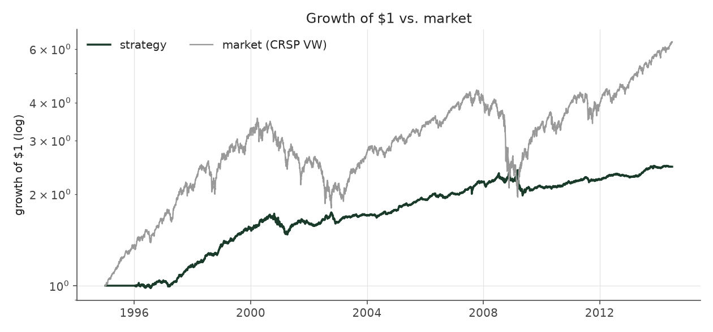
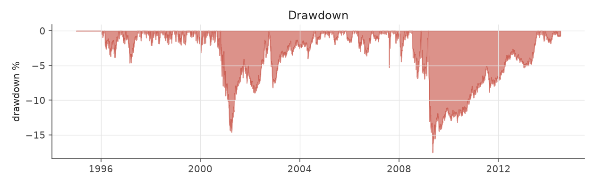
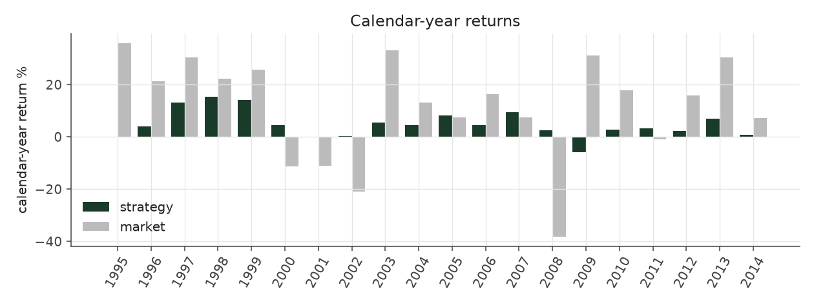
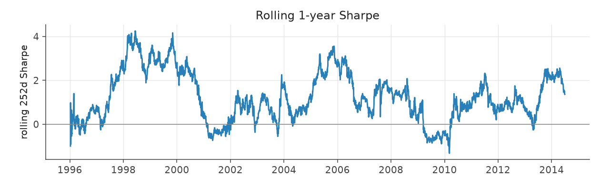
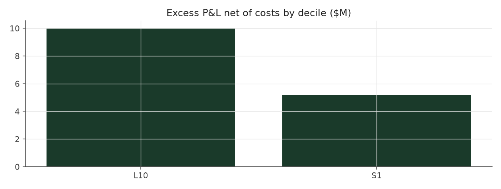

# size_balanced_legacy

_equity strategy | family: equity-baseline | status: reference | derived from `size_balanced`_

## What this strategy does

Extreme Picks, with an equal budget for each of the five company sizes -- ORIGINAL leverage cap (new positions only, open book ignored)

**Why it should work.** PEAD is stronger in small caps; balancing by size keeps the edge but removes a size bet.

**Design notes** (from the strategy's source file).

Size Balanced -- Extreme Picks with an equal budget for each company-size group.

Extreme Picks' trade, but each leg's budget is spread evenly over the size quintiles present that quarter, so micro-caps (where most extreme surprises happen) cannot dominate the book.

| parameter | value |
|---|---|
| base_unit_fraction | 0.003 |
| max_gross_leverage | 1.5 |
| liquidity_cap_frac | 0.05 |
| return_basis | mktadj |
| cap_mode | proportional |
| exposure_cap | entry_cohort |
| beta_overlay | 0.0 |

## Performance

| metric | size_balanced_legacy | market (CRSP VW) |
|---|---|---|
| Annualized return | 4.74% | 9.94% |
| Annualized volatility | 5.26% | 19.35% |
| Sharpe (NAV-pct) | 0.91 | 0.59 |
| Sortino | 1.26 |  |
| Max drawdown | -17.5% | -55.5% |
| Calmar | 0.27 |  |
| Final NAV ($10M start) | $24,622,256 |  |
| Worst day | -4.30% |  |
| % positive days | 52.2% |  |
| Sharpe 1996-2001 | 1.32 |  |
| Sharpe 2002-2007 | 1.28 |  |
| Sharpe 2008-2013 | 0.34 |  |

Correlation of daily returns with the market: **0.00**.

- best Sharpe among equity: `calm_rank_tilt` (1.47); this one: 0.906
- best return among equity: `market_boost_max` (0.116); this one: 0.0474
- best Calmar among equity: `calm_rank_tilt` (0.442); this one: 0.27

*NAV (log scale)*

*Drawdown from running peak*

*Calendar-year returns*

*Is the edge stable, or concentrated in a few years?*

## Where the return comes from

*Long leg vs. short leg vs. total*

|  | long leg | short leg |
|---|---|---|
| P&L ($M, before costs) | 23.53 | -5.75 |
| P&L after costs ($M) | 22.05 | -7.43 |
| of which common (average-event) component ($M) | 11.79 | -12.31 |
| of which excess / PEAD component ($M) | 11.52 | 6.84 |
| excess minus costs ($M) | 10.05 | 5.17 |
| gross return per $ traded (bp) | 309.93 | -70.95 |
| positions in the money (hit rate) | 0.57 | 0.49 |
| stand-alone Sharpe (leg only) | 1.16 | -0.23 |

Daily P&L correlation between the two legs: **-0.64**.

- **The short leg loses money in absolute terms** (-5.7M before costs) while the long leg earns +23.5M. That is mostly a benchmark effect, not a signal failure: the average earnings-event stock beat the cap-weighted market during its holding window, which flatters the long leg and hurts the short leg by 11.8M / 12.3M. Stripping that common component, the surprise signal itself earned +11.5M on the long side and +6.8M on the short side.
- The two legs' daily P&L are -0.64 correlated: the short leg is the hedge that makes the long leg's variance disappear (stand-alone leg Sharpe 1.16 long / -0.23 short vs 0.91 combined).

### By decile and side (signal-driven part only)

| leg | decile | positions | notional_M | net_pnl_M | excess_M | cost_M | alpha_net_M | alpha_share | alpha_bp_per_$ |
|---|---|---|---|---|---|---|---|---|---|
| long | 10 | 17,174 | 759.10 | 22.05 | 11.52 | 1.48 | 10.04 | 66.0% | 132.28 |
| short | 1 | 17,169 | 809.89 | -7.43 | 6.84 | 1.68 | 5.16 | 33.9% | 63.71 |

*D10 and the short deciles carry the alpha; the middle of each leg earns little*

### By size quintile (1 = smallest)

| size_quintile | positions | notional_M | net_pnl_M | excess_M | cost_M | alpha_net_M | alpha_share | alpha_bp_per_$ |
|---|---|---|---|---|---|---|---|---|
| 1 | 4,832 | 149.12 | 2.16 | 3.46 | 0.54 | 2.92 | 19.2% | 195.53 |
| 2 | 7,159 | 327.44 | 4.51 | 5.52 | 0.90 | 4.62 | 30.4% | 141.06 |
| 3 | 7,735 | 358.82 | 5.24 | 5.68 | 0.74 | 4.95 | 32.5% | 137.85 |
| 4 | 7,731 | 365.93 | 1.70 | 2.24 | 0.57 | 1.67 | 11.0% | 45.67 |
| 5 | 6,886 | 367.69 | 1.01 | 1.46 | 0.41 | 1.05 | 6.9% | 28.52 |

### By liquidity quintile (1 = least liquid)

| liquidity_quintile | positions | notional_M | net_pnl_M | excess_M | cost_M | alpha_net_M | alpha_share | alpha_bp_per_$ |
|---|---|---|---|---|---|---|---|---|
| 1 | 4,357 | 93.37 | 2.65 | 3.32 | 0.47 | 2.85 | 18.8% | 305.74 |
| 2 | 7,223 | 337.61 | 3.47 | 5.08 | 1.01 | 4.07 | 26.7% | 120.39 |
| 3 | 7,834 | 386.64 | 5.77 | 6.92 | 0.77 | 6.15 | 40.4% | 159.06 |
| 4 | 7,850 | 385.18 | 1.56 | 1.96 | 0.54 | 1.42 | 9.3% | 36.90 |
| 5 | 7,077 | 366.08 | 1.20 | 1.10 | 0.37 | 0.73 | 4.8% | 20.03 |

### By holding-window length

| hold_bucket | positions | notional_M | net_pnl_M | excess_M | cost_M | alpha_net_M | alpha_share | alpha_bp_per_$ |
|---|---|---|---|---|---|---|---|---|
| <=40d | 6,338 | 335.10 | -0.26 | 3.22 | 0.51 | 2.71 | 17.8% | 80.89 |
| 41-60d | 11,202 | 486.79 | 1.49 | 2.28 | 0.99 | 1.29 | 8.5% | 26.50 |
| 61-90d | 12,665 | 583.62 | 5.83 | 5.16 | 1.17 | 3.99 | 26.2% | 68.30 |
| >90d | 4,138 | 163.48 | 7.56 | 7.70 | 0.48 | 7.21 | 47.4% | 441.30 |

### By era

| era | positions | notional_M | net_pnl_M | excess_M | cost_M | alpha_net_M | alpha_share | alpha_bp_per_$ |
|---|---|---|---|---|---|---|---|---|
| 1996-01 | 9,920 | 371.88 | 5.68 | 6.59 | 0.71 | 5.88 | 38.6% | 158.13 |
| 2002-07 | 11,506 | 527.09 | 5.64 | 6.76 | 1.04 | 5.71 | 37.6% | 108.41 |
| 2008-13 | 12,917 | 670.02 | 3.30 | 5.01 | 1.41 | 3.61 | 23.7% | 53.82 |

### By FF12 sector

| ff12_sector | positions | notional_M | net_pnl_M | excess_M | cost_M | alpha_net_M | alpha_share | alpha_bp_per_$ |
|---|---|---|---|---|---|---|---|---|
| BusEq | 6,718 | 298.31 | 2.57 | 1.99 | 0.59 | 1.40 | 9.2% | 46.90 |
| Chems | 687 | 31.76 | -0.19 | -0.12 | 0.06 | -0.18 | -1.2% | -57.47 |
| Durbl | 869 | 38.28 | 0.26 | 0.50 | 0.08 | 0.42 | 2.7% | 109.15 |
| Enrgy | 1,375 | 66.03 | 1.65 | 1.81 | 0.13 | 1.67 | 11.0% | 253.51 |
| Hlth | 3,037 | 133.90 | 1.35 | 1.10 | 0.29 | 0.81 | 5.3% | 60.51 |
| Manuf | 3,627 | 163.12 | 0.76 | 1.40 | 0.32 | 1.08 | 7.1% | 66.19 |
| Money | 5,366 | 255.16 | 1.65 | 3.65 | 0.50 | 3.15 | 20.7% | 123.40 |
| NoDur | 1,540 | 71.33 | 0.94 | 1.00 | 0.14 | 0.86 | 5.7% | 121.30 |
| Other | 5,074 | 228.66 | 2.19 | 2.66 | 0.51 | 2.15 | 14.2% | 94.25 |
| Shops | 3,547 | 160.84 | 2.53 | 2.99 | 0.32 | 2.67 | 17.6% | 166.20 |
| Telcm | 1,164 | 55.57 | 0.74 | 1.01 | 0.11 | 0.90 | 5.9% | 162.04 |
| Utils | 1,339 | 66.02 | 0.17 | 0.37 | 0.11 | 0.26 | 1.7% | 39.41 |

### By idiosyncratic-volatility tercile

| vol_tercile | positions | notional_M | net_pnl_M | excess_M | cost_M | alpha_net_M | alpha_share | alpha_bp_per_$ |
|---|---|---|---|---|---|---|---|---|
| high vol | 11,517 | 531.47 | 2.60 | 4.04 | 0.96 | 3.08 | 20.2% | 57.96 |
| low vol | 11,554 | 516.11 | 6.39 | 7.82 | 1.15 | 6.67 | 43.9% | 129.31 |
| mid vol | 10,730 | 492.43 | 5.30 | 6.13 | 0.99 | 5.14 | 33.8% | 104.38 |

### Short-borrow sensitivity (not modeled in the backtest)

| borrow_rate | fee_M | annualized_return | drag |
|---|---|---|---|
| 0.0% | 0.0 | 4.74% | 0.00% |
| 0.5% | 0.9 | 4.53% | 0.20% |
| 1.0% | 1.8 | 4.32% | 0.41% |
| 2.0% | 3.6 | 3.88% | 0.85% |
| 5.0% | 9.1 | 2.29% | 2.44% |

The engine charges the same transaction cost on shorts as on longs and no stock-borrow fee. The short leg is concentrated in small, illiquid names, where borrow is scarce and expensive -- read the table as a floor on the cost of running the short leg.
