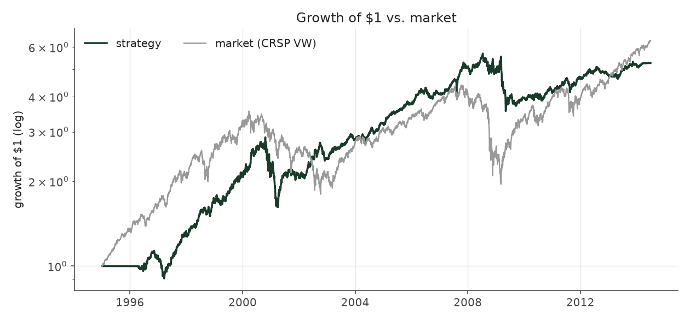
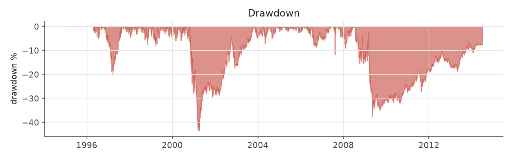
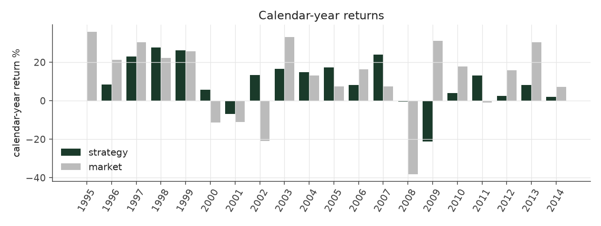
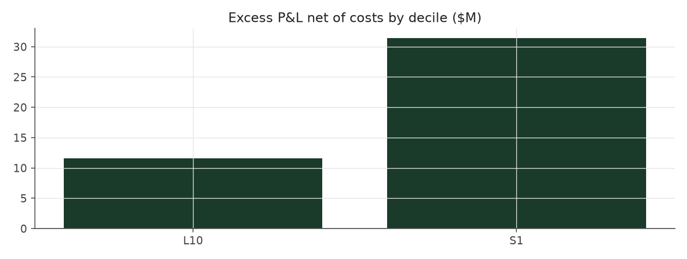

# size_balanced_max

_equity strategy | family: equity-max | status: research | derived from `size_balanced`_

## What this strategy does

size_balanced with bigger bets for more return: base unit 0.009, 6x leverage cap

**Why it should work.** PEAD is stronger in small caps; balancing by size keeps the edge but removes a size bet.

**Design notes** (from the strategy's source file).

Max-size variants ("<name>_max") of the hand-built equity strategies.

Same signal, trim, tilt and neutralization as each base strategy; only the two dials that set how big and how levered the book is change (base_unit_fraction, gross-leverage cap = 6x). The multiplier for each was picked by sweeping 1.5x..12x the original base unit and taking the highest return subject to Sharpe >= 0.6 and max drawdown >= -40% (a worse drawdown is a fund-ending event, not a risk preference). The untouched 5%-of-ADV liquidity cap remains the real capacity constraint, and bites roughly four times as often at this sizing.

These are generated from the base strategy classes, so a change to a base strategy's weights flows through automatically.

| parameter | value |
|---|---|
| base_unit_fraction | 0.009 |
| max_gross_leverage | 6.0 |
| liquidity_cap_frac | 0.05 |
| return_basis | mktadj |
| cap_mode | proportional |
| exposure_cap | open_book |
| beta_overlay | 0.0 |

## Performance

| metric | size_balanced_max | market (CRSP VW) |
|---|---|---|
| Annualized return | 8.90% | 9.94% |
| Annualized volatility | 13.00% | 19.35% |
| Sharpe (NAV-pct) | 0.72 | 0.59 |
| Sortino | 1.02 |  |
| Max drawdown | -43.6% | -55.5% |
| Calmar | 0.20 |  |
| Final NAV ($10M start) | $52,667,008 |  |
| Worst day | -7.15% |  |
| % positive days | 49.8% |  |
| Sharpe 1996-2001 | 0.82 |  |
| Sharpe 2002-2007 | 1.52 |  |
| Sharpe 2008-2013 | 0.09 |  |

Correlation of daily returns with the market: **0.04**.

- best Sharpe among equity: `calm_rank_tilt` (1.47); this one: 0.721
- best return among equity: `market_boost_max` (0.116); this one: 0.089
- best Calmar among equity: `calm_rank_tilt` (0.442); this one: 0.204

*NAV (log scale)*

*Drawdown from running peak*

*Calendar-year returns*

*Is the edge stable, or concentrated in a few years?*

## Where the return comes from

*Long leg vs. short leg vs. total*

|  | long leg | short leg |
|---|---|---|
| P&L ($M, before costs) | 72.35 | -17.86 |
| P&L after costs ($M) | 66.58 | -23.92 |
| of which common (average-event) component ($M) | 54.98 | -55.35 |
| of which excess / PEAD component ($M) | 17.37 | 37.49 |
| excess minus costs ($M) | 11.60 | 31.43 |
| gross return per $ traded (bp) | 202.09 | -49.26 |
| positions in the money (hit rate) | 0.57 | 0.49 |
| stand-alone Sharpe (leg only) | 0.91 | -0.19 |

Daily P&L correlation between the two legs: **-0.60**.

- **The short leg loses money in absolute terms** (-17.9M before costs) while the long leg earns +72.4M. That is mostly a benchmark effect, not a signal failure: the average earnings-event stock beat the cap-weighted market during its holding window, which flatters the long leg and hurts the short leg by 55.0M / 55.3M. Stripping that common component, the surprise signal itself earned +17.4M on the long side and +37.5M on the short side.
- The two legs' daily P&L are -0.60 correlated: the short leg is the hedge that makes the long leg's variance disappear (stand-alone leg Sharpe 0.91 long / -0.19 short vs 0.72 combined).

### By decile and side (signal-driven part only)

| leg | decile | positions | notional_M | net_pnl_M | excess_M | cost_M | alpha_net_M | alpha_share | alpha_bp_per_$ |
|---|---|---|---|---|---|---|---|---|---|
| long | 10 | 20,136 | 3,580.12 | 66.58 | 17.37 | 5.77 | 11.60 | 27.0% | 32.40 |
| short | 1 | 18,299 | 3,625.91 | -23.92 | 37.48 | 6.05 | 31.43 | 73.0% | 86.68 |

*D10 and the short deciles carry the alpha; the middle of each leg earns little*

### By size quintile (1 = smallest)

| size_quintile | positions | notional_M | net_pnl_M | excess_M | cost_M | alpha_net_M | alpha_share | alpha_bp_per_$ |
|---|---|---|---|---|---|---|---|---|
| 1 | 5,287 | 242.20 | -4.46 | -2.52 | 0.78 | -3.29 | -7.7% | -136.03 |
| 2 | 7,872 | 960.78 | 10.40 | 13.94 | 2.29 | 11.65 | 27.1% | 121.25 |
| 3 | 8,605 | 1,714.13 | 18.98 | 21.21 | 3.23 | 17.98 | 41.8% | 104.91 |
| 4 | 8,744 | 2,082.80 | 9.44 | 11.76 | 3.10 | 8.66 | 20.1% | 41.56 |
| 5 | 7,927 | 2,206.13 | 8.31 | 10.46 | 2.42 | 8.04 | 18.7% | 36.43 |

### By liquidity quintile (1 = least liquid)

| liquidity_quintile | positions | notional_M | net_pnl_M | excess_M | cost_M | alpha_net_M | alpha_share | alpha_bp_per_$ |
|---|---|---|---|---|---|---|---|---|
| 1 | 4,793 | 105.11 | 2.20 | 3.07 | 0.53 | 2.54 | 5.9% | 242.12 |
| 2 | 7,905 | 695.75 | 2.26 | 5.59 | 2.09 | 3.50 | 8.1% | 50.36 |
| 3 | 8,745 | 1,876.49 | 20.78 | 25.47 | 3.75 | 21.71 | 50.5% | 115.71 |
| 4 | 8,837 | 2,320.37 | 3.77 | 7.19 | 3.25 | 3.94 | 9.2% | 16.97 |
| 5 | 8,153 | 2,207.82 | 13.76 | 13.64 | 2.21 | 11.43 | 26.6% | 51.78 |

### By holding-window length

| hold_bucket | positions | notional_M | net_pnl_M | excess_M | cost_M | alpha_net_M | alpha_share | alpha_bp_per_$ |
|---|---|---|---|---|---|---|---|---|
| <=40d | 7,482 | 1,735.24 | 3.87 | 28.13 | 2.70 | 25.43 | 59.1% | 146.55 |
| 41-60d | 11,345 | 1,880.76 | 2.18 | 8.33 | 3.32 | 5.01 | 11.6% | 26.64 |
| 61-90d | 17,258 | 3,304.06 | 25.59 | 9.85 | 5.18 | 4.66 | 10.8% | 14.12 |
| >90d | 2,350 | 285.98 | 11.03 | 8.55 | 0.62 | 7.93 | 18.4% | 277.14 |

### By era

| era | positions | notional_M | net_pnl_M | excess_M | cost_M | alpha_net_M | alpha_share | alpha_bp_per_$ |
|---|---|---|---|---|---|---|---|---|
| 1996-01 | 10,157 | 1,151.50 | 11.16 | 12.37 | 1.82 | 10.55 | 24.5% | 91.60 |
| 2002-07 | 13,612 | 2,526.59 | 27.84 | 30.31 | 4.13 | 26.18 | 60.8% | 103.62 |
| 2008-13 | 14,666 | 3,527.95 | 3.66 | 12.18 | 5.87 | 6.30 | 14.6% | 17.86 |

### By FF12 sector

| ff12_sector | positions | notional_M | net_pnl_M | excess_M | cost_M | alpha_net_M | alpha_share | alpha_bp_per_$ |
|---|---|---|---|---|---|---|---|---|
| BusEq | 7,541 | 1,314.18 | 6.42 | 2.23 | 2.13 | 0.10 | 0.2% | 0.77 |
| Chems | 776 | 160.77 | 1.24 | 1.77 | 0.26 | 1.52 | 3.5% | 94.31 |
| Durbl | 990 | 163.59 | -0.74 | 0.28 | 0.28 | -0.01 | -0.0% | -0.60 |
| Enrgy | 1,529 | 318.94 | 6.24 | 7.31 | 0.51 | 6.79 | 15.8% | 213.03 |
| Hlth | 3,443 | 592.72 | 4.89 | 3.10 | 1.01 | 2.09 | 4.9% | 35.33 |
| Manuf | 4,089 | 762.89 | 0.88 | 3.98 | 1.23 | 2.75 | 6.4% | 36.07 |
| Money | 5,981 | 1,218.29 | 3.03 | 10.99 | 1.97 | 9.02 | 21.0% | 74.06 |
| NoDur | 1,707 | 331.01 | 2.58 | 2.92 | 0.54 | 2.38 | 5.5% | 71.91 |
| Other | 5,674 | 1,008.37 | 9.68 | 10.91 | 1.78 | 9.14 | 21.2% | 90.61 |
| Shops | 3,935 | 732.24 | 6.96 | 7.77 | 1.20 | 6.58 | 15.3% | 89.79 |
| Telcm | 1,293 | 252.06 | 1.97 | 2.99 | 0.39 | 2.60 | 6.0% | 103.10 |
| Utils | 1,477 | 350.99 | -0.48 | 0.60 | 0.54 | 0.07 | 0.2% | 1.97 |

### By idiosyncratic-volatility tercile

| vol_tercile | positions | notional_M | net_pnl_M | excess_M | cost_M | alpha_net_M | alpha_share | alpha_bp_per_$ |
|---|---|---|---|---|---|---|---|---|
| high vol | 12,942 | 2,617.72 | 3.20 | 9.22 | 3.98 | 5.24 | 12.2% | 20.00 |
| low vol | 12,792 | 2,201.21 | 20.35 | 23.65 | 3.90 | 19.75 | 45.9% | 89.70 |
| mid vol | 12,052 | 2,286.11 | 18.34 | 21.21 | 3.76 | 17.45 | 40.5% | 76.33 |

### Short-borrow sensitivity (not modeled in the backtest)

| borrow_rate | fee_M | annualized_return | drag |
|---|---|---|---|
| 0.0% | 0.0 | 8.90% | -0.00% |
| 0.5% | 3.6 | 8.51% | 0.40% |
| 1.0% | 7.3 | 8.08% | 0.83% |
| 2.0% | 14.6 | 7.11% | 1.79% |
| 5.0% | 36.4 | 2.53% | 6.37% |

The engine charges the same transaction cost on shorts as on longs and no stock-borrow fee. The short leg is concentrated in small, illiquid names, where borrow is scarce and expensive -- read the table as a floor on the cost of running the short leg.
