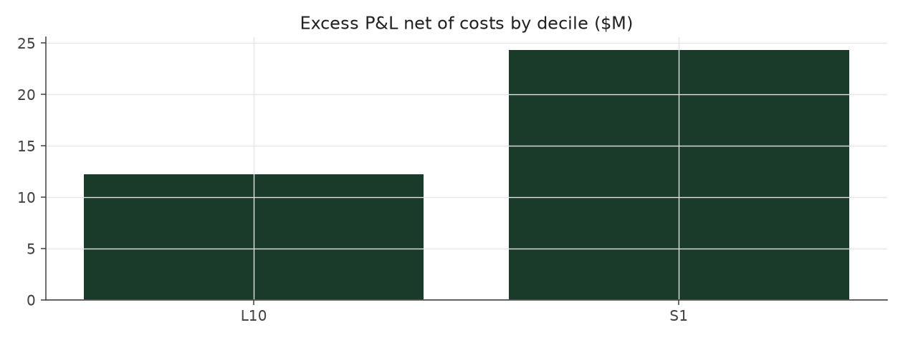

# size_balanced_max_legacy

_equity strategy | family: equity-max | status: reference | derived from `size_balanced_max`_

## What this strategy does

size_balanced with bigger bets for more return: base unit 0.009, 6x leverage cap -- ORIGINAL leverage cap (new positions only, open book ignored)

**Why it should work.** PEAD is stronger in small caps; balancing by size keeps the edge but removes a size bet.

**Design notes** (from the strategy's source file).

Max-size variants ("<name>_max") of the hand-built equity strategies.

Same signal, trim, tilt and neutralization as each base strategy; only the two dials that set how big and how levered the book is change (base_unit_fraction, gross-leverage cap = 6x). The multiplier for each was picked by sweeping 1.5x..12x the original base unit and taking the highest return subject to Sharpe >= 0.6 and max drawdown >= -40% (a worse drawdown is a fund-ending event, not a risk preference). The untouched 5%-of-ADV liquidity cap remains the real capacity constraint, and bites roughly four times as often at this sizing.

These are generated from the base strategy classes, so a change to a base strategy's weights flows through automatically.

| parameter | value |
|---|---|
| base_unit_fraction | 0.009 |
| max_gross_leverage | 6.0 |
| liquidity_cap_frac | 0.05 |
| return_basis | mktadj |
| cap_mode | proportional |
| exposure_cap | entry_cohort |
| beta_overlay | 0.0 |

## Performance

| metric | size_balanced_max_legacy | market (CRSP VW) |
|---|---|---|
| Annualized return | 8.45% | 9.94% |
| Annualized volatility | 12.26% | 19.35% |
| Sharpe (NAV-pct) | 0.72 | 0.59 |
| Sortino | 1.01 |  |
| Max drawdown | -37.5% | -55.5% |
| Calmar | 0.23 |  |
| Final NAV ($10M start) | $48,527,312 |  |
| Worst day | -7.65% |  |
| % positive days | 51.2% |  |
| Sharpe 1996-2001 | 1.00 |  |
| Sharpe 2002-2007 | 1.52 |  |
| Sharpe 2008-2013 | 0.03 |  |

Correlation of daily returns with the market: **0.00**.

- best Sharpe among equity: `calm_rank_tilt` (1.47); this one: 0.723
- best return among equity: `market_boost_max` (0.116); this one: 0.0845
- best Calmar among equity: `calm_rank_tilt` (0.442); this one: 0.226

*NAV (log scale)*

*Drawdown from running peak*

*Calendar-year returns*

*Is the edge stable, or concentrated in a few years?*

## Where the return comes from

*Long leg vs. short leg vs. total*

|  | long leg | short leg |
|---|---|---|
| P&L ($M, before costs) | 67.08 | -18.11 |
| P&L after costs ($M) | 62.06 | -23.53 |
| of which common (average-event) component ($M) | 49.67 | -47.83 |
| of which excess / PEAD component ($M) | 17.28 | 29.76 |
| excess minus costs ($M) | 12.27 | 24.35 |
| gross return per $ traded (bp) | 215.17 | -56.29 |
| positions in the money (hit rate) | 0.57 | 0.49 |
| stand-alone Sharpe (leg only) | 0.95 | -0.15 |

Daily P&L correlation between the two legs: **-0.54**.

- **The short leg loses money in absolute terms** (-18.1M before costs) while the long leg earns +67.1M. That is mostly a benchmark effect, not a signal failure: the average earnings-event stock beat the cap-weighted market during its holding window, which flatters the long leg and hurts the short leg by 49.7M / 47.8M. Stripping that common component, the surprise signal itself earned +17.3M on the long side and +29.8M on the short side.
- The two legs' daily P&L are -0.54 correlated: the short leg is the hedge that makes the long leg's variance disappear (stand-alone leg Sharpe 0.95 long / -0.15 short vs 0.72 combined).

### By decile and side (signal-driven part only)

| leg | decile | positions | notional_M | net_pnl_M | excess_M | cost_M | alpha_net_M | alpha_share | alpha_bp_per_$ |
|---|---|---|---|---|---|---|---|---|---|
| long | 10 | 17,174 | 3,117.40 | 62.06 | 17.28 | 5.02 | 12.26 | 33.5% | 39.34 |
| short | 1 | 17,169 | 3,218.32 | -23.53 | 29.76 | 5.42 | 24.34 | 66.5% | 75.63 |

*D10 and the short deciles carry the alpha; the middle of each leg earns little*

### By size quintile (1 = smallest)

| size_quintile | positions | notional_M | net_pnl_M | excess_M | cost_M | alpha_net_M | alpha_share | alpha_bp_per_$ |
|---|---|---|---|---|---|---|---|---|
| 1 | 4,832 | 217.96 | 1.03 | 2.78 | 0.70 | 2.07 | 5.7% | 95.08 |
| 2 | 7,159 | 851.52 | 9.00 | 11.39 | 2.04 | 9.36 | 25.5% | 109.89 |
| 3 | 7,735 | 1,508.31 | 19.31 | 20.15 | 2.85 | 17.31 | 47.3% | 114.75 |
| 4 | 7,731 | 1,825.97 | 4.75 | 6.27 | 2.73 | 3.54 | 9.7% | 19.40 |
| 5 | 6,886 | 1,931.95 | 4.43 | 6.45 | 2.12 | 4.32 | 11.8% | 22.38 |

### By liquidity quintile (1 = least liquid)

| liquidity_quintile | positions | notional_M | net_pnl_M | excess_M | cost_M | alpha_net_M | alpha_share | alpha_bp_per_$ |
|---|---|---|---|---|---|---|---|---|
| 1 | 4,357 | 95.80 | 2.67 | 3.36 | 0.48 | 2.88 | 7.9% | 300.67 |
| 2 | 7,223 | 626.01 | 4.82 | 7.35 | 1.88 | 5.47 | 14.9% | 87.38 |
| 3 | 7,834 | 1,653.81 | 21.64 | 24.45 | 3.31 | 21.14 | 57.7% | 127.83 |
| 4 | 7,850 | 2,025.08 | 3.79 | 6.43 | 2.83 | 3.59 | 9.8% | 17.73 |
| 5 | 7,077 | 1,934.54 | 5.72 | 5.56 | 1.94 | 3.63 | 9.9% | 18.75 |

### By holding-window length

| hold_bucket | positions | notional_M | net_pnl_M | excess_M | cost_M | alpha_net_M | alpha_share | alpha_bp_per_$ |
|---|---|---|---|---|---|---|---|---|
| <=40d | 6,338 | 1,638.57 | -1.43 | 14.57 | 2.33 | 12.24 | 33.4% | 74.71 |
| 41-60d | 11,202 | 1,959.72 | 6.23 | 6.44 | 3.22 | 3.22 | 8.8% | 16.44 |
| 61-90d | 12,665 | 2,326.18 | 15.79 | 8.60 | 3.90 | 4.70 | 12.8% | 20.19 |
| >90d | 4,138 | 411.25 | 17.94 | 17.43 | 0.98 | 16.44 | 44.9% | 399.83 |

### By era

| era | positions | notional_M | net_pnl_M | excess_M | cost_M | alpha_net_M | alpha_share | alpha_bp_per_$ |
|---|---|---|---|---|---|---|---|---|
| 1996-01 | 9,920 | 1,114.42 | 12.42 | 13.36 | 1.76 | 11.60 | 31.7% | 104.09 |
| 2002-07 | 11,506 | 2,156.30 | 24.73 | 27.02 | 3.52 | 23.49 | 64.1% | 108.95 |
| 2008-13 | 12,917 | 3,064.99 | 1.38 | 6.66 | 5.15 | 1.51 | 4.1% | 4.93 |

### By FF12 sector

| ff12_sector | positions | notional_M | net_pnl_M | excess_M | cost_M | alpha_net_M | alpha_share | alpha_bp_per_$ |
|---|---|---|---|---|---|---|---|---|
| BusEq | 6,718 | 1,160.09 | 9.46 | 5.21 | 1.88 | 3.33 | 9.1% | 28.71 |
| Chems | 687 | 139.18 | 0.43 | 0.54 | 0.22 | 0.32 | 0.9% | 22.63 |
| Durbl | 869 | 140.56 | -0.42 | 0.35 | 0.25 | 0.10 | 0.3% | 7.37 |
| Enrgy | 1,375 | 271.72 | 5.57 | 6.24 | 0.44 | 5.80 | 15.8% | 213.39 |
| Hlth | 3,037 | 511.47 | 3.67 | 1.92 | 0.87 | 1.05 | 2.9% | 20.54 |
| Manuf | 3,627 | 669.11 | 1.81 | 3.76 | 1.08 | 2.67 | 7.3% | 39.96 |
| Money | 5,366 | 1,096.02 | 1.04 | 9.58 | 1.78 | 7.80 | 21.3% | 71.18 |
| NoDur | 1,540 | 295.77 | 2.35 | 2.46 | 0.48 | 1.98 | 5.4% | 66.94 |
| Other | 5,074 | 881.82 | 6.37 | 6.73 | 1.57 | 5.16 | 14.1% | 58.52 |
| Shops | 3,547 | 641.11 | 6.64 | 7.04 | 1.05 | 5.99 | 16.3% | 93.41 |
| Telcm | 1,164 | 224.12 | 1.16 | 2.13 | 0.35 | 1.79 | 4.9% | 79.76 |
| Utils | 1,339 | 304.75 | 0.44 | 1.08 | 0.47 | 0.61 | 1.7% | 20.12 |

### By idiosyncratic-volatility tercile

| vol_tercile | positions | notional_M | net_pnl_M | excess_M | cost_M | alpha_net_M | alpha_share | alpha_bp_per_$ |
|---|---|---|---|---|---|---|---|---|
| high vol | 11,517 | 2,311.71 | 3.82 | 9.45 | 3.51 | 5.94 | 16.2% | 25.68 |
| low vol | 11,554 | 1,942.27 | 17.45 | 19.82 | 3.47 | 16.35 | 44.6% | 84.16 |
| mid vol | 10,730 | 1,995.54 | 16.79 | 17.50 | 3.30 | 14.21 | 38.8% | 71.19 |

### Short-borrow sensitivity (not modeled in the backtest)

| borrow_rate | fee_M | annualized_return | drag |
|---|---|---|---|
| 0.0% | 0.0 | 8.45% | 0.00% |
| 0.5% | 3.4 | 8.05% | 0.40% |
| 1.0% | 6.8 | 7.62% | 0.83% |
| 2.0% | 13.5 | 6.64% | 1.80% |
| 5.0% | 33.8 | 2.00% | 6.44% |

The engine charges the same transaction cost on shorts as on longs and no stock-borrow fee. The short leg is concentrated in small, illiquid names, where borrow is scarce and expensive -- read the table as a floor on the cost of running the short leg.
