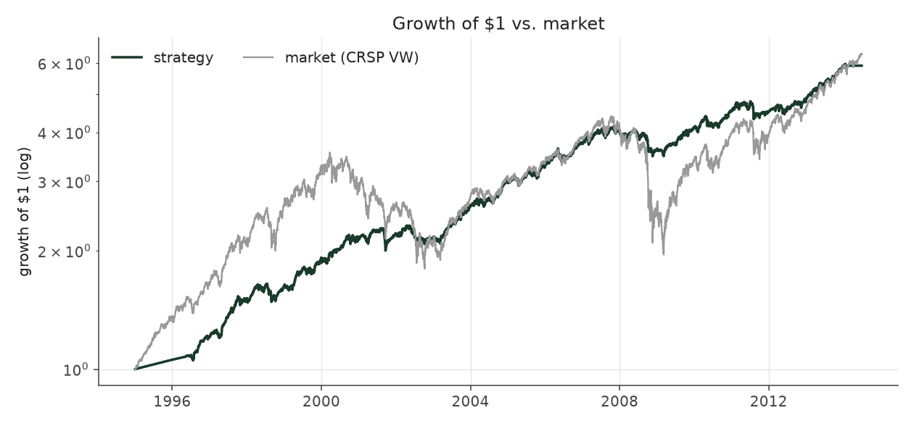
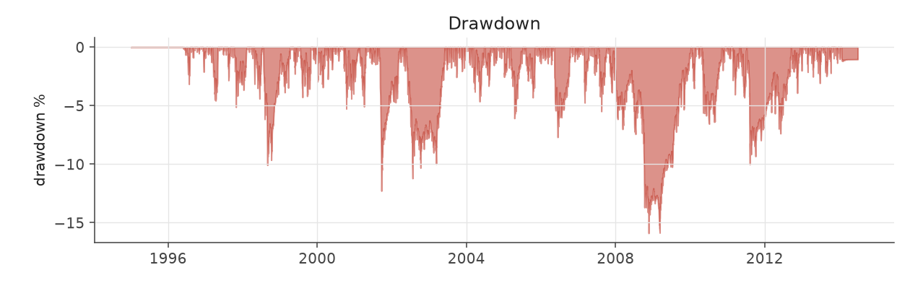
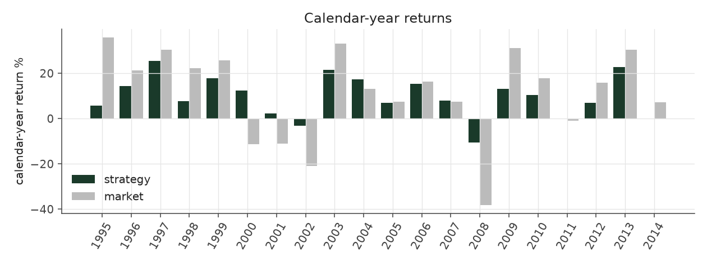
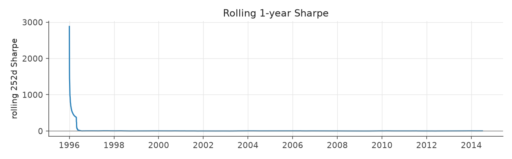
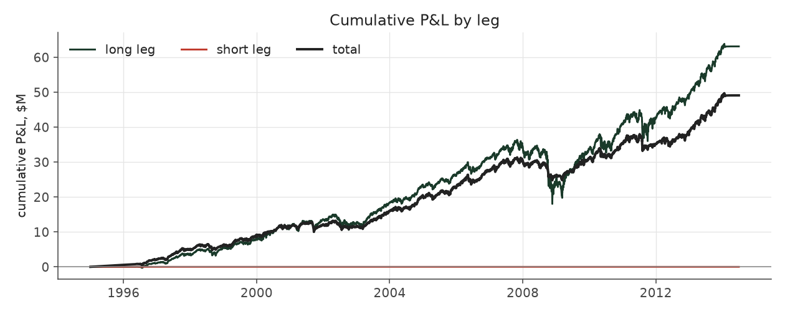
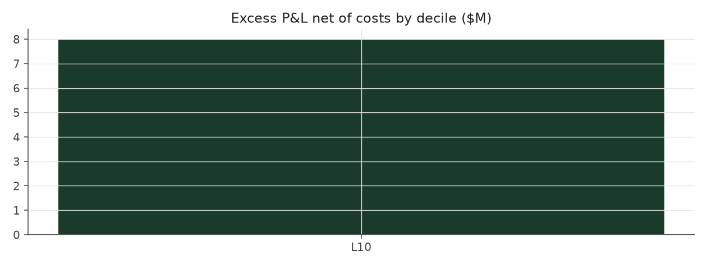

# steady_drift_calm

_equity strategy | family: equity-longonly | status: research | derived from `steady_drift`_

## What this strategy does

Steady Drift with the risk throttle at 8% volatility (smaller drawdowns, a little less return)

**Why it should work.** The paid leg of PEAD is the long side of the top surprise decile; size by calmness, never borrow, and keep book risk roughly constant so the edge is not swamped by market drawdowns.

**Design notes** (from the strategy's source file).

Steady Drift -- a long-only, never-borrowing PEAD book with a constant-risk throttle (research).

What it does * Buys only the best earnings surprises (top decile of the point-in-time SUE rank) in stocks that trade at least $2M a day, holds each for exactly 60 trading sessions, and never sells short. * Sizes each position by how calm the stock is (inverse idiosyncratic variance, relative to the typical stock of the past year), at most 2% of NAV per name and 5% of the stock's daily dollar volume. Positions are admitted in announcement order, so no decision depends on events that have not happened yet. * Total stock cost basis is capped at 70% of NAV; the rest is cash earning the Treasury-bill rate (not the index). * A risk throttle scales the whole book down when its recent volatility exceeds the target (never above 100% invested, so it can only reduce risk, never borrow).

Why: after the methodology fixes, every market-neutral book collapses to 1-3% a year once short collateral is counted (they tie up 1.2-5.6x NAV), and the options edge disappears at real bid/ask. What survives is the long side of the surprise signal; docs/STEADY_DRIFT.md and docs/META_STRATEGY.md carry the evidence and the shuffled-surprise placebo.

STATUS research: the design was chosen after seeing 1996-2013; a shuffled-surprise test shows about half of the excess return over the cap-weighted index is the event universe (small/mid-cap, low-vol), not surprise skill; the T-bill series is typed from memory (pead/core/rates.py).

| parameter | value |
|---|---|
| base_unit_fraction | 0.004 |
| max_gross_leverage | 0.7 |
| liquidity_cap_frac | 0.05 |
| return_basis | raw |
| cap_mode | chronological |
| exposure_cap | open_book |
| beta_overlay | 0.0 |
| hold_sessions | 60 |
| long_only_cash | True |
| risk_target_vol | 0.08 |
| name_cap_frac | 0.02 |

## Performance

| metric | steady_drift_calm | market (CRSP VW) |
|---|---|---|
| Annualized return | 9.55% | 9.94% |
| Annualized volatility | 7.81% | 19.35% |
| Sharpe (NAV-pct) | 1.21 | 0.59 |
| Sortino | 1.74 |  |
| Max drawdown | -15.9% | -55.5% |
| Calmar | 0.60 |  |
| Final NAV ($10M start) | $59,076,029 |  |
| Worst day | -4.33% |  |
| % positive days | 59.5% |  |
| Sharpe 1996-2001 | 1.61 |  |
| Sharpe 2002-2007 | 1.30 |  |
| Sharpe 2008-2013 | 0.79 |  |

Correlation of daily returns with the market: **0.84**.

- best Sharpe among equity: `calm_rank_tilt` (1.47); this one: 1.21
- best return among equity: `market_boost_max` (0.116); this one: 0.0955
- best Calmar among equity: this strategy; this one: 0.601

*NAV (log scale)*

*Drawdown from running peak*

*Calendar-year returns*

*Is the edge stable, or concentrated in a few years?*

## Where the return comes from

*Long leg vs. short leg vs. total*

|  | long leg | short leg |
|---|---|---|
| P&L ($M, before costs) | 63.10 | 0.00 |
| P&L after costs ($M) | 60.97 | 0.00 |
| of which common (average-event) component ($M) | 21.72 | 0.00 |
| of which excess / PEAD component ($M) | 10.14 | 0.00 |
| excess minus costs ($M) | 8.00 | 0.00 |
| gross return per $ traded (bp) | 405.42 | - |
| positions in the money (hit rate) | 0.64 | - |
| stand-alone Sharpe (leg only) | 0.86 | - |

Daily P&L correlation between the two legs: **nan**.

- The two legs' daily P&L are nan correlated: the short leg is the hedge that makes the long leg's variance disappear (stand-alone leg Sharpe 0.86 long / nan short vs 1.21 combined).

### By decile and side (signal-driven part only)

| leg | decile | positions | notional_M | net_pnl_M | excess_M | cost_M | alpha_net_M | alpha_share | alpha_bp_per_$ |
|---|---|---|---|---|---|---|---|---|---|
| long | 10 | 8,467 | 1,556.35 | 60.97 | 10.14 | 2.13 | 8.01 | 100.0% | 51.43 |

*D10 and the short deciles carry the alpha; the middle of each leg earns little*

### By size quintile (1 = smallest)

| size_quintile | positions | notional_M | net_pnl_M | excess_M | cost_M | alpha_net_M | alpha_share | alpha_bp_per_$ |
|---|---|---|---|---|---|---|---|---|
| 1 | 65 | 3.02 | 0.08 | -0.08 | 0.01 | -0.08 | -1.0% | -277.25 |
| 2 | 803 | 55.91 | 3.76 | 1.51 | 0.14 | 1.37 | 17.1% | 245.22 |
| 3 | 1,772 | 193.88 | 9.65 | 2.94 | 0.37 | 2.56 | 32.0% | 132.08 |
| 4 | 2,711 | 462.97 | 17.98 | 3.94 | 0.70 | 3.25 | 40.5% | 70.09 |
| 5 | 3,116 | 840.56 | 29.50 | 1.82 | 0.91 | 0.91 | 11.4% | 10.84 |

### By liquidity quintile (1 = least liquid)

| liquidity_quintile | positions | notional_M | net_pnl_M | excess_M | cost_M | alpha_net_M | alpha_share | alpha_bp_per_$ |
|---|---|---|---|---|---|---|---|---|
| 2 | 471 | 53.85 | 2.15 | 0.37 | 0.16 | 0.21 | 2.6% | 38.51 |
| 3 | 1,984 | 264.19 | 13.93 | 5.48 | 0.53 | 4.96 | 61.9% | 187.55 |
| 4 | 2,785 | 507.59 | 19.31 | 4.01 | 0.71 | 3.30 | 41.3% | 65.08 |
| 5 | 3,227 | 730.71 | 25.57 | 0.27 | 0.73 | -0.46 | -5.8% | -6.31 |

### By holding-window length

| hold_bucket | positions | notional_M | net_pnl_M | excess_M | cost_M | alpha_net_M | alpha_share | alpha_bp_per_$ |
|---|---|---|---|---|---|---|---|---|
| 41-60d | 8,467 | 1,556.35 | 60.97 | 10.14 | 2.13 | 8.01 | 100.0% | 51.43 |

### By era

| era | positions | notional_M | net_pnl_M | excess_M | cost_M | alpha_net_M | alpha_share | alpha_bp_per_$ |
|---|---|---|---|---|---|---|---|---|
| 1996-01 | 2,988 | 231.12 | 13.05 | 6.17 | 0.32 | 5.86 | 73.1% | 253.35 |
| 2002-07 | 2,537 | 527.79 | 17.84 | 5.83 | 0.70 | 5.13 | 64.1% | 97.25 |
| 2008-13 | 2,942 | 797.44 | 30.07 | -1.87 | 1.12 | -2.98 | -37.3% | -37.41 |

### By FF12 sector

| ff12_sector | positions | notional_M | net_pnl_M | excess_M | cost_M | alpha_net_M | alpha_share | alpha_bp_per_$ |
|---|---|---|---|---|---|---|---|---|
| BusEq | 2,075 | 263.14 | 11.67 | 2.37 | 0.36 | 2.01 | 25.1% | 76.40 |
| Chems | 200 | 57.34 | 2.72 | 1.56 | 0.08 | 1.48 | 18.5% | 257.75 |
| Durbl | 200 | 38.65 | 0.70 | -0.57 | 0.05 | -0.62 | -7.8% | -160.56 |
| Enrgy | 241 | 39.81 | 2.21 | 0.92 | 0.05 | 0.86 | 10.8% | 217.00 |
| Hlth | 664 | 127.99 | 3.97 | -0.36 | 0.16 | -0.52 | -6.5% | -40.87 |
| Manuf | 1,029 | 223.82 | 7.01 | 2.33 | 0.30 | 2.03 | 25.3% | 90.64 |
| Money | 1,258 | 334.50 | 12.98 | 0.66 | 0.47 | 0.19 | 2.4% | 5.68 |
| NoDur | 405 | 85.35 | 3.72 | 0.76 | 0.11 | 0.65 | 8.1% | 75.77 |
| Other | 1,068 | 162.42 | 7.19 | 2.92 | 0.24 | 2.67 | 33.4% | 164.68 |
| Shops | 862 | 123.90 | 4.58 | 0.03 | 0.17 | -0.15 | -1.9% | -12.01 |
| Telcm | 187 | 19.62 | 0.96 | 0.14 | 0.03 | 0.12 | 1.4% | 58.95 |
| Utils | 278 | 79.82 | 3.25 | -0.60 | 0.11 | -0.71 | -8.9% | -89.03 |

### By idiosyncratic-volatility tercile

| vol_tercile | positions | notional_M | net_pnl_M | excess_M | cost_M | alpha_net_M | alpha_share | alpha_bp_per_$ |
|---|---|---|---|---|---|---|---|---|
| high vol | 3,155 | 224.85 | 7.38 | 0.68 | 0.29 | 0.38 | 4.7% | 16.89 |
| low vol | 2,478 | 841.05 | 35.34 | 6.40 | 1.16 | 5.24 | 65.5% | 62.31 |
| mid vol | 2,704 | 482.63 | 18.02 | 2.96 | 0.66 | 2.30 | 28.8% | 47.70 |

### Short-borrow sensitivity (not modeled in the backtest)

| borrow_rate | fee_M | annualized_return | drag |
|---|---|---|---|
| 0.0% | 0.0 | 9.55% | 0.00% |
| 0.5% | 0.0 | 9.55% | 0.00% |
| 1.0% | 0.0 | 9.55% | 0.00% |
| 2.0% | 0.0 | 9.55% | 0.00% |
| 5.0% | 0.0 | 9.55% | 0.00% |

The engine charges the same transaction cost on shorts as on longs and no stock-borrow fee. The short leg is concentrated in small, illiquid names, where borrow is scarce and expensive -- read the table as a floor on the cost of running the short leg.
