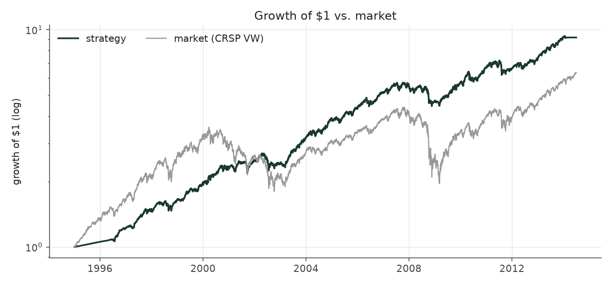
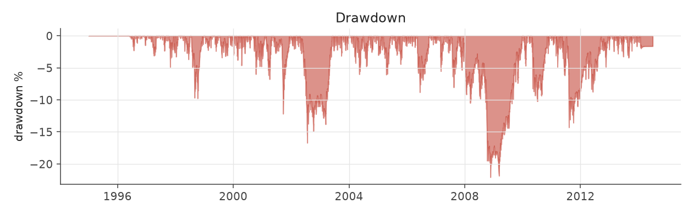
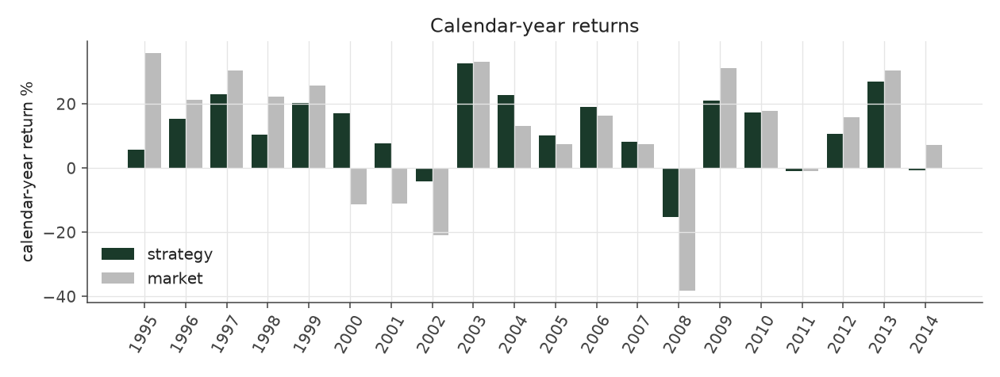
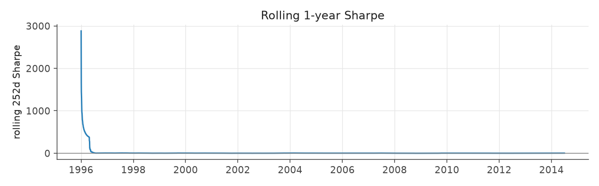
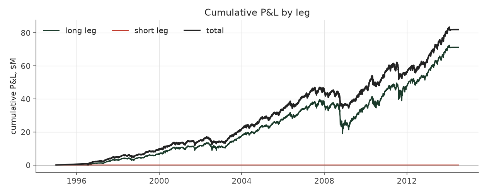
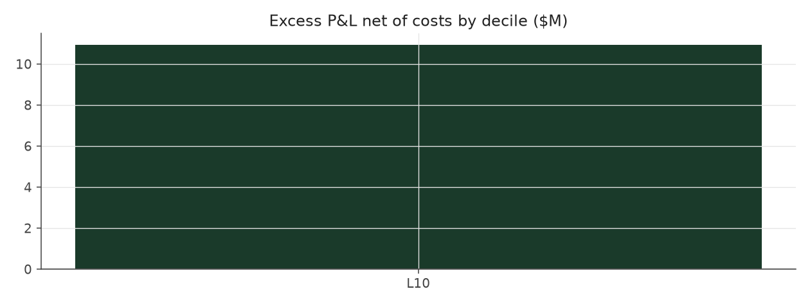

# steady_drift_plus

_equity strategy | family: equity-longonly | status: research | derived from `steady_drift`_

## What this strategy does

Steady Drift with smaller, more numerous positions, 80% invested cap and a 12% risk target (more return, same or better Sharpe)

**Why it should work.** Breadth lowers the 5%-of-volume cap's bite (56% of positions capped -> 39%) and diversifies, so the same signal supports a higher risk target without a lower Sharpe.

**Design notes** (from the strategy's source file).

Steady Drift -- a long-only, never-borrowing PEAD book with a constant-risk throttle (research).

What it does * Buys only the best earnings surprises (top decile of the point-in-time SUE rank) in stocks that trade at least $2M a day, holds each for exactly 60 trading sessions, and never sells short. * Sizes each position by how calm the stock is (inverse idiosyncratic variance, relative to the typical stock of the past year), at most 2% of NAV per name and 5% of the stock's daily dollar volume. Positions are admitted in announcement order, so no decision depends on events that have not happened yet. * Total stock cost basis is capped at 70% of NAV; the rest is cash earning the Treasury-bill rate (not the index). * A risk throttle scales the whole book down when its recent volatility exceeds the target (never above 100% invested, so it can only reduce risk, never borrow).

Why: after the methodology fixes, every market-neutral book collapses to 1-3% a year once short collateral is counted (they tie up 1.2-5.6x NAV), and the options edge disappears at real bid/ask. What survives is the long side of the surprise signal; docs/STEADY_DRIFT.md and docs/META_STRATEGY.md carry the evidence and the shuffled-surprise placebo.

STATUS research: the design was chosen after seeing 1996-2013; a shuffled-surprise test shows about half of the excess return over the cap-weighted index is the event universe (small/mid-cap, low-vol), not surprise skill; the T-bill series is typed from memory (pead/core/rates.py).

| parameter | value |
|---|---|
| base_unit_fraction | 0.003 |
| max_gross_leverage | 0.8 |
| liquidity_cap_frac | 0.05 |
| return_basis | raw |
| cap_mode | chronological |
| exposure_cap | open_book |
| beta_overlay | 0.0 |
| hold_sessions | 60 |
| long_only_cash | True |
| risk_target_vol | 0.12 |
| name_cap_frac | 0.01 |

## Performance

| metric | steady_drift_plus | market (CRSP VW) |
|---|---|---|
| Annualized return | 12.07% | 9.94% |
| Annualized volatility | 9.97% | 19.35% |
| Sharpe (NAV-pct) | 1.19 | 0.59 |
| Sortino | 1.73 |  |
| Max drawdown | -22.1% | -55.5% |
| Calmar | 0.55 |  |
| Final NAV ($10M start) | $91,947,400 |  |
| Worst day | -5.27% |  |
| % positive days | 59.9% |  |
| Sharpe 1996-2001 | 1.71 |  |
| Sharpe 2002-2007 | 1.32 |  |
| Sharpe 2008-2013 | 0.79 |  |

Correlation of daily returns with the market: **0.87**.

- best Sharpe among equity: `calm_rank_tilt` (1.47); this one: 1.19
- best return among equity: this strategy; this one: 0.121
- best Calmar among equity: `steady_drift_calm` (0.601); this one: 0.547

*NAV (log scale)*

*Drawdown from running peak*

*Calendar-year returns*

*Is the edge stable, or concentrated in a few years?*

## Where the return comes from

*Long leg vs. short leg vs. total*

|  | long leg | short leg |
|---|---|---|
| P&L ($M, before costs) | 71.25 | 0.00 |
| P&L after costs ($M) | 68.75 | 0.00 |
| of which common (average-event) component ($M) | 21.73 | 0.00 |
| of which excess / PEAD component ($M) | 13.44 | 0.00 |
| excess minus costs ($M) | 10.93 | 0.00 |
| gross return per $ traded (bp) | 409.80 | - |
| positions in the money (hit rate) | 0.64 | - |
| stand-alone Sharpe (leg only) | 0.89 | - |

Daily P&L correlation between the two legs: **nan**.

- The two legs' daily P&L are nan correlated: the short leg is the hedge that makes the long leg's variance disappear (stand-alone leg Sharpe 0.89 long / nan short vs 1.19 combined).

### By decile and side (signal-driven part only)

| leg | decile | positions | notional_M | net_pnl_M | excess_M | cost_M | alpha_net_M | alpha_share | alpha_bp_per_$ |
|---|---|---|---|---|---|---|---|---|---|
| long | 10 | 11,961 | 1,738.64 | 68.75 | 13.44 | 2.50 | 10.93 | 100.0% | 62.88 |

*D10 and the short deciles carry the alpha; the middle of each leg earns little*

### By size quintile (1 = smallest)

| size_quintile | positions | notional_M | net_pnl_M | excess_M | cost_M | alpha_net_M | alpha_share | alpha_bp_per_$ |
|---|---|---|---|---|---|---|---|---|
| 1 | 107 | 4.20 | 0.10 | -0.10 | 0.01 | -0.11 | -1.0% | -263.64 |
| 2 | 1,241 | 79.04 | 4.36 | 1.59 | 0.19 | 1.40 | 12.8% | 177.01 |
| 3 | 2,655 | 260.94 | 13.44 | 4.11 | 0.52 | 3.59 | 32.8% | 137.58 |
| 4 | 3,838 | 565.80 | 22.18 | 4.79 | 0.87 | 3.92 | 35.9% | 69.32 |
| 5 | 4,120 | 828.65 | 28.67 | 3.04 | 0.91 | 2.13 | 19.5% | 25.73 |

### By liquidity quintile (1 = least liquid)

| liquidity_quintile | positions | notional_M | net_pnl_M | excess_M | cost_M | alpha_net_M | alpha_share | alpha_bp_per_$ |
|---|---|---|---|---|---|---|---|---|
| 2 | 813 | 85.47 | 3.17 | 0.56 | 0.26 | 0.30 | 2.7% | 34.92 |
| 3 | 2,983 | 363.99 | 18.75 | 7.95 | 0.73 | 7.22 | 66.0% | 198.37 |
| 4 | 3,916 | 573.11 | 21.45 | 2.54 | 0.80 | 1.74 | 15.9% | 30.38 |
| 5 | 4,249 | 716.07 | 25.39 | 2.39 | 0.72 | 1.67 | 15.3% | 23.37 |

### By holding-window length

| hold_bucket | positions | notional_M | net_pnl_M | excess_M | cost_M | alpha_net_M | alpha_share | alpha_bp_per_$ |
|---|---|---|---|---|---|---|---|---|
| 41-60d | 11,961 | 1,738.64 | 68.75 | 13.44 | 2.50 | 10.93 | 100.0% | 62.88 |

### By era

| era | positions | notional_M | net_pnl_M | excess_M | cost_M | alpha_net_M | alpha_share | alpha_bp_per_$ |
|---|---|---|---|---|---|---|---|---|
| 1996-01 | 3,486 | 192.78 | 11.46 | 5.28 | 0.27 | 5.01 | 45.8% | 259.88 |
| 2002-07 | 4,120 | 606.29 | 21.94 | 8.98 | 0.85 | 8.13 | 74.4% | 134.11 |
| 2008-13 | 4,355 | 939.57 | 35.34 | -0.83 | 1.38 | -2.21 | -20.2% | -23.50 |

### By FF12 sector

| ff12_sector | positions | notional_M | net_pnl_M | excess_M | cost_M | alpha_net_M | alpha_share | alpha_bp_per_$ |
|---|---|---|---|---|---|---|---|---|
| BusEq | 2,809 | 288.02 | 12.51 | 2.13 | 0.41 | 1.72 | 15.7% | 59.54 |
| Chems | 288 | 62.63 | 3.17 | 1.73 | 0.09 | 1.64 | 15.0% | 262.21 |
| Durbl | 273 | 39.95 | 0.94 | -0.32 | 0.06 | -0.37 | -3.4% | -93.58 |
| Enrgy | 348 | 43.29 | 2.59 | 1.09 | 0.06 | 1.03 | 9.4% | 237.33 |
| Hlth | 990 | 138.09 | 4.90 | 0.24 | 0.19 | 0.05 | 0.5% | 3.66 |
| Manuf | 1,412 | 231.22 | 7.95 | 2.45 | 0.32 | 2.13 | 19.5% | 92.10 |
| Money | 1,764 | 369.82 | 14.18 | 0.86 | 0.54 | 0.32 | 2.9% | 8.57 |
| NoDur | 578 | 90.93 | 3.65 | 0.61 | 0.13 | 0.49 | 4.5% | 53.66 |
| Other | 1,557 | 201.85 | 8.95 | 3.41 | 0.31 | 3.10 | 28.3% | 153.40 |
| Shops | 1,209 | 146.91 | 4.85 | 0.58 | 0.21 | 0.36 | 3.3% | 24.76 |
| Telcm | 304 | 30.39 | 1.16 | -0.03 | 0.04 | -0.07 | -0.7% | -23.55 |
| Utils | 429 | 95.52 | 3.90 | 0.69 | 0.14 | 0.55 | 5.0% | 57.48 |

### By idiosyncratic-volatility tercile

| vol_tercile | positions | notional_M | net_pnl_M | excess_M | cost_M | alpha_net_M | alpha_share | alpha_bp_per_$ |
|---|---|---|---|---|---|---|---|---|
| high vol | 4,426 | 263.62 | 8.14 | 0.51 | 0.36 | 0.15 | 1.4% | 5.74 |
| low vol | 3,512 | 903.62 | 39.11 | 8.70 | 1.33 | 7.36 | 67.3% | 81.49 |
| mid vol | 3,841 | 561.50 | 21.46 | 4.42 | 0.80 | 3.62 | 33.2% | 64.56 |

### Short-borrow sensitivity (not modeled in the backtest)

| borrow_rate | fee_M | annualized_return | drag |
|---|---|---|---|
| 0.0% | 0.0 | 12.07% | 0.00% |
| 0.5% | 0.0 | 12.07% | 0.00% |
| 1.0% | 0.0 | 12.07% | 0.00% |
| 2.0% | 0.0 | 12.07% | 0.00% |
| 5.0% | 0.0 | 12.07% | 0.00% |

The engine charges the same transaction cost on shorts as on longs and no stock-borrow fee. The short leg is concentrated in small, illiquid names, where borrow is scarce and expensive -- read the table as a floor on the cost of running the short leg.
