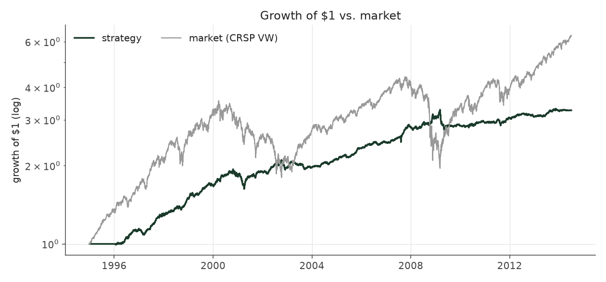
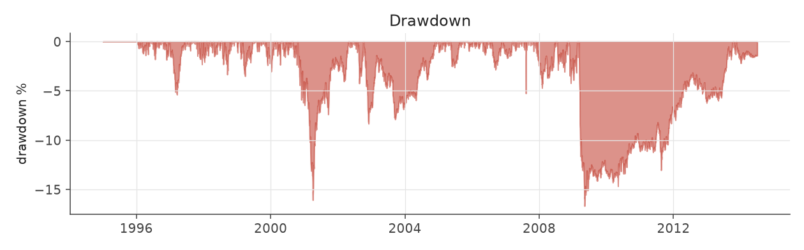
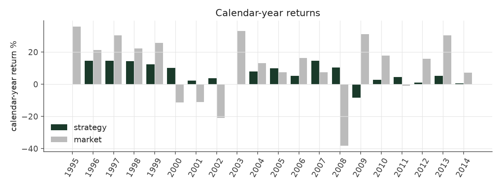
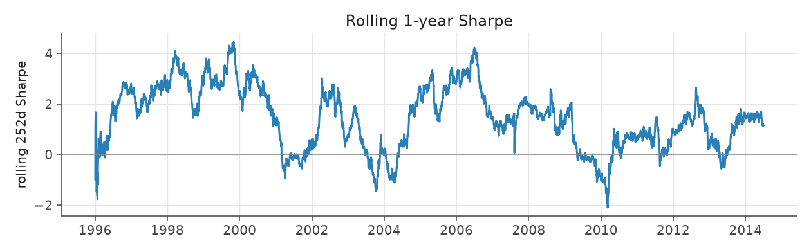
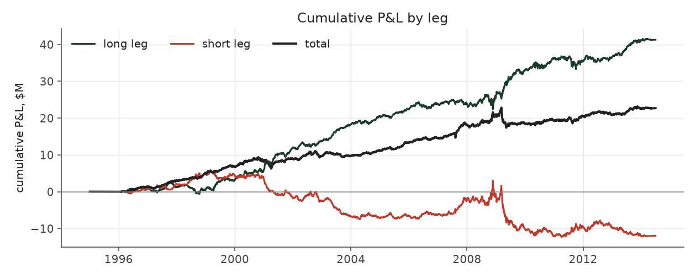
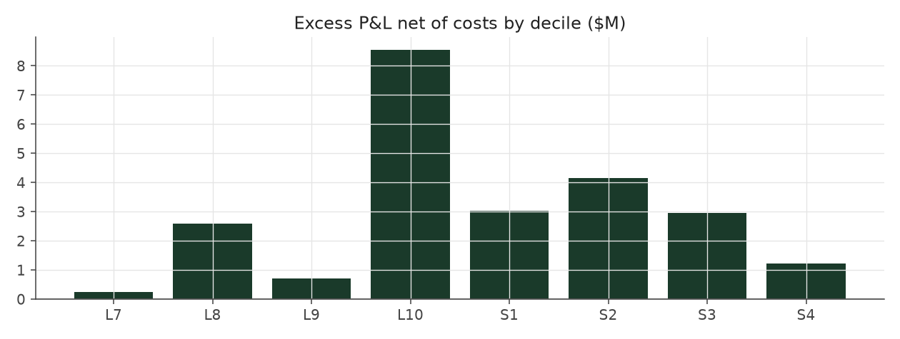

# volatility_filter

_equity strategy | family: equity-volatility | status: research | derived from `balanced_leverage`_

## What this strategy does

Balanced Leverage, skipping long/short x jumpiness groups that have not made money so far

**Why it should work.** Skip the cells that history says do not pay -- but the data shows a gradient, not a bad cell.

**Design notes** (from the strategy's source file).

Strategy 9a / 9c -- walk-forward volatility-cell filter (alone and combined with inverse-vol).

Drops a (side, idio-vol tercile) cell from new entries when its own history says it has not earned its keep, judged ONLY on quarters whose positions had fully exited. Result: filtering does not help on its own (Sharpe 1.23 vs 1.30 baseline-equivalent run; the effect is a smooth gradient, not one broken cell) and adds nothing once inverse-vol sizing is on (9c 1.41 < 9b 1.47). Kept as a documented negative result: size by vol, do not filter by it.

| parameter | value |
|---|---|
| base_unit_fraction | 0.003 |
| max_gross_leverage | 2.5 |
| liquidity_cap_frac | 0.05 |
| return_basis | mktadj |
| cap_mode | priority |
| beta_overlay | 0.0 |

## Performance

| metric | volatility_filter | market (CRSP VW) |
|---|---|---|
| Annualized return | 6.27% | 9.94% |
| Annualized volatility | 5.05% | 19.35% |
| Sharpe (NAV-pct) | 1.23 | 0.59 |
| Sortino | 1.79 |  |
| Max drawdown | -16.7% | -55.5% |
| Calmar | 0.38 |  |
| Final NAV ($10M start) | $32,665,477 |  |
| Worst day | -3.65% |  |
| % positive days | 51.8% |  |
| Sharpe 1996-2001 | 1.90 |  |
| Sharpe 2002-2007 | 1.44 |  |
| Sharpe 2008-2013 | 0.48 |  |

Correlation of daily returns with the market: **0.04**.

- best Sharpe among equity: `calm_rank_tilt` (1.81); this one: 1.23
- best return among equity: `market_boost_max` (0.15); this one: 0.0627
- best Calmar among equity: `calm_rank_tilt` (0.614); this one: 0.376

*NAV (log scale)*

*Drawdown from running peak*

*Calendar-year returns*

*Is the edge stable, or concentrated in a few years?*

## Where the return comes from

*Long leg vs. short leg vs. total*

|  | long leg | short leg |
|---|---|---|
| P&L ($M, before costs) | 41.25 | -11.96 |
| P&L after costs ($M) | 38.06 | -15.40 |
| of which common (average-event) component ($M) | 25.96 | -26.74 |
| of which excess / PEAD component ($M) | 15.29 | 14.78 |
| excess minus costs ($M) | 12.10 | 11.35 |
| gross return per $ traded (bp) | 253.40 | -71.65 |
| positions in the money (hit rate) | 0.56 | 0.49 |
| stand-alone Sharpe (leg only) | 1.21 | -0.26 |

Daily P&L correlation between the two legs: **-0.81**.

- **The short leg loses money in absolute terms** (-12.0M before costs) while the long leg earns +41.3M. That is mostly a benchmark effect, not a signal failure: the average earnings-event stock beat the cap-weighted market during its holding window, which flatters the long leg and hurts the short leg by 26.0M / 26.7M. Stripping that common component, the surprise signal itself earned +15.3M on the long side and +14.8M on the short side.
- The two legs' daily P&L are -0.81 correlated: the short leg is the hedge that makes the long leg's variance disappear (stand-alone leg Sharpe 1.21 long / -0.26 short vs 1.23 combined).

### By decile and side (signal-driven part only)

| leg | decile | positions | notional_M | net_pnl_M | excess_M | cost_M | alpha_net_M | alpha_share | alpha_bp_per_$ |
|---|---|---|---|---|---|---|---|---|---|
| long | 7 | 8,009 | 143.22 | 2.92 | 0.54 | 0.28 | 0.25 | 1.1% | 17.69 |
| long | 8 | 16,508 | 381.09 | 8.90 | 3.35 | 0.75 | 2.59 | 11.1% | 67.99 |
| long | 9 | 17,676 | 504.10 | 8.05 | 1.68 | 0.97 | 0.70 | 3.0% | 13.98 |
| long | 10 | 17,111 | 599.56 | 18.19 | 9.73 | 1.18 | 8.55 | 36.5% | 142.59 |
| short | 1 | 17,093 | 602.76 | -5.93 | 4.33 | 1.29 | 3.04 | 13.0% | 50.38 |
| short | 2 | 17,204 | 519.78 | -4.61 | 5.21 | 1.06 | 4.15 | 17.7% | 79.90 |
| short | 3 | 15,897 | 390.13 | -3.46 | 3.73 | 0.79 | 2.95 | 12.6% | 75.50 |
| short | 4 | 9,154 | 156.96 | -1.39 | 1.51 | 0.30 | 1.21 | 5.2% | 77.08 |

*D10 and the short deciles carry the alpha; the middle of each leg earns little*

### By size quintile (1 = smallest)

| size_quintile | positions | notional_M | net_pnl_M | excess_M | cost_M | alpha_net_M | alpha_share | alpha_bp_per_$ |
|---|---|---|---|---|---|---|---|---|
| 1 | 14,166 | 300.07 | 5.43 | 7.33 | 1.15 | 6.18 | 26.4% | 205.99 |
| 2 | 22,785 | 620.13 | 5.83 | 7.93 | 1.74 | 6.19 | 26.4% | 99.88 |
| 3 | 25,396 | 756.47 | 5.70 | 7.17 | 1.58 | 5.60 | 23.9% | 73.97 |
| 4 | 27,473 | 807.13 | 3.43 | 4.58 | 1.26 | 3.32 | 14.2% | 41.11 |
| 5 | 28,832 | 813.80 | 2.29 | 3.05 | 0.89 | 2.15 | 9.2% | 26.48 |

### By liquidity quintile (1 = least liquid)

| liquidity_quintile | positions | notional_M | net_pnl_M | excess_M | cost_M | alpha_net_M | alpha_share | alpha_bp_per_$ |
|---|---|---|---|---|---|---|---|---|
| 1 | 13,618 | 221.29 | 5.14 | 6.66 | 1.11 | 5.55 | 23.7% | 250.73 |
| 2 | 23,010 | 655.74 | 5.53 | 8.35 | 1.97 | 6.38 | 27.2% | 97.26 |
| 3 | 25,773 | 804.72 | 5.97 | 8.09 | 1.61 | 6.48 | 27.6% | 80.53 |
| 4 | 27,539 | 811.43 | 4.28 | 4.77 | 1.14 | 3.63 | 15.5% | 44.80 |
| 5 | 28,707 | 804.24 | 1.74 | 2.20 | 0.80 | 1.39 | 5.9% | 17.34 |

### By holding-window length

| hold_bucket | positions | notional_M | net_pnl_M | excess_M | cost_M | alpha_net_M | alpha_share | alpha_bp_per_$ |
|---|---|---|---|---|---|---|---|---|
| <=40d | 45,693 | 1,250.38 | -0.79 | 6.30 | 2.20 | 4.10 | 17.5% | 32.79 |
| 41-60d | 25,536 | 745.51 | 4.38 | 4.54 | 1.53 | 3.02 | 12.9% | 40.45 |
| 61-90d | 35,163 | 970.88 | 6.82 | 8.31 | 2.05 | 6.26 | 26.7% | 64.47 |
| >90d | 12,260 | 330.83 | 12.25 | 10.91 | 0.84 | 10.07 | 42.9% | 304.33 |

### By era

| era | positions | notional_M | net_pnl_M | excess_M | cost_M | alpha_net_M | alpha_share | alpha_bp_per_$ |
|---|---|---|---|---|---|---|---|---|
| 1996-01 | 33,652 | 695.59 | 8.69 | 10.31 | 1.36 | 8.95 | 38.2% | 128.69 |
| 2002-07 | 39,722 | 1,084.81 | 9.34 | 11.51 | 2.13 | 9.37 | 40.0% | 86.37 |
| 2008-13 | 45,278 | 1,517.20 | 4.64 | 8.25 | 3.13 | 5.12 | 21.8% | 33.76 |

### By FF12 sector

| ff12_sector | positions | notional_M | net_pnl_M | excess_M | cost_M | alpha_net_M | alpha_share | alpha_bp_per_$ |
|---|---|---|---|---|---|---|---|---|
| BusEq | 21,907 | 322.97 | 1.41 | 2.09 | 0.68 | 1.41 | 6.0% | 43.55 |
| Chems | 2,587 | 220.11 | 1.30 | 1.70 | 0.39 | 1.31 | 5.6% | 59.38 |
| Durbl | 2,836 | 237.64 | 2.34 | 2.85 | 0.44 | 2.41 | 10.3% | 101.37 |
| Enrgy | 6,186 | 269.12 | 3.79 | 4.39 | 0.51 | 3.89 | 16.6% | 144.43 |
| Hlth | 11,622 | 313.38 | 2.57 | 3.25 | 0.66 | 2.58 | 11.0% | 82.50 |
| Manuf | 12,007 | 294.12 | 1.73 | 2.50 | 0.61 | 1.89 | 8.1% | 64.36 |
| Money | 17,569 | 288.48 | 2.51 | 3.26 | 0.65 | 2.61 | 11.2% | 90.62 |
| NoDur | 5,074 | 265.27 | 1.25 | 1.74 | 0.51 | 1.23 | 5.3% | 46.45 |
| Other | 18,309 | 313.12 | 2.26 | 3.06 | 0.70 | 2.36 | 10.1% | 75.48 |
| Shops | 11,943 | 306.44 | 3.05 | 3.71 | 0.63 | 3.08 | 13.1% | 100.58 |
| Telcm | 3,942 | 260.75 | -0.03 | 0.49 | 0.47 | 0.01 | 0.0% | 0.44 |
| Utils | 4,670 | 206.21 | 0.48 | 1.03 | 0.38 | 0.65 | 2.8% | 31.61 |

### By idiosyncratic-volatility tercile

| vol_tercile | positions | notional_M | net_pnl_M | excess_M | cost_M | alpha_net_M | alpha_share | alpha_bp_per_$ |
|---|---|---|---|---|---|---|---|---|
| high vol | 39,046 | 1,043.79 | 3.54 | 6.67 | 1.89 | 4.78 | 20.4% | 45.74 |
| low vol | 40,091 | 1,128.50 | 9.89 | 12.40 | 2.49 | 9.91 | 42.3% | 87.81 |
| mid vol | 37,903 | 1,073.74 | 9.08 | 10.73 | 2.13 | 8.60 | 36.7% | 80.08 |

### Short-borrow sensitivity (not modeled in the backtest)

| borrow_rate | fee_M | annualized_return | drag |
|---|---|---|---|
| 0.0% | 0.0 | 6.27% | 0.00% |
| 0.5% | 1.7 | 5.98% | 0.29% |
| 1.0% | 3.4 | 5.67% | 0.59% |
| 2.0% | 6.8 | 5.01% | 1.26% |
| 5.0% | 16.9 | 2.36% | 3.90% |

The engine charges the same transaction cost on shorts as on longs and no stock-borrow fee. The short leg is concentrated in small, illiquid names, where borrow is scarce and expensive -- read the table as a floor on the cost of running the short leg.
