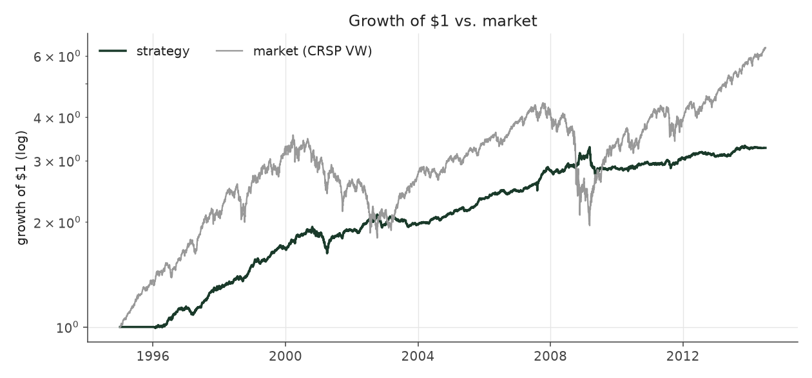
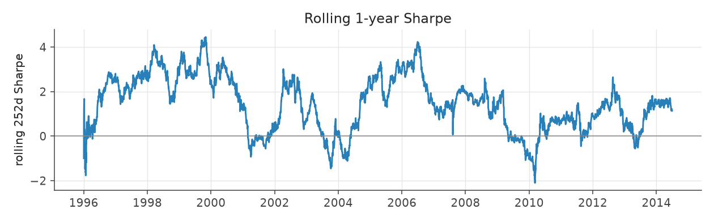
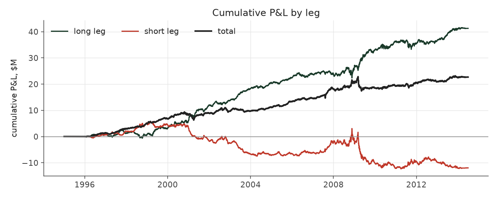
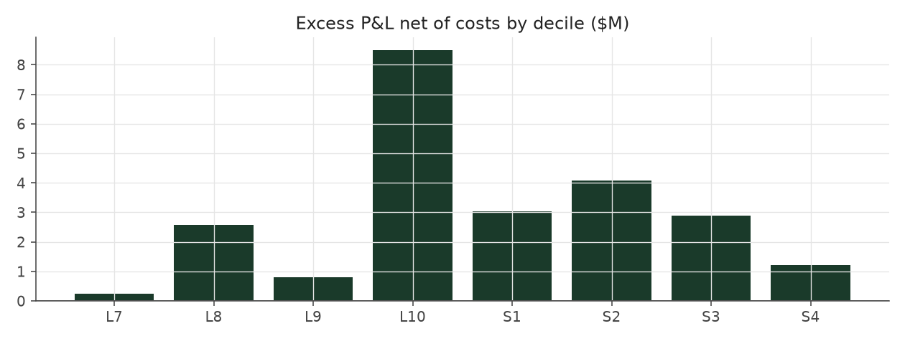

# volatility_filter_legacy

_equity strategy | family: equity-volatility | status: reference | derived from `volatility_filter`_

## What this strategy does

Balanced Leverage, skipping long/short x jumpiness groups that have not made money so far -- ORIGINAL leverage cap (new positions only, open book ignored)

**Why it should work.** Skip the cells that history says do not pay -- but the data shows a gradient, not a bad cell.

**Design notes** (from the strategy's source file).

Volatility Filter (and Calm Weighted Filter) -- skip stock groups that have not paid, judged only on past data.

Drops a (side, idio-vol tercile) cell from new entries when its own history says it has not earned its keep, judged ONLY on quarters whose positions had fully exited. Result: filtering does not help on its own (corrected run: Sharpe 0.89 vs 1.09 for Balanced Leverage; pre-fix 1.23 vs 1.30; the effect is a smooth gradient, not one broken cell) and adds nothing once inverse-vol sizing is on (corrected: Calm Weighted Filter 1.08 < Calm Weighted 1.24; pre-fix 1.41 < 1.47). Kept as a documented negative result: size by vol, do not filter by it.

| parameter | value |
|---|---|
| base_unit_fraction | 0.003 |
| max_gross_leverage | 2.5 |
| liquidity_cap_frac | 0.05 |
| return_basis | mktadj |
| cap_mode | priority |
| exposure_cap | entry_cohort |
| beta_overlay | 0.0 |

## Performance

| metric | volatility_filter_legacy | market (CRSP VW) |
|---|---|---|
| Annualized return | 6.27% | 9.94% |
| Annualized volatility | 5.05% | 19.35% |
| Sharpe (NAV-pct) | 1.23 | 0.59 |
| Sortino | 1.79 |  |
| Max drawdown | -16.7% | -55.5% |
| Calmar | 0.38 |  |
| Final NAV ($10M start) | $32,665,477 |  |
| Worst day | -3.65% |  |
| % positive days | 51.8% |  |
| Sharpe 1996-2001 | 1.90 |  |
| Sharpe 2002-2007 | 1.44 |  |
| Sharpe 2008-2013 | 0.48 |  |

Correlation of daily returns with the market: **0.04**.

- best Sharpe among equity: `calm_rank_tilt` (1.47); this one: 1.23
- best return among equity: `market_boost_max` (0.116); this one: 0.0627
- best Calmar among equity: `calm_rank_tilt` (0.442); this one: 0.376

*NAV (log scale)*

*Drawdown from running peak*

*Calendar-year returns*

*Is the edge stable, or concentrated in a few years?*

## Where the return comes from

*Long leg vs. short leg vs. total*

|  | long leg | short leg |
|---|---|---|
| P&L ($M, before costs) | 41.25 | -11.96 |
| P&L after costs ($M) | 38.06 | -15.40 |
| of which common (average-event) component ($M) | 25.51 | -26.25 |
| of which excess / PEAD component ($M) | 15.28 | 14.63 |
| excess minus costs ($M) | 12.11 | 11.21 |
| gross return per $ traded (bp) | 253.40 | -71.65 |
| positions in the money (hit rate) | 0.56 | 0.49 |
| stand-alone Sharpe (leg only) | 1.21 | -0.26 |

Daily P&L correlation between the two legs: **-0.81**.

- **The short leg loses money in absolute terms** (-12.0M before costs) while the long leg earns +41.3M. That is mostly a benchmark effect, not a signal failure: the average earnings-event stock beat the cap-weighted market during its holding window, which flatters the long leg and hurts the short leg by 25.5M / 26.3M. Stripping that common component, the surprise signal itself earned +15.3M on the long side and +14.6M on the short side.
- The two legs' daily P&L are -0.81 correlated: the short leg is the hedge that makes the long leg's variance disappear (stand-alone leg Sharpe 1.21 long / -0.26 short vs 1.23 combined).

### By decile and side (signal-driven part only)

| leg | decile | positions | notional_M | net_pnl_M | excess_M | cost_M | alpha_net_M | alpha_share | alpha_bp_per_$ |
|---|---|---|---|---|---|---|---|---|---|
| long | 7 | 8,009 | 143.22 | 2.92 | 0.52 | 0.28 | 0.24 | 1.0% | 16.48 |
| long | 8 | 16,508 | 381.09 | 8.90 | 3.32 | 0.75 | 2.56 | 11.0% | 67.22 |
| long | 9 | 17,676 | 504.10 | 8.05 | 1.77 | 0.97 | 0.80 | 3.4% | 15.83 |
| long | 10 | 17,111 | 599.56 | 18.19 | 9.68 | 1.18 | 8.50 | 36.4% | 141.72 |
| short | 1 | 17,093 | 602.76 | -5.93 | 4.32 | 1.29 | 3.03 | 13.0% | 50.31 |
| short | 2 | 17,204 | 519.78 | -4.61 | 5.12 | 1.06 | 4.07 | 17.4% | 78.22 |
| short | 3 | 15,897 | 390.13 | -3.46 | 3.67 | 0.79 | 2.89 | 12.4% | 73.99 |
| short | 4 | 9,154 | 156.96 | -1.39 | 1.51 | 0.30 | 1.21 | 5.2% | 76.97 |

*D10 and the short deciles carry the alpha; the middle of each leg earns little*

### By size quintile (1 = smallest)

| size_quintile | positions | notional_M | net_pnl_M | excess_M | cost_M | alpha_net_M | alpha_share | alpha_bp_per_$ |
|---|---|---|---|---|---|---|---|---|
| 1 | 14,166 | 300.07 | 5.43 | 7.41 | 1.15 | 6.26 | 26.8% | 208.54 |
| 2 | 22,785 | 620.13 | 5.83 | 7.86 | 1.74 | 6.12 | 26.3% | 98.72 |
| 3 | 25,396 | 756.47 | 5.70 | 7.07 | 1.58 | 5.49 | 23.5% | 72.56 |
| 4 | 27,473 | 807.13 | 3.43 | 4.48 | 1.26 | 3.22 | 13.8% | 39.94 |
| 5 | 28,832 | 813.80 | 2.29 | 3.09 | 0.89 | 2.19 | 9.4% | 26.96 |

### By liquidity quintile (1 = least liquid)

| liquidity_quintile | positions | notional_M | net_pnl_M | excess_M | cost_M | alpha_net_M | alpha_share | alpha_bp_per_$ |
|---|---|---|---|---|---|---|---|---|
| 1 | 13,618 | 221.29 | 5.14 | 6.67 | 1.11 | 5.56 | 23.8% | 251.21 |
| 2 | 23,010 | 655.74 | 5.53 | 8.33 | 1.97 | 6.37 | 27.3% | 97.09 |
| 3 | 25,773 | 804.72 | 5.97 | 7.99 | 1.61 | 6.38 | 27.4% | 79.29 |
| 4 | 27,539 | 811.43 | 4.28 | 4.79 | 1.14 | 3.65 | 15.7% | 44.98 |
| 5 | 28,707 | 804.24 | 1.74 | 2.13 | 0.80 | 1.32 | 5.7% | 16.45 |

### By holding-window length

| hold_bucket | positions | notional_M | net_pnl_M | excess_M | cost_M | alpha_net_M | alpha_share | alpha_bp_per_$ |
|---|---|---|---|---|---|---|---|---|
| <=40d | 45,693 | 1,250.38 | -0.79 | 6.28 | 2.20 | 4.08 | 17.5% | 32.63 |
| 41-60d | 25,536 | 745.51 | 4.38 | 4.46 | 1.53 | 2.94 | 12.6% | 39.38 |
| 61-90d | 35,163 | 970.88 | 6.82 | 8.23 | 2.05 | 6.18 | 26.5% | 63.66 |
| >90d | 12,260 | 330.83 | 12.25 | 10.94 | 0.84 | 10.09 | 43.3% | 304.98 |

### By era

| era | positions | notional_M | net_pnl_M | excess_M | cost_M | alpha_net_M | alpha_share | alpha_bp_per_$ |
|---|---|---|---|---|---|---|---|---|
| 1996-01 | 33,652 | 695.59 | 8.69 | 10.14 | 1.36 | 8.78 | 37.7% | 126.28 |
| 2002-07 | 39,722 | 1,084.81 | 9.34 | 11.50 | 2.13 | 9.36 | 40.2% | 86.31 |
| 2008-13 | 45,278 | 1,517.20 | 4.64 | 8.27 | 3.13 | 5.14 | 22.0% | 33.87 |

### By FF12 sector

| ff12_sector | positions | notional_M | net_pnl_M | excess_M | cost_M | alpha_net_M | alpha_share | alpha_bp_per_$ |
|---|---|---|---|---|---|---|---|---|
| BusEq | 21,907 | 322.97 | 1.41 | 2.11 | 0.68 | 1.43 | 6.1% | 44.12 |
| Chems | 2,587 | 220.11 | 1.30 | 1.63 | 0.39 | 1.24 | 5.3% | 56.51 |
| Durbl | 2,836 | 237.64 | 2.34 | 2.84 | 0.44 | 2.41 | 10.3% | 101.27 |
| Enrgy | 6,186 | 269.12 | 3.79 | 4.37 | 0.51 | 3.87 | 16.6% | 143.66 |
| Hlth | 11,622 | 313.38 | 2.57 | 3.21 | 0.66 | 2.55 | 10.9% | 81.33 |
| Manuf | 12,007 | 294.12 | 1.73 | 2.39 | 0.61 | 1.78 | 7.6% | 60.39 |
| Money | 17,569 | 288.48 | 2.51 | 3.32 | 0.65 | 2.67 | 11.5% | 92.59 |
| NoDur | 5,074 | 265.27 | 1.25 | 1.74 | 0.51 | 1.23 | 5.3% | 46.34 |
| Other | 18,309 | 313.12 | 2.26 | 3.10 | 0.70 | 2.41 | 10.3% | 76.87 |
| Shops | 11,943 | 306.44 | 3.05 | 3.69 | 0.63 | 3.05 | 13.1% | 99.66 |
| Telcm | 3,942 | 260.75 | -0.03 | 0.47 | 0.47 | -0.01 | -0.0% | -0.36 |
| Utils | 4,670 | 206.21 | 0.48 | 1.05 | 0.38 | 0.67 | 2.9% | 32.43 |

### By idiosyncratic-volatility tercile

| vol_tercile | positions | notional_M | net_pnl_M | excess_M | cost_M | alpha_net_M | alpha_share | alpha_bp_per_$ |
|---|---|---|---|---|---|---|---|---|
| high vol | 39,046 | 1,043.79 | 3.54 | 6.67 | 1.89 | 4.78 | 20.5% | 45.77 |
| low vol | 40,091 | 1,128.50 | 9.89 | 12.40 | 2.49 | 9.91 | 42.5% | 87.80 |
| mid vol | 37,903 | 1,073.74 | 9.08 | 10.74 | 2.13 | 8.61 | 36.9% | 80.21 |

### Short-borrow sensitivity (not modeled in the backtest)

| borrow_rate | fee_M | annualized_return | drag |
|---|---|---|---|
| 0.0% | 0.0 | 6.27% | 0.00% |
| 0.5% | 1.7 | 5.98% | 0.29% |
| 1.0% | 3.4 | 5.67% | 0.59% |
| 2.0% | 6.8 | 5.01% | 1.26% |
| 5.0% | 16.9 | 2.36% | 3.90% |

The engine charges the same transaction cost on shorts as on longs and no stock-borrow fee. The short leg is concentrated in small, illiquid names, where borrow is scarce and expensive -- read the table as a floor on the cost of running the short leg.
